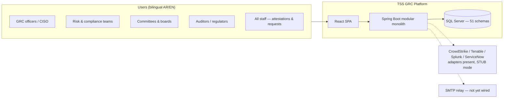
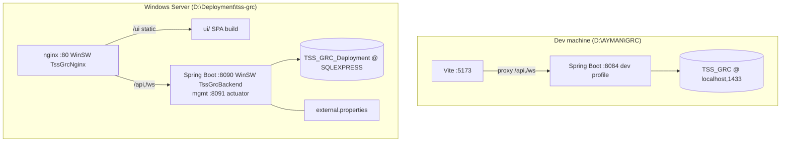

# TSS GRC Platform — Architecture, Design & Assessment Pack
### حزمة العمارة والتصميم وتقييم المنصة

> **Purpose.** One navigable, as-built reference for **assessing and improving** the whole platform: ADRs, solution architecture, product design specification, business-process design, data architecture, state machines, integration architecture, security architecture, UX architecture, quality/ops architecture, an honest maturity assessment, the consolidated product backlog, and reference appendices.
>
> **Baseline (verified against the live dev stack and repo on 2026-07-23):** branch `feat/change-policy-remediation` @ `338700c7` (master @ `00ba890e`) · backend suite **2,316/0/0** · authorization ratchet **62** · migrations **V1–V312** packaged (302 files; next free **V313**, V313–V322 reserved) · prod deployed at Flyway **V312**.
>
> **How this pack relates to the other documents:** `PROJECT_CHRONICLE.md` is the operational master reference (installation, ops, troubleshooting, development history). The `docs/` tree (analysis / architecture / Saudi-GRC-Platform-Integration) is the **V1-era design corpus** — valuable for intent, but written before the 2026-06→07 remediation programmes; where it conflicts with this pack, **this pack and the chronicle are current**. Per-programme `*_PLAN.md` files carry their own §0 trackers.

---

## Table of contents

- §1 Platform overview & context
- §2 Architecture Decision Records (ADR-001 … ADR-022)
- §3 Solution architecture
- §4 Product Design Specification (module catalogue)
- §5 Business process design
- §6 Data architecture
- §7 State-machine catalogue
- §8 Integration architecture
- §9 Security architecture
- §10 UX architecture
- §11 Quality & test architecture
- §12 Operations & deployment architecture
- §13 Platform assessment (maturity scorecard, debt & defect registers)
- §14 Product backlog reference (consolidated)
- §15 Reference appendices

---

## §1 Platform overview & context

**TSS GRC** is a bilingual (Arabic-primary / English), multi-tenant, enterprise **Governance, Risk & Compliance platform for Saudi Arabia / MENA**, built as a **modular monolith**: one Spring Boot REST backend, one SQL Server database, one React SPA — deliberately not microservices (ADR-001).

**Measured footprint (2026-07-23, dev):**

| Dimension | Value |
|---|---|
| Backend modules (top-level dirs under `module/`) | **59** (≈24 core domains + platform services + ~20 regulatory micro-modules + lifecycle sub-modules) |
| Backend code | **1,734** Java files · **184,278** LoC |
| REST surface | **255** controllers · **2,154** endpoints · **2,156** `@PreAuthorize` guards |
| Database | **458 tables** across **51 schemas** · Flyway V1–V312 (302 files) |
| RBAC | **99 permissions** across **25 permission modules** × 7 actions · **57 roles** · persona matrix seeded |
| Automation | **211** active F8 automation rules |
| Frontend | **733** TS/TSX files · **232,275** LoC · **328 routes** · 104 page dirs · 136 shared components · 231 lib modules |
| Tests | **2,316** backend tests (0 fail) · FE vitest suite + `tsc` · GitHub Actions CI |
| Tenancy | 3 seeded Saudi demo tenants; org-scoped everything |

**Primary user classes (dev personas):** `admin` (PLATFORM_ADMIN), `so_officer` (CISO + Sustainability Officer — the standing second approver for 4-eyes flows), `compliance` (GRC administrator), `auditor`, `ranalyst`/`rmanager` (risk), `viewer` (read-only). Full persona/role matrix: chronicle §4.

**System context (C4 level 1):**



**Value proposition** (chronicle §1): a single Saudi-regulation-native platform covering ERM/KRI/FAIR risk, compliance & policy, cyber + SOC ops (NCA ECC), BCM (NCEMA/ISO 22301), privacy (PDPL), TPRM/SCM (SAMA outsourcing), ESG + green finance (CMA/IFRS S1-S2/ISAE 3410), access governance, ethics/AML, and ~20 sector verticals — on one workflow engine, one evidence subsystem, one committee engine, one audit ledger, one export stack.

---

## §2 Architecture Decision Records (ADR log)

> Consolidates chronicle §17 with the decisions made across the 2026-06→07 remediation programmes, in standard ADR form. Status: **Accepted** (implemented & verified) · **Proposed** (planned, not yet built).

| ADR | Decision | Status | Context → Consequence |
|---|---|---|---|
| **ADR-001** | **Modular monolith**, not microservices | Accepted | Cross-module joins (risk↔compliance↔evidence) *are* the product; one Saudi enterprise tenant fits one box. → One DB/one deploy; module discipline must come from code structure + tests, not process boundaries (see ADR-020). |
| **ADR-002** | **SQL Server + Flyway; forward-only, idempotent, additive migrations**; Flyway **OFF in dev** (Python-bootstrapped) / **ON in prod** (baseline 292) | Accepted | Dev DB predates Flyway; rewriting history was riskier than a disciplined baseline. → Every migration applied ×2 to dev via pyodbc before commit; `flyway.clean` disabled; destructive change only via expand-contract (V233→V312 is the worked example). |
| **ADR-003** | **Multi-tenancy = shared schema + `organisation_id` column** with `TenantContext` thread-local from JWT; prod adds a **tenant write-guard interceptor** | Accepted | Schema-per-tenant rejected (3-tenant scale, cross-tenant platform admin). → Org filtering is a *developer responsibility* per repository query; schedulers/async must set org explicitly; cross-tenant write throws `SecurityException`. |
| **ADR-004** | **AuthN: JJWT** — 15-min access token in body + 7-day refresh token in HttpOnly/SameSite=Strict cookie; optional server-side refresh-token store with jti rotation; **JWT_SECRET fail-fast** (≥32 chars, placeholder-rejected) + previous-key rotation overlap | Accepted | → FE auto-refreshes on 401; *any* invalid token must yield 401 never 500 (ADR-022); secret rotation is a config-only operation. |
| **ADR-005** | **AuthZ: `hasPermission('MODULE','ACTION')`** via `ModulePermissionEvaluator` over a DB permission catalogue (99 perms / 25 modules / 7 actions incl. EXPORT, TRIAGE, BREAK_GLASS); PLATFORM_ADMIN bypass in code | Accepted | → Guards live on controllers (2,156 of them); catalogue growth is a migration, not code; **@Valid fires before @PreAuthorize** (landmine — probes need valid bodies). |
| **ADR-006** | **Authorization ratchet test** — suite fails if unguarded write endpoints exceed **62**; count may only go down | Accepted | Response to the audit's biggest finding class. → Every new write endpoint ships guarded or the build breaks. |
| **ADR-007** | **Soft deletes** (`is_deleted` + Hibernate `@Where`) platform-wide; exception: `iam.user_roles` hard-deleted | Accepted | → Native SQL must filter `is_deleted` manually; `smallint`/`bit` reconciliation still owed before `ddl-auto=validate` can be re-enabled in prod (backlog BL-C7). |
| **ADR-008** | **RFC-7807 ProblemDetail** for all errors; FE `problemMessage()` folds bean-validation field maps into toasts | Accepted | → Failures name the offending field; "bare Validation Failed" toasts were eliminated in the button-audit programme. |
| **ADR-009** | **Bilingual by schema** — user-visible records carry `*_en` **and** `*_ar`; Arabic backend-mandatory, client-gated in forms; **RTL-correct exports** with bundled Amiri font | Accepted | → No record can be born monolingual; every export generator passed the platform-wide RTL conformance sweep (22 generators, 8/8 live, 33/33 titles). |
| **ADR-010** | **One platform workflow engine** (`workflow.requests`: steps, SLA, reminders, escalation tiers, completion rules) adopted by **14 modules** instead of per-module workflow code | Accepted | → Consistent SLA/escalation semantics; Change Enablement is the planned 15th adopter (CE-10). |
| **ADR-011** | **One evidence subsystem** — SHA-256 hashing, four-eyes verification, evidence requests/items, matrix views; modules link to it rather than storing files ad hoc | Accepted | → "Verified figure ⇒ traceable evidence" (ISAE 3410 posture); cyber's façade evidence forms were remediated to this subsystem; change_mgmt adoption is CE-9. |
| **ADR-012** | **F8 automation** = domain events + DB-seeded rules (211 active), executed **afterCommit** with per-call `REQUIRES_NEW` `TransactionTemplate` + native stamp updates | Accepted | → Joined-TX failures can't poison the business commit (landmine #3); rules must be **seeded per environment** or the automation is silently dormant. |
| **ADR-013** | **One committee/meeting engine** (`admin.committee`, 14 tables) is the platform's single decision body: quorum, per-member votes, COI recusal, papers, action items, **e-signed minutes** via `platform.signatures` | Accepted | → Change CAB/ECAB and Policy approval route through it via `committee_referral` + per-tenant `committee_gate_map` (Track D); CAB becomes a **profile over** the engine, never a fork (CE plan, ADR status Proposed for the profile). |
| **ADR-014** | **Maker-checker / SoD server-enforced as HTTP 409**, never UI-only | Accepted | → A 409 with an SoD message is the feature *working*; test with two users (`admin` + `so_officer`). |
| **ADR-015** | **Exports centralized** in `module/reporting` (Apache POI XLSX/DOCX/PPTX + OpenPDF), DoS-hardened, with Export History + EXPORT permission as a 6th action rolled out READ-parity | Accepted | → New registers add methods to the shared services rather than shipping their own writers. |
| **ADR-016** | **SPA + same-origin `/api` proxy** (Vite dev / nginx prod); no SSR; STOMP/SockJS over `/ws` | Accepted | → CORS eliminated in prod; backend port hidden; **if the backend is down every button fails at once** (triage rule #1). |
| **ADR-017** | **Windows-native ops**: WinSW services + nginx on the deployment server; **all prod config in `external.properties`** next to the jar | Accepted | → Operators edit one file and restart; no rebuilds for config; services need an elevated shell to restart. |
| **ADR-018** | **Dedicated CHANGE permission module** split from the 54-role WORKFLOW over-grant (V301) | Accepted | → Change Enablement is separately grantable/auditable; the WORKFLOW module remains shared — never strip it. |
| **ADR-019** | **Committee-decision provenance is immutable**: decisions carry resolution/meeting IDs, quorum proof, vote tallies; minutes hash-anchored and e-signed | Accepted | → Referred-item approval is provable end-to-end; legacy non-referred paths stay byte-identical (regression-probed). |
| **ADR-020** | **Module boundary enforcement via architecture tests** (import ratchet, LoC ceiling, pure state machines), starting with `module/change` + SPI ports/adapters | **Proposed** (CE-1) | → The monolith keeps monolith benefits while gaining enforceable seams; pattern intended to extend platform-wide. |
| **ADR-021** | **Schema names are permanent** — `change_mgmt` schema stays even when the Java package becomes `module/change` | Accepted (decided in CE plan) | → Schema renames are outage-grade destructive ops with zero functional gain; Java naming and DB naming are decoupled. |
| **ADR-022** | **Invalid credentials/tokens are 4xx, never 5xx** — `validateToken` catches the whole `JwtException` family (incl. `SignatureException` from stale/foreign-key cookies) | Accepted (`00ba890e`) | → Returning users with stale refresh cookies get a clean login redirect; regression-locked by tests. |

---

## §3 Solution architecture

### 3.1 Containers (C4 level 2)

| Container | Technology | Responsibility |
|---|---|---|
| **SPA** `tss-grc-ui-v2` | React 18 + Vite + TypeScript, Recharts, STOMP/SockJS | All UX; calls same-origin `/api/*`; bilingual AR/EN with RTL; light/dark themes; service worker |
| **API monolith** `tss-grc-backend` | Spring Boot 3.5.x, **Java 17 (pinned — Lombok)**, Spring Security 6, Hibernate 6 / Spring Data JPA (`ddl-auto=none`) | 59 modules, each `controller / dto / entity / repository / service`; platform services (workflow, evidence, audit ledger, automation, signatures, exports, notifications, branding, committees) |
| **Database** | SQL Server 2019+ (Express in dev), UTF-8 collation | 51 schemas / 458 tables; Flyway history in `platform.flyway_schema_history` |
| **Reverse proxy** (prod) | nginx (WinSW service) | Serves SPA from `/ui`, proxies `/api` + `/ws` → backend :8090; single origin :80 |
| **Legacy static UI** `tss-grc-ui/` | Static HTML | **Superseded** — historic only |

### 3.2 Backend component layers

```
controller (@RestController + @PreAuthorize)          ← 255 controllers / 2,154 endpoints
    ↓ DTOs (records; @Valid — fires BEFORE @PreAuthorize)
service (@Service, @Transactional; business rules, SoD gates, state machines)
    ↓
repository (Spring Data JPA; EVERY query org-scoped; soft-delete aware)
    ↓
SQL Server (schema per module; CHECK constraints on enum columns)

Cross-cutting platform services consumed by modules:
  TenantContext · AuditLogService · DomainEvent/F8 · WorkflowEngine ·
  Evidence/Attachment · SignatureService · Export services · Notifications ·
  Committee engine · Branding/licensing
```

### 3.3 Key runtime scenarios

1. **Login/refresh** — `POST /api/auth/login` → access token (body) + refresh cookie (HttpOnly). FE auto-refresh on 401 via `POST /api/auth/refresh`; *any* invalid refresh cookie → 401 (ADR-022). Public endpoints rate-limited (`PublicEndpointRateLimitFilter`); login lockout active in prod, effectively off in dev.
2. **Guarded write** — `@Valid` body validation (400 with field map) → `@PreAuthorize` permission check (403) → service SoD gates (409) → org-scoped mutation → `AuditLogService` row → F8 `DomainEvent` published afterCommit.
3. **Committee-gated transition** (Track D) — e.g. change `transition(CAB_APPROVED)`: if an active `committee_referral` exists → `assertDecisionApproves` (resolution APPROVED + meeting MINUTES_APPROVED + voteFor ≥ minApprovals, else 409); otherwise the legacy tally path runs byte-identically.
4. **Scheduler/async work** — must set `TenantContext` explicitly and guard `RequestContextHolder.getRequestAttributes()` (off-request audit landmine); engine-wiring TX rules per ADR-012.
5. **Export** — reporting service renders POI/OpenPDF binary (RTL-shaped Arabic, Amiri) → EXPORT permission gate → Export History row → download with standard naming.

### 3.4 Deployment view



Profiles: `dev` (Swagger on, Flyway off, permissive CORS, 1-h tokens) · `prod` (Swagger off, Flyway on baseline-aware, hardened, JSON structured logs). Full runbooks: `DEPLOYMENT.md`, chronicle §9–§12.

---

## §4 Product Design Specification (module catalogue)

> Per module: purpose, primary UI, API base, core records, anchor standards. Screens are SPA routes (328 total). The FE calls only same-origin `/api/*`. **Detailed screen/API walk-throughs live in chronicle §3** — this is the assessment-grade catalogue.

### 4.1 Core GRC domains

| Module (schema) | Purpose & key records | UI | API base | Standards anchor |
|---|---|---|---|---|
| **risk** (24 tables) | ERM register (inherent/residual with control effectiveness), treatments, acceptance (4-eyes), KRI library+readings+breach workflow, FAIR quantification, emerging risk | `/risk/*`, KRI dashboard | `/api/v1/risks`, `/api/v1/kri/*` | ISO 31000, COSO |
| **compliance** (14) | Frameworks/controls library, assessments, findings→CAPA, framework anchors (policy/KRI/risk/DPIA links), regulatory-change register | `/compliance`, `/frameworks` | `/api/v1/compliance/*` | NCA ECC, ISO 27001, SAMA CSF |
| **policy** (5) | Canonical policy documents (versioned, CHECK-constrained lifecycle), inline content (CH-10), control links, framework mappings (V302), exceptions, attestations, expiry/review sweeps, committee-gated approval | `/policy-management` | `/api/policy/*` | ISO 27001 A.5, ISO 9001 §7.5 |
| **change_mgmt** (7) | ITIL v4 change enablement: 13-state lifecycle, type×risk authorisation matrix, freeze windows, conflicts, CAB votes + committee referral, tasks w/ SLA scheduler, PIR summary, register exports | `/changes` | `/api/v1/changes` | ITIL 4, ISO 20000-1, COBIT BAI06 |
| **cyber** (18) + **socops** (25) | Cyber controls (NCA ECC), assessments, vulns w/ SLA, ASM (assets/findings/shadow-IT), SOC alerts/cases/shifts/playbooks, TI feeds | `/cyber/*`, `/soc/*` | `/api/v1/cyber/*`, `/api/v1/soc/*` | NCA ECC, SAMA CSF |
| **incident** (in socops/incident) | Incident lifecycle, comms, post-incident | `/incidents` | `/api/v1/incidents` | NCA, ISO 27035 |
| **bcm** (51 — largest schema) | BIA, BCP builder, strategies, crisis mgmt, exercises/tests with runtime, NCEMA compliance, corrective actions, full lifecycle sub-modules | `/bcm/*` | `/api/v1/bcm/*` | ISO 22301, NCEMA |
| **privacy** (20) | PDPL: RoPA, DPIA, DSR w/ clocks, breach (72-h), consent, subprocessors, transfers | `/privacy/*` | `/api/v1/privacy/*` | PDPL + regs, ISO 27701 |
| **tprm** (12) + **scm** (12) + **outsourcing** (5) | Vendor register, due-diligence assessments, contracts, SAMA outsourcing arrangements (incl. materiality/non-objection), supply-chain risk | `/tprm/*`, `/vendors` | `/api/v1/tprm/*` | SAMA outsourcing, NCA |
| **sust** (34) | ESG metrics/targets/initiatives, materiality, GHG 15-category Scope 1/2/3 w/ evidence-gated verification, CAPA loop (CAR/PAR), vendor ESG, CBAM helper, green finance: instruments (Sukuk), UoP allocations (4-eyes), portfolio/GAR, carbon credits, ISAE 3410 assurance lineage, IFRS S1/S2 & CMA disclosure packs | `/esg`, `/green-finance` | `/api/sustainability/*` | GHG Protocol, IFRS S1/S2, CMA, ISAE 3410 |
| **iam** (11) + `iam/governance` | Users/roles/permissions; access requests (maker-checker), SoD rule engine + violations, recertification campaigns, break-glass w/ self-review block | `/access-governance/*` | `/api/v1/iam/*` | NCA ECC 2-2, SAMA CSF 3.3.5 |
| **evidence** (12) | Evidence requests/items, SHA-256, four-eyes verify, evidence matrix, GRC-expert Q&A | `/evidence` | `/api/v1/evidence/*` | ISAE 3410, ISO 27001 |
| **audit_lc** (8) + audit_eng/audit_committee | Internal-audit annual plan, engagements, fieldwork→findings, audit committee | `/audit/*` | `/api/v1/audit/*` | IIA IPPF |
| **ethics** (14) + **aml** (4) | Ethics cases, COI, disclosures, whistleblower (public rate-limited endpoint), KYC, AML alerts + sanctions screening | `/ethics/*` | `/api/v1/ethics/*` | Nazaha, FATF-40 |
| **workflow** (18) | The shared engine: requests, steps, SLA/reminders/escalation tiers, submissions, approvals inbox | `/workflows/*`, `/approvals` | `/api/v1/workflow*` | — (platform service) |
| **admin** (14) | Org/branding/licensing, **committee engine** (14 tables: meetings, attendance, papers, resolutions, votes, referrals, gate map, member terms/skills, action items, templates) | `/committees`, `/admin/*` | `/api/admin/*`, `/api/v1/committees/*` | — (platform service) |

### 4.2 Data & reporting services

| Module | Purpose | Notes |
|---|---|---|
| **platform** (34 tables) | Audit ledger, automation rules/events (F8), notifications, signatures, exports history, branding, health (DbSizeMonitorJob warn 7 GB/alert 9 GB/halt 9.5 GB), org registry | The kernel — every module depends on it |
| **reporting** (4) + board_pack | Register exports (PDF/XLSX/DOCX/PPTX), board packs, executive dashboard HTML | ADR-015 |
| **dashboard** | Landing dashboards/widgets | Aggregates cross-module KPIs |
| **ndi** (15) + **data_officer** (14) + **dataclass** (4) + **datagov** | NDMO national data index, data-officer workspace, data classification, data-governance stubs | NDMO/DGA anchors; **datagov = 1 file (stub)** |
| **ai** + **ai_governance** (7) | AI use-case register & governance (SDAIA-adjacent) | Light review only to date |
| **intake** (2) + forms | Public intake/track (rate-limited), dynamic forms | Forms P2/P3 remediated 2026-07-07 |
| **knowledge/kb** (2) | Knowledge base | Thin |
| **controlmap**, **ccm** (2), **capa**, **regchange**, **nca_ecc**, **signature**, **attachment**, **approvals**, **workflow_submission** | Cross-cutting helpers: control mapping, continuous controls monitoring, CAPA API façade, regulatory-change feed, NCA ECC library, e-signature API, attachments, approval inbox | Small by design |

### 4.3 Saudi regulatory micro-modules (vertical packs)

`sharia` (6 tables — Shariah governance/AAOIFI), `openbanking` (5 — SAMA Open Banking), `fraud` (3 — SAMA counter-fraud), `consumer` (3 — SAMA consumer protection), `cpty` (5 — counterparty/credit), `rrp` (5 — recovery & resolution planning), `opres` (3 — operational resilience), `regreporting` (3) + `reginspect` (3) — regulator reporting & inspections. *(Standards anchors here are inferred from naming + seeds — verify per module during their reviews; flagged in §13.)*

### 4.4 Lifecycle sub-modules (`*_lc`)

`risk_lc` (7 tables), `audit_lc` (8), `bcm_lc` (4), `cyber_lc` (4), `privacy_lc` (4 — **known orphaned tables, landmine #25: do not seed**). These carry maturity/lifecycle models per domain; wiring depth varies — assessment flag in §13.

---

## §5 Business process design

> The ten load-bearing end-to-end processes. Format: actors → steps → **server-enforced controls** (the parts a UI cannot bypass) → records produced. Detailed screen flows: chronicle §3. **Per-process user stories with testable acceptance criteria: `PLATFORM_USER_STORIES.md`** (84 stories, status-tracked ✅/🔶/⬜ against this pack's backlog).

**BP-1 Change enablement (ITIL v4).** Requester → Change manager → CAB/ECAB committee → Implementer → Reviewer.
Draft (type/category/risk, plans, bilingual titles) → submit → impact assess → authorisation matrix resolves gate (AUTO/CAB/ECAB + min approvals) → CAB vote *or* committee referral (quorum + SoD recusal + e-signed minutes) → schedule (freeze/conflict checks) → implement (tasks w/ SLA scheduler) → PIR → close.
**Controls:** status-bypass blocked (PUT cannot flip status); rubber-stamp block (recorded REJECT ⇒ no CAB_APPROVED); referral gate 409s (pre-link / direct-vote / pre-minutes / sub-quorum); requester+owner force-RECUSED; emergency = ratification mode; PIR summary required before CLOSED; freeze-window conflicts surfaced. **Records:** change request (43 cols), approvals/votes, committee referral+resolution+votes, tasks, links (12 entity types × 7 relations), PIR fields, register exports.

**BP-2 Policy document control.** Author → Reviewer → Committee (optional gate) → Owner → All staff.
Create (forced DRAFT) → content (inline MD or upload) → REVIEW → committee referral (optional; quorum-gated APPROVED) → APPROVED (SoD: approver ≠ creator, 409) → effective/publish → attestations (per-user, decline→reason) → expiry & review-due sweeps (multi-tenant scheduler) → exceptions/waivers lifecycle → new version (diff compare).
**Controls:** create-time lifecycle bypass blocked; CH-7 SoD; CH-10 doc-gate (no APPROVED without content); version uniqueness; org-scoped sweeps. **Records:** versioned documents, attestations, exceptions, control links, framework mappings, evidence packages.

**BP-3 Risk management.** Risk owner → Risk manager → Acceptor (2nd user) → Committee/board reporting.
Identify → assess inherent → link controls (effectiveness feeds residual) → treat (plans/tasks) → **accept = 4-eyes** (server 409 on self-accept) → KRI monitoring (definitions → readings → breach → workflow) → periodic review → board pack export.

**BP-4 Incident & SOC operations.** Analyst (TRIAGE perm) → SOC lead → CISO.
Alert intake → triage → case/incident → containment tasks → comms log → post-incident review → (auto-CAPA / risk link). Shifts, playbooks, TI feeds support the loop.

**BP-5 Evidence lifecycle.** Requester → Uploader → Verifier (2nd user).
Evidence request (per control/obligation) → upload (SHA-256 stamped) → four-eyes verify (self-verify 409) → link to consuming records (controls, GHG, green finance, policies) → assurance lineage (ISAE 3410 view grades object types by evidence state).

**BP-6 Committee governance.** Secretary → Chair → Members → Signatory.
Charter/committee (or from template) → schedule meeting → attendance → quorum (deterministic) → agenda/papers → resolutions with per-member votes (FOR/AGAINST/ABSTAIN/RECUSED; COI forced) → minutes → **MINUTES_APPROVED + e-signature (SHA-256 of minutes)** → action items → referral write-back to source module (change/policy).

**BP-7 Access governance (IAM).** Requester → Approver (maker-checker) → System owner → Campaign reviewer.
Access request → SoD engine simulation (violations block/flag) → approve (4-eyes) → provision → recertification campaigns (self-certify 409) → break-glass grants (time-boxed, self-review 409, sweep-expired) → SoD violation register with disposition.

**BP-8 Privacy (PDPL).** DPO → Process owners → Requestor (data subject).
RoPA per processing activity → DPIA (framework-anchored) → DSR intake → identity check → fulfil within statutory clock → breach register (72-h regulator notification tracking) → consent & transfers → subprocessor lifecycle.

**BP-9 Third-party / outsourcing (SAMA).** Vendor owner → TPRM analyst → Approver.
Vendor onboarding → due-diligence assessment (questionnaires) → risk tiering → contract + SLAs → SAMA outsourcing arrangement (materiality, non-objection tracking) → continuous monitoring (incl. vendor ESG) → exit plan.

**BP-10 ESG / GHG / green finance.** Data owner → Verifier → Sustainability officer → Assurance.
Metric definitions → readings/activity data → GHG computation (15 Scope-3 categories) → **verification requires evidence** (Rule 2) → CAPA loop on gaps (CAR/PAR; Complete requires evidence_ref; Verify = principal, SoD) → green instruments → UoP allocations (**approve = 4-eyes**) → impact/portfolio/GAR rollups → carbon credits (retire) → ISAE 3410 lineage → IFRS S1/S2 / CMA disclosure exports.

*(Cross-cutting BP-0: the workflow engine pattern — request → steps → SLA → reminders → escalation tiers → completion rule — is the same in all 14 adopting modules.)*

---

## §6 Data architecture

**Physical:** SQL Server 2019+ (dev: Express `localhost,1433`, DB `TSS_GRC`; prod: `TSS_GRC_Deployment`), UTF-8 collation at DB level. **458 tables / 51 schemas** — schema = module boundary (§4 lists tables per schema). Size guardrails: `DbSizeMonitorJob` warn 7,168 MB / alert 9,216 MB / halt 9,728 MB.

**Conventions (enforced by review + suite):**
- Every tenant-owned table: `organisation_id NOT NULL` + org-scoped repository queries (ADR-003).
- Soft delete: `is_deleted` + `@Where` (ADR-007); native SQL must filter it explicitly.
- Bilingual columns `*_en` / `*_ar` on user-visible records (ADR-009).
- Enum columns carry **CHECK constraints** (e.g. V300 change enums; `ck_ca_source` on CAPA — *new sourceTypes must be added or inserts 500*).
- Audit columns `created_at/by`, plus `AuditLogService` rows for mutations.
- Unique *filtered* indexes for "one active row" semantics (e.g. one active referral per entity).
- ROWVERSION tables: never save an entity twice around a native `@Modifying` (landmine #2).
- Mixed-collation joins (legacy Latin1 vs UTF8): use `COLLATE DATABASE_DEFAULT` on ad-hoc joins.

**Migrations (ADR-002):** V1–V312 packaged; forward-only, idempotent (`IF OBJECT_ID/COL_LENGTH` guards, `NOT EXISTS` backfills), GO-separated; applied ×2 to dev via pyodbc (Flyway OFF in dev); prod Flyway baseline 292, currently at **V312**. Destructive change = expand-contract with a reverse recipe in the header (V233 expand → V312 contract is the exemplar). Programme index: §15.3.

**Reference data & seeds:** Python bootstrap (`setup_*.py`, `seed_real_data.py` — idempotent, `SET NOCOUNT ON;` required) for dev; SME seed packs for NCA/PDPL/NDMO/ESG verticals; `[REVIEW-TEST]` rows cleaned with CHARINDEX (never `LIKE '[...]'` — bracket class landmine).

**Lineage patterns:** evidence links (SHA-256), committee referral → resolution → votes → signature, framework anchors (policy/KRI/risk/DPIA/findings ↔ frameworks), generic `change_links` / cross-module link tables, export history.

---

## §7 State-machine catalogue

> Services defining explicit transition tables (grep-verified). The four marked ✅ were re-verified live this programme; for the rest the file is the source of truth — enumerate before modifying.

| Machine | States (summary) | Guards worth knowing | Code |
|---|---|---|---|
| ✅ **Change request** | 13: DRAFT→SUBMITTED→IMPACT_ASSESSED→CAB_PENDING→CAB_APPROVED/REJECTED→SCHEDULED→IMPLEMENTING→IMPLEMENTED→POST_REVIEW→CLOSED + EMERGENCY_APPROVED, ROLLED_BACK, CANCELLED | Committee gate; rubber-stamp block; vote window; PIR-before-close; freeze/conflict | `change_mgmt/service/ChangeManagementService.java:42` |
| ✅ **Policy document** | DRAFT→REVIEW→APPROVED→PUBLISHED→EXPIRED/ARCHIVED (+ retire) | Create forces DRAFT; SoD approver≠creator; doc-gate; committee gate; version uniqueness | `policy/service/PolicyManagementService.java` |
| ✅ **Committee meeting / resolution** | Meeting SCHEDULED→IN_PROGRESS→COMPLETED→MINUTES_APPROVED · Resolution outcome APPROVED/REJECTED/DEFERRED/WITHDRAWN · votes FOR/AGAINST/ABSTAIN/RECUSED | Deterministic quorum; COI + referral recusal; e-sign on minutes | `admin/committee/service/*` |
| ✅ **CAPA (CAR/PAR)** | OPEN→IN_PROGRESS→COMPLETED→VERIFIED→CLOSED (+CANCELLED) | Rule B: evidence_ref before COMPLETED; verify = authenticated principal, SoD vs owner | `sust/capa` services |
| Workflow request | request/step statuses + SLA/escalation tiers | completion rules, reminder cadence | `workflow/requests/service/WorkflowRequestService.java`, `workflow/service/WorkflowEngineService.java` |
| Evidence request / item | requested→uploaded→verified (four-eyes) | self-verify block | `evidence/service/EvidenceRequestService.java`, `EvidenceItemService.java` |
| Policy exception | draft→submitted→approved/rejected→expired | expiry sweep | `policy` services |
| Attestation | PENDING→ATTESTED/DECLINED | decline requires reason | `policy` services |
| Audit lifecycle / IA plan / engagement | plan→engagement→fieldwork→reporting | | `audit_lc/service/*.java` |
| BCM exercise runtime | scheduled→running→completed→evaluated | | `bcm/cycle/runtime/service/ExerciseRuntimeService.java` |
| ASM asset / finding / shadow-IT | discovery→triage→resolution | | `cyber/asm/service/*.java` |
| Ethics case / disclosure / COI | intake→investigation→disposition | | `ethics/service/*.java`, `ethics/coi/service/CoiService.java` |
| AML alert / sanctions hit | alert→review→disposition/SAR | | `ethics/service/AmlAlertService.java`, `aml/sanctions/service/SanctionsHitService.java` |
| Fraud / OpRes / Outsourcing / Subprocessor | per-service lifecycles | | `fraud/`, `opres/`, `tprm/outsourcing/`, `privacy/subprocessor/` services |
| IAM: access request / campaign / break-glass | maker-checker; certify; time-boxed grant | self-decide/self-certify/self-review 409s | `iam/governance/*` |
| Green finance: instrument / allocation / credit | issue→allocate (4-eyes)→report; credit issue→retire | offset cap (tenant-configurable) | `sust/finance/*` |

**Planned (CE plan §7):** `CAB_DEFERRED`, `MORE_INFO_REQUIRED`, `PENDING_RATIFICATION` + condition/expiry/ratification/PIR-record/evidence/model guards.

---

## §8 Integration architecture

**Internal fabric (how modules talk):**

| Mechanism | Shape | Notes |
|---|---|---|
| **F8 automation** | `DomainEvent` → 211 seeded rules → actions (create records, notify, escalate) | afterCommit + REQUIRES_NEW (ADR-012); rules are per-environment data — seed or dormant |
| **Workflow engine** | `workflow.requests` raised by 14 modules | single SLA/escalation semantics (ADR-010) |
| **Evidence subsystem** | evidence/attachment links from consuming modules | SHA-256 + four-eyes (ADR-011) |
| **Committee engine** | `committee_referral` + per-tenant `committee_gate_map`; decision read-back via source-module endpoints | Track D; enriched decision view guarded by the source module's own READ |
| **Link tables** | e.g. `change_links` (12 entity types × 7 relations), policy↔control, framework anchors | inverse `by-entity` panels shared across modules |
| **Signatures** | `platform.signatures` — sign(entityType, id, intent, statement, userId) | minutes e-sign; APPROVE/REVIEW/ACK/ATTEST/REJECT intents |
| **Audit ledger** | `AuditLogService` on every mutation | off-request guard required (landmine) |
| **Notifications + WebSocket** | in-app notifications; STOMP/SockJS `/ws` | **no SMTP relay wired yet** (backlog) |

**External integrations:** `module/integrations/{crowdstrike, servicenow, splunk, tenable}` — present, configuration-driven, **all `enabled=false mode=STUB`** in prod today (verified from boot logs). Treat as adapters awaiting credentials/endpoints, not as live integrations.

**API conventions:** REST under `/api/v1/*` (auth: `/api/auth/*`; policy legacy-base `/api/policy`; sustainability `/api/sustainability`); RFC-7807 errors; pagination `page/size`; bilingual payload fields; Swagger **dev-only** at `/swagger-ui.html`. Exports under `/api/v1/exports/*` with EXPORT gates + history.

---

## §9 Security architecture

**Identity & sessions (ADR-004, ADR-022):** JJWT HS-signed; access 15 min (dev 1 h) in memory, refresh 7 d in HttpOnly SameSite=Strict cookie; optional server-side refresh store (jti, rotation, revocation, admin endpoints); JWT_SECRET ≥32 chars with placeholder rejection at boot + `JWT_SECRET_PREVIOUS` rotation overlap; invalid tokens always 4xx.

**Authorization (ADR-005/-006/-018):** DB catalogue — **99 permissions / 25 modules**; actions READ·WRITE·EXPORT (×24), DELETE (×18), APPROVE (×7), TRIAGE (socops), BREAK_GLASS (iam); 57 roles incl. 55-role persona matrix; PLATFORM_ADMIN code bypass; **ratchet: unguarded write endpoints ≤ 62, enforced by test**; `@Valid`-before-`@PreAuthorize` ordering documented.

**Segregation of duties (ADR-014):** server 409s throughout — risk acceptance, allocation approve, tag/request decide, campaign self-certify, break-glass self-review, GHG verify-needs-evidence, policy approver≠creator, CAPA verify, committee COI/referral recusal, CAB rubber-stamp block. **SoD rule engine** (IAM governance) detects toxic combinations with a violation register.

**Tenancy (ADR-003):** JWT-carried org → `TenantContext`; every repo query filtered; prod `TenantWriteGuard` interceptor throws on cross-tenant writes without explicit allowance; schedulers org-explicit; cross-tenant reads return 404/зero rows (probed).

**Data protection & audit:** evidence SHA-256; e-signatures with hash-anchored statements; append-style audit ledger; export history; soft-delete retention; UTF-8 everywhere.

**Perimeter & hardening:** nginx single origin (prod CORS eliminated); public endpoints (whistleblower, intake track, BCP attest-by-token) rate-limited with 429s; login lockout (prod); Swagger off in prod; secrets only via `external.properties`/env with fail-fast validation; structured JSON logs (logstash format) with unhandled-exception reference IDs.

**Known security posture items (honest list):** dev CORS permissive by design; demo passwords must be rotated at go-live (chronicle §19); no TLS until domain/cert exists (nginx-ready); SMTP absent → no email-channel alerts; 4 deliberately-open demo SoD violations in org 1; audit 2026-06-18's 4 Criticals (cross-tenant/authz) remediated by V272 + programmes — re-verify at next audit cycle.

---

## §10 UX architecture

**Stack:** React 18 + Vite + TS; 328 lazy routes in `App.tsx`; provider shell `ErrorBoundary → Theme → I18n → Toast → Dialog → Router`; 136 shared components (`Card`, `Badge`, `Button`, `FormModal`/`FieldDef`, `DataTable`, `Kpi`, `InlineEmpty`, `AttachmentsField`, …); 231 `lib/` API clients typed end-to-end.

**Bilingual & RTL:** `I18nProvider` ar/en with full RTL flip (Arabic primary); bilingual form fields client-gate Arabic-mandatory (CH-2); Hijri dual-date display via shared `formatHijri` where regulatory-relevant; exports RTL-shaped (Amiri).

**Theming:** light/dark/system via `ThemeProvider` + CSS variables (`--surface-*`, `--ink-*`, `--primary`, `--border`); all new UI must consume variables (no hard-coded colors).

**Interaction conventions:** RFC-7807-aware toasts (`problemMessage()` names the failing field); confirm/prompt via `useDialog` modals — **no `window.prompt/confirm`** (CH-8); optimistic-free (reload-after-mutate) data flow; command palette + global search hydrated from canonical APIs (CH-9); notifications bell + unread count; org switcher; production-readiness panel.

**PWA/service worker:** `sw.js` caches the shell — after a redeploy a returning browser may need one hard refresh; update strategy is a backlog item (BL-C4).

**Known UX debt:** `ChangesPage.tsx` 981 LoC (split planned CE-13); `mockChanges.ts` still in tree; main bundle chunk 534 kB (> 500 kB warning) → code-split candidates; a dev-only HMR artifact on `CommitteesPage` (`useToast must be used inside ToastProvider`) clears on full reload.

---

## §11 Quality & test architecture

| Layer | What runs | Status |
|---|---|---|
| Backend unit/integration | `mvn -o clean package` — **2,316 tests** | 0 fail, ~10–15 min |
| Architecture ratchets | `ControllerAuthorizationRatchetTest` (≤62) | green; boundary-import ratchet **planned** (ADR-020/CE-1) |
| Frontend | `npx tsc --noEmit` + vitest (49+) + `vite build` | green |
| CI | GitHub Actions `ci.yml`: backend (JDK 17, Maven verify) + frontend (build+tsc) in parallel, per-branch concurrency cancel, CI-local secrets | active on push/PR to master |
| **Live-probe doctrine** | Every slice probed against the running stack (Python urllib + pyodbc): happy path, guard 403s, SoD 409s, cross-tenant zero-rows, export magic bytes; two-user flows via `admin`+`so_officer`; `[REVIEW-TEST]` data self-cleaned | the house verification norm (chronicle §14) |
| E2E browser automation | — | **absent** (backlog BL-E3); browser checks are manual/driven per-slice |

---

## §12 Operations & deployment architecture

**Dev:** backend `:8084` (`dev` profile; JWT_SECRET + DB_PASSWORD required; JDK 17 mandatory — shells default to 11), Vite `:5173` proxying `/api`+`/ws`; SQL Express `localhost,1433`; Flyway off — migrations applied by script.
**Prod (`D:\Deployment\tss-grc`):** WinSW services `TssGrcBackend` (:8090 app / :8091 actuator) + `TssGrcNginx` (:80 → SPA + proxy); config in `external.properties`; Flyway migrates on boot (currently **V336**, applied 2026-07-31 16:47:23 — read from `platform.flyway_schema_history`, 0 failed rows, and corroborated by `/actuator/info` `packagedHead 336`; **two deploys happened that day**, V334 at 16:36 and V336 at 16:47); JSON logs `app/WinSW.NET4_*.out.log`; deploys = stage `jar.new` → elevated stop/move/start (idempotent snippet in ops notes); every deploy takes DB `.bak` + `ui_pre_*` + jar backups under `backup/`.
**Runbooks:** `DEPLOYMENT.md`, chronicle §10–§12; troubleshooting encyclopedia §15; **25 developer landmines** §16 (JDK17, ROWVERSION, off-request audit, LIKE-bracket, port-steal, nested repos, NOCOUNT seeds, orphaned `privacy_lc`, …).

---

## §13 Platform assessment

### 13.1 Maturity scorecard

Scale: **A** hardened (deep-reviewed + remediated + live-probed) · **B** functional, not deep-reviewed · **C** thin/vertical or stub · **D** known-defective/orphaned.

| Area | Grade | Evidence |
|---|---|---|
| Risk/ERM + KRI | **A** | E-A…E-K remediation merged (V241–247); KRI consolidation; acceptance 4-eyes |
| Compliance + Policy | **A** | C-1…C-12 + CH/PM programmes; canonical policy backend consolidation; committee-gated approval |
| Change enablement | **A−** | CH-1…CH-17 + Track D complete; *separation & CAB operating model still planned* (CE-1…16) |
| Cyber + SOC ops | **A** | 15/15 epics (V261 backfill verified); evidence façades remediated |
| BCM | **A** | B-A…B-I merged (V235–239); largest schema (51 tables) |
| ESG / GHG / CAPA / Green finance | **A** | S-A…S-R + green-finance + CAPA loop + GF residuals all merged; evidence-gated verification |
| IAM + access governance | **A** | RBAC governance plan implemented (V280–284); SoD engine; break-glass |
| Workflow engine | **A** | WF-1…WF-10 + 14-module adoption; §7 MARKET-READY checklist 20/20 |
| Committees | **A** | CH-14 + Track D: attendance, votes, referrals, e-signed minutes |
| Exports/reporting | **A** | export-quality programme (P0–P3 + binaries + history + DoS hardening + RTL sweep) |
| Evidence subsystem | **A−** | core hardened; change_mgmt not yet a consumer (CE-9) |
| Privacy (PDPL) | **B** | functional breadth (20 tables); **no dedicated deep review yet** |
| TPRM/SCM/outsourcing | **B** | functional; SAMA outsourcing seeded; review recommended |
| Audit lifecycle (IA) | **B** | plan/engagement machines exist; review recommended |
| Ethics/AML/whistleblower | **B** | seeded + public endpoint hardened; review recommended |
| NDI / data_officer / dataclass | **B** | NDMO-aligned seeds; review recommended |
| Intake/forms | **B+** | forms P2/P3 remediated; intake thin (2 tables) |
| AI / ai_governance | **B−** | register exists; governance depth unassessed |
| Regulatory micro-modules (sharia, openbanking, fraud, consumer, cpty, rrp, opres, regreporting, reginspect, nca_ecc, ccm, kb) | **C** | thin verticals (3–6 tables each); functional claims unverified — assess before selling the checkbox |
| `datagov` | **C** | 1 file — stub |
| `privacy_lc` | **D** | orphaned tables (landmine #25) |
| Legacy `tss-grc-ui/` | **D** | superseded static UI — candidate for archival |

### 13.2 Technical-debt register (structural, deliberate deferrals)

| ID | Item | Source |
|---|---|---|
| TD-1 | `ChangeManagementService` god-service (853 LoC) + no module boundaries anywhere (ArchUnit-style tests absent platform-wide) | CE-1 / ADR-020 |
| TD-2 | DUP-001 BaseEntity unification (~200-table migration) — deferred by decision | audit tail |
| TD-3 | DUP-002 FE clone dedup; FA-006 cross-module façades; per-endpoint `@Valid` DTO conversion | audit tail |
| TD-4 | TI-001 outsourcing-module merge (tprm/scm/outsourcing overlap) | audit tail |
| TD-5 | `is_deleted` smallint/bit reconciliation → re-enable `ddl-auto=validate` in prod | chronicle §19 |
| TD-6 | FE main chunk 534 kB; route-level code-split incomplete | vite build warning |
| TD-7 | `mockChanges.ts` + legacy `tss-grc-ui/` + V1-era `docs/` drift vs as-built | this pack |

### 13.3 Live defect register (evidence-backed, open at write time)

| ID | Defect | Evidence | Severity |
|---|---|---|---|
| DF-1 | **Break-glass expiry sweep fails every ~30 min in prod** — `WARN BreakGlassService: break-glass expiry sweep failed: Executing an update/delete query` (a `@Modifying` JPQL running without a transaction in the scheduled sweep — off-request TX landmine class) — **fixed in code** (`5dd05fde` on `fix/break-glass-sweep-tx`, 2026-07-25: per-org REQUIRES_NEW `TransactionTemplate` + explicit `TenantContext` + org-scoped native update + 6-test regression class; suite 2322/0/0, live-proven on dev incl. per-org audit rows + viewer 403); **RESOLVED — deployed to prod 2026-07-31 16:36** (V334 jar live, `packagedHead 334`; the 16:41 sweep tick passed with **0 WARNs** after 33 that morning and 48/day for 8 days). Swap history: the first run applied V313–V334 + booted clean; a second run of the (non-idempotent) snippet removed the jar mid-flight — restored from the byte-verified backup + service restarted same hour | prod log 2026-07-23 → 2026-07-31 16:26 (last WARN); clean after 16:36 | Closed |
| DF-2 | Auth-refresh 500 on stale cookies — **RESOLVED**: fixed in code (`00ba890e`, ADR-022) and **activated with the 2026-07-31 16:36 deploy** (same V334 jar as DF-1) | this session | Closed |
| DF-3 | Service worker serves the stale shell after redeploy (one hard refresh needed) | deploy verification | Medium |
| DF-4 | Dev-only: `CommitteesPage` HMR ToastProvider artifact; DevTools transient `APPLICATION FAILED TO START` on recompile | dev logs | Low |
| DF-5 | No SMTP relay — notification emails silently absent | chronicle §19 | Medium (ops) |

---

## §14 Product backlog reference (consolidated)

> One prioritised view across every open source: the CE plan, chronicle §19, the audit tail, and this pack's assessment. IDs are stable for tracking.

### A — Committed programme (planned, speced, not started)
**CE-1 … CE-16** — Change Enablement separation + CAB uplift (see `CHANGE_ENABLEMENT_MODULE_SEPARATION_AND_CAB_UPLIFT_PLAN.md` §0 for the full table; migrations V313–V322 reserved). Gating decisions **D-1 … D-7** await the user (CAB=profile?, agenda build trigger, ratification SLA, guard rollout, approval expiry, standard-change auto-approve, delegate voting).

### B — Platform hardening (carry-over, chronicle §19)
| ID | Item |
|---|---|
| BL-B1 | Rotate all seeded passwords; decide demo tenants 2–3; TLS at nginx when cert exists |
| BL-B2 | Wire SMTP relay (`SMTP_*` + `MAIL_HEALTH_ENABLED=true`) |
| BL-B3 | Disposition the 4 open demo SoD violations (org 1) |
| BL-B4 | `is_deleted` type reconciliation → `ddl-auto=validate` (TD-5) |
| BL-B5 | Minor: regulator-package FE button · NDI ad-hoc export live-verify · CMA Arabic term alignment |

### C — Defects & session finds (this pack §13.3)
| ID | Item |
|---|---|
| BL-C1 | ~~**Fix DF-1**~~ ✅ **CLOSED end-to-end 2026-07-31**: fixed (`5dd05fde`), merged (`d82cb570`), pushed, **deployed + live-verified on prod** (0 sweep WARNs post-16:36) |
| BL-C2 | ~~**Activate DF-1 + DF-2 + V313–V334**~~ ✅ **DONE 2026-07-31 16:26–16:36**: Flyway applied all 22 migrations to prod (`now at version v334`, 0.371s), SPA + jar live, health UP, `packagedHead 334`. ➕ **Superseded the same day by a second restage at 16:47** (V335 + V336 applied, `packagedHead 336`) — recorded because the two runs are why this row and §12 disagreed about the head until the merge that brought this row in. ⚠ **Ops lesson: the swap snippet was run twice and its Move-Items are not idempotent** — the second run removed the live jar (3 × "Unable to access jarfile", service down ~10 min) until restored from the byte-verified backup. Any future swap snippet must guard each move with `Test-Path` on the source. Rollback assets: `backup\TSS_GRC_Deployment_20260731_prestage_V334.bak` + `backup\ui_pre_20260731` (old UI at top level; the run-2 duplicate of the new UI is nested inside as `ui\`) — the pre-swap Jul-23 jar was overwritten by run 2 (rebuildable from git) |
| BL-C3 | SW update strategy (versioned SW / skipWaiting+clients.claim) |
| BL-C4 | Delete `mockChanges.ts` once CE-13 lands; archive `tss-grc-ui/` |
| BL-C5 | Code-split the 534 kB main chunk |

### D — Module review queue (grade-B/C areas, review-only epics first)
Privacy/PDPL → TPRM/SCM/outsourcing → audit_lc → ethics/AML → NDI/data-officer/dataclass → AI governance → regulatory micro-modules (batch) → intake. *(Use the established review command format; each yields its own remediation plan.)*

### E — Structural debt (schedule deliberately)
TD-2 BaseEntity · TD-3 FE dedup/façades/@Valid DTOs · TD-4 outsourcing merge · ADR-020 platform-wide boundary tests · E2E browser suite (Playwright) in CI (BL-E3).

---

## §15 Reference appendices

### 15.1 Document map (what to read for what)
| Need | Document |
|---|---|
| Ops/install/troubleshooting/landmines/history | `PROJECT_CHRONICLE.md` (§ index in its TOC) |
| Go-live runbook | `DEPLOYMENT.md` · dev bring-up: `LOCAL_SETUP.md` |
| This pack | `PLATFORM_ARCHITECTURE_PACK.md` (you are here) |
| User-story register (per process, status-tracked) | `PLATFORM_USER_STORIES.md` |
| Next programme | `CHANGE_ENABLEMENT_MODULE_SEPARATION_AND_CAB_UPLIFT_PLAN.md` |
| Past programmes (each with §0 tracker) | `MODULE_REVIEW_AND_REMEDIATION_PLAN.md` (compliance/policy) · `ERM_RISK_MANAGEMENT_*` · `SUSTAINABILITY_ESG_*` · `SUSTAINABILITY_GREEN_FINANCE_*` · `ESG_CAPA_GREEN_FINANCE_*` · `CHANGE_AND_POLICY_*` · RBAC governance plan · cyber/socops + workflow + export programmes (see memory/chronicle §13) |
| Platform audit (2026-06-18, 287 findings) | `reports/audit-report.html` + `audit/` data |
| V1-era design corpus (historic intent) | `docs/analysis/*` (16 files) · `docs/architecture/*` (18) · `docs/Saudi-GRC-Platform-Integration/*` (16 sections) · `docs/domain|database|diagrams/*` · module maps `docs/*_MODULE_MAP.md` |

### 15.2 Permission catalogue snapshot (dev, 2026-07-23)
99 permissions · 25 modules · actions: READ 24 · WRITE 24 · EXPORT 24 · DELETE 18 · APPROVE 7 · TRIAGE 1 (SOCOPS) · BREAK_GLASS 1 (IAM). 57 roles; personas chronicle §4. Landmine: `@Valid` 400 precedes 403 — write-gate probes need valid bodies.

### 15.3 Migration programme index (V1–V312 → programmes)
| Range | Programme |
|---|---|
| V1–V234 | V1-era build-out + audit remediations (baseline 292 predates prod) |
| V235–V239 | BCM remediation · V241–V247 ERM · V245/246 KRI consolidation |
| V248–V257 | ESG S-A…S-R · V261 cyber evidence backfill |
| V269–V276 | Workflow engine + RBAC catalogue · V272 permission catalogue completion |
| V277–V278 | Forms P2/P3 · V280–V284 access governance · V285–V295 green finance + roadmap closure |
| V296 | SGI uplift · V297–V299 CAPA/GF residuals |
| V300–V309 | Change+Policy phases 0–4 (enums, CHANGE perms, mappings, inline content, matrix, freeze, attendance, votes) |
| V310–V312 | Committee referral/recusal (Track D) + PM-M5 contract |
| **V313–V322** | **Reserved: CE-2…CE-15** |

### 15.4 Standards → module matrix (anchor view)
NCA ECC → cyber, socops, compliance, iam, change · SAMA CSF → cyber, iam, change · PDPL/SDAIA → privacy, datagov, ndi · NCEMA/ISO 22301 → bcm · ISO 27001 → compliance, policy, cyber, evidence · ISO 20000/ITIL 4/COBIT → change_mgmt · ISO 31000/COSO → risk · GHG Protocol/IFRS S1-S2/CMA/ISAE 3410 → sust/finance · SAMA outsourcing → tprm/scm/outsourcing · FATF/Nazaha → ethics/aml · AAOIFI (verify) → sharia · SAMA Open Banking/CFF/consumer (verify) → openbanking/fraud/consumer · IIA IPPF → audit_lc · NDMO/DGA → ndi/dataclass/data_officer. *(Micro-module anchors marked "verify" pending their reviews — §13.1.)*

### 15.5 Glossary & conventions
See chronicle §18 (bilingual glossary). House verification rhythm: build → targeted tests → migration ×2 → live probes (403/409/tenant/export) → commit per slice → merge only on the explicit word "merge".

---

*Prepared 2026-07-23 against the live dev stack + repo. Numbers in §1 are measured, not estimated; where an anchor is inferred it is marked "verify". Maintain this pack the way §0 trackers are maintained: update in the same commit as the change that invalidates it.*
