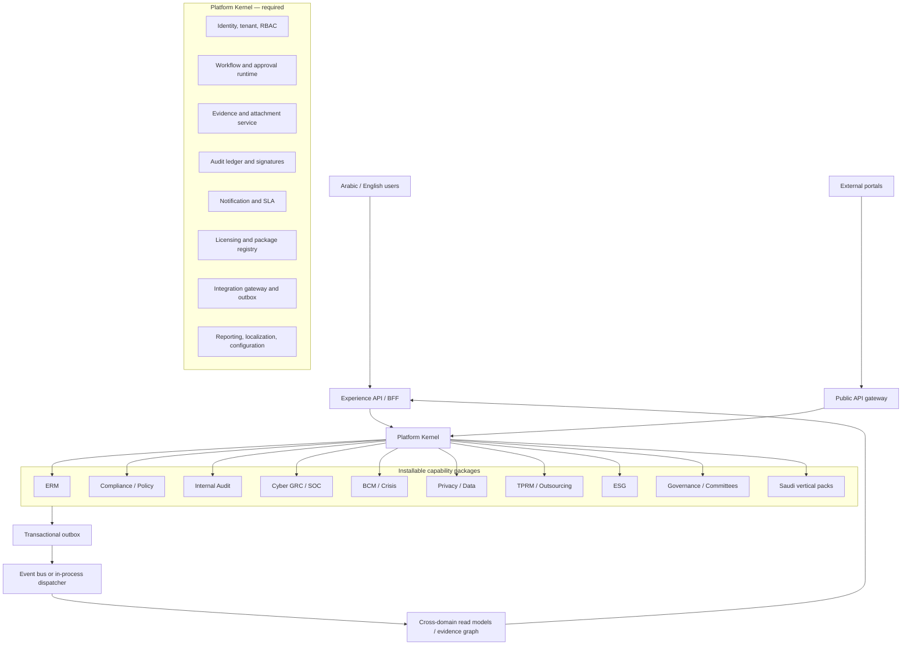

# Solution Architecture

## 1. Baseline

`VERIFIED` The current system is a Spring Boot modular monolith, React SPA and SQL Server database. It has substantial platform services—workflow, evidence, permissions, licensing, audit, notification, exports and realtime events—but package boundaries are inconsistent.

Baseline indicators:

- 58 top-level backend module directories;
- 252 controllers, 423 repositories and 313 services;
- 734 direct cross-module Java imports across 136 directed pairs;
- 14 bidirectional module pairs;
- 22 licensed-controller guards, all in SOC Ops;
- one large frontend router with more than 300 routed pages;
- more than 300 packaged SQL Server migrations.

The architecture is deployable. It is not yet commercially composable.

## 2. Target logical architecture



The arrow from kernel to package means runtime enablement, not a kernel source dependency. Source dependencies point from packages to kernel contracts.

## 3. Backend structure

Target package skeleton:

```text
packages/<package-code>/
  api/                 public commands and queries
  application/         use cases, transaction boundaries
  domain/              aggregates, policies, domain events
  infrastructure/      JPA, adapters, schedulers
  web/                 controllers and DTOs
  manifest/            entitlement, dependencies, permissions, routes
  tests/               architecture, contracts, tenant and state tests
```

Shared kernel:

```text
kernel/
  identity/
  tenancy/
  authorization/
  workflow/
  evidence/
  audit/
  notification/
  licensing/
  integration/
  reporting/
  localization/
```

“Common” is not a dumping ground. A type enters the kernel only if at least three packages need the same semantics and the kernel team owns its lifecycle.

## 4. Frontend architecture

Replace the single route catalogue with package manifests and five experience layers:

1. **My Work:** inbox, approvals, deadlines, delegations and escalations.
2. **Assurance:** risks, controls, obligations, evidence, issues and tests.
3. **Domain Workspaces:** installed packages only.
4. **Executive:** role-specific posture and decisions.
5. **Administration:** organisation, access, integrations, packages and content.

Each package contributes routes, permissions, navigation labels, help, telemetry events and feature flags. Public portals are separate application shells with narrower security and accessibility profiles.

## 5. Runtime scenarios

### Control assurance

`Compliance owns control definition → Workflow assigns test → Evidence receives version → Control test records result → Issue/CAPA created → Event updates ERM/Cyber projections → Executive metric retains lineage.`

### Material outsourcing

`TPRM owns party profile → SAMA package evaluates materiality → Governance records approval → BCM records resilience test by reference → events update vendor risk projection.`

No step reads a peer repository.

## 6. Deployment

Supported topologies:

- customer-managed on-premise;
- Saudi private cloud;
- Saudi public cloud SaaS;
- isolated regulated tenant deployment.

Minimum production components:

- reverse proxy/WAF;
- stateless application instances;
- SQL Server HA tier;
- object storage with malware scanning and retention;
- queue/outbox worker;
- identity provider;
- secrets manager/HSM or KMS;
- centralized privacy-aware telemetry;
- backup vault in approved geography.

The current Windows service deployment remains a supported transitional topology, not the target SaaS operating model.

## 7. Quality attributes

| Attribute | Target |
|---|---|
| Availability | Package-tier SLOs; no single node for enterprise tier |
| RPO/RTO | Customer tier and data class; rehearsed, not declared |
| Performance | P95 interactive reads under agreed target at production-like volume |
| Security | OWASP ASVS-aligned verification and Saudi control evidence |
| Modularity | Zero forbidden imports; package disable tests pass |
| Accessibility | WCAG 2.2 AA for product and public portals |
| Localization | Full Arabic/English task parity |
| Auditability | Every material decision traceable to actor, authority, evidence and version |

