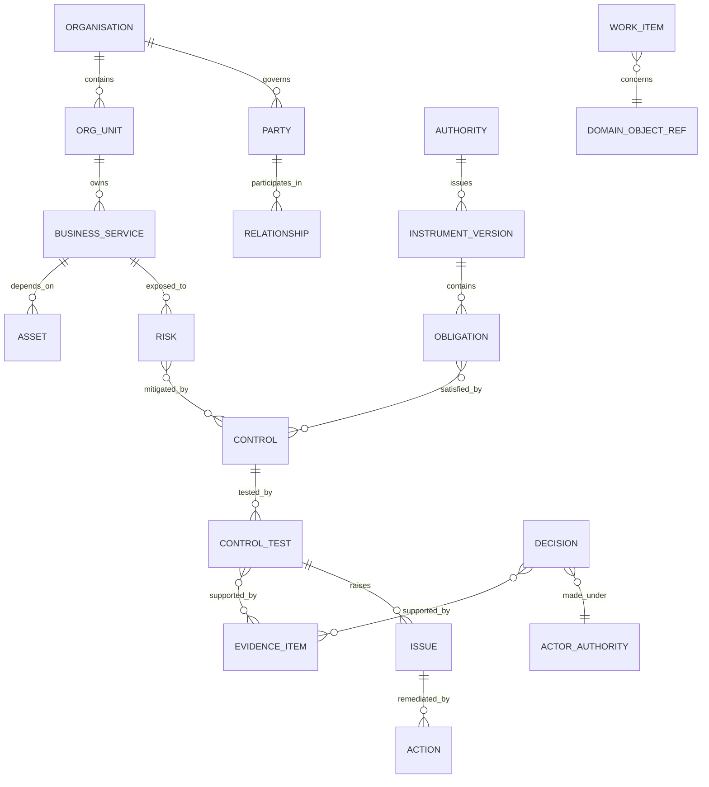

# Data Architecture

## Baseline

`VERIFIED` The platform uses SQL Server with many domain schemas, Hibernate/JPA, Flyway migrations for production, soft deletion in many aggregates, organisation-scoped queries and an audit/evidence model. Schema names provide useful organisation, but direct cross-module imports and repository use weaken ownership.

## Data principles

1. One canonical owner per object.
2. Tenant is part of every tenant-scoped key, uniqueness rule, cache key and event.
3. History is append-only for material decisions and submissions.
4. Evidence content and evidence metadata are separated.
5. Classification, purpose, retention and legal hold travel with data.
6. Reporting uses governed projections, not uncontrolled operational joins.
7. Arabic and English material content has explicit completeness/provenance.
8. Synthetic demo data is visibly separated from customer data.

## Canonical enterprise model

This is a semantic model, not one universal relational schema.

## Object ownership

| Object | Owner | Consumers |
|---|---|---|
| Organisation, user, org unit | Kernel identity | all packages |
| Business service / asset | kernel asset catalogue or explicit owning package | ERM, BCM, Cyber, TPRM |
| Authority/instrument/obligation | Compliance/Regulatory | all assurance packages |
| Control and implementation | Compliance | ERM, Cyber, Privacy, Audit |
| Risk | ERM | executive, audit, packages |
| Evidence item/version | Evidence kernel | all packages |
| Issue/action | Assurance kernel or designated owner | all packages |
| Party | TPRM/party master | outsourcing, privacy, cyber, ethics |
| Committee/decision | Governance | audit, risk, change, ESG |
| Processing activity | Privacy | data governance, TPRM |
| Model/use case | AI Governance | all AI-enabled packages |

Ownership disputes must be resolved by ADR before migration.

## Evidence graph

The evidence graph is a relationship service, not a content dump.

Node types:

- obligation, control, risk, test, evidence version, issue, action, decision, policy version, asset, party and submission.

Edge attributes:

- relationship type;
- asserted by/at;
- valid from/to;
- scope;
- confidence;
- source;
- review status;
- tenant.

Evidence reuse is permitted only if validity, period, population and scope satisfy the consuming claim.

## Multi-tenancy

### Default pooled tier

Shared database and schemas with mandatory `organisation_id`, layered application filtering and database write safeguards.

### Isolation tiers

- pooled application/database;
- dedicated database;
- dedicated application and database;
- customer-managed deployment.

Tier differences are deployment configuration. Domain code remains unchanged.

### Tenant proof

Automated negative tests cover list, ID lookup, search, export, aggregation, file, websocket, cache, scheduled job, async event and admin support operation.

## Data classification

| Class | Examples | Minimum handling |
|---|---|---|
| Public | published framework metadata, public trust content | integrity and version control |
| Internal | routine tasks and configurations | authenticated access |
| Confidential | risks, findings, contracts, committee papers | role/need-to-know, encryption, export control |
| Restricted | whistleblower identity, credentials, breach evidence, sensitive personal data | case-level access, enhanced audit, masking, restricted export |

Customer-specific classification policies may refine these classes.

## Retention and deletion

Retention is policy-driven by object type, jurisdiction, contract, investigation and legal hold. Soft delete is not erasure. The platform needs:

- retention schedule and authority;
- deletion eligibility service;
- legal/regulatory hold;
- content, indexes, caches, projections and backups handling;
- anonymisation/pseudonymisation where appropriate;
- destruction certificate;
- PDPL request linkage;
- immutable record exceptions with documented basis.

## Bilingual data

Material entities use either:

- `title_ar`, `title_en` plus translation status; or
- versioned localized-content child records for rich text.

Fields are mandatory by business rule, not merely database nullable flags. Search indexes normalize Arabic for retrieval but retain original strings.

## Analytics

Operational dashboards use read models. Enterprise analytics uses a governed lake/warehouse feed with:

- tenant and classification tags;
- published metric definitions;
- slowly changing dimensions where required;
- data-quality results;
- lineage to source object/version;
- masking and row-level access;
- refresh timestamp and lag SLO.

No executive metric may query uncontrolled duplicated data.

## Migration and master data

Every customer implementation defines:

- source inventory and owner;
- mapping to canonical objects;
- duplicate resolution;
- bilingual quality rules;
- reconciliation totals;
- rejected-row process;
- cutover and rollback;
- signed acceptance.

## Data quality dimensions

Completeness, validity, uniqueness, consistency, timeliness, accuracy and lineage. Quality rules are versioned, owned and measurable. A score without failed-record drill-down is not actionable.

## Database evolution

- production migrations are forward-only and idempotent where practical;
- package migrations are declared by manifest;
- expand/migrate/contract pattern for compatibility;
- schema-owner review for cross-schema change;
- online/index strategy for large tables;
- restoration rehearsed with application version compatibility;
- development must exercise migrations in a production-like profile, not rely solely on bootstrap scripts.

