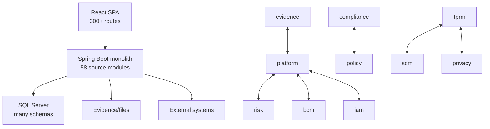
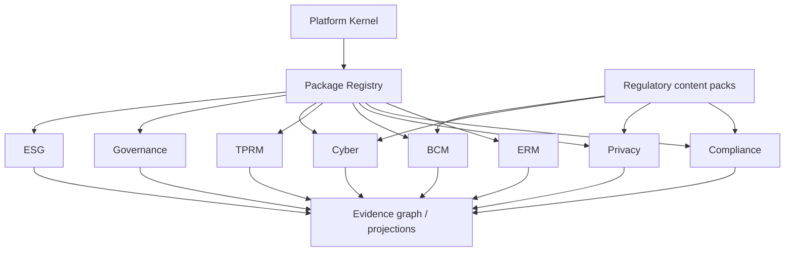
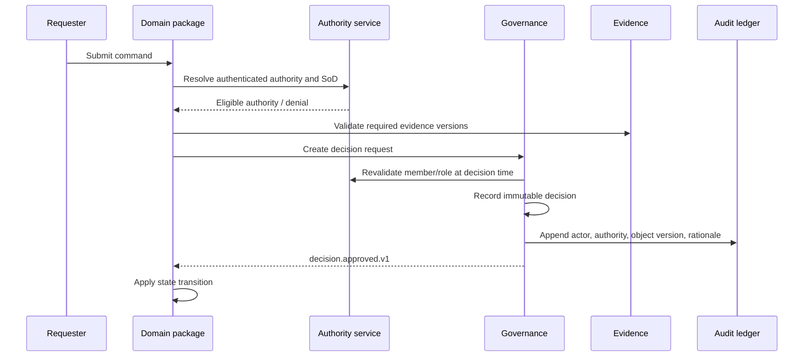
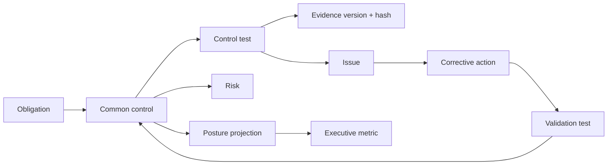
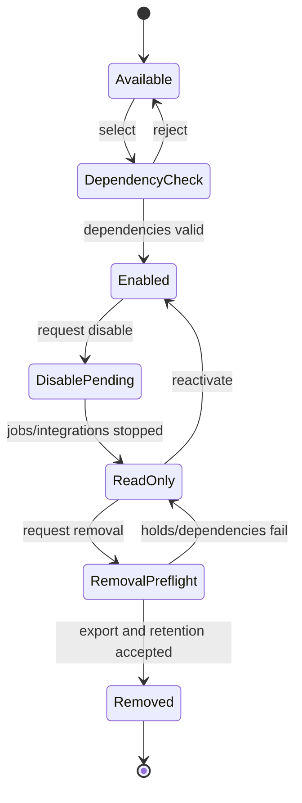
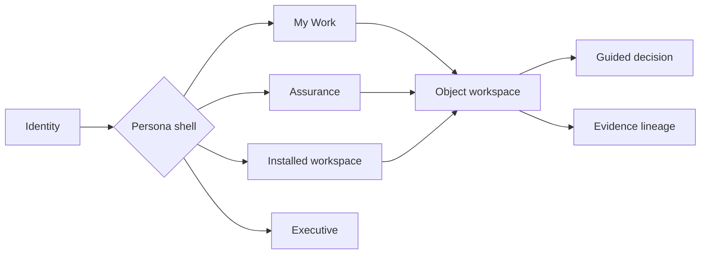

# Platform Diagrams

## Current-state pressure map

The issue is not one deployable. It is bidirectional ownership and direct access.

## Target commercial composition

## Material decision sequence

## Evidence lineage

## Package lifecycle

## UX shell

