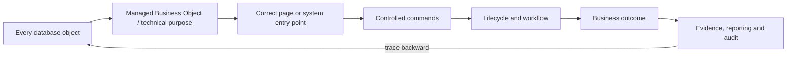

# Enterprise Table, Page, Process and Workflow Completeness Audit Plan

**Document type:** Enterprise product-operability, UX, data and process audit plan  
**Status:** `DISPOSITIONED (reduced to four keepers)` — see §0. Not executed as written.  
**Baseline date:** 2026-07-31  
**Scope:** Every SQL Server object, managed business object, backend command/API, workflow, frontend page and module in the TSS GRC Platform  
**Companion:** [Platform Capability Reachability and Orphan Discovery Plan](PLATFORM_CAPABILITY_REACHABILITY_AND_ORPHAN_DISCOVERY_PLAN.md)  

---

## §0 Disposition — 2026-08-01

**This document is not scheduled as written, and the reason is the finding.** It appeared in the tree
on 2026-07-31, 1,173 lines, scoped to *"every SQL Server object, managed business object, backend
command/API, workflow, frontend page and module"* — while its own companion, the
[Reachability and Orphan Discovery Plan](PLATFORM_CAPABILITY_REACHABILITY_AND_ORPHAN_DISCOVERY_PLAN.md),
was already **rescoped and half-executed** as F2-68 in the governing backlog. Two documents proposing
overlapping census machinery, days apart, is the duplication F2-68 exists to prevent — **occurring
while F2-68 was being written.** So this gets the treatment
[`UNIFIED_IMPLEMENTATION_PLAN.md`](../../UNIFIED_IMPLEMENTATION_PLAN.md) prescribes for a plan that
arrives beside an active programme: a disposition at the top, its keepers filed as `F2-*` ids in the
governing backlog, and **no numbering scheme of its own**.

**Reviewed in full against the instruments that already exist** (`table_xref.py`, `schema_drift.py`,
`grant_tightness.py`, `deployment_identity.py`, `SchemaContractRatchetTest`,
`RoleGuardConversionRatchetTest`, `routeReachability.test.ts`). Verdict: **one genuinely new idea plus
three small pairwise joins — roughly 3–4 engineer-weeks — inside ~1,100 lines that re-derive
instruments already running.** The bulk is not wrong; it is *already built*, and re-inflates the
8-role pod, four councils, master graph and ten hand-maintained registers that the companion's adopted
rescope deliberately cut. One measured example of the cost of not checking: its §6.1 proposes a
stored-procedure and view universe for a database the companion measured at **1 view, 0 procedures,
1 trigger**.

### The four keepers

| # | Keep | Where it is here | Why it survives | Size |
|---|---|---|---|---|
| **K-1** | **Interaction-archetype / expected-surface classification** | §5, TPC-001 | The only novel *idea* in the document. `table_xref.py` classifies **liveness** — operating, seed-only, orphaned. Nothing classifies what surface a table *ought* to have, so "this table has no page" cannot currently be distinguished from "this table must never have one". Two columns on the existing register + exceptions pattern, adjudicated **only for tables already under disposition** | days |
| **K-2** | **Status-transition reachability scan** | §9.2 | States with no incoming or no outgoing command; backend states absent from the FE; two state machines over one record. No instrument does this, and F2-22b and F2-29 already supply the known positives to anchor it against vacuity. Workflow-adopting modules first | 1–2 wk |
| **K-3** | **Multi-write-path (dual-lineage) detector** | §7.3 | A detector for this platform's historically worst shape — CH-6/CH-9's two policy backends, DF-3 — currently found only by hand, and only after it has shipped. Sits on top of `table_xref.py`'s existing reference collection | days |
| **K-4** | **Workflow definition-vs-actor reachability** | §10.1–10.2 | Template with no publisher; task role with no users in the tenant. Folds into **F2-66**'s clean-tenant probe rather than standing alone — F2-66 already has to exercise the engine end to end | 1–2 d |

⚠ **K-1 through K-4 are filed as backlog candidates, not as a plan.** They enter the queue through
`UNIFIED_IMPLEMENTATION_PLAN.md` §8 like anything else, behind the schema spine — because a
classification of what surface a table *should* have is worth little while 67 mapped tables and 11 of
their schemas cannot be created by a migration at all (RC-A / F2-70).

**Everything below this section is retained as reference, not as scope.**

---

## 1. Executive position

The original idea is correct but must be expressed more precisely:

> The audit should not ask whether every physical table has generic Add, Edit and Delete buttons. It should determine whether every **managed business object** has the correct authorised entry point, lifecycle, workflow, evidence and user experience—and whether every physical table has a justified role in that process.

Direct CRUD for every table would make the platform less mature and less secure. Examples:

- audit ledger rows must be append-only, never editable;
- votes and signed decisions must be recorded through controlled commands, not edited like ordinary records;
- join tables should be managed through relationship controls inside the parent page;
- outbox, scheduler and workflow-event tables need operational diagnostics, not business-user forms;
- regulatory/reference content may be installed from versioned packs, not typed manually;
- derived snapshots and dashboards should be read-only with drill-through to their sources;
- evidence hashes, signatures and tenant identifiers must not be user-editable;
- legacy tables should normally have no create entry point at all.

The professional audit unit is therefore the **Managed Business Object (MBO)**: a risk, control, policy, assessment, audit, finding, evidence item, vendor, change, meeting, request or other business aggregate. One MBO may use several tables and several pages. A table may support multiple screens without being a user-managed object itself.

The audit will perform a complete two-way reconciliation:



No capability will be declared complete because a table, entity, controller or page exists. Completion requires a real authorised persona to discover the process, start it, progress it, reach a valid terminal outcome and prove the resulting evidence.

---

## 2. Audit outcomes

The program shall produce:

1. A classification and interaction decision for **100% of database tables and views**.
2. An authoritative data/process mapping for **100% of active frontend pages**.
3. A lifecycle and workflow assessment for every business aggregate.
4. A per-table and per-page recommendation: retain, redesign, complete, merge, migrate, make read-only, archive or retire.
5. A per-module Product Design Improvement Specification.
6. A prioritised implementation backlog with acceptance tests and release gates.
7. CI controls preventing new tables, pages, states or workflows from becoming unreachable or incomplete.
8. Corrected Platform Bible and sales claims based on demonstrated operability.

### 2.1 Questions answered for every table

- What business/technical purpose does it serve?
- Which aggregate owns it?
- Who or what legitimately creates records?
- Who may update which fields and through which business command?
- Is deletion allowed, or must the process archive/retire/supersede?
- Where are records viewed and acted upon?
- Which workflow, states, evidence and downstream outcomes depend on it?
- Is it tenant-safe, authorised, bilingual where applicable and auditable?
- Are its records real, seeded, mocked, externally ingested, derived or legacy?
- Does it need a standalone page, nested component, wizard, admin configuration screen, reconciliation console, read-only viewer—or no UI?
- What is missing compared with a mature GRC process and comparable product pattern?

### 2.2 Questions answered for every page

- Which persona and user outcome is the page for?
- How is it discovered from a workspace, task, notification or parent record?
- Which authoritative tables/aggregates and APIs does it read/write?
- Can the user create, progress and complete the intended process?
- Are actions state-aware, permission-aware and entitlement-aware?
- Does it expose raw CRUD where a governed command is required?
- Does it show truthful loading, empty, denied, error and demo states?
- Does it provide evidence, relationships, history, tasks and next actions?
- Is it complete in Arabic/RTL and accessible?
- Should it remain, be redesigned, merge into an object workspace, become detail-only or be retired?

---

## 3. Governing principles

| ID | Principle | Audit consequence |
|---|---|---|
| TP-01 | Audit aggregates, not tables in isolation | Several tables may map to one managed object and one task workspace |
| TP-02 | Use commands, not unrestricted CRUD, for governed state changes | “Approve”, “Submit”, “Accept Risk”, “Close Finding” are server commands with evidence |
| TP-03 | Every capability needs a legitimate start | Start may be UI, event, scheduler, content installation or documented integration |
| TP-04 | Every non-terminal state must have a legal path forward | No records may become stuck because a command/actor/UI action is missing |
| TP-05 | Every outcome must have a consumer | Records must drive decisions, monitoring, remediation, evidence or reporting |
| TP-06 | Delete is exceptional in GRC | Prefer archive, retire, revoke, supersede or soft-delete with retention controls |
| TP-07 | Role and tenant access are part of operability | An endpoint usable only by platform-admin is not proof of customer usability |
| TP-08 | UI must show the business process, not the schema | Pages organise tasks, decisions, evidence and related objects rather than expose tables |
| TP-09 | Derived and immutable data are read-only | Dashboards, tallies, scores, signatures and logs cannot be caller-authored |
| TP-10 | Demo data never proves production capability | Empty-tenant and backend-down behaviour must remain truthful |
| TP-11 | Every recommendation must name the current break | No generic “improve UX/workflow” statements |
| TP-12 | Market comparison is pattern-based | Adopt valuable operating patterns; do not clone vendor screen layouts |
| TP-13 | Saudi readiness is designed into the process | Arabic, sector controls, evidence and local operating defaults are acceptance criteria |
| TP-14 | Standalone SKU boundaries remain enforceable | No page/process may secretly require an unlicensed sibling product |

---

## 4. Market-leader benchmark model

The comparison is not a feature-count exercise. Each TSS managed object will be assessed against operating patterns demonstrated by leading GRC products.

### 4.1 Benchmark patterns

| Pattern | What mature products demonstrate | TSS audit question |
|---|---|---|
| Role-based workspace | Daily tasks, priorities, records and actions are organised for a persona | Can the intended persona discover and complete work without knowing table/module structure? |
| Guided entry | Create actions collect the correct context, relationships, risk and evidence | Is there an appropriate wizard/form/import/integration start, or only an empty register? |
| Structured lifecycle | Assessments, exceptions, events, audits and issues progress through named states | Can every state be entered/exited lawfully, with owner, SLA and evidence? |
| Connected data | Risks, controls, issues, assets, vendors, policies and audits relate to each other | Are relations authoritative and actionable rather than decorative links? |
| Contextual action | Related risks, indicators, control failures, issues and evidence appear where decisions are made | Does the user have decision context without switching through unrelated pages? |
| Controlled collaboration | Tasks, comments, work notes, delegation, confidentiality and approvals are role-scoped | Is collaboration inside the record and auditable? |
| Remediation to closure | Findings/issues generate owned action plans and validation before closure | Does a negative outcome create and close real remediation work? |
| Real-time monitoring | Indicators, assessments and control results update dashboards with drill-through | Can every KPI trace to a real data-producing process? |
| Configurable methodology | Scales, templates, approval policies and workflows support tenant context | Is configuration safe and versioned rather than hard-coded or raw-table edited? |
| Evidence lineage | Decisions and reports trace to source, actors, versions and approvals | Can an auditor reconstruct who did what, why and under which rule? |

### 4.2 Comparator lessons

- ServiceNow’s current Risk Management documentation describes structured workflows for risk assessments, indicators and issues, supported by a simplified role-oriented Risk Workspace and real-time dashboards. Its policy-exception workflow provides a specific create entry, role requirements, states, risk assessment, approvals, work notes, confidentiality and extensions rather than generic table editing.
- Archer describes standardised risk inputs, processes and outcomes, accountability, central risk/control relationships and workflows that turn data into decision support.
- MetricStream’s audit product describes an end-to-end path from audit universe and planning through resourcing, fieldwork, evidence, findings, action remediation, review/approval and final reporting.
- OneTrust describes connected risk assessments, control management, remediation and risk dashboards; its policy/audit material emphasises guided workflow, stakeholder evidence and policy attestation.
- AuditBoard positions audit, risk and compliance work on a connected data/analytics platform, reinforcing the need for shared objects and drill-through rather than isolated registers.

TSS differentiation should be Arabic-first Saudi regulatory evidence, strong segregation of duties, modular sellability and transparent provenance—not a larger count of tables or menu items.

---

## 5. Managed Business Object archetypes

The first audit decision is the table archetype. This determines whether a page and Add/Edit/Delete actions are appropriate.

| Archetype | Examples | Expected interaction | Create | Update | Delete |
|---|---|---|---|---|---|
| Aggregate root | Risk, policy, vendor, audit, change, incident | Register + detail/task workspace + lifecycle commands | Form/wizard/import/event | Field edit in allowed states; governed commands | Usually archive/retire/soft-delete |
| Aggregate child | Risk treatment, audit step, change task, meeting agenda item | Nested panel/table inside parent; optional focused detail | Add within parent context | Owner/state-specific | Remove only before submission or supersede |
| Relationship/junction | Risk-control, policy-control, vendor-service | Relationship picker/manager on parent | Link command | Change relationship metadata | Unlink with audit/restrictions |
| Reference/master data | Categories, scales, methods, sectors | Controlled admin/configuration page or versioned content pack | Admin/import/content pack | Effective-dated versioning | Retire, rarely delete |
| Workflow/task | Approval request, recipient, escalation | My Work/task inbox + parent timeline | System creates from process | Respond/reassign/escalate commands | Cancel/withdraw by policy |
| Evidence/document | Evidence file, attestation, signature | Evidence panel/viewer with upload/validate/version actions | Upload/system capture | New version/status validation | Retention-controlled removal only |
| Decision/vote | Approval, committee vote, risk acceptance | Decision panel tied to eligible actor and state | Authenticated command | Immutable; correction by supersession | Never ordinary delete |
| Audit/event ledger | Audit log, workflow event, export audit | Read-only investigation/operations viewer | System only | Append-only | Retention purge only |
| Derived score/snapshot | Residual score, posture snapshot, dashboard aggregate | Read-only KPI with formula/source/drill-through | Server calculation | Recalculate through source change | Retention policy |
| Outbox/inbox/idempotency | Domain event delivery, retries | Operations diagnostics and replay controls | System only | Controlled retry/status | Retention cleanup |
| Integration staging/quarantine | Imported scan/vendor/regulatory data | Reconciliation console with accept/reject/map | Connector/import | Mapping/correction through controlled workflow | Purge after reconciliation/retention |
| Scheduler/configuration | Cadence, job policy, notification template | Admin configuration + health/run history | Admin/content pack | Versioned/validated | Disable/retire |
| Security secret/credential | Connector secret, key metadata | Masked secret-management flow | Secure vault command | Rotate/revoke | Secure revoke/purge |
| Archive/legal hold | Closed historic record | Read-only search/export with access controls | Migration/system | Legal-hold metadata only | Only after approved retention |
| Legacy/duplicate | Superseded V1/lifecycle table | No normal entry point; read-only compatibility if required | Prohibited | Prohibited except migration | Controlled retirement |

### 5.1 Interaction rule

The audit must never recommend a standalone page simply because a table exists. It recommends the **smallest correct management surface**:

1. standalone workspace;
2. register + object detail;
3. nested child component;
4. relationship manager;
5. admin configuration;
6. import/reconciliation console;
7. read-only viewer/drill-through;
8. operational diagnostics;
9. system-only with no UI;
10. legacy read-only or retirement.

---

## 6. Audit universes and reconciliation keys

### 6.1 Database universe

All SQL Server:

- schemas, tables and columns;
- views, indexed views and synonyms;
- stored procedures, functions and triggers;
- foreign keys, unique/check/default constraints and indexes;
- Flyway migrations and Python bootstrap/seed/fix scripts;
- tenant, soft-delete, temporal, row-version and audit structures.

### 6.2 Backend universe

- JPA entities and embeddables;
- repositories and native SQL/JDBC access;
- services, commands, validators and state maps;
- controllers and DTOs;
- schedulers, listeners and domain-event publishers;
- workflow/automation definitions and callbacks;
- permissions, roles, licensing and resource-membership checks;
- export, search, dashboard and integration consumers.

### 6.3 Frontend universe

- routed pages and detail pages;
- workspace/dashboard cards and navigation items;
- forms, wizards, modals, tables, tabs and action buttons;
- API-client methods, hooks and WebSocket consumers;
- mock/demo/static data imports;
- loading, empty, error, permission and entitlement states;
- Arabic/English translations and RTL behaviour.

### 6.4 Process universe

- Product Bible PDS and business-process claims;
- user stories and acceptance criteria;
- state-machine catalogue;
- workflow definitions, tasks, timers and notifications;
- regulatory controls and evidence requirements;
- scheduled/automated and external-integration processes.

### 6.5 Stable reconciliation identifiers

The audit assigns:

```text
MBO-<MODULE>-<OBJECT>       Managed business object
DBO-<SCHEMA>-<OBJECT>      Database object
PG-<WORKSPACE>-<PAGE>      Frontend page
PR-<MODULE>-<PROCESS>      Business process
WF-<MODULE>-<WORKFLOW>     Workflow
```

Names may differ between layers; reconciliation uses code references, endpoints, FKs, events and runtime correlation—not string similarity alone.

---

## 7. The audit loops

### 7.1 Loop A — every table to its correct user/system interaction

For each database object, execute these steps in order.

#### A1. Establish identity and ownership

- schema/table/view and introduction migration;
- current entity/native SQL mappings;
- module, SKU, aggregate and accountable owners;
- data classification, retention and regulatory relevance;
- canonical, derived, technical, integration, demo or legacy status.

#### A2. Determine real producers

Search all legitimate creation paths:

- create command/controller;
- nested parent command;
- workflow/automation action;
- scheduler;
- domain-event consumer;
- external integration/import;
- migration-installed reference content;
- Python bootstrap/seed/demo scripts.

Identify whether the only writer is demo/seed or generic entity binding.

#### A3. Determine real consumers

- page/register/detail panel;
- workflow decision or task;
- downstream aggregate/CAPA/notification;
- search/report/dashboard/export;
- external integration;
- retention/audit/investigation.

#### A4. Decide required interaction model

Using §5, record whether the object needs:

- Create/Add entry;
- update/edit fields;
- lifecycle commands;
- relationship management;
- read-only view;
- operational/admin console;
- no UI;
- migration/retirement.

#### A5. Verify implementation

- entry exists and is discoverable;
- page/component invokes the correct API;
- API writes the correct aggregate/table;
- required fields and Arabic fields are validated;
- state and authority determine available actions;
- successful command refreshes UI and produces audit evidence;
- failure shows RFC 7807 detail without false success;
- related outputs appear in tasks/reports.

#### A6. Evaluate lifecycle completeness

Map the object against the lifecycle model in §9. Missing phases require an explicit `NOT_APPLICABLE` reason, not a blank.

#### A7. Evaluate controls

- tenant isolation;
- permission/role/licence;
- ownership and resource scope;
- maker-checker/SoD;
- optimistic concurrency;
- immutable actor and time;
- evidence/version/signature;
- retention/archive.

#### A8. Runtime proof

Create/progress/complete a representative record with intended personas, prove database lineage and verify downstream consumers. For system-only objects, trigger the owning event/job/integration.

#### A9. Benchmark and recommendation

Compare the business pattern with the relevant market-leading workflow, then select one disposition:

```text
KEEP · COMPLETE_ENTRY · REDESIGN_PAGE · ADD_LIFECYCLE · ADD_WORKFLOW
NEST_UNDER_PARENT · ADD_RECONCILIATION · MAKE_READ_ONLY · MERGE/MIGRATE
ARCHIVE · RETIRE · UNKNOWN_PENDING_DECISION
```

#### A10. Produce finding/backlog

Record precise break, root cause, impacts, target design, alternatives, effort, priority, ROI and acceptance test.

### 7.2 Loop B — every page to authoritative data and a complete outcome

For each active page:

#### B1. Purpose and persona

- page title/route/workspace;
- intended persona and task;
- SKU/module/entitlement;
- business outcome and frequency;
- how the persona discovers it.

#### B2. Data lineage

- every API/hook/WebSocket call;
- backing controller/service/repository/table/view;
- mock/static/fallback data;
- derived fields/formulas;
- export/search/dashboard dependencies.

#### B3. Interaction inventory

Record every action:

- create/add/import;
- edit/save;
- submit/approve/reject/return;
- assign/delegate/escalate;
- link/unlink;
- attach/validate evidence;
- archive/retire/delete;
- export/share;
- bulk action.

For each action, trace frontend handler → API → permission → service command → state/data change → event/workflow → user feedback.

#### B4. State and permission behaviour

- button is visible/enabled only for legal state and authority;
- server independently enforces the same rule;
- disabled control explains why;
- empty page offers the correct first action;
- unauthorised/unlicensed states are truthful;
- admin bypass is not the only working persona.

#### B5. Task-centred completeness

The page should answer:

1. What is this object?
2. Why does it matter?
3. What state is it in?
4. What is missing or overdue?
5. Who owns the next action?
6. What may I do now?
7. What evidence and relationships support the decision?
8. What happened previously?
9. What downstream outcome will this action create?

#### B6. UX and data quality

- progressive disclosure rather than one giant form;
- correct required/conditional fields;
- bilingual text and RTL;
- accessible keyboard/focus/labels/status;
- search/filter/sort/saved view for registers;
- pagination and large-dataset behaviour;
- unsaved change warning and optimistic-lock conflict;
- explicit loading/empty/error/demo states;
- no success toast before server confirmation;
- no raw IDs/status strings where business language is required.

#### B7. Page disposition

```text
KEEP · REDESIGN · MERGE_INTO_OBJECT_WORKSPACE · MAKE_DETAIL_ONLY
ADD_ENTRY · ADD_ACTIONS · ADD_DATA · RESTRICT_ADMIN · REMOVE_MOCK
REPLACE_WITH_TASK_INBOX · RETIRE
```

### 7.3 Loop C — every managed object across all pages

After table and page loops, reconcile by MBO:

- list/register page;
- create/start flow;
- object detail/workspace;
- child/relationship tabs;
- review/decision task;
- monitoring/dashboard;
- archive/history/evidence.

Detect fragmentation:

- two pages edit the same field under different rules;
- one page uses real API and another uses mock data;
- one status can be changed through generic edit and governed workflow;
- successor/V2 and legacy pages both accept writes;
- a child object has standalone CRUD without parent integrity;
- a report uses a different table lineage from the operational page.

### 7.4 Loop D — every page back to every table

Create the inverse matrix:

- every page must list all tables it reads/writes indirectly;
- every displayed KPI must list its source formula and drill-through;
- every form field must map to a DTO/command and canonical field or explicitly be presentation-only;
- every derived field must identify the calculating service;
- every displayed record must identify real/demo/reference provenance;
- every write must name its audit event.

This detects attractive pages that have no authoritative process behind them.

---

## 8. CRUD and command assessment

### 8.1 Create/Add assessment

For each business object where creation is legitimate:

- entry point exists in the correct workspace or parent;
- user sees purpose, eligibility and required information;
- wizard steps follow business reasoning, not table column order;
- defaults come from tenant policy/reference data;
- duplicate detection runs before creation;
- owner, scope and relationships are established;
- draft/save/resume behaviour is defined;
- source/provenance and actor are immutable;
- successful creation starts the required workflow/task/SLA.

Creation may be intentionally prohibited when records come only from integration, calculation, migration, evidence capture or system events.

### 8.2 Update/Edit assessment

Classify fields:

- editable while draft;
- editable by owner;
- editable only through a specific command;
- recalculated/system-managed;
- immutable after submission/decision;
- correctable only through superseding version;
- secret/masked;
- auditor-only annotation.

Generic `PUT entity` patterns are high-risk where clients can supply status, tenant, actor, decision, tally, calculated value or audit fields.

### 8.3 Delete assessment

For every delete endpoint/button ask:

- is deletion legally and operationally appropriate?
- are evidence, decisions, children and reports affected?
- should the action be cancel, archive, retire, revoke, anonymise or supersede?
- is reason/authority/four-eyes required?
- can the object be restored?
- does retention/legal hold block it?

Hard delete is generally reserved for approved test cleanup, security-sensitive ephemeral data or explicit retention purge—not routine GRC business records.

### 8.4 Bulk operation assessment

Bulk actions require:

- per-row tenant/permission/state validation;
- preview of eligible/ineligible rows;
- idempotency and partial-failure reporting;
- export/audit logging;
- no bypass of SoD or approval thresholds.

---

## 9. Process lifecycle completeness model

Every MBO is mapped to the applicable phases:


Not every object needs every phase, but each phase must be `IMPLEMENTED`, `NOT_APPLICABLE` with reason, or `MISSING`.

### 9.1 Lifecycle checklist

| Phase | Required evidence |
|---|---|
| Discover | Source, intake, scheduled identification or integration |
| Start | Create command, actor, tenant, ownership and minimum data |
| Validate | Completeness, duplicate, scope, applicability and data-quality rules |
| Assess | Methodology, calculations, evidence, version and assessor |
| Review | Independent challenge, comments, return/rework path |
| Decide | Authenticated authority, SoD, decision, rationale and conditions |
| Execute | Tasks/action plan, resources, dates and implementation evidence |
| Monitor | Indicators, SLAs, recurring assessment and exception detection |
| Correct | Issue/CAPA/remediation, owner, due date and escalation |
| Close | Verification, residual status, independent closure where required |
| Retain | Archive, review cycle, supersession, legal hold and purge |

### 9.2 State-machine audit

For every status column/enum:

- authoritative state owner;
- incoming and outgoing commands;
- guard, role and evidence;
- side effects/events/tasks;
- UI action and label;
- SLA/escalation;
- terminal/reopen/cancel rules;
- database constraint;
- unit/integration/live test.

Flag:

- states with no incoming command;
- non-terminal states with no outgoing command;
- status editable through ordinary update;
- UI labels for impossible states;
- backend states absent from frontend;
- terminal states with open mandatory tasks/actions;
- two state machines governing the same record.

---

## 10. Workflow completeness audit

Every process workflow is evaluated across this chain:

```text
Trigger → Instance → Actor resolution → Task → Decision/action
→ Branch → SLA/escalation → Callback → Domain state → Evidence → Closure
```

### 10.1 Workflow checklist

- real manual/event/scheduled/integration trigger;
- active definition/version for tenant/module;
- idempotent instance creation;
- eligible actor resolution with non-zero users;
- assignment/delegation/out-of-office handling;
- bilingual task title/instructions/deep link;
- due date, reminder and escalation;
- evidence and comment requirements;
- approve/reject/return/request-information branches;
- SoD/maker-checker;
- terminal callback updates authoritative aggregate;
- failure/retry/dead-letter behaviour;
- cancellation/withdrawal/reopen;
- audit events and metrics;
- task inbox and parent-page visibility;
- clean-tenant and two-person live proof.

### 10.2 Workflow anti-patterns

- workflow template with no publisher/start command;
- event trigger with no enabled rule;
- task assigned to a role with no users in the tenant;
- approval completes but domain status does not change;
- generic status edit bypasses workflow;
- notification is treated as workflow completion;
- scheduler runs without explicit tenant context;
- seeded workflow instances are the only demonstration;
- “approve” and “review” use the same person without policy;
- child tasks close while parent remains permanently open.

---

## 11. Per-table audit record

Every physical table/view receives this record:

| Field group | Required fields |
|---|---|
| Identity | DBO ID, schema/object, type, migration origin, latest change |
| Ownership | module, SKU, MBO, Product/Data/Technical Owner |
| Classification | archetype, data classification, regulatory/retention, canonical/legacy |
| Structure | tenant key, PK/FKs, constraints, soft delete, row version, timestamps |
| Producers | command/API/event/job/integration/seed; real versus demo |
| Consumers | pages, workflows, reports, exports, integrations, evidence |
| Interaction | required UI pattern; create/update/delete/commands and rationale |
| Lifecycle | states, start, progress, terminal, reopen/archive |
| Workflow | definition, trigger, actors, SLA, callback, evidence |
| Security | permission, roles/users by tenant, entitlement, SoD, field integrity |
| UX | page/component, route/nav/task entry, Arabic, accessibility |
| Runtime | rows by tenant/provenance, last activity, live-probe result |
| Benchmark | relevant leader pattern and gap |
| Decision | classification, findings, recommended design, disposition, effort/priority |

### 11.1 Table coverage gates

An object cannot be closed as reviewed until:

- all writers and readers are accounted for, including native SQL/scripts;
- correct interaction archetype is approved;
- real producer and consumer are proven or intentionally absent;
- page/no-page decision is justified;
- lifecycle/workflow status is recorded;
- security/tenant/retention controls are assessed;
- recommendation and owner are recorded.

---

## 12. Per-page audit record

| Field group | Required fields |
|---|---|
| Identity | PG ID, route, component, workspace/nav parent, module/SKU |
| Purpose | persona, job-to-be-done, frequency, expected outcome |
| Discovery | nav/card/task/deep-link/parent entry; off-nav reason |
| Data | APIs/hooks/events/mocks and DBO/MBO lineage |
| Actions | every button/form/bulk action and backend command |
| Lifecycle | visible state, allowed next actions, terminal outcome |
| Workflow | tasks, approvals, SLAs, notifications, callback visibility |
| Security | entitlement, permission, resource scope, state/SoD behaviour |
| UX | layout, forms, related data, timeline, empty/error/demo, accessibility/RTL |
| Runtime | intended-persona browser result and denied control persona |
| Benchmark | comparable operating pattern and gap |
| Decision | keep/redesign/merge/detail-only/retire; backlog/acceptance |

### 12.1 Page coverage gates

- every displayed value has authoritative lineage;
- every action has an executed backend path and audit outcome;
- every process has a visible start and next action or explicit system-only reason;
- every page is reachable by intended persona;
- every mock/demo source is disclosed and dispositioned;
- Arabic/English and empty/error/denied states are tested;
- page outcome reaches a real consumer/report/task.

---

## 13. Completeness and maturity scorecard

Score each MBO from 0–5 on each dimension:

| Dimension | 0 | 3 | 5 |
|---|---|---|---|
| Ownership | No owner | Technical owner only | Product, data and business owners accountable |
| Entry/discoverability | No start | Hidden/partial entry | Role-based guided start and task entry |
| Data integrity | Caller-controlled/ambiguous | Basic constraints | Canonical, tenant-safe, versioned, provenance-bound |
| Lifecycle | CRUD/status text only | Partial state rules | Complete tested state/command model |
| Workflow | None/dead | Manual or partial | Actor/SLA/branches/callback/retry complete |
| Authorisation/SoD | Admin/broad role | Permission only | Permission + resource + state + SoD + entitlement |
| Evidence/audit | Weak/free text | Audit events present | Reconstructable signed/versioned evidence chain |
| UX/task fitness | Empty register/raw form | Usable CRUD | Contextual task workspace and next-best action |
| Relationships | Isolated IDs | Related lists | Connected actionable graph with ownership |
| Monitoring/remediation | None | Dashboard or actions | Indicators → issue/CAPA → verified closure |
| Reporting lineage | Static/demo | Live aggregate | Defined formula, provenance and drill-through |
| Integration | Unspecified | One-off import | Contracted, reconciled, observable and idempotent |
| Arabic/accessibility | Missing/inconsistent | Translated basics | Arabic-first RTL and WCAG 2.2 AA target |
| Operability | No runtime proof | Happy-path test | Clean-tenant, two-person, failure/restart proof |
| Modular sellability | Hidden sibling dependency | Partly gated | Standalone SKU activation and isolation proven |

### 13.1 Maturity bands

- `A — MARKET OPERABLE` ≥ 4.2 average and no mandatory gate below 3;
- `B — OPERABLE WITH DEBT` 3.4–4.19;
- `C — PARTIAL PROCESS` 2.5–3.39;
- `D — REGISTER/DEMO ONLY` 1.5–2.49;
- `E — ORPHAN/UNSAFE` < 1.5 or any P0 integrity failure.

Scores prioritise work; they do not replace detailed findings.

---

## 14. Improvement pattern catalogue

Recommendations shall select concrete patterns.

### 14.1 Replace empty register with guided start

Use when a business aggregate has list/read API but no production creation process.

Target:

- role-specific “Create/Report/Request/Start Assessment” action;
- wizard based on business decision points;
- duplicate and applicability checks;
- ownership and scope;
- workflow created on submit;
- empty-state guidance.

### 14.2 Replace raw form with object workspace

Use for complex GRC objects.

Workspace includes:

- summary, state, owner and next action;
- contextual relationships;
- risk/control/evidence panels;
- tasks, comments and timeline;
- decision and conditions;
- monitoring and remediation;
- history/versions and exports.

### 14.3 Nest child records under the parent

Use where standalone CRUD would permit invalid orphan children. Parent context supplies tenant, ownership, sequence and lifecycle.

### 14.4 Convert status editing to commands

Replace dropdown/PUT with named operations:

```text
Submit · Assign · CompleteAssessment · Approve · Reject · Return
AcceptRisk · RequestException · Publish · CloseFinding · VerifyAction
Archive · Retire · Reopen
```

Each command validates actor, state, evidence, SoD and side effects.

### 14.5 Add workflow completion spine

Use when records exist but no owned route to closure:

- create task;
- resolve actor;
- SLA/reminders/escalation;
- decision branches;
- callback to parent;
- evidence and closure verification.

### 14.6 Add integration reconciliation console

Use for external-ingress/staging data:

- source/run health;
- accepted/rejected/quarantined records;
- mapping and duplicate resolution;
- retry with idempotency;
- lineage to created MBO;
- reconciliation totals.

### 14.7 Make system facts read-only with drill-through

Use for scores, snapshots, tallies and KPIs. Show formula, source time, provenance and drill-through; change source inputs rather than derived value.

### 14.8 Canonicalise duplicate lineages

Select one aggregate/table/page family, stop legacy writes, reconcile/migrate data, update all consumers and retain legacy read-only only as required.

### 14.9 Add clean-tenant activation

Every SKU receives setup health:

- licence active;
- roles/grants present;
- methodologies/templates/reference content installed;
- required integrations configured or explicitly optional;
- first-process guided setup;
- no demo records required.

---

## 15. Security and control review within every loop

For each page/table/action verify:

- `organisation_id` is server-owned and every query is tenant-scoped;
- entity binding cannot set tenant, actor, status, decision, score or audit metadata;
- write endpoint uses a catalogued permission and intended roles hold it;
- module entitlement is enforced without cross-SKU leakage;
- resource ownership/membership is checked where needed;
- SoD/maker-checker uses immutable user IDs;
- native SQL filters tenant and soft delete;
- concurrency does not overwrite another decision;
- audit/evidence records are append-only or superseded;
- exports/search/indexes follow source-object confidentiality;
- deletion respects retention/legal hold;
- UI hiding is never treated as security.

High-consequence tables—approvals, votes, acceptances, signatures, evidence, identity grants, audit results and regulatory submissions—receive P0 review first.

---

## 16. UX and Saudi-market review within every loop

### 16.1 Task-centred UX

- workspace reflects persona outcomes, not package names;
- My Work shows assigned/overdue/returned tasks;
- object page shows state, next action, owner and missing requirements;
- wizards reduce cognitive load for complex assessments;
- related records are contextual and actionable;
- executive screens use summaries with drill-through, not data-entry tables;
- regulator/auditor views are read-only, time-scoped and evidence-centred.

### 16.2 Arabic and Saudi defaults

- Arabic and English required for authoritative user-visible records;
- correct RTL layout and mirrored process indicators;
- Asia/Riyadh canonical display defaults;
- Hijri display where useful, Gregorian/UTC canonical storage;
- Saudi terminology validated by GRC/regulatory owner;
- NCA/SAMA/SDAIA/PDPL/DGA/CMA evidence links are versioned, not hard-coded claims;
- bilingual exports preserve Arabic shaping, order and evidence parity.

### 16.3 Accessibility

- WCAG 2.2 AA target;
- keyboard operation for tables, dialogs and workflow actions;
- correct focus and error summary;
- screen-reader labels and state announcements;
- non-colour status cues;
- zoom/reflow and Arabic font legibility.

---

## 17. Automation and evidence tooling

The audit needs automated candidate generation plus human process judgement.

### 17.1 Discovery collectors

1. **SQL metadata collector** — objects, columns, constraints, FKs, indexes, row/tenant/provenance measures.
2. **Migration lineage collector** — creation/alteration/seed references by object.
3. **Java graph collector** — entity/repository/service/controller/command/event/scheduler/permission edges using parser/reflection.
4. **Workflow collector** — definitions/triggers/actors/states/callbacks/runtime instances.
5. **Permission/entitlement collector** — guard → permission → roles/users per tenant → licence.
6. **TypeScript graph collector** — page/route/nav/action/API/mock edges using the TypeScript AST.
7. **Runtime probe harness** — intended/denied persona API and browser flows with correlation IDs.
8. **Report/KPI lineage collector** — displayed metric → API/query → source tables/producers.

### 17.2 Required anti-vacuity

Every collector asserts:

- realistic minimum node/edge counts;
- known positive examples;
- known dynamic/native/reflection cases;
- a mutation that causes the expected named failure.

Regex-only scans are not accepted as final evidence. Prior repository work demonstrated that under-counting can hide defects and over-counting can invent them.

### 17.3 Master graph schema

```text
MBO ↔ DBO ↔ Entity/Query ↔ Command/API/Event
    ↔ Permission/Role/Entitlement ↔ Page/Action/Route
    ↔ Workflow/Task ↔ Outcome/Evidence/Report
```

Every finding includes reproducible graph paths and the exact broken edge.

---

## 18. Runtime acceptance method

For each MBO selected for live proof:

1. Start from an empty licensed tenant or clean test scope.
2. Log in as the intended non-admin persona.
3. Discover the entry without typing an undocumented URL.
4. Create/start the process with valid bilingual data.
5. Verify row lineage and tenant ownership.
6. Progress with distinct actors where SoD applies.
7. Exercise return/reject/failure/overdue paths, not only approval.
8. Reach terminal outcome and verify open required actions are blocked.
9. Verify notification, task, evidence, report and dashboard consumers.
10. Probe denied persona, cross-tenant ID and invalid transition.
11. Confirm empty/error/backend-down/demo states.
12. Capture audit correlation and clean approved test records.

The default development test tag is `[REVIEW-TEST]`. Database cleanup is destructive and follows explicit approval and the repository’s literal `CHARINDEX` convention.

---

## 19. Illustrative application of the method

These examples explain the method; they are not substitutes for the complete audit.

| Object | Naive recommendation | Mature interaction decision | Improvement question |
|---|---|---|---|
| `change_mgmt.change_requests` | Add CRUD page | Aggregate workspace with guided request, assessment, authority, schedule, implementation and PIR commands | Are every type/risk path and CAB/ECAB outcome reachable and evidenced? |
| Committee meeting attendance | Standalone Add/Edit table | Nested meeting-session roster; seat-bound attendance; locked after minutes; read-only evidence later | Can secretary record attendance without editing quorum/tally, and can recusals affect only the item? |
| Audit/export ledger | Admin edit page | System-only append; read-only investigation/search/export; retention purge | Can an investigator trace action/actor/tenant without anyone rewriting history? |
| Derived risk score | Editable number field | Read-only score with method/version/formula and source-input drill-through; override only through justified command | Is the score reproducible and is any override separately evidenced? |
| `privacy_lc` family | Create missing pages | First determine canonical versus superseded privacy aggregate | Is this unfinished product value or legacy duplication that should stop receiving writes? |
| Integration staging rows | Hide table | Reconciliation console if operational intervention is required | Can operators see rejects, map records, retry safely and reconcile totals? |

---

## 20. Audit deliverables

### 20.1 Machine-readable registers

- `MASTER_DATABASE_OBJECT_REGISTER.csv`
- `MASTER_MANAGED_BUSINESS_OBJECT_REGISTER.csv`
- `TABLE_TO_PAGE_INTERACTION_MATRIX.csv`
- `PAGE_TO_DATA_AND_PROCESS_MATRIX.csv`
- `PROCESS_LIFECYCLE_COMPLETENESS_MATRIX.csv`
- `WORKFLOW_TRIGGER_ACTOR_COMPLETION_MATRIX.csv`
- `PERMISSION_ROLE_ENTITLEMENT_REACHABILITY.csv`
- `DEMO_AND_DATA_PROVENANCE_REGISTER.csv`
- `DUPLICATE_AND_LEGACY_LINEAGE_REGISTER.csv`
- `REMEDIATION_BACKLOG.csv`

### 20.2 Markdown specifications

- executive completeness heatmap;
- per-SKU/module audit summary;
- per-MBO target Product Design Specification;
- revised state machines and business processes;
- UX object-workspace/page redesign specifications;
- data migration/retention dispositions;
- ADRs for canonical ownership and interaction architecture;
- findings register in the Platform Bible format;
- implementation roadmap and acceptance plan.

### 20.3 Per-module pack

Each module receives one pack containing:

```text
Scope and product promise
Managed-object inventory
Tables and classifications
Pages and persona journeys
Lifecycle/state-machine coverage
Workflow/automation coverage
Security/tenant/entitlement coverage
Demo/real-data provenance
Market comparison
Findings and root causes
Target interaction architecture
Prioritised backlog and acceptance cases
Disposition decisions
```

---

## 21. Finding and recommendation standard

Every finding includes:

- ID
- Title
- Category
- Severity
- Current State
- Problem
- Root Cause
- Impact
- Business Impact
- Technical Impact
- UX Impact
- Sales Impact
- Recommendation
- Alternative Solutions
- Trade-offs
- Estimated Effort
- Priority
- Expected ROI
- References

Add:

- MBO/DBO/Page/Process/Workflow IDs;
- table archetype and expected interaction;
- first broken forward/backward edge;
- evidence planes and confidence;
- current and target lifecycle;
- market benchmark pattern;
- data migration/retention implications;
- testable acceptance criteria.

Generic statements such as “add CRUD”, “improve UX”, “add workflow” or “follow best practice” are prohibited.

---

## 22. Execution waves

### Wave 0 — platform kernel and audit tooling

`auth`, `iam`, permissions/licensing, workflow, approvals, evidence, signatures, audit ledger, automation, notifications, attachments, exports, admin/committees.

Reason: a shared-kernel break can make every product module look incomplete.

### Wave 1 — high-consequence authority processes

Change/CAB, policy approval, risk acceptance, committee resolutions, access governance, evidence approval, audit findings.

### Wave 2 — core GRC products

Risk, compliance/policy/control mapping, internal audit, cyber/SOC, privacy/PDPL, BCM, TPRM/SCM/outsourcing.

### Wave 3 — specialist and Saudi products

SAMA financial-sector modules, Sharia, open banking, recovery/resolution, NDI/data/AI governance, ethics/AML/fraud/consumer, ESG/green finance.

### Wave 4 — cross-platform experience

Executive dashboards, My Work, global search, reports/exports, calendars, notifications, mobile/responsive and external portals.

Within each wave audit vertical outcomes, not all tables first and all pages later. The two-way matrices are updated continuously.

---

## 23. Delivery schedule and governance

For the current platform scale, allow **10–12 weeks for the audit and target specifications** with a dedicated cross-functional pod. Remediation follows a separately approved roadmap.

| Phase | Weeks | Outcome | Gate |
|---|---:|---|---|
| 0. Standards and pilot selection | 1 | Archetypes, IDs, scorecards, owners, evidence protocol | Audit charter approved |
| 1. Automated inventory/graph | 1–3 | Complete database/backend/frontend/workflow candidate graph | Anti-vacuity and sample reconciliation pass |
| 2. Kernel and Wave 1 audit | 3–5 | Authority/process integrity findings and target designs | P0 decisions approved |
| 3. Core GRC module audit | 5–8 | Per-table/page/process assessments and specs | Module owners sign classifications |
| 4. Specialist/Saudi audit | 7–10 | Specialist packs and Saudi-market improvements | GRC/regulatory review complete |
| 5. Cross-platform UX and consolidation | 9–11 | Workspace/page consolidation and shared-object decisions | UX/Architecture council sign-off |
| 6. Portfolio and CI prevention | 11–12 | Final heatmaps, backlog, release waves and ratchets | Acceptance committee approves audit |

### 23.1 Core audit team

- Chief Product/Enterprise GRC reviewer;
- Enterprise/Solution Architect;
- Data Architect/SQL Server specialist;
- Backend/Security Engineer;
- Frontend/Principal UX Designer;
- QA Automation/Acceptance Lead;
- Saudi Regulatory SME;
- rotating module business owners.

### 23.2 Governance forums

- weekly Evidence Review: candidate → corroborated → verified;
- weekly Product Process Council: interaction/lifecycle decisions;
- fortnightly Architecture/Data Council: canonical ownership/migration;
- fortnightly Security/Acceptance Council: P0/P1 controls;
- owner decision log for activate/merge/retain/archive/retire.

---

## 24. Initial product backlog

| ID | Priority | Deliverable | Acceptance |
|---|---|---|---|
| TPC-001 | P0 | Ratify MBO archetypes and interaction rules | Every table class has page/no-page rule |
| TPC-002 | P0 | Build full database object/migration lineage collector | 100% SQL objects inventoried |
| TPC-003 | P0 | Build Java producer/consumer/command graph | Known JPA/native/dynamic cases detected |
| TPC-004 | P0 | Build TypeScript page/action/API graph | Every active route/action inventoried |
| TPC-005 | P0 | Build workflow trigger/actor/callback graph | Definitions and publishers reconciled |
| TPC-006 | P0 | Join permission/role/user/entitlement reachability | Intended non-admin persona identified |
| TPC-007 | P0 | Pilot on workflow/evidence/approvals/committee/change/privacy | Known positives and defects validate method |
| TPC-008 | P0 | Audit high-consequence decision tables/pages | No caller-editable decision fact remains unassessed |
| TPC-009 | P1 | Execute every-table Loop A by module wave | 100% table records classified |
| TPC-010 | P1 | Execute every-page Loop B | 100% active page records classified |
| TPC-011 | P1 | Build MBO two-way reconciliation | No unowned table/page remains without decision |
| TPC-012 | P1 | Complete lifecycle/state-machine matrix | Every state has command/path/terminal evidence |
| TPC-013 | P1 | Complete workflow matrix | Every workflow has trigger/actor/callback/outcome |
| TPC-014 | P1 | Perform empty-tenant and intended-persona probes | Representative MBOs proven end to end |
| TPC-015 | P1 | Produce per-module improvement PDS | Target interaction/process design approved |
| TPC-016 | P1 | Produce canonical/legacy migration decisions | ADR and retention plan for duplicates |
| TPC-017 | P1 | Produce page consolidation/workspace blueprint | Register/detail/task/admin surfaces rationalised |
| TPC-018 | P1 | Produce remediation implementation roadmap | P0/P1/P2 slices, effort, ROI and dependencies |
| TPC-019 | P1 | Add capability/table/page/workflow CI ratchets | Mutation-proven failures name broken edge |
| TPC-020 | P2 | Build ongoing completeness health dashboard | New/unclassified/stuck/drift items visible |

---

## 25. Acceptance criteria for the audit

The audit is complete only when:

1. Every SQL Server table/view has a DBO record, owner, archetype and disposition.
2. Every business table maps to an MBO and the correct interaction model.
3. Every table has real producer/consumer evidence or a justified system/reference/legacy exception.
4. Every active page has a persona, discoverable path, authoritative data lineage and disposition.
5. Every page action traces to a guarded backend command and auditable outcome.
6. Every business MBO has start, progress, decision, outcome, evidence and retention coverage as applicable.
7. Every state has tested incoming/outgoing commands or explicit terminal status.
8. Every workflow has a real trigger, eligible actor, SLA/branch/callback and closure evidence.
9. Every paid SKU can be activated and operated in a clean tenant without demo data or unlicensed sibling dependency.
10. Every dashboard/report/KPI traces to real production producers and supports drill-through.
11. Every mock/demo/seed dependency is classified and cannot contaminate customer evidence.
12. High-consequence objects pass two-person, cross-tenant, failure and concurrency probes.
13. Arabic/English, RTL and accessibility have explicit page-level results.
14. Every finding has a concrete target design and acceptance test.
15. Product, Data, Architecture, Security, UX, QA and Saudi GRC owners sign the final matrices.

---

## 26. Information required before execution

1. Authoritative development, production and demo database identities.
2. Read-only production metadata/audit access and approved observation period.
3. Named Product, Data and Business Owner per SKU/module.
4. Current licensed tenants, pilot customers and intended personas.
5. Existing process manuals, RACI, approval matrices and regulator/customer acceptance criteria.
6. External systems expected to create/consume data.
7. Approved retention, archive, legal-hold and deletion policies.
8. Canonical/legacy decisions already made but not documented.
9. Whether empty production tenants should show no records or an explicitly isolated demo mode.
10. Permission to create/clean `[REVIEW-TEST]` records in development.

Unknown answers remain visible audit blockers; they are not replaced by silent assumptions.

---

## 27. Authoritative benchmark references

- [ServiceNow Risk Management](https://www.servicenow.com/docs/r/governance-risk-compliance/grc-risk-management-workspace/grc-risk-overview.html) — structured assessment/indicator/issue workflows, role-oriented workspace and dashboards.
- [ServiceNow Compliance Workspace — Policy Exception](https://www.servicenow.com/docs/r/governance-risk-compliance/grc-compliance-management-workspace/request-policy-exception-ws.html) — guided entry, states, risk assessment, approval, work notes, confidentiality and extensions.
- [Archer Enterprise & Operational Risk](https://www.archerirm.com/enterprise-operational-risk) — standardised risk processes/outcomes, accountability and connected risks/controls.
- [MetricStream Internal Audit Management](https://www.metricstream.com/products/internal-audit-management.htm) — audit universe, planning, resourcing, fieldwork, evidence, findings, remediation, workflow review and reporting.
- [OneTrust IT Risk Management](https://www.onetrust.com/products/it-risk-management/) — assessments, controls, remediation and risk dashboards.
- [AuditBoard Connected Risk Platform](https://www.auditboard.com/) — connected audit/risk/compliance data, collaboration and analytics benchmark.
- [Saudi Central Bank Rulebook — Change Management 3.3.7](https://rulebook.sama.gov.sa/en/337-change-management-0) — example of Saudi-required process, approval, testing, SoD, emergency and PIR completeness.
- [National Cybersecurity Authority — ECC 2-2024](https://nca.gov.sa/en/regulatory-documents/controls-list/ecc/) — current national cybersecurity-control baseline and implementation guidance.

---

## 28. Immediate next action

Start with **TPC-001 through TPC-007** as a read-only pilot. The first pilot must deliberately include different archetypes:

```text
change request (aggregate root)
committee attendance/vote (child + immutable decision)
workflow request/event (task + ledger)
evidence/signature (versioned/immutable)
privacy versus privacy_lc (canonical/duplicate candidate)
automation/outbox (system technical)
dashboard/export source (derived consumer)
```

The pilot succeeds only when the audit correctly recommends a page for some tables, a nested interaction for others, and **no editable UI** for immutable/technical/legacy tables. That proves the method is assessing product process maturity rather than mechanically generating CRUD screens.
