# Platform Capability Reachability and Orphan Discovery Plan

**Document type:** Enterprise capability archaeology, operability audit and remediation plan  
**Status:** `ADOPTED (rescoped)` — see **§0 Disposition** (2026-07-31): reviewed, second-model consulted, rescoped from a 7-person programme to a one-engineer audit; 2 of its 5 scans shipped and 5 findings raised. **§0 governs.**  
**Baseline date:** 2026-07-31  
**Scope:** Entire TSS GRC Platform — database, backend, workflows, events, permissions, entitlements, integrations, frontend, reports, scheduled jobs, demo/seed data and operating documentation  
**Primary question:** Can every claimed capability be legitimately started, progressed, completed and evidenced by an authorised persona in a licensed tenant?  

---

## 0. Disposition — reviewed, second-model consulted, rescoped, partly executed

> **Added 2026-07-31.** The plan was tracked as received (`31ccfaa4`), reviewed by me, put to a
> **Fable 5** seat briefed to attack it, and then rescoped. Every load-bearing claim in the review
> was re-measured against both databases before being accepted. **This section governs; §§1–18 are
> the source material it dispositions.**

### 0.1 Verdict

**RESCOPE — do not execute as written; do not discard.** The thesis is right and it was proved the
hard way: running a compressed version of the plan's own §8.2/§8.3 logic found a **shipped,
sidebar-linked capability whose tables exist in neither database**, plus a *fixed* finding that is
still open in production. Both were invisible to every existing ratchet.

But three things about the document as written would waste the effort:

1. **It is sized for a team that does not exist.** §14 asks for **7 people over 8–10 weeks**. There
   is one engineer. The core of workstreams B, C and E was executed in under a day during this
   review — because the findings come from *pairwise joins*, not from apparatus.
2. **Roughly 40% of the machinery it proposes already exists in this repo** (§0.4), including
   §13.3's anti-vacuity idea, which caught a real miss in `BoardPackGuardTest` on 2026-07-31.
3. **Its deliverable is an apparatus; the need is a list.** A 21-node/20-edge graph, 8 registers,
   12 CI invariants and a 20-field hand-maintained Master Register — when what the platform needs
   is ~75 tables triaged and an owner disposition. ⚠ **And a hand-maintained register is the
   stale-ledger factory this repo has already measured**: `UNIFIED_IMPLEMENTATION_PLAN.md` §4 was
   *"renumbered by delivery ten times"* while being actively maintained, and stopped reserving
   numbers on the same day this was written. **The register must be generated.**

### 0.2 What the taxonomy cannot say, and the worst defect is in that gap

§5.2 defines 17 classification codes. The single worst defect actually present — **a JPA entity,
two controllers and three routed UI pages over a table that exists in no database** — has **no code
in the taxonomy**. Meanwhile `EXTERNAL_EGRESS` matched nothing, because no delivery/reconciliation
evidence plane exists in this platform.

**Add `MAPPED_NO_TABLE`. Delete `EXTERNAL_EGRESS`.** Collapse the four
`PROCESS/WORKFLOW/PRODUCER/CONSUMER_ORPHAN` codes into one `BROKEN_CHAIN` plus §6.4's
`first_break` column — the four codes only restate *where* the break is, which the column already
carries. Merge `EXTERNAL_INGRESS`+`DORMANT_CONFIG` → `DORMANT` with a reason, and
`LEGACY_READ_ONLY`+`DUPLICATE_LINEAGE` → `LEGACY` with a `canonical` pointer. **17 → 12.**

### 0.3 Findings, evidenced — and one severity correction

| # | Finding | Verified how | Severity |
|---|---|---|---|
| **F-1** | **`bcm.crisis_comms_cascade` and `bcm.crisis_comms_template_v2` exist in NEITHER database**, while JPA entities, `CrisisCommsDispatchService`/`CrisisCommsTemplateService`, two controllers at `/api/v1/bcm/comms/v2*` and three routed pages reached from `Sidebar.tsx` sit on top of them. `V172` creates them idempotently — but dev never runs Flyway, and prod baselined at 292, so **`V172 < 292` will never execute**. Two of the guard's roles (`CRISIS_COMMANDER`, `COMMS_LEAD`) do not exist in `iam.roles` either; `CISO`/`BCM_MANAGER` do. Zero mentions in any `.md` in the repo | `sys.tables` in both DBs + the full static chain, **then live** | **P2** |
| **F-2** | **The prod grant surface is 22 migrations stale, so two CLOSED findings are still open in production.** `REPORTING:WRITE` is held by **2 roles in dev and 0 in prod** (F2-43's V321 packaged, unapplied); `VIEWER` holds **16 `*:EXPORT` in dev and 17 in prod** (V333 likewise). Any audit reading dev reports both fixed | grant joins on both DBs | **P1** |
| **F-3** | **Three legacy plural KRI tables exist in prod only and Flyway will never drop them.** `risk.kri_definitions`/`kri_readings`/`kri_breach_events` — 0 rows, created **2026-07-11 17:05** (43 min after the 16:22 restore, so an out-of-band script), absent from dev. `V247__drop_legacy_kri_tables.sql` is packaged but below baseline. Canonical singular tables live in both | `sys.tables` + `create_date` + Flyway history | **P2** |
| **F-4** | **The old workflow tables are seeded ballast in production; the real engine is unused there.** `workflow.workflow_definitions/instances/tasks` hold 20/14/15 rows in **both** DBs with no JPA mapping and no Java reference — only Python seed and old migrations touch them. The actual engine (`workflow.requests`) holds **1 row in dev and 0 in prod**. So "workflow engine adopted by 14 modules" is `WIRED_UNPROVEN` in production | row counts + grep | **P2** |
| **F-5** | **~20 pre-V2 module table families are seed-only ballast in both DBs**, JPA-unmapped and Java-unreferenced, with identical dev/prod counts: `compliance.compliance_assessments/compliance_findings/evidence_items` (10/18/**83** rows), `bcm.bcm_exercises/…`, `cyber_lc.*`, `bcm_lc.*`, `risk_lc.kri_breaches`, `privacy.consents`(36)`/…`, `audit.audit_logs`(14 — schema `audit` is the one DB schema JPA does not know at all), `reporting.report_definitions`(20), `platform.business_units`(10)… Only `privacy_lc` was previously documented; the scan generalised that known positive to its whole class | census + xref | **P2** |

⚠ **Severity correction to F-1, and it matters.** The review predicted an authorised persona would
hit a **guaranteed 500**. It could not log in (its constraints forbade writes, and a login writes
refresh-token and audit rows), so it proved the chain statically. **I logged in and observed a
`503`, not a `500`** — and a purpose-built one: RFC-7807 `https://grc.tss.com/errors/db-object-missing`,
title *"Module not yet bootstrapped"*. `GlobalExceptionHandler` has a dedicated missing-table branch
carrying a SEC-CFG-001 note about not leaking schema names outside dev. **So the platform anticipated
this failure and degrades gracefully.** The capability is still dead and still sidebar-linked, but it
announces itself rather than crashing — **P1 → P2**. The lesson is the one this programme keeps
relearning: *a static chain predicts the failure, not its severity; only the running system reports that.*

✅ **Correctly NOT flagged (§5.3's discipline works, and was validated live):** `iam.break_glass_events`
(0 rows by design — rare-event), `platform.crowdstrike_*`/`tenable_recast_log` (connector ingress
awaiting config), `platform.flyway_schema_history`, `iam.user_roles` (ORM join table, caught via the
`@JoinTable` parse), `module/datagov` (**F2-20: registered `PLANNED`, do not delete** — add it to §5.3).
⚠ One §5.3 example is already stale: `sust.esg_metric` is now **26 definitions / 48 readings**, not
26/0 — which is itself the argument for generating the register rather than typing it.

### 0.4 What already exists (do not rebuild)

| Plan proposal | Existing artifact |
|---|---|
| §3 measured baseline | `Appendix/MEASURED_BASELINE.md` + `scripts/coupling.py`, `verify.py` — generated, dated, under the standing "no claim without provenance" rule |
| §8.5 dead/cosmetic permission report | `scripts/grant_tightness.py` → `Appendix/GRANT_TIGHTNESS.md` (its classes A/B/C **are** the plan's dead/over-broad/cosmetic), fed by `PermissionCatalogueUsageTest` **by reflection, not regex** |
| §8.5 role/actor eligibility | `scripts/role_guard_census.py` + `RoleGuardConversionRatchetTest` (647 role-name guards, 40 ghost roles) |
| §8.5 entitlement plane | `SkuCatalogueRatchetTest` + ADR-018 (15 ratified SKUs); W2-0 backfill queued |
| §8.6 route/nav reachability | `routeReachability.test.ts` (F2-07b — **found the 8 dark SOC Ops pages**), with `INTENTIONALLY_OFF_NAV` reasons |
| §8.6 mock/demo discipline | `demoFallbackContract.test.ts` (W2-1b) + mock debt counted in MEASURED_BASELINE + F2-15 |
| §13.2 #12 (half) | `scripts/deployment_identity.py` (W0-7) — packaged-vs-applied migration head |
| §13.2 #6 | `ControllerAuthorizationRatchetTest`, `ExportAuthorizationRatchetTest`, `MassAssignmentRatchetTest` |
| §13.3 anti-vacuity | Already house culture — floors in ≥4 ratchets; one caught a real miss on 2026-07-31 |
| Migration hygiene | `MigrationFilenameRatchetTest` (born from F2-49) |

**And the backlog is already remediating this plan's own failure classes one at a time** — F2-43
(`REPORTING:WRITE` held by nobody), F2-07b (8 dark pages), F2-27 (`AI:EXPORT`), F2-23
(`ADMIN:APPROVE`), F2-49 (never-applied migrations), F2-56 (roles unreachable outside tenant 1),
F2-60/F2-61. The plan's value is not a new programme; it is **the two joins nobody had run**.

### 0.5 Section verdicts

| § | Verdict | Reason |
|---|---|---|
| 5.2 codes | **SIMPLIFY 17 → 12, ADD `MAPPED_NO_TABLE`, DROP `EXTERNAL_EGRESS`** | §0.2 |
| 5.3 do-not-misclassify | **KEEP VERBATIM** (+ `datagov`) | Validated live; without it every finding above is a false positive |
| 6.1–6.3 graph | **DROP** | Every finding came from pairwise joins. A 21×20 emitted graph is machinery nobody queries |
| 6.4 break-point rule | **KEEP** — as two register columns | Genuinely good |
| 7 planes/confidence | **SIMPLIFY** — keep two-planes-before-a-finding; 5 confidence levels → 3 | `VERIFIED_INTENTIONAL` conflates classification with confidence |
| 8.1 charter | **DROP as a workstream** | One engineer, one owner; the safety rules are already house rules |
| 8.2 DB archaeology | **KEEP, halved** | It found nearly everything. Cut views/procs/triggers/synonyms — measured **1 view, 0 procedures, 1 trigger** in the whole database |
| 8.3 backend graph | **SIMPLIFY** | Entity↔table join: keep. Per-aggregate command/state matrices for 413 entities: drop until a break is suspected |
| 8.4 workflow/event | **KEEP, scoped** | Drop the "stuck-state heatmap" — `workflow.requests` has 1 row in dev, 0 in prod. **That is the finding** |
| 8.5 security reachability | **KEEP = run what exists**, + the prod flag | Built. The gap was that it could only read dev — fixed today |
| 8.6 frontend | **SIMPLIFY** | Route reachability exists and is mutation-proven. New: unused API-client exports |
| 8.7 demo provenance | **REDUCE to the clean-tenant test** | **Prod is a dev-dump restore** (§0.6), so per-row provenance proves nothing. Also: `demoFallbackContract.test.ts` pins the *disclosed* `isDemo` contract and W2-1b is an **open owner decision** — §8.7 as written contradicts a deliberate, tested behaviour |
| 8.8 runtime probes | **KEEP** | This is the existing live-probe discipline; scope to corroborated candidates |
| 8.9 owner validation | **KEEP, renamed** | It is one person reviewing a CSV. Make the 10 questions register columns |
| 9 root causes | **KEEP as vocabulary, not as process** | Matches measured history (RC-06 = the ledger drift; RC-20 = the regex incidents). Do not mandate a full history investigation per finding |
| 10.2 weighted score | **DROP** | Arbitrary weights, double-counted signals. Two-of-three signals ⇒ `CORROBORATED` |
| 11.1 Master Register | **DROP as specified — GENERATE it** | §0.1(3) |
| 13.1 capability manifest | **DROP** | Another unchecked registry. The working pattern here is scanner + in-code exceptions with reasons |
| 13.2 12 invariants | **KEEP 2, note 3 exist, DEFER 7** | Build #1/#2 (every table mapped or excepted-with-reason) and #12's schema-diff half — **#12's half shipped today** |
| 13.3 anti-vacuity · 13.4 DoD | **KEEP** | Cheap, cultural, already working |
| 14 team/schedule | **REPLACE** with §0.7 | 7 people → 1–2 weeks solo. Keep the module-wave ordering |
| 16 acceptance criteria | **REPLACE** | Five "100% of everything" criteria are the team-of-7 version |
| 18 first wave | **KEEP, amended** | Run the two platform-wide scans FIRST — the biggest finding is in `bcm`, which §18's wave excludes |

### 0.6 Baseline corrections (§3)

§3's figures were re-measured. **All but one are exact**: 50 JPA schemas, 422 repositories, 255
controllers, 320 services, 36 schedulers/listeners, 321 migration files (+V334 since), 132–133 FE
API callers. Two corrections and one addition:

* **"418 entity files" over-counts by 5 — the real number is 413.** The 5 phantoms are
  `@EntityListeners`, `@EntityGraph` and Javadoc prose. `MEASURED_BASELINE.md` says 417. **Three
  sources, three numbers, and only the strict one is right** — RC-20 again, inside the baseline
  document whose own rule is that nothing enters unmeasured.
* **The database has 51 schemas, not 50.** The extra is `audit`, whose only table is itself an orphan.
* **Prod is a 2026-07-11 restore of a dev dump.** 428 of 458 shared tables carry identical row
  counts, there are **zero dev-only tables**, and the 4 prod-only ones are `flyway_schema_history`
  plus F-3's KRI leftovers. **This reframes all of §8.7:** prod's data *is* the demo data.

### 0.7 Minimum viable audit — one engineer

**Scans, all validated against the known positives** (`privacy_lc` orphaned, `REPORTING:WRITE` held
by nobody, 8 unrouted SOC Ops pages, `REGULATORY:EXPORT` guarding nothing until 2026-07-31). *A
scanner that cannot rediscover those does not work.*

1. **`schema_drift.py`** — ✅ **SHIPPED 2026-07-31** (`Appendix/scripts/`). dev↔prod table/row diff +
   Flyway-history-vs-disk, reporting only the never-running migrations **whose intent the schema
   contradicts** (5 rows across 2 files, from 279 candidates). Found F-1 and F-3. ⚠ Its own first run
   produced a false positive — `V93` drops `platform.controls` *and re-creates it*, so presence is the
   intended end state; retirement is now defined as DROP with no matching CREATE. **A regex that reads
   a verb without its context invents defects.**
2. **`grant_tightness.py --database`** — ✅ **SHIPPED 2026-07-31.** It was hardcoded to dev, so every
   report it ever produced described a laptop. Found F-2.
3. **`table_xref.py`** — ⬜ next. Table census joined to a reflection-grade `@Table`/`@JoinTable`/
   `@CollectionTable` parse plus `schema.table` string references across Java, tests, migrations and
   the Python seed scripts. Emits the register. Prototype validated during the review (found 40
   unmapped tables, 38 zero-row-in-both, 6 reference-free, **2 mapped-but-absent**).
4. **Route/API dead-ends** — extend `routeReachability.test.ts`; add an unused-API-client-export scan.
5. **Clean-tenant probe** — manual, two personas, wave-1 modules. Given §0.6, **the only trustworthy
   provenance evidence there is.**

**One register, generated:** `TABLE_DISPOSITION_REGISTER.csv`, rebuilt by scan 3 on every run and
joined to a small hand-curated **exceptions file** (`schema.table → code, reason, owner, date`) that
the generator validates **both ways** — an unknown table becomes an `UNKNOWN` row, and an exception
naming a vanished table is an error. That is the `INTENTIONALLY_OFF_NAV` pattern this repo has
already proven. **Nothing else is hand-maintained.**

**Order:** (1) the two shipped scans, platform-wide — done; (2) F-1's disposition + F-4's workflow
reality + F-5's ~20 legacy families, with the owner; (3) §18's wave, mostly confirming zeros and
writing the exceptions file; (4) clean-tenant probes; (5) the two new ratchets.

### 0.8 Open for the owner

1. **F-1 — activate or retire crisis-comms v2?** Activate = an idempotent `≥V335` re-issue of V172's
   DDL, applied to dev twice per convention. Retire = remove 3 pages, the nav entry and 2 controllers.
   **This is the difference between a migration slice and a deletion slice**, and nothing else in the
   plan is blocked on it.
2. **F-5 — retirement authority for ~20 legacy seed families.** Destructive, so it needs the explicit
   OK (house rule 6), plus a call on whether prod's copies need retention review first given they
   shipped inside the restore.
3. **Prod scans before or after the deployment?** F-2's findings **evaporate** the moment the pending
   rebuild/restage/restart applies V313–V334. Run them before *and* after to prove the diff, or only
   after?
4. **W2-1b** (badged demo rows vs hard zeros) — already open; it decides whether §8.7 has any
   remaining work.
5. **Where does the exceptions file live** — Bible (visible to audit) or backend test tree (enforced
   by CI)? *Recommendation: test tree, mirrored into the generated register.*

### 0.9 Status change

**`TARGET` → `ADOPTED (rescoped)`.** §§1–5.3, 6.4, 8.2, 8.4–8.9, 9, 12, 13.2–13.4 and 14.2 survive
as written or simplified above. §§6.1–6.3, 10.2, 11.1, 11.4 and 13.1 are **dropped**. §14's team and
schedule are **replaced** by §0.7. Two of §0.7's five scans **shipped the same day this section was
written**; the findings they produced are F-1…F-5 above.

---

## 1. Executive answer

Yes, the concern is valid. The platform can contain an entity, table, migration, API, page or workflow definition and still have **no operable business capability**.

The failure usually appears in one of these forms:

- a table has no legitimate producer;
- a table is written but nothing consumes its records;
- a process can be listed but cannot be started;
- a process starts but has no command that progresses or completes it;
- a workflow template exists but no event creates an instance;
- an event is emitted but no rule/listener consumes it;
- an endpoint exists but no intended role can call it;
- a licensed module has no usable navigation or persona entry point;
- a page exists but uses mock/demo data rather than the live process;
- demo migrations make a dead capability look populated;
- a legacy table remains after a replacement process became canonical;
- a report reads data that no real user process can create;
- documentation describes a module that source or runtime does not actually operate.

This is more serious than ordinary technical debt. It creates false product breadth, unreliable demonstrations, unusable purchased modules, misleading regulatory evidence, unnecessary database risk and a maintenance burden whose purpose nobody can explain.

The audit shall build an end-to-end **Capability Reachability Graph** and classify every material table and business process as operating, intentionally technical, wired but unproven, dark/unreachable, demo-only, legacy, duplicated or genuinely orphaned. No table will be deleted or seeded merely to change its row count.

---

## 2. Why file and table inventories are insufficient

A real enterprise capability has a complete chain:

```mermaid
flowchart LR
    P["Persona and business need"] --> E["Discoverable entry point"]
    E --> A["Entitlement and permission"]
    A --> C["Command / event / integration"]
    C --> V["Validation and state machine"]
    V --> D["Authoritative data write"]
    D --> W["Workflow / task / notification"]
    W --> O["Consumer and business outcome"]
    O --> X["Evidence, report and audit trail"]
```



A table in the middle proves only persistence. It does not prove that a user can reach the command, that an eligible role exists, that the workflow advances, that the output is consumed, or that the product delivers value.

The audit therefore asks two reachability questions:

1. **Forward reachability:** Starting from a legitimate persona, event, scheduler or external integration, can the system reach the data and complete the business outcome?
2. **Backward reachability:** Starting from every claimed outcome, dashboard, report or evidence record, can it be traced back to an authoritative, non-demo producer?

If either direction breaks, the capability is incomplete even if every layer contains code.

---

## 3. Source-grounded reason for this audit

The existing repository evidence already demonstrates the pattern:

| Pattern | Existing evidence | Lesson |
|---|---|---|
| Legacy/orphan lifecycle tables | `PROJECT_CHRONICLE.md` explicitly warns that `privacy_lc` is orphaned while live pages use `privacy` | Never seed an empty table before proving it is canonical |
| Permission makes feature unreachable | Scheduled-reporting writes were once guarded by a permission held by zero roles | Endpoint existence does not prove persona reachability |
| Structure exists but is unused | Committee attendance held zero structured rows while approved meeting records existed through a legacy path | A well-designed mechanism may never be exercised |
| UI exists but is undiscoverable | Eight complete SOC Ops pages were routed but had no navigation link before the reachability test | Route existence does not prove user access |
| Control exists but adoption stopped | Entitlement enforcement was piloted in one module and not rolled across the platform | Pilot completion is not platform completion |
| Mock data masks reality | Some frontend hooks deliberately substitute disclosed demo data on errors or successful empty responses | A visually rich page is not proof of backend operability |
| Field/process specified but never implemented | Roll-up and provenance findings show columns and documentation promising recomputation that did not exist | Schema intent is not executable behaviour |

Measured source scale at this baseline illustrates why manual inspection alone is inadequate:

- 50 distinct JPA schemas in the measured baseline;
- 418 source files containing JPA entities;
- 422 Spring Data repository files;
- 255 REST controller files;
- 320 service files;
- 36 files containing schedulers or application-event listeners;
- 133 frontend files making API/fetch calls;
- 321 SQL Server migration files currently present;
- hundreds of frontend routes and module screens.

These figures describe surface area, not operability. The audit will convert them into a graph with evidence and ownership.

---

## 4. Objectives

### 4.1 Primary objectives

1. Inventory every business table, view, process, workflow, scheduled job, integration and user entry point.
2. Identify where each capability chain starts, progresses, completes and produces evidence.
3. Detect genuine orphans, demo-only artefacts, dark capabilities, duplicate lineages and broken workflows.
4. Determine the **specific causal break** and why existing tests/reviews did not detect it.
5. Decide whether to activate, complete, merge, migrate, retain, archive or retire each artefact.
6. Establish CI and governance controls that prevent new orphan capabilities.
7. Correct the Platform Bible so feature claims reflect demonstrated operability.

### 4.2 Non-objectives

- Do not delete tables during discovery.
- Do not seed empty tables to make dashboards look functional.
- Do not label a table orphaned from row count alone.
- Do not equate a REST controller with a finished product process.
- Do not redesign every module before measuring its actual break point.
- Do not rewrite the modular monolith as microservices.
- Do not access or export production personal/confidential data unnecessarily.

---

## 5. Definitions and classification model

### 5.1 Core terms

| Term | Definition |
|---|---|
| Capability | A user- or system-valued outcome with an accountable owner, legitimate trigger, controlled lifecycle and evidence |
| Aggregate | The authoritative business object and its lifecycle, not simply one table |
| Producer | Authenticated command, event, scheduler or integration that legitimately creates/changes authoritative data |
| Consumer | User process, service, rule, report or external contract that uses the record for a business outcome |
| Entry point | Discoverable UI action, documented API, event, import, scheduled policy or integration trigger that begins the process |
| Orphan | An artefact with no legitimate, reachable place in an approved capability chain |
| Dark capability | Implemented behaviour that an intended persona cannot discover or exercise |
| Demo-only capability | Appears functional only because migration, seed or mock data supplies records; no real production path is proven |
| Legacy lineage | Retained historical structure superseded by a named canonical process and governed by retention/deprecation policy |

### 5.2 Required classifications

Every artefact receives exactly one primary classification:

| Code | Classification | Meaning | Default disposition |
|---|---|---|---|
| `OPERATING` | End-to-end operating | Real entry, authority, lifecycle, data, consumer, runtime evidence and tests | Retain and monitor |
| `WIRED_UNPROVEN` | Static chain exists | Appears complete in source but lacks representative runtime proof | Live-probe and test |
| `INTENTIONAL_TECHNICAL` | Platform plumbing | Join/outbox/audit/cache/reference/staging table with documented owner and producer/consumer | Retain; test contract |
| `EXTERNAL_INGRESS` | Integration-owned input | No UI producer is expected; documented external contract exists | Retain; contract-test connector |
| `EXTERNAL_EGRESS` | Integration/output sink | Written for an external consumer with documented delivery/reconciliation | Retain; monitor delivery |
| `DORMANT_CONFIG` | Valid but not configured | Capability is intentionally off until tenant policy, connector or content is installed | Add health check/onboarding |
| `DARK_UI` | Backend is usable, user path is absent | No route/nav/task entry for intended persona | Promote, merge or explicitly hide |
| `DARK_API` | Endpoint exists but no authorised intended caller | Permission/role/entitlement makes it unreachable | Fix grants/design or retire |
| `PROCESS_ORPHAN` | CRUD exists without a complete business lifecycle | Can create/list records but cannot progress to outcome | Complete or merge |
| `WORKFLOW_ORPHAN` | Workflow/event chain is broken | Definition without trigger, event without consumer, unresolved actor, or callback absent | Wire or retire |
| `PRODUCER_ORPHAN` | No legitimate writer/start path | Table/report may exist but real records cannot be produced | Build entry/process or retire |
| `CONSUMER_ORPHAN` | Records are written but create no outcome | Data accumulates without use, review, escalation or reporting | Add consumer/retention or retire |
| `DEMO_ONLY` | Seed/mock is the only proven source | Demonstration data masks absence of production process | Quarantine demo; build or retire |
| `LEGACY_READ_ONLY` | Superseded but retained intentionally | History must remain queryable; new writes prohibited | Document and enforce read-only |
| `DUPLICATE_LINEAGE` | Two structures claim the same concept | Canonical ownership is ambiguous | Select canonical, migrate and retire duplicate |
| `ORPHAN_CONFIRMED` | No approved owner, producer, consumer or retention reason | Genuine dead artefact | Controlled retirement after approval |
| `UNKNOWN` | Evidence insufficient | No conclusion permitted | Acquire evidence/owner decision |

### 5.3 What must not be falsely classified as orphaned

- Flyway history and schema-version records;
- audit/event ledgers and append-only evidence stores;
- association/join tables used implicitly by ORM mappings;
- outbox/inbox, idempotency and delivery-retry tables;
- content/reference/control catalogues loaded through migrations;
- integration staging/quarantine tables;
- scheduled snapshots/materialised reporting tables;
- retention/legal-hold archives;
- tables written by native SQL, stored procedures or Python bootstrap scripts rather than JPA;
- inbound-only tables whose source is a documented external contract;
- tables intentionally empty until a tenant licenses/configures a module;
- disaster-recovery or break-glass structures designed for rare events.

Each exception still needs an owner, contract and test. “Technical” is not a waiver from evidence.

---

## 6. Capability Reachability Graph

### 6.1 Graph nodes

The discovery tooling shall emit machine-readable nodes for:

- SKU, module, package and schema;
- table, view, stored procedure, trigger and migration;
- entity, repository query and native SQL statement;
- service command/query, state machine and validator;
- controller endpoint, scheduler, listener, event publisher and event consumer;
- automation rule, workflow definition, actor selector, task and callback;
- permission, grant, role, committee seat and entitlement;
- frontend API function, query hook, form/wizard, button, route and navigation item;
- report/export/dashboard KPI;
- seed/demo/mock source;
- persona, business process, outcome, evidence and control/regulatory mapping.

### 6.2 Graph edges

At minimum:

```text
OWNS · MAPS_TO · READS · WRITES · CALLS · EMITS · HANDLES · STARTS
TRANSITIONS · GUARDED_BY · GRANTED_TO · LICENSED_BY · INVOKED_BY
ROUTED_AT · NAVIGATED_FROM · PRODUCES · CONSUMES · REPORTED_BY
SEEDED_BY · SUPERSEDES · RETAINED_FOR · TESTED_BY
```

### 6.3 Reachability roots

Forward traversal starts from approved roots:

- visible user actions/forms/wizards;
- documented public/partner APIs;
- authenticated internal APIs invoked by a real consumer;
- enabled schedulers with explicit tenant iteration;
- external connectors with a configured tenant and health proof;
- domain events with a real publisher;
- migration-installed reference/configuration content;
- controlled administrative setup actions.

Backward traversal starts from promised outcomes:

- module PDS and user-story outcomes;
- dashboards, KPIs, reports and regulatory exports;
- approvals, decisions and signed evidence;
- notifications/escalations and CAPA;
- sales/demo claims and acceptance-committee scenarios.

### 6.4 Break-point rule

For each capability, record the **first forward break** and **first backward break**. Examples:

```text
Forward: Persona → page → button → endpoint → permission [BREAK: zero roles]
Backward: KPI → query → table [BREAK: rows come only from seed migration]
```

This identifies the cause precisely and prevents broad statements such as “workflow is missing” when the actual problem is an ungranted permission or absent tenant configuration.

---

## 7. Evidence planes

A conclusion must combine independent evidence planes.

| Plane | Evidence collected | Questions answered |
|---|---|---|
| Product/process | PDS, stories, module docs, persona journeys, SOPs | What outcome was intended? Who owns it? |
| Schema/data | SQL metadata, constraints, FKs, row counts/provenance, migrations | What persists? When/why was it introduced? |
| Backend static | Entities, repositories, services, commands, listeners, schedulers | Who reads/writes it and through what rules? |
| Workflow/event | Definitions, triggers, actor resolution, timers, callbacks | Can the process start and finish? |
| Security/access | Permissions, role grants, tenant licences, resource scope | Can the intended persona legally execute it? |
| Frontend/UX | API calls, routes, navigation, buttons, forms, empty/error/demo states | Can a user discover and operate it? |
| Runtime | Audit logs, event runs, query usage, API/browser probes | Has the path actually operated? |
| Ownership | Product, engineering and business-owner confirmation | Is it intended, superseded or abandoned? |

### 7.1 Confidence standard

| Confidence | Requirement |
|---|---|
| `CANDIDATE` | One static signal only; no finding yet |
| `CORROBORATED` | Two independent planes identify the same break |
| `VERIFIED_ORPHAN` | Static graph break plus runtime evidence and/or accountable-owner confirmation |
| `VERIFIED_INTENTIONAL` | Design/retention contract plus producer/consumer/test evidence |
| `UNKNOWN` | Conflicting or insufficient evidence; decision remains open |

Zero rows, no JPA entity, no frontend page or no direct controller is never sufficient alone.

---

## 8. Discovery workstreams

### 8.1 Workstream A — scope, safety and ownership

1. Freeze the definitions/classification codes in §5.
2. Record all active branches, deployed versions and database identities.
3. Establish read-only development and production evidence access.
4. Identify module Product Owner, Technical Owner, Data Owner and business persona.
5. Define regulated retention/legal-hold constraints before any retirement recommendation.
6. Tag every test record `[REVIEW-TEST]`; cleanup requires the approved process and literal `CHARINDEX`, never a wildcard `LIKE` pattern.
7. Prohibit destructive database action during discovery.

**Output:** audit charter, owners register, environment manifest and evidence-handling protocol.

### 8.2 Workstream B — database and migration archaeology

Inventory SQL Server metadata from `sys.schemas`, `sys.tables`, `sys.columns`, `sys.foreign_keys`, `sys.check_constraints`, `sys.indexes`, `sys.views`, `sys.procedures`, `sys.triggers` and synonyms.

For each table/view:

- schema/name, row count by tenant and soft-delete state;
- creation migration and later alteration migrations;
- entity mapping or native/JDBC/Python references;
- inbound/outbound FK degree;
- likely aggregate owner;
- created/updated/business-date coverage;
- presence of `organisation_id`, `is_deleted`, row version and audit fields;
- seed/demo statements and identifiable demo markers;
- duplicate names/concepts across schemas;
- retention, archive and reporting dependencies;
- development-versus-production schema difference.

Special searches must include:

- quoted and dynamic SQL;
- `JdbcTemplate`, entity-manager native queries and `@Query(nativeQuery=true)`;
- stored procedures/triggers;
- `setup_*.py`, `seed_*.py`, `fix_*.py` and operational scripts;
- migration views and compatibility synonyms;
- export/report code that reads tables without an entity.

**Never conclude:** “no entity means orphan.”  
**Required conclusion:** “no mapped/native/script producer or consumer was found after these named scans.”

**Output:** `TABLE_DISPOSITION_REGISTER.csv` and schema heatmap.

### 8.3 Workstream C — backend execution graph

Use Java-aware parsing/reflection where possible; regex is a candidate generator only.

Trace:

```text
table ↔ entity ↔ repository method/native query ↔ service command/query
      ↔ controller/listener/scheduler/integration ↔ permission/tenant policy
```

For every aggregate:

- creation command and accepted DTO;
- update commands and state transitions;
- delete/archive/retention behaviour;
- business validators and SoD;
- domain event publishers/consumers;
- scheduler tenant propagation;
- downstream notifications, evidence and CAPA;
- actual call sites, including reflection/strategy registries;
- tests that execute the production path.

Candidate defect rules:

- entity with no repository/native access;
- repository injected nowhere;
- service method with no caller;
- state value with no command entering or leaving it;
- create endpoint with no completion path;
- report/query over a table with no non-seed writer;
- scheduler/listener with no enabled configuration or tenant iteration;
- controller returning entities whose lifecycle fields cannot be changed lawfully;
- direct peer-module dependency that bypasses the canonical aggregate owner.

**Output:** backend reachability graph and per-aggregate command/state matrix.

### 8.4 Workstream D — workflow, automation and event reachability

Build four reconciliations:

1. **Published trigger → enabled rule/listener**
2. **Enabled rule definition → real publisher**
3. **Workflow code → start command → actor selector → eligible recipients**
4. **Terminal workflow outcome → callback/domain state transition**

For every workflow:

- source module/entity and start condition;
- manual versus automatic start;
- definition/version/effective dates;
- actor selector and actual role/member population by tenant;
- states, legal actions, timers and escalations;
- evidence requirements;
- terminal outcomes and source-record callback;
- retry/idempotency and failure queue;
- UI task inbox/deep link;
- runtime instance/event counts and oldest stuck item.

Detect:

- trigger-string spelling/case drift;
- rule installed but disabled;
- event publisher with no consumer;
- listener/rule with no publisher;
- actor role with zero users;
- callback that updates no authoritative status;
- workflow that can start but never reach a terminal state;
- workflow instance rows created only by seed;
- automation action that logs success without producing the promised record;
- scheduled SLA job that has no tenant context or skips all tenants.

**Output:** `WORKFLOW_TRIGGER_AND_COMPLETION_MATRIX.csv`, stuck-state heatmap and sequence diagrams for critical processes.

### 8.5 Workstream E — security, role and entitlement reachability

For every mutating/read/export surface:

- permission and composed guard;
- roles holding it, by tenant;
- real users/personas holding those roles;
- module licence/entitlement, by tenant;
- resource-level membership/ownership condition;
- hidden bypass, especially `PLATFORM_ADMIN`;
- equivalent alternate routes with weaker/different guards.

Classify:

- **dead permission:** guards a feature but no intended role holds it;
- **cosmetic permission:** granted/catalogued but guards no executable surface;
- **entitlement-dark capability:** module exists but tenant cannot license/activate it;
- **persona mismatch:** navigation is visible but all backing calls return 403;
- **admin-only false proof:** feature works only through platform-admin bypass;
- **alternate-route bypass:** intended path is blocked but generic CRUD/transition can reach the state.

Every live proof uses at least one intended persona and one denied control persona. `admin` alone proves nothing.

**Output:** persona-to-capability matrix, dead/cosmetic permission report and entitlement reachability report.

### 8.6 Workstream F — frontend and discoverability graph

Trace:

```text
persona → workspace → navigation/deep link → route → page
        → action/button/form → frontend API method → backend endpoint
        → response/empty/error/demo state → next task/outcome
```

Inspect:

- all routes, including dynamic/detail/workflow-catalogue links;
- all navigation sources, cards, buttons, tables and programmatic navigation;
- API client functions with no caller;
- buttons/forms that never call an endpoint;
- endpoints used nowhere in the active SPA;
- mock imports, demo fallback hooks and static KPI data;
- success messages that are emitted before server confirmation;
- pages visible without matching permissions/entitlements;
- detail pages with no legitimate parent list;
- process pages without a “start” action;
- status labels for states no command can produce;
- Arabic/English route/action parity.

The existing route-reachability test is a foundation, not full proof: reaching a page does not prove its buttons, permissions, data or workflow are usable.

**Output:** `CAPABILITY_ENTRYPOINT_MATRIX.csv`, orphan API/client list and persona journey break map.

### 8.7 Workstream G — demo, seed and provenance audit

Every visible dataset receives a provenance classification:

- real user-created;
- real integration-created;
- system-generated;
- regulatory/reference content;
- development seed;
- worked example;
- frontend mock/fallback;
- unknown/legacy.

Tests:

1. Identify rows inserted by migrations and Python seed scripts.
2. Trace whether the same table has a production create path.
3. Start with an empty licensed tenant and attempt the full process without seeding.
4. Stop the backend and verify pages show truthful errors rather than ordinary-looking records.
5. Return a successful empty response and verify the UI distinguishes empty from demo.
6. Verify exports, dashboards and search do not mix demo records into customer evidence.
7. Verify demo mode cannot be enabled accidentally in production.

Demo data must live in an explicitly marked demo tenant/profile or isolated fixture mechanism. It must not be the hidden dependency that makes a module appear complete.

**Output:** `DATA_PROVENANCE_REGISTER.csv`, demo-dependency findings and clean-tenant acceptance report.

### 8.8 Workstream H — runtime operability probes

Static reachability is necessary but not sufficient. Runtime probes shall use the real stack and Vite proxy.

For each critical/representative capability:

1. Log in as the intended persona.
2. Find the process without typing a hidden URL.
3. Create the minimum valid record through the UI/API.
4. Progress every legal state with distinct actors where SoD applies.
5. Trigger workflow, task, notification, event and downstream record.
6. Reach the terminal business outcome.
7. Verify dashboard/report/search/evidence reflects it.
8. Probe denied persona, cross-tenant ID and invalid state.
9. Restart where relevant and prove timers/events survive.
10. Capture audit correlation IDs and database lineage.

Runtime evidence sources may include:

- application audit ledger and export log;
- automation rule runs and failure records;
- workflow instances/events/recipients;
- notification delivery logs;
- SQL Server Query Store or approved DMV usage metadata where available;
- created/updated timestamps and actor provenance;
- browser console/network traces;
- connector health and reconciliation logs.

Production examination is read-only unless separately authorised. Absence from query-usage statistics is weak evidence because restarts, cache and disabled Query Store can erase history.

**Output:** live-probe evidence pack and runtime-versus-static variance register.

### 8.9 Workstream I — product and owner validation

For every `DARK`, `DEMO_ONLY`, `LEGACY`, `DUPLICATE`, `ORPHAN` or `UNKNOWN` item, conduct a structured owner review:

1. What user problem was this meant to solve?
2. Who is accountable for the outcome today?
3. Who starts it, under what event, and how often?
4. What terminal outcome and evidence are expected?
5. Is another module now canonical?
6. Is the structure required only for regulation, retention or an external integration?
7. Was delivery intentionally phased? Where is the remaining backlog/decision?
8. Has any customer contract, demo, report or control mapping claimed this capability?
9. What is the cost/risk of activation versus retirement?
10. Who approves the disposition?

Silence or “maybe future” is not a retention justification. It becomes `UNKNOWN` with a decision deadline.

**Output:** signed disposition decisions and corrected product claims.

---

## 9. Deep root-cause analysis

The audit must explain **why the break was created and why it survived**, not only where it is.

### 9.1 Root-cause taxonomy

| Code | Root cause | Typical evidence | Corrective direction |
|---|---|---|---|
| RC-01 | Database-first scaffolding | Migration/entity committed before command/process | Require vertical operable slice |
| RC-02 | Demo-first delivery | Seed/mock/report exists before production writer | Separate demo profile; clean-tenant acceptance |
| RC-03 | Pilot without adoption | Engine/control wired to one module only | Adoption matrix and CI coverage floor |
| RC-04 | Additive migration accumulation | Historic/renamed tables never receive disposition | Deprecation/retention ledger and canonical-owner ADR |
| RC-05 | Parallel implementations | Legacy and V2 modules/pages both remain | Select canonical aggregate; migrate and gate old writes |
| RC-06 | Hand-maintained registries drift | Routes/nav, triggers/rules, permission/grants stored separately | Generate or cross-validate registries |
| RC-07 | Permission/grant mismatch | Guard exists, zero eligible roles or users | Persona acceptance and inverse grant tests |
| RC-08 | Entitlement not enforced/configured | Code exists but licence code/grant missing | SKU manifest and clean-tenant activation test |
| RC-09 | Event contract mismatch | Publisher/consumer strings or payload disagree | Typed event catalogue/contract tests |
| RC-10 | Workflow callback missing | Approval finishes but source record stays unchanged | Terminal-outcome contract |
| RC-11 | Missing entry-point ownership | Backend CRUD exists; nobody designed the user journey | PDS requires start/progress/complete journey |
| RC-12 | Integration assumed, not delivered | Table awaits external feed with no connector/health check | Explicit external-ingress contract and onboarding |
| RC-13 | Development/production schema drift | Python bootstrap creates different reality from Flyway | Schema equivalence test |
| RC-14 | Admin bypass hides reachability | Only platform admin can demonstrate feature | Test real persona and denied control |
| RC-15 | Mock fallback hides outage/emptiness | Page looks rich without live data | Truthful UI and demo isolation |
| RC-16 | No lifecycle invariant tests | States/columns exist without commands or completion | State/command reachability ratchet |
| RC-17 | No accountable owner | Table/module kept “for future” indefinitely | Ownership and sunset decision |
| RC-18 | Documentation copied intent as fact | PDS/chronicle says “supports” based on file existence | Evidence labels and acceptance links |
| RC-19 | Rare process mistaken for dead | Emergency/annual path has no recent rows | Scenario test and policy evidence, not usage count |
| RC-20 | Scanner blind spot | Regex misses dynamic SQL, annotations, route catalogues or reflection | Parser/reflection plus anti-vacuity controls |

### 9.2 Causal-chain format

Each verified issue documents:

```text
Intended outcome
→ implementation decision
→ first missing/broken edge
→ masking condition
→ missing preventive control
→ business/security/regulatory consequence
→ systemic correction
```

Example:

```text
Scheduled report creation
→ endpoint protected by REPORTING:WRITE
→ no tenant role held REPORTING:WRITE
→ PLATFORM_ADMIN bypass made developer demonstrations pass
→ no inverse permission-grant test existed
→ customers could see schedules but no normal persona could create one
→ add grant-tightness CI plus persona-level acceptance
```

### 9.3 Required history investigation

For each P0/P1 candidate:

- identify introduction migration and commit;
- inspect contemporaneous plan/story/status claim;
- determine whether remaining slices were planned and abandoned;
- identify successor tables/modules/routes;
- inspect production activity and customer dependencies;
- ask why unit/integration/acceptance tests passed;
- state the process/control change that prevents recurrence.

“Developer forgot” is not an acceptable root cause. It describes the final human action, not the system that permitted it.

---

## 10. Scoring and prioritisation

### 10.1 Severity

| Severity | Definition | Examples |
|---|---|---|
| P0 Critical | Break corrupts/forges regulated decision evidence, crosses tenants, or makes a mandatory high-consequence control false | Approval table populated only through bypass; workflow outcome misrepresented |
| P1 High | Paid/contracted/regulator-relevant capability is unreachable or demo-only; duplicate lineage risks inconsistent decisions | Change approval, privacy rights, committee, audit evidence |
| P2 Medium | Non-critical capability is dark/incomplete or unused data creates material maintenance/support cost | Hidden page, writer without consumer, abandoned scheduler |
| P3 Low | Intentional technical/legacy structure lacks documentation/test or creates minor clutter | Unlabelled archive, unused compatibility view |

### 10.2 Orphan confidence score

Use a score to order investigation, not to auto-delete:

| Signal | Weight |
|---|---:|
| No legitimate producer found after JPA/native/script/integration scan | 25 |
| No consumer/outcome found | 20 |
| No entry point/trigger or lifecycle start | 15 |
| No intended role/user/entitlement can exercise it | 15 |
| Only seed/mock provenance exists | 10 |
| No runtime activity in approved observation window | 5 |
| No accountable owner/process/documented retention | 10 |

- `0–29`: weak candidate;
- `30–59`: corroborated investigation target;
- `60–79`: probable orphan;
- `80–100`: high-confidence orphan candidate requiring owner/retention confirmation.

No destructive action is automated from the score.

### 10.3 Remediation value

Prioritise fixes using:

```text
regulatory/customer impact × capability value × confidence
÷ remediation effort and migration risk
```

An easy deletion is not automatically higher priority than activating a valuable Saudi-market workflow.

---

## 11. Required audit registers and outputs

### 11.1 Master Capability Operability Register

One row per business capability/aggregate:

```text
capability_id
sku / module / owner
persona and business trigger
schema / tables / migration origin
canonical aggregate
producer commands/events/integrations
state machine and terminal outcomes
workflow/automation bindings
permission / roles by tenant / entitlement
frontend API / route / navigation / start action
consumers / reports / evidence
rows by tenant and provenance
runtime last activity
forward break / backward break
classification / confidence / severity
root cause / disposition / decision owner / target release
tests and live-probe evidence
```

### 11.2 Table Disposition Register

One row per database object:

- `KEEP_CANONICAL`
- `KEEP_TECHNICAL`
- `COMPLETE_PROCESS`
- `MIGRATE_TO_CANONICAL`
- `ARCHIVE_READ_ONLY`
- `RETIRE_AFTER_RETENTION`
- `DROP_APPROVED`
- `UNKNOWN_PENDING_OWNER`

### 11.3 Finding format

Every verified finding follows the Platform Bible’s required format:

- ID
- Title
- Category
- Severity
- Current State
- Problem
- Root Cause
- Impact
- Business Impact
- Technical Impact
- UX Impact
- Sales Impact
- Recommendation
- Alternative Solutions
- Trade-offs
- Estimated Effort
- Priority
- Expected ROI
- References

Add audit-specific fields: capability ID, first forward break, first backward break, evidence planes, confidence, affected tenants/SKUs and proposed disposition.

### 11.4 Visual outputs

- platform capability heatmap by SKU/module;
- table producer/consumer heatmap;
- workflow trigger/completion matrix;
- persona reachability matrix;
- route/API/process-entry map;
- demo-data dependency map;
- duplicate/canonical lineage map;
- remediation portfolio by value/risk/effort.

---

## 12. Disposition decision framework

### 12.1 Activate/complete

Choose when the capability is strategically valuable, regulator/customer relevant and substantially implemented.

Required before “done”:

- named owner/persona;
- real start/progress/complete flow;
- permissions/entitlement;
- truthful UI;
- workflow/outcome/evidence;
- clean-tenant and live-persona acceptance;
- operational monitoring/runbook.

### 12.2 Merge/migrate

Choose when two structures represent the same aggregate.

- ratify canonical owner in ADR;
- stop new writes to the legacy path;
- map/reconcile tenant data and evidence;
- preserve IDs/provenance or explicit crosswalk;
- update all consumers/reports;
- retain legacy read-only for approved period;
- remove only after dependency and retention proof.

### 12.3 Retain as intentional technical/reference

Requires:

- owner and purpose;
- producer/consumer contract;
- retention/cleanup policy;
- health metric;
- test proving the contract;
- exclusion reason recorded so future scans do not repeatedly flag it.

### 12.4 Archive/retire/drop

Requires:

- production usage look-back;
- customer/contract/regulatory dependency check;
- data classification and retention approval;
- export/archive plan where required;
- no code/view/report/procedure/script dependency;
- backup and reversible rehearsal;
- explicit user approval for destructive database action;
- migration with preconditions, reconciliation and rollback plan.

---

## 13. Prevention architecture

### 13.1 Capability manifest

Every sellable capability shall declare:

```yaml
capability: CHANGE_NORMAL_CAB
sku: CHANGE
owner: change-management
personas: [CHANGE_MANAGER, CAB_MEMBER]
entrypoints: [/changes/new, /change-boards]
permission: [CHANGE:WRITE, CHANGE:APPROVE]
tables: [change_mgmt.change_requests]
start_command: SubmitChange
terminal_outcomes: [CLOSED, CANCELLED]
workflows: [CHANGE_NORMAL_CAB]
events: [CHANGE_SUBMITTED, CHANGE_CLOSED]
evidence: [assessment, decision, implementation, pir]
tests: [contract, persona, clean-tenant, live-probe]
```

The manifest describes the contract; CI proves it. It must not become another unchecked document.

### 13.2 CI invariants

1. Every entity/table is mapped to a capability or an approved technical/legacy exception.
2. Every business table has a discovered producer and consumer, or a reasoned exception.
3. Every lifecycle state is reachable from a start command and can reach a terminal state, unless explicitly terminal.
4. Every workflow definition has a start path, eligible actor and terminal callback.
5. Every published event has a catalogued payload and intended consumer; every enabled rule references a real publisher.
6. Every write endpoint is permission guarded and at least one intended non-admin role holds the permission in a reference tenant.
7. Every paid SKU has an entitlement activation and clean-tenant acceptance test.
8. Every route is linked or explicitly `detailOnly/offNav` with a reason.
9. Every production page discloses demo mode; target state removes runtime mock fallback from normal customer tenants.
10. Every frontend API function and backend endpoint is either used/documented or explicitly internal/deprecated.
11. Every report/KPI traces to a table with a real production writer.
12. Development bootstrap schema and Flyway production schema are reconciled.

### 13.3 Anti-vacuity controls

Every scanner/test asserts known-positive examples and realistic minimum counts. A green scan that found zero entities, routes, guards or events is a failed scanner, not a healthy platform.

Parser/reflection results must be compared against known dynamic cases:

- native/dynamic SQL;
- composed `@PreAuthorize` expressions;
- workflow-catalogue route keys;
- reflection/strategy registries;
- event publishers constructed through helpers;
- stored procedures and Python schema scripts.

### 13.4 Definition of Done amendment

No new table/module/workflow is complete until:

- the entry point and accountable persona exist;
- an authorised non-admin user can start it;
- the lifecycle can reach a meaningful terminal outcome;
- its downstream consumer/evidence is demonstrated;
- an empty licensed tenant behaves truthfully;
- Arabic and English paths work;
- the capability manifest and Platform Bible are updated;
- mutation-proven tests prevent the key reachability edge from disappearing.

---

## 14. Delivery plan

### 14.1 Recommended team

- Enterprise/Product Architect — audit owner and capability model;
- Data Architect/DBA — SQL metadata, migration and retention archaeology;
- Backend/Security Engineer — execution, permission, workflow and event graph;
- Frontend/UX Engineer — route, action and persona journey graph;
- QA Automation Engineer — clean-tenant and live probes;
- GRC/Saudi Regulatory SME — intended process and evidence validation;
- module Product/Business Owners — disposition decisions.

### 14.2 Indicative schedule

For the whole platform, allow **8–10 weeks for discovery and disposition**, assuming a dedicated core team and timely owner/data access. Remediation is a separate roadmap.

| Phase | Weeks | Work | Exit evidence |
|---|---:|---|---|
| 0. Charter and safety | 1 | Definitions, environments, owners, access, retention rules | Signed audit charter |
| 1. Automated census | 1–2 | Schema, migrations, Java/TS, permissions, routes, workflows, seeds | Raw graph and anti-vacuity checks |
| 2. Static reconciliation | 2–4 | Forward/backward reachability and candidate classification | Candidate register with break points |
| 3. Runtime and clean-tenant proof | 3–6 | Persona/API/browser/workflow/data-provenance probes | Evidence packs and confidence upgrades |
| 4. Root-cause and owner review | 5–8 | History, product intent, regulatory/retention validation | Signed classification/disposition |
| 5. Remediation portfolio | 8–9 | Activate/merge/retain/retire backlogs and release gates | Prioritised implementation plan |
| 6. Prevention controls | 9–10 | Capability manifest and CI ratchets | Mutation-proven guard suite |

Run by vertical module waves, not technology layers only:

1. **P0 authority/evidence:** IAM, workflow, evidence, approvals, committees, change, policy.
2. **Regulated operations:** privacy, cyber/SOC, BCM, TPRM/outsourcing, audit.
3. **Risk/compliance:** risk, compliance, controls, reporting.
4. **Saudi differentiators:** SAMA/NDI/AI/Sharia/Open Banking/recovery-resolution.
5. **ESG and remaining platform services.**

The shared platform/kernel is inspected first because an orphan there can make many modules appear broken.

---

## 15. Initial audit backlog

| ID | Priority | Work item | Output |
|---|---|---|---|
| ORP-001 | P0 | Ratify definitions, confidence and disposition codes | Audit charter |
| ORP-002 | P0 | Build SQL Server object/migration census | Database inventory |
| ORP-003 | P0 | Parse entity/repository/native SQL producer-consumer edges | Backend data graph |
| ORP-004 | P0 | Extract commands, state machines, schedulers and event edges | Execution graph |
| ORP-005 | P0 | Reconcile workflow definitions, triggers, actors and callbacks | Workflow matrix |
| ORP-006 | P0 | Reconcile permissions, roles, users and entitlements per tenant | Access reachability graph |
| ORP-007 | P0 | Extend route reachability to actions, API functions and permissions | UX entrypoint graph |
| ORP-008 | P0 | Trace seeds/mocks to all reports/pages/tables | Provenance register |
| ORP-009 | P0 | Audit authority/evidence modules first | P0 findings |
| ORP-010 | P1 | Execute empty licensed-tenant module starts | Clean-tenant evidence |
| ORP-011 | P1 | Run two-person end-to-end process probes | Operability evidence |
| ORP-012 | P1 | Identify duplicate canonical concepts across schemas/modules | Lineage decision list |
| ORP-013 | P1 | Inventory states with no incoming/outgoing command | State-machine defects |
| ORP-014 | P1 | Inventory events/rules with no counterpart | Event automation defects |
| ORP-015 | P1 | Inventory reports/KPIs without real data producer | Misleading-output findings |
| ORP-016 | P1 | Product-owner and regulatory disposition workshops | Signed decisions |
| ORP-017 | P1 | Create activation/merge/archive/retire roadmap | Remediation plan |
| ORP-018 | P1 | Add capability-manifest and CI invariants | Prevention suite |
| ORP-019 | P2 | Add runtime health dashboard for dormant/stuck capabilities | Operations control |
| ORP-020 | P2 | Correct sales, PDS, user-story and Platform Bible claims | Truthful product corpus |

---

## 16. Acceptance criteria for the audit itself

The discovery program is complete only when:

- 100% of SQL Server user tables/views are classified with an owner or `UNKNOWN` decision owner/date;
- 100% of entity/repository mappings are linked to a database object and capability;
- 100% of workflow definitions and enabled automation rules have a reconciled trigger/actor/completion path;
- 100% of mutating endpoints have permission, role and entitlement reachability evidence;
- 100% of frontend routes have a reasoned entry path and every process page has a start/progress/complete assessment;
- every dashboard/report/KPI has a documented real-data producer or is labelled demo/reference;
- all P0/P1 candidates have runtime proof or an explicit evidence blocker;
- every verified finding contains the required full format and reproducible references;
- every table has an approved disposition category—without performing unauthorised deletion;
- every retained exception has an owner, purpose, producer/consumer or retention contract, and test;
- CI prevents a new unclassified table, unreachable workflow, zero-role feature or off-nav page from silently entering the product;
- Product, Architecture, Security, Data, UX and Saudi GRC owners sign the final register.

---

## 17. Information required before execution

1. Which environments/databases are authoritative: development, deployed production, customer copies and demo tenants?
2. Read-only production metadata/audit access and approved observation window.
3. Current customer contracts, licensed modules and sales/demo claims.
4. Named owner for each of the 15 ratified SKUs and Base Platform.
5. Data classification, retention, legal-hold and deletion authorities.
6. List of external integrations expected to create or consume platform records.
7. Which tenants are deliberately demo/training and how they are identified.
8. Canonical versus superseded decisions for `*_lc`, legacy UI and duplicate domain packages.
9. Expected low-frequency/annual/emergency processes so lack of recent rows is interpreted correctly.
10. Permission to create and later clean `[REVIEW-TEST]` records in development; production remains read-only unless separately authorised.

---

## 18. Immediate next step

Implement **ORP-001 through ORP-008 as a read-only discovery toolkit**, then produce the first Master Capability Operability Register before changing or seeding any table. The first vertical audit wave should cover:

```text
workflow + evidence + approvals + admin/committee + change_mgmt + policy + privacy/privacy_lc
```

This wave contains known examples of dead grants, unused structures, cross-module decision paths and duplicate lifecycle ownership. It will validate the methodology against known positives before the scanner is trusted across the remaining platform.

The governing principle is simple:

> A platform feature exists only when an authorised persona can legitimately start it, complete it, produce an outcome and prove the evidence. Everything else is an implementation artefact awaiting a decision.
