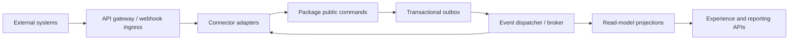

# Integration Architecture

## Objective

Enable Saudi enterprise ecosystems without turning connectors into direct dependencies between domain modules.

## Architecture



## Integration patterns

| Pattern | Use |
|---|---|
| Synchronous command/query | user-waiting validation or lookup |
| Webhook | trusted external event with signature and replay protection |
| Asynchronous event | cross-package propagation and external notifications |
| Scheduled pull | systems without event capability |
| Managed file exchange | regulator/legacy bulk import/export |
| Virtual/reference link | external authoritative data that should not be copied |

## API standard

- versioned REST resources and commands;
- OpenAPI as a release artifact;
- OAuth2/OIDC service identity or mTLS where appropriate;
- tenant resolved from trusted credential, never arbitrary header alone;
- idempotency key for external writes;
- correlation ID;
- RFC 7807 errors;
- pagination, filtering and stable external IDs;
- optimistic concurrency for update/decision;
- classification and rate-limit policy;
- deprecation and compatibility period.

## Event envelope

```json
{
  "eventId": "uuid",
  "eventType": "risk.rating-changed.v1",
  "occurredAt": "UTC timestamp",
  "organisationId": "trusted tenant reference",
  "aggregateType": "risk",
  "aggregateId": "stable external id",
  "aggregateVersion": 12,
  "correlationId": "uuid",
  "causationId": "uuid",
  "classification": "CONFIDENTIAL",
  "payload": {}
}
```

Events contain the minimum information consumers need. Sensitive content is retrieved through authorized APIs.

## Initial event catalogue

- `risk.identified.v1`
- `risk.rating-changed.v1`
- `risk.accepted.v1`
- `control.effectiveness-changed.v1`
- `evidence.approved.v1`
- `issue.raised.v1`
- `action.overdue.v1`
- `kri.threshold-breached.v1`
- `change.authorized.v1`
- `change.failed.v1`
- `incident.severity-changed.v1`
- `privacy.breach-confirmed.v1`
- `vendor.risk-tier-changed.v1`
- `bcm.plan-invoked.v1`
- `access.break-glass-activated.v1`
- `regulatory.instrument-updated.v1`
- `ai.model-suspended.v1`

## Connector families

| Family | Examples | Primary controls |
|---|---|---|
| Identity | Entra ID/AD, SAML/OIDC, SCIM, Nafath where applicable | identity assurance, provisioning, deprovisioning |
| Work/IT | ServiceNow, Jira, Azure DevOps, CI/CD | mapping, status authority, webhook replay |
| Security | SIEM, vulnerability, EDR, CSPM, threat intel | volume, source trust, deduplication, retention |
| Enterprise | ERP, HR, procurement, CMDB, document management | master ownership, privacy, reconciliation |
| Saudi/regulator | approved filing/exchange channels | legal authority, format/version, receipt |
| Communication | email, SMS, Teams | data leakage, template approval, delivery receipt |
| Analytics | lake/warehouse/BI | classification, masking, freshness, tenant scope |
| AI | model providers and private endpoints | residency, prompt/data controls, evaluation, audit |

## Connector isolation

Each adapter has:

- package owner and business purpose;
- credential stored in secrets manager;
- permitted data classes and geography;
- request/response schema;
- timeout, retry and circuit breaker;
- idempotency and deduplication;
- failure queue and replay;
- health metric;
- reconciliation report;
- disable switch;
- contract and sandbox tests.

Connector failures cannot poison the originating business transaction. External dispatch uses after-commit/outbox behaviour.

## Module-to-module integration

Cross-package integration uses the same public contracts as external integration. The fact that code runs in one JVM does not permit repository access.

Example: Privacy asks TPRM for processor profile through `PartyQuery`; it does not import `VendorRepository`.

## Regulatory submissions

The platform prepares, validates and records a submission package. Automated filing is enabled only where the authority supports it and the customer has approved credentials. Retain:

- form/content version;
- generated file hash;
- signatory and authority;
- dispatch time/channel;
- receipt/reference;
- rejection/correction history.

## Operations

Monitor latency, error rate, retry depth, dead letters, stale cursor, reconciliation difference and data-class violations. Alerting routes to the connector owner and affected package owner.

