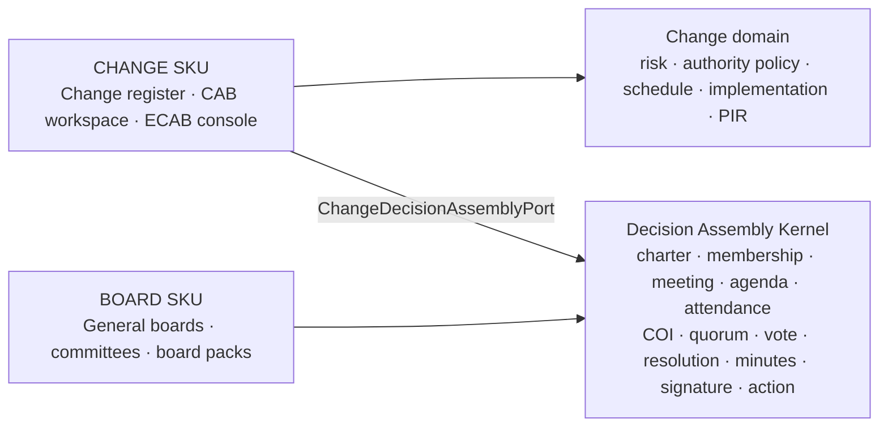
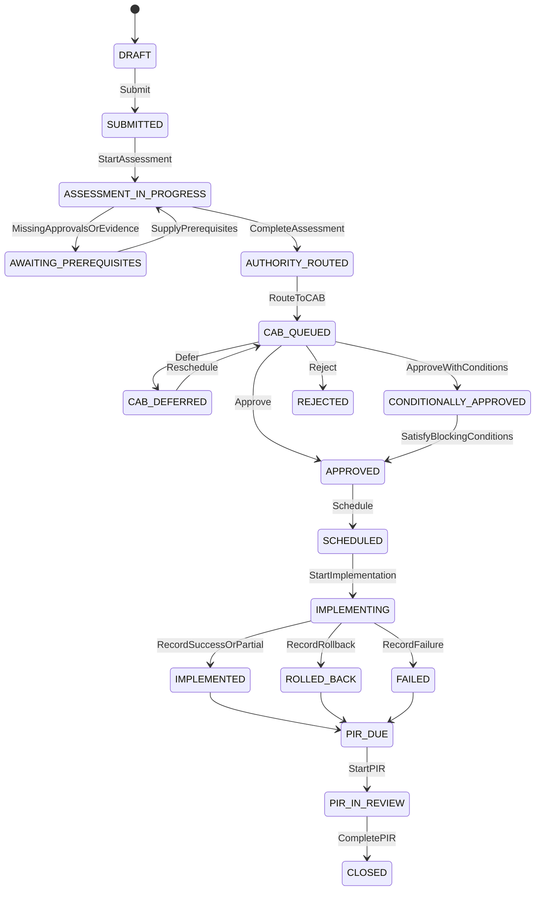
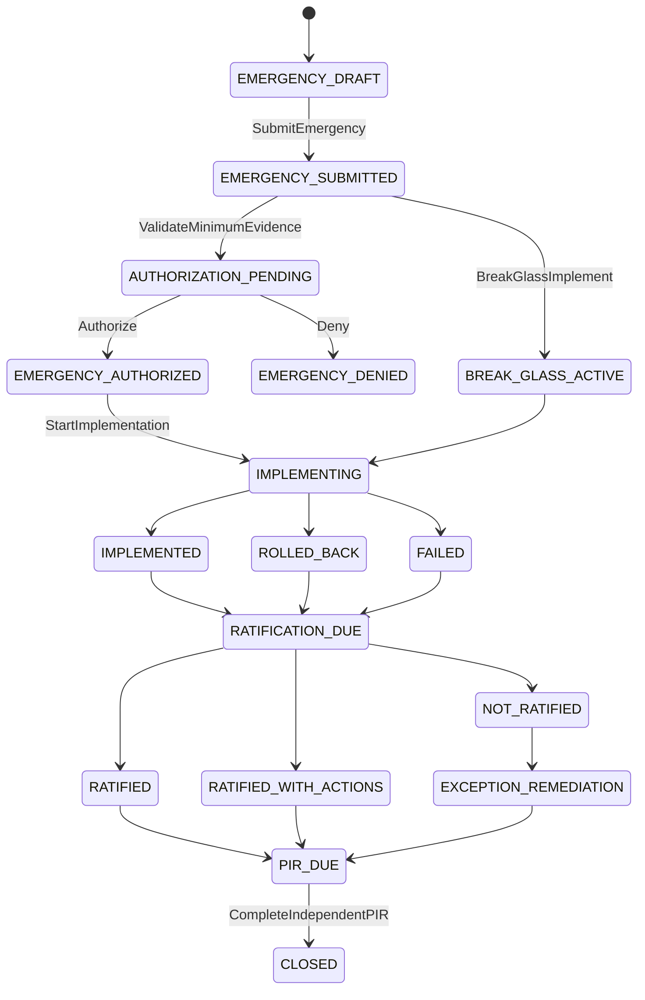

# Change Management — CAB, ECAB and ECAP Implementation Plan

**Document type:** Product, process, solution architecture and delivery plan  
**Status:** `TARGET` — implementation not yet authorised by this document  
**Baseline assessed:** 2026-07-31 source tree  
**Product SKU:** `CHANGE` — Change Governance & CAB  
**Primary users:** Change Manager, CAB Chair, CAB Secretary, CAB/ECAB members, Change Owner, Business Owner, Cybersecurity Approver, Implementer, PIR Reviewer, Auditor  
**Languages:** Arabic primary, English complete  

---

## 0. Disposition — reviewed, consulted, decided (2026-07-31)

> **This document is NOT adopted as the delivery plan. It is ratified as an amendment set.**
> The delivery backlog for this scope remains **`CHANGE_ENABLEMENT_MODULE_SEPARATION_AND_CAB_UPLIFT_PLAN.md`
> (CE-0…CE-16)**, sequenced by `UNIFIED_IMPLEMENTATION_PLAN.md` Wave 3 / S5–S8. The keepers listed
> in §0.4 are to be folded into that spec under its numbering; the items in §0.5 are dropped.
> Same treatment, and for the same reason, as the two superseded SKU catalogues under ADR-018:
> keep what is better, do not run two backlogs for one scope.

**Provenance.** Reviewed by a second model (Fable 5) against the working tree, with the
load-bearing claims re-verified independently before anything here was acted on. Where a claim
could not be verified, it says so — that distinction is the point of this section.

### 0.1 Why not adopted as written

**It re-derives a live programme under new vocabulary and does not cite it.** Verified: the CE spec
exists (55 KB, `CE-0`…`CE-16`, with its own §0 status ledger), and this document contains
**zero** occurrences of `CE-`, `ADR-017`, `UNIFIED_IMPLEMENTATION_PLAN` or `S5` across all 1,009
lines. Its §11.2 tables, §12.1 port, §10.2 workspace, §7.2 change models and §17 KPIs are CE §6,
CE-1, CE-13, CE-2 and CE-12 under different names and a competing `CAB-001…036` numbering. Two
backlogs for one scope is how the same table gets built twice.

**Its headline P0 is backwards.** §3 row 11 / §3.1 gap 1 say a `CHANGE`-licensed customer cannot
run CAB because committee endpoints are on `ADMIN:*`. Committee endpoints *are* on `ADMIN:*` — but
**V317 already granted** `ADMIN:READ` to 21 roles, `WRITE` to 3, `APPROVE` to 15, `EXPORT` to 7, so
committee operation is not admin-locked. And **no entitlement enforcement exists for either SKU**:
`LicensingService.KNOWN_MODULES` contains neither `CHANGE` nor `BOARD`, and `@RequireModule`
annotates only the 22 SOCOPS controllers — a fact already measured and ratified in ADR-018, whose
`SkuCatalogueRatchetTest` pins the scan population at 22 for exactly this reason. So nothing blocks
a Change-only tenant today; the live defect is **the inverse — `BOARD` ships free to every tenant**.
The plan would spend P0 effort enabling something that already works while the revenue leak stays
open. It also never engages **ADR-017 D-1**, which already ratified that a SKU code is not a
permission module and that committee authorisation stays on `ADMIN`.

### 0.2 What the review confirmed — the current-state assessment is unusually good

**10 of 12 §3 rows verified accurate against source**, with `file:line` evidence. Notably correct:
the advisory-only authorisation matrix (`ChangeAuthorisationMatrix` — "advisory" is in the field
comment), the reject/defer/conditional evidence asymmetry (approval requires a quorate committee
resolution; `CAB_REJECTED` requires only permission and notes), the absent ratification state and
SLA, item-level COI/quorum snapshots genuinely absent, and `change_mgmt` importing committee types
directly. This is a well-researched document and that is why it is worth mining rather than
discarding.

**Two rows are PARTIAL/mis-framed and both matter:** row 11 (above), and row 9 — the legacy-JSON
claim understates what already shipped (`attendeesJson` is already *refused* on write, quorum is
already structured and persisted, and many actor IDs are already captured by V316/V318). §7.4 also
treats recurring calendar generation and standing-item agendas as absent when both already ship
(`CommitteeCalendarService`), and §3.1 gap 8 misses that a consolidated per-change CAB pack PDF
already ships.

### 0.3 Dispositions by section

| § | Item | Disposition | Reason |
|---|---|---|---|
| 2 | Decision Assembly Kernel (CAB-002/003) | **DROP as re-architecture · ENHANCE as a port** | The kernel exists — 51 files, hardened by DF-3, F2-25/26/28/39/40, V315–V319/V322. ADR-013 already decided "CAB = profile over the committee engine via `CommitteePort`" (CE-1/S5). Re-platforming it reopens a dozen closed findings for zero control gain |
| 2, 4 | `CHANGE`/`BOARD` commercial independence | **IMPLEMENT the entitlement half** | Via F2-57 + `@RequireModule`. This is the true packaging P0, in the opposite direction to the plan's |
| 2, 12.2 | Named commands replacing `/transition` | **DEFER into S5** | Enforcement is live and pinned by `ChangeDecisionAuthorityTest`; the split is an API-shape change with FE churn. Do it once, inside the S5 restructure that rewrites the controller anyway |
| 5 | Emergency-authoriser independence, independent PIR assignment | **IMPLEMENT** | Closes the one real residual: `requireDecisionAuthority` checks the permission and never the requester's identity, so a raiser holding `CHANGE:APPROVE` can still authorise their own emergency |
| 6 | Charter field list, member capacities, delegates | **ENHANCE into CE-3** | Better checklist than CE's; fold it in. Capacities are the prerequisite for composition enforcement |
| 6.3 | 24×7 on-call rota with acknowledgement escalation | **DEFER** | ServiceNow-scale ITSM plumbing. Saudi mid-market ECABs run on phones; notification + acknowledgement tracking suffices |
| 7.2 | Standard/pre-approved change models | **IMPLEMENT** | = CE-2. Note the current `STANDARD` type is *not* actually pre-approved — it follows the same transition map |
| 7.3 | ECAP authorise → implement → ratify separation | **IMPLEMENT** | = CE-6 + D-3. The biggest control gap a SAMA reviewer would find |
| 8.1 | Wholesale state renaming | **DROP** | Breaks FE literals, F8 triggers, analytics buckets, V300 CHECK constraints and audit-history continuity. The three genuinely new states (`CAB_DEFERRED`, `MORE_INFO_REQUIRED`, `PENDING_RATIFICATION`) deliver all the value |
| 8.3 | 9-state lifecycle on the shared meeting engine | **DROP as specified** | The engine serves other referrers; CE-4 gets the same phases from CAB-side tables without touching engine literals |
| 9.1–9.3 | Enforced decision composition | **IMPLEMENT** | = S6. Replace the advisory CSV with structured required-capacity rows evaluated server-side |
| 9.2 | Item-level COI / eligibility / quorum snapshots | **IMPLEMENT — the plan's best original idea** | But it must inherit the shipped engine's floor arithmetic; as written it is unsound (§0.6 defect 1) |
| 9.3 | Veto / supermajority / chair casting-vote algebra | **DEFER** | No Saudi buyer requirement, and not in the comparator's CAB product either |
| 9.4 | Conditional approval + conditions register | **IMPLEMENT** | = CE-5, with schedule/start gates |
| 10.2 | CAB workspace | **IMPLEMENT** | = CE-13, already sequenced |
| 10.3 | ECAB console | **IMPLEMENT-lite** | A responsive queue page, not the XL parallel product the plan sizes |
| 10.5 | Hijri (Umm al-Qura) display | **IMPLEMENT** | Cheap, real differentiator |
| 11.2 | Eligibility/quorum snapshot tables, `committee_pack_version` | **IMPLEMENT** | Genuinely new; the rest of §11.2 is CE §6 renamed |
| 11.4, 12.3 | Outbox + idempotency-key subsystem | **DROP** | The platform's eventing discipline is `afterCommit` + per-call `REQUIRES_NEW`, and concurrency is ROWVERSION. A second eventing regime for one module is drift |
| 12.3 | 15-endpoint change-scoped committee façade | **PARTIAL** | Build only what CE-13's workspace consumes; a full mirror doubles the guard surface — the exact drift CAB-ADR-02 warns about |
| 13 | CMDB / deployment-gate adapters | **DEFER** | ADR-017 D-4: compete on governance, not pipelines |
| 14.1 | Permission model | **IMPLEMENT via CE-15** | Finer-grained than the plan's two additions. ⚠ `CHANGE:TRIAGE` does not exist (§0.6 defect 2) |
| 14.2 | Threat table | **ADOPT as the test checklist** | 7 of its 12 rows are already closed. The two worth building: content-digest binding of change edits after pack issue, and an effective-date rule on membership changes |
| 15.1 | SAMA FI profile gate list | **IMPLEMENT** | Sound and correctly scoped; see §0.5 on the control number |
| 15.2 | NCA profile | **PARTIAL** | As written it is a paragraph of intent with no control numbers — not yet buildable. Make it real mappings in the content pack |
| 20.2 | Fifteen live acceptance scenarios | **ADOPT WHOLESALE into CE §16** | Two-principal probes with 409s as success. Exactly house practice |
| 35 | Historical `agenda_json` parse-and-reconcile | **DEFER** | Keep legacy JSON as read-only evidence; stop-writing is largely done |
| 36 | AI-drafted minutes at launch | **DEFER to P2** | AI-drafted content under an e-signature whose hash attests the minutes body is a hard conversation with a reviewer |

### 0.4 Recommended build order (ranked)

1. **(M) Wire real entitlement for `CHANGE` and `BOARD`** — F2-57 + `@RequireModule`, and write the
   reconciliation ADR this plan's §26 and the SKU catalogue both call for. `BOARD` is currently free
   to every tenant.
2. **(L) Complete ECAP** — `PENDING_RATIFICATION`, a ratification record, an SLA with escalation,
   auto-referral of implemented emergencies in `RATIFICATION` mode, and emergency-authoriser
   independence.
3. **(M) Enforced decision composition + the SAMA FI profile** — required capacities evaluated
   server-side, with Business Owner and Cybersecurity-before-CAB as prerequisites. Cheapest item
   with the highest demo value for the FI segment.
4. **(L) Decision-outcome parity** — `CAB_DEFERRED`, `MORE_INFO_REQUIRED`,
   `APPROVED_WITH_CONDITIONS`, a conditions register, and `CAB_REJECTED` of a referred change
   requiring the committee's REJECTED resolution the way approval already requires APPROVED.
5. **(L) CAB workspace (CE-13)** with agenda auto-placement and the item-level quorum snapshot, so a
   recusal visibly changes one item's arithmetic rather than the whole meeting's.

### 0.5 Regulatory findings — including one against our own ratified catalogue

⚠ **External verification was unavailable.** Both the reviewing model's web tools and my own
`WebFetch` fail in this environment with a backend model error, so every control-number claim below
rests on domain knowledge plus in-repo cross-evidence and **must be confirmed by the Saudi GRC owner
against the rulebook text** before it reaches a customer-facing artefact. §20.4 already requires
that gate; this is that gate firing.

- 🔴 **`SKU_CATALOGUE.md` row 15's regulator anchors for `CHANGE` are conflicted, and the catalogue
  is the ratified sales authority.** It reads "NCA ECC 2-7 change management; SAMA CSF **3.3.9**".
  This plan's own citation is
  `rulebook.sama.gov.sa/en/337-change-management-0` — slug `337`, i.e. **3.3.7** — and its §15.1
  prose says 3.3.7. Two documents in the same repository disagree, and only one of them carries a
  URL. In CSF 1.0, 3.3.9 is understood to be Cryptography, and NCA ECC-1 2-7 to be Data &
  Information Protection (change control sitting in the governance domain, 1-6). **Action:** the
  catalogue's anchor is marked **UNVERIFIED-CONFLICTED** pending owner confirmation rather than
  silently swapped — substituting one unverifiable number for another is not a correction. Amendment
  goes through ADR-018 R5 (named regulator + comparator).
- **§15.1's requirement list is plausible and correctly scoped**, and its disclaimer — provide
  evidence, never claim that installing software makes a customer compliant — is exactly right and
  should be kept verbatim.
- **Omissions a Saudi FI buyer would expect:** SAMA outsourcing/cloud rules (vendor-executed changes
  and workload moves need the institution's own approval evidence); a defined CMA-listed profile
  (§6.2 offers it as a charter option, §15 never defines it); NCA **CSCC** for government critical
  systems, which is stricter than ECC and is unmentioned in the government profile.
- **Arabic/RTL handling is strong** and consistent with the platform mandate. Specify **Umm al-Qura**
  explicitly for Hijri.

### 0.6 Internal defects in this plan

1. 🔴 **The item-level quorum formula is unsound at the small-committee edge.**
   `required = ceiling(eligible × pct)` with recusals removed from the denominator has no floor and
   no all-recused rule: a two-seat committee with both members recused gives denominator 0 →
   required 0 → "present ≥ 0" → **quorum vacuously met with zero eligible voters**. The shipped
   engine already solved this (`max(1, ceil(...))` plus a `totalVoting > 0` condition). Any per-item
   formula must inherit both, and add an explicit escalation path for "everyone is conflicted".
2. 🔴 **§14.1 says "retain existing `CHANGE:…TRIAGE`" — `CHANGE:TRIAGE` does not exist.** V301
   catalogued READ/WRITE/APPROVE/DELETE/EXPORT only, and there are zero
   `hasPermission('CHANGE','TRIAGE')` guards in the tree, yet §12.2 hangs three endpoints on it. It
   must be "catalogue + grant + guard in one migration" — the F2-23 rule — not "retain".
3. **Unreachable and stuck states.** `CONDITIONALLY_APPROVED` has one exit and no path for failed,
   expired or waiver-refused conditions; the §8.1 diagram omits the cancellation edges its own prose
   promises; `CAB_DEFERRED ↔ CAB_QUEUED` can live-lock without the SLA the text implies;
   `EMERGENCY_DENIED` is terminal with no convert-to-normal edge; `BREAK_GLASS_ACTIVE` is reachable
   only from `EMERGENCY_SUBMITTED`, leaving deny-then-break-glass undefined.
4. **Unreconciled with ratified decisions** — ADR-017 D-1, D-2 (the fail-closed gate map, already
   implemented) and D-3 (ratification-SLA amendments: interim escalation, bounded per-tenant
   override, grandfathering the one existing un-ratified EMERGENCY row) are re-specified without
   their ratified constraints.
5. **Roadmap arithmetic.** §18's P0 set at the plan's own day-ranges midpoints near 220–240
   engineering days before integrated acceptance, while §19 has P0 exiting around week 8 of a 16–20
   week programme. Only plausible with large parallel squads and nothing else in flight — say so.
6. **Small contradictions.** §6.1 seats accountable owners on the deciding body while §6.3 says
   non-term-holders never vote; §1 declares a canonical code `EMERGENCY_APPROVAL_PROCESS` that no
   state machine or table then uses; §11.5 defers migration numbers to a ledger that is itself stale
   — **V332 is taken (`V332__board_export_permission.sql`), V333 is taken
   (`V333__regulatory_export_viewer_revoke.sql`), next free is V334.**

### 0.7 Owner questions that change what gets built

1. **Which document governs?** Recommended and applied above: CE keeps the numbering and the §0
   ledger; this becomes the amendment set. Confirm or reverse.
2. **Packaging:** does a `CHANGE`-only tenant get purpose-scoped committee mechanics without buying
   `BOARD` — and if so, is `BOARD` still defensible on general committees plus board packs alone?
   This decides how `@RequireModule` is wired and amends the ratified catalogue.
3. **Break-glass:** is a distinct implement-without-prior-authorisation act required for the launch
   sectors, or does ECAB authorisation plus mandatory ratification satisfy the emergency-procedure
   expectation?
4. **Item-level quorum semantics:** do recusals shrink the item's quorum denominator (this plan) or
   only voting eligibility (the current engine)? Includes who decides an item when everyone is
   conflicted.
5. **Ratification SLA and consequence:** D-3's 5 business days with a bounded override, or this
   plan's "next CAB or configured hours"? And must `NOT_RATIFIED` auto-raise a CAPA — which requires
   adding the new `source_type` to `ck_ca_source` or inserts 500.
6. **Launch sector order (SAMA FI vs NCA government)** — decides whether §15.2 must become real ECC
   mappings now, and whether CSCC belongs in the government profile.

---

## 1. Terminology and intent

The request used **ECAP**. This plan deliberately distinguishes two related concepts:

- **CAB** — Change Advisory Board, the standing normal-change decision forum.
- **ECAB** — Emergency Change Advisory Board, the smaller on-call decision authority for urgent changes.
- **ECAP** — Emergency Change Approval Process, the complete emergency workflow: justification, independent authorisation, implementation, evidence, ECAB ratification, PIR and corrective action.

If a customer uses “ECAP” as the name of its emergency committee, the display label may be configured without changing the canonical domain codes `ECAB` and `EMERGENCY_APPROVAL_PROCESS`.

This plan creates a marketable Saudi change-governance product, not merely a meeting calendar. A decision is valid only when the platform can prove the authority, membership, quorum, conflict-of-interest treatment, vote, conditions, minutes, signature and resulting change transition.

---

## 2. Executive decision

### 2.1 Recommended product shape

`CHANGE` must be independently sellable and must include everything needed to operate CAB, ECAB and ECAP. It must **not** require the customer to buy the separate `BOARD` SKU.

The implementation shall use one internal **Decision Assembly Kernel** for committee mechanics and two separately entitled product surfaces:



The kernel is internal platform plumbing, not a free customer-facing committee product. `CHANGE` may use it only for resources whose purpose is `CHANGE_CAB` or `CHANGE_ECAB`; `BOARD` unlocks general-purpose committee administration and board packs.

### 2.2 Decisions

| ID | Decision | Rationale |
|---|---|---|
| CAB-ADR-01 | Keep `CHANGE` and `BOARD` commercially independent | A buyer must be able to operate change governance without buying general board governance |
| CAB-ADR-02 | Extract reusable committee mechanics into a Decision Assembly Kernel | One authoritative implementation prevents divergent quorum, voting and signing logic |
| CAB-ADR-03 | Change owns its policy, routing, emergency authorisation and referral state | The committee engine must not decide the change lifecycle or interpret change risk |
| CAB-ADR-04 | Use named commands, not caller-selected target states, for high-consequence transitions | The URL, permission and audit event must disclose the business act |
| CAB-ADR-05 | The meeting resolution is the decision system of record for referred changes | A status value or free-text note is not evidence of a valid CAB decision |
| CAB-ADR-06 | ECAP separates pre-implementation emergency authorisation from post-implementation ECAB ratification | Ratification cannot be misrepresented as prior approval; non-ratification produces an exception and CAPA, not historical erasure |
| CAB-ADR-07 | Quorum is calculated per agenda item where recusals affect eligibility | Meeting-level quorum alone is insufficient when a member is conflicted on one change |
| CAB-ADR-08 | Canonical governance records are structured; JSON/CSV fields become legacy read-only snapshots | Search, validation, evidence, analytics and tenant-safe joins require first-class records |
| CAB-ADR-09 | Standard changes are approved models, not arbitrary low-risk changes | A deviation from the approved model routes to the normal-change process |
| CAB-ADR-10 | Regulatory profiles configure mandatory gates but never weaken core SoD | Saudi financial-sector requirements differ from general enterprise policy |

### 2.3 Rejected options

| Option | Decision | Why |
|---|---|---|
| Duplicate committee tables and services under `change_mgmt` | `REJECTED` | Creates two membership, quorum, vote, minutes and signature implementations with inevitable control drift |
| Make `BOARD` a prerequisite for `CHANGE` | `REJECTED` | Violates the ratified standalone SKU model and weakens sales flexibility |
| Treat every change as a CAB agenda item | `REJECTED` | Turns CAB into a bottleneck; standard models and delegated change authorities are safer and faster |
| Let emergency type mean automatic approval | `REJECTED` | Urgency changes the authority and SLA, not the need for independent authorisation and evidence |
| Use email approval as the authoritative record | `REJECTED` | Identity, terms, quorum, conditions and immutable evidence cannot be reliably enforced |
| Let the secretary set quorum or final tallies | `REJECTED` | Both must be derived from eligible seats, attendance, recusals and authenticated votes |

---

## 3. Current-state assessment

The labels below follow the Platform Bible evidence standard. No live runtime probe was performed for this planning document.

| Area | Evidence-backed current state | Assessment |
|---|---|---|
| Change lifecycle | `VERIFIED (source)` — normal change has `DRAFT → SUBMITTED → IMPACT_ASSESSED → CAB_PENDING → CAB_APPROVED/REJECTED`; emergency can move `DRAFT → EMERGENCY_APPROVED` | Useful base, but emergency approval and ratification are conflated/missing |
| Decision authority | `VERIFIED (source)` — decision targets now require `CHANGE:APPROVE`; direct CAB votes are stamped from the authenticated user | Material security improvement already shipped |
| CAB approval evidence | `VERIFIED (source)` — normal approval requires direct votes or an approved committee resolution on computed-quorum, approved minutes | Strong foundation, but rejection/defer/conditional outcomes are not equivalently bound end to end |
| Committee referral | `VERIFIED (source)` — change can be referred as `CAB` or `ECAB`; emergencies use referral mode `RATIFICATION` | Link exists; there is no complete ECAP state machine or SLA enforcement |
| Authority matrix | `VERIFIED (source)` — tenant/type/risk matrix defines `AUTO/CAB/ECAB`, minimum approvals and advisory `requiredRoles` CSV | Required composition is displayed but not enforced as structured policy |
| Meetings | `VERIFIED (source)` — committees, member terms, attendance, computed quorum, resolutions, votes, minutes approval, e-signature, papers and actions exist | Reusable capability is substantial |
| Meeting lifecycle | `VERIFIED (source)` — current states are `SCHEDULED → IN_PROGRESS → COMPLETED → MINUTES_APPROVED` | Too coarse for agenda cut-off, pack issue, minutes review, signing and closure |
| Quorum | `VERIFIED (source)` — denominator comes from active voting roster and attendance is structured; attendance recorder cannot approve the same minutes | Strong meeting-level control; item-level recusal/quorum is still needed |
| Data model | `VERIFIED (source)` — `members_json`, `agenda_json`, `decisions_json`, `action_items_json`, name fields and CSV recusals/roles remain | These cannot remain canonical for regulated decisions |
| API boundary | `VERIFIED (source)` — `change_mgmt` directly imports committee entity/service types | Violates the target port boundary and makes independent evolution harder |
| Entitlement/permissions | `VERIFIED (source)` — committee execution endpoints use `ADMIN:*`, while the product catalogue sells `CHANGE` and `BOARD` separately | **P0 standalone-sale blocker** for a Change-only tenant |
| UX | `VERIFIED (source)` — Change has register, governance matrix, freeze windows, calendar and per-record referral; Committees has separate meeting/resolution screens | Capabilities are fragmented; there is no task-centred CAB workbench or ECAB console |

### 3.1 Critical gaps to close

1. A `CHANGE`-licensed customer cannot be forced through `ADMIN`/`BOARD` permissions to run CAB.
2. Emergency authorisation, implementation and later ratification are not distinct auditable acts.
3. A referred change needs automatic agenda placement and resolution binding; manual linking is error-prone.
4. `CAB_REJECTED`, `DEFERRED` and `APPROVED_WITH_CONDITIONS` need the same evidence quality as approval.
5. Required voter composition is advisory text, not an enforceable rule.
6. The platform needs item-level COI, eligibility and quorum snapshots.
7. The current UI makes users navigate between Change and generic Committees to finish one job.
8. Meeting packs, agenda cut-offs, late papers, minutes review and signatures need explicit states and SLAs.
9. The generic `/transition` endpoint hides business authority from static security review.
10. The product needs operational KPIs, regulatory evidence exports and acceptance tests before Saudi launch.

---

## 4. Product scope and packaging

### 4.1 Included in the `CHANGE` SKU

- Standard, normal and emergency change models.
- Change risk, impact, collision, freeze and maintenance-window governance.
- Change authority rules by tenant, regulatory profile, service, risk, type and materiality.
- CAB and ECAB definitions restricted to change-governance purpose.
- Recurring CAB calendar and ad hoc ECAB meetings.
- Membership, terms, delegates, skills, on-call rotations and scoped voting rights.
- Agenda intake, validation, ordering, pack generation, late-item handling and presenter workflow.
- Attendance, apologies, COI, recusal, item-level quorum and authenticated voting.
- Decisions: approve, approve with conditions, reject, defer, request information, withdraw.
- ECAP: emergency justification, independent authorisation, break-glass evidence, ECAB ratification and exception/CAPA handling.
- Scheduling, implementation, rollback, outcome, PIR and closure.
- Minutes review, signature, decision notices, action tracking and regulatory evidence bundles.
- Change-specific dashboards, reports, audit trail and APIs.

### 4.2 Reserved for the `BOARD` SKU

- General-purpose corporate committees unrelated to change.
- Corporate board portal, director books and enterprise board-pack catalogue.
- Board evaluations, board-level governance templates and cross-committee reporting.
- Unlimited committee types and non-change referral sources.

### 4.3 Entitlement rule

The Change façade shall enforce both:

```text
tenant holds CHANGE
AND resource.purpose_code IN (CHANGE_CAB, CHANGE_ECAB)
```

The Board façade shall enforce `tenant holds BOARD`. Internal kernel calls do not bypass tenant or resource-purpose policy. A user with `CHANGE:APPROVE` does not gain access to unrelated board meetings.

---

## 5. Personas, responsibilities and segregation of duties

| Persona | Responsibilities | Must not do |
|---|---|---|
| Change Requester | Raise and clarify request; supply business justification and evidence | Authorise or vote on own change |
| Change Owner | Own completeness, coordination, conditions and outcome | Be sole final authority for own change |
| Change Manager | Triage, classify, route, chair/coordinate process, schedule after valid authority | Override vote/quorum evidence or back-date a decision |
| Business Owner | Confirm value, business impact, downtime and acceptance | Substitute for cybersecurity approval where required |
| Cybersecurity Approver | Assess security requirements/testing and approve before CAB under SAMA profile | Approve own implementation work without an independent reviewer |
| CAB Chair | Open/close items, manage discussion, declare outcome derived by the system | Edit votes, manufacture quorum or approve minutes they authored where SoD applies |
| CAB Secretary | Prepare agenda/pack, record attendance, minutes and actions | Vote on behalf silently or sign the attendance-derived minutes they alone recorded |
| CAB Voting Member | Review pack, declare COI, vote within active term/capacity | Vote outside term, twice, or while recused |
| ECAB On-call Member | Provide rapid decision in assigned emergency discipline | Convert urgency into automatic approval |
| Implementer | Execute approved plan, record evidence and rollback/outcome | Start before valid authorisation except controlled break-glass |
| PIR Reviewer | Independently assess success, control impact and lessons | Review a high-risk change they requested, approved or implemented |
| Auditor/Observer | Read evidence and export traceability | Change records or participate in tally unless separately appointed |

### 5.1 Minimum SoD rules

- Requester and implementer cannot cast the deciding vote on their change.
- Requester, owner and implementer may present but are automatically non-voting for that agenda item.
- Attendance recorder cannot approve/sign the same meeting minutes.
- For high/critical changes, PIR reviewer must be independent of requester, implementer and final authoriser.
- Emergency authoriser must be independent of requester/implementer unless a documented break-glass policy permits immediate action; that exception must trigger mandatory ratification and review.
- On-behalf votes require an active delegation, actor identity, represented member identity, reason and visible `ON_BEHALF` marker.
- A platform administrator bypass must never count as committee membership or voting eligibility.

---

## 6. Committee and charter design

### 6.1 Board types

| Board | Purpose | Typical cadence | Membership model | Decision timing |
|---|---|---|---|---|
| CAB | Normal/material changes, forward schedule and PIR exceptions | Weekly; configurable | Standing terms plus approved delegates and invited specialists | Before scheduling/implementation |
| ECAB | Emergency authorisation and/or rapid consultation | On demand, 24×7 on-call | Small rota with required business, technical and cyber capacities | Before implementation where feasible |
| ECAB Ratification Session | Review emergency actions, validate exception and order CAPA | Next CAB or dedicated session within SLA | ECAB plus accountable owners/reviewer | After implementation; never presented as prior approval |

### 6.2 Mandatory charter fields

Each CAB/ECAB charter shall be bilingual and versioned:

- legal name, code, purpose and scope;
- services, locations, environments and change classes covered;
- authority delegated by whom and effective dates;
- chair, deputy chair, secretary and alternates by user/seat, not name only;
- voting seats, required capacities and term dates;
- delegate rules and on-call rotation rules;
- quorum formula and rounding method;
- item-level COI and recusal policy;
- decision outcomes and whether chair casting vote is permitted;
- evidence, pack, agenda cut-off and late-item policy;
- normal, emergency and ratification SLAs;
- conditional approval and condition-expiry rules;
- minutes review, signature and retention rules;
- confidentiality/data classification;
- escalation and appeal/reconsideration path;
- annual review date, approving authority and formation resolution;
- regulatory profile: General, Government/NCA, SAMA Financial Institution, CMA Listed, or custom.

### 6.3 Membership and eligibility

- Member terms are the canonical roster; legacy `members_json` is display-only until retired.
- Each seat has `capacity_code`, voting flag, term start/end, substitute rules and required skills.
- Eligibility is evaluated at agenda-item voting close, using an immutable snapshot.
- Guests and presenters never vote unless they also hold an eligible term.
- Membership expiry, suspension or delegation expiry removes voting eligibility automatically.
- ECAB rota must show current primary, backup, acknowledgement status and escalation contact.

---

## 7. End-to-end business processes

### 7.1 Normal change and CAB

1. Requester creates a bilingual change and supplies service/CI, business reason, impact, implementation, test and rollback plans.
2. System validates required fields and calculates an explainable risk/materiality recommendation.
3. Change Manager confirms classification; the server resolves a versioned authority rule.
4. Required pre-CAB approvals are collected, including Business Owner and Cybersecurity where the regulatory profile requires them.
5. System creates a change-governance referral and agenda candidate; no manual re-keying.
6. Secretary validates readiness. Incomplete items return to the owner with named deficiencies.
7. Agenda engine proposes the next eligible meeting based on cut-off, priority, capacity, freeze/collision and SLA.
8. Chair/Secretary publishes the agenda and pack; the pack version is hashed and receipt status tracked.
9. Members declare COI, review the change and submit questions before the meeting.
10. At the meeting, attendance and item-specific recusals create the eligible denominator and quorum snapshot.
11. Authenticated members vote. The system derives the tally and checks required capacity composition.
12. Chair closes the item; the system creates the resolution and one outcome:
    - `APPROVED`;
    - `APPROVED_WITH_CONDITIONS`;
    - `REJECTED`;
    - `DEFERRED`;
    - `MORE_INFORMATION_REQUIRED`.
13. A valid resolution drives the corresponding named change command. No user manually selects `CAB_APPROVED`.
14. Conditional approval blocks scheduling until blocking conditions are satisfied and verified.
15. Approved change is scheduled after collision/freeze validation, implemented and assigned a recorded outcome.
16. Required PIR is performed; failures, unauthorised deviation or unmet conditions trigger incident/CAPA/escalation.
17. Change closes only when required PIR/actions/evidence are complete.

### 7.2 Standard change

1. A Standard Change Model is proposed with scope, steps, test, rollback, risk limits, evidence and expiry.
2. CAB approves the **model version**, not every execution.
3. A request matching the active model and all constraints is authorised through that model.
4. Any material deviation, expired model, failed recent execution or threshold breach automatically converts the request to normal change.
5. Model performance is reviewed on cadence; repeated failures suspend the model and create a CAB agenda item.

### 7.3 ECAP — emergency change

1. Requester selects emergency reason: active major incident, critical vulnerability, regulatory deadline, safety, severe service loss, or approved custom reason.
2. System requires incident/vulnerability/regulatory linkage where applicable and records why normal lead time is impossible.
3. Minimum evidence gate validates impact, implementation, test-as-feasible and rollback/fallback.
4. ECAB/on-call routing selects required capacities from the active policy and rota.
5. An independent emergency authoriser records `AUTHORISE`, `AUTHORISE_WITH_CONDITIONS` or `DENY` using a named command.
6. Where delay would create greater harm, a tightly configured `BREAK_GLASS_IMPLEMENT` command may proceed with reason, incident link and accountable actor. It never creates a false prior approval.
7. Implementation evidence and actual outcome are captured immediately.
8. System opens `RATIFICATION_DUE` with a policy SLA, normally at the next CAB or within a configured number of hours.
9. ECAB/CAB reviews necessity, decision quality, testing, deviation, outcome, security impact and whether the emergency classification was abused.
10. Ratification outcomes are:
    - `RATIFIED`;
    - `RATIFIED_WITH_ACTIONS`;
    - `NOT_RATIFIED`;
    - `ESCALATED_FOR_INVESTIGATION`.
11. `NOT_RATIFIED` does not rewrite history. It creates a governance exception, CAPA, potential unauthorised-change record and management escalation.
12. PIR and all mandatory actions complete before closure.

### 7.4 Meeting management

#### Before the meeting

- Generate recurring occurrences from the charter calendar.
- Auto-populate standing items: previous actions, deferred changes, emergency ratifications, failed changes and upcoming freeze/forward schedule.
- Accept agenda candidates until cut-off; flag late items with a reason and chair approval.
- Validate every change against a readiness checklist.
- Assign presenter, time box, decision type and confidentiality.
- Build bilingual pack from authoritative records; hash each paper and the pack manifest.
- Notify members/delegates and track acknowledgement/read receipt.
- Collect pre-reading questions and preliminary COI declarations.

#### During the meeting

- Start only with identified chair and secretary.
- Record joining/leaving times, apologies, delegation and guest attendance.
- Recompute eligibility and quorum for every item after recusals or attendance changes.
- Present the change summary, risk, collision, security/business approvals, implementation/rollback and questions in one screen.
- Open and close voting explicitly; prevent duplicate/late/ineligible votes.
- Derive the tally; do not accept caller-supplied totals.
- Record conditions with owner, due date, blocking flag and verification method.
- Create resolution and action items directly from the item.

#### After the meeting

- Generate bilingual minutes draft from structured facts, with human review.
- Route minutes to chair/reviewer; preserve every version and comment.
- Sign the final minutes and bind signature to content digest, attendance/quorum snapshots, resolutions and pack manifest.
- Deliver decision notice to each change owner.
- Roll deferred items and open actions to the next eligible agenda.
- Track conditions, actions, ratification and PIR to closure.

---

## 8. Target state machines

### 8.1 Normal change



Cancellation and withdrawal are separate commands with policy-dependent legal source states. Rejected changes may be cloned/reworked into a new version; the rejected decision remains immutable.

### 8.2 Emergency change / ECAP



### 8.3 Meeting

```text
DRAFT → AGENDA_OPEN → PACK_ISSUED → IN_SESSION → MINUTES_DRAFT
      → MINUTES_REVIEW → APPROVED → SIGNED → CLOSED
```

- `CANCELLED` is allowed before `IN_SESSION` with reason and notices.
- Pack amendments after `PACK_ISSUED` create a new version and visible late-change record.
- No agenda item can be decided outside `IN_SESSION` except an explicitly recorded asynchronous ECAB decision governed by the same eligibility/vote rules.

### 8.4 Agenda item, resolution and action

| Aggregate | States |
|---|---|
| Agenda item | `PROPOSED → VALIDATING → READY → SCHEDULED → PRESENTED → VOTING → DECIDED`; alternate `RETURNED`, `DEFERRED`, `WITHDRAWN` |
| Resolution | `DRAFT → VOTING_OPEN → VOTING_CLOSED → TALLIED → CARRIED/LOST/DEFERRED → BOUND_TO_MINUTES → EFFECTIVE` |
| Condition | `OPEN → SUBMITTED_FOR_VERIFICATION → SATISFIED`; alternate `REJECTED`, `WAIVED_WITH_AUTHORITY`, `OVERDUE` |
| Action | `OPEN → IN_PROGRESS → BLOCKED → DONE → VERIFIED`; alternate `CANCELLED_WITH_REASON` |

---

## 9. Decision and quorum rules

### 9.1 Authority policy resolution

The server resolves one immutable policy version from:

```text
tenant + regulatory profile + change type + risk + materiality
+ environment + critical service + data classification + security impact
```

The client may display a recommendation but cannot choose a weaker gate.

### 9.2 Quorum

For each agenda item:

```text
eligible denominator = active voting seats at item start
                     - valid item recusals
                     - suspended seats

required = ceiling(eligible denominator × charter quorum percentage)
quorum met = eligible present voting seats >= required
```

The snapshot stores the rule version, seats, present members, recusals, delegates, numerator, denominator, required count and timestamp. A later roster change cannot alter history.

### 9.3 Decision composition

Minimum vote count alone is insufficient. A policy may require:

- one Business Owner approval;
- one Cybersecurity approval;
- one Service/Technical Owner approval;
- a majority or supermajority;
- zero vetoes from designated control functions;
- specific quorum for critical services;
- chair casting vote only if charter explicitly permits it.

`requiredRoles` CSV shall be replaced by structured required-capacity rows and evaluated by the server.

### 9.4 Conditional approval

Each condition has bilingual text, owner ID, due date, blocking flag, verifier capacity, evidence requirement and status. Blocking conditions prevent scheduling; non-blocking conditions create monitored obligations. Waiver requires a separate named authority and reason.

---

## 10. UX architecture

### 10.1 Change workspace navigation

```text
Change Management / إدارة التغيير
├── Command Center / مركز القيادة
├── Change Register / سجل التغييرات
├── Change Calendar / تقويم التغييرات
├── CAB Workspace / مساحة لجنة التغيير
├── ECAB & Emergencies / اللجنة الطارئة والتغييرات الطارئة
├── Standard Models / نماذج التغيير القياسي
├── PIR & Actions / مراجعات ما بعد التنفيذ والإجراءات
├── Analytics / التحليلات
└── Governance Settings / إعدادات الحوكمة
```

General board-governance navigation must not appear unless `BOARD` is licensed.

### 10.2 CAB Workspace

The default screen is a task-centred weekly workspace:

- left: meetings/calendar and SLA indicators;
- centre: agenda ordered by readiness, decision urgency and time box;
- right: quorum, members, acknowledgements and pack status;
- meeting mode: one change at a time with summary, risk, approvals, collisions, plan, rollback, evidence, questions, COI, vote and conditions;
- persistent banner: meeting state, current item, item quorum and decision authority;
- keyboard-accessible voting and chair controls;
- one-click deep links between change, agenda item, resolution, minutes and actions.

### 10.3 ECAB Console

- mobile-responsive, low-latency view suitable for on-call use;
- severity, incident/service impact and time remaining above the fold;
- “why this is emergency” and “harm of waiting” shown separately;
- minimum evidence checklist with explicit gaps;
- current on-call capacities and acknowledgement status;
- authorise/deny/condition controls requiring reason;
- prominent warning that authorisation is not ratification;
- ratification queue, SLA countdown and overdue escalation.

### 10.4 Change detail governance rail

Every change shows:

1. classification and resolved policy version;
2. missing prerequisites;
3. board/meeting/agenda placement;
4. member COI and item quorum status;
5. resolution and conditions;
6. schedule/implementation status;
7. ECAP ratification, PIR and open actions;
8. complete evidence timeline.

### 10.5 Arabic and accessibility

- Arabic is authored content, not machine-translated evidence; `*_ar` and `*_en` are mandatory for charters, decisions, conditions and notices.
- Full RTL layout, mirrored stepper/arrows, correct Hijri/Gregorian display policy and Asia/Riyadh defaults.
- Arabic search normalises alef/hamza and supports Arabic-Indic digits without altering stored evidence.
- WCAG 2.2 AA target: keyboard meeting operation, focus order, screen-reader decision summaries, non-colour status cues and 200% zoom.
- Vote confirmation reads the exact decision and change code in the active language.
- Destructive/irreversible actions use a confirmation dialog and server-provided consequences.

### 10.6 UX truth rules

- Never show “approved” before the authoritative resolution is effective.
- Never call an ECAB ratification a prior approval.
- Never show quorum without its numerator/denominator and source.
- Never show required roles as satisfied unless the server evaluated them.
- Never silently fall back from committee routing to direct votes.
- A disabled action explains the missing authority, evidence, state or entitlement.

---

## 11. Data architecture

### 11.1 Ownership

| Owner | Canonical aggregates |
|---|---|
| `change_mgmt` | Change, assessment, authority policy, standard model, emergency authorisation, governance referral, conditions, ratification, PIR |
| Decision Assembly Kernel | Committee/board definition, term/seat, meeting, agenda item, attendee, item eligibility/quorum, resolution, vote, minutes, signature link, committee action |
| Evidence kernel | Files, hashes, versions, four-eyes validation and retention metadata |
| Workflow/notification kernel | Tasks, timers, escalations, delivery and acknowledgement |

### 11.2 New or refactored records

| Record | Key fields / purpose |
|---|---|
| `change_board_profile` | `organisation_id`, `board_type`, kernel `committee_id`, scope, authority policy, cadence/cut-off, emergency SLA, active dates |
| `change_authority_policy` | versioned selector, gate, majority rule, required approvals, effective dates, regulatory profile |
| `change_authority_required_capacity` | policy ID, capacity code, minimum count, veto flag, sequence/parallel group |
| `change_governance_referral` | change ID, policy version, board profile, meeting/agenda/resolution references, mode, state, requested-by user ID/time |
| `change_standard_model` | version, constraints, approved resolution, expiry, suspension and performance thresholds |
| `change_emergency_authorisation` | authenticated authoriser, decision, conditions, justification, evidence, decision time, policy version |
| `change_ratification` | meeting/resolution, outcome, reasons, SLA due/completed, exception/CAPA links |
| `change_decision_condition` | decision/referral, bilingual condition, owner, due date, blocking, verifier, evidence and status |
| `committee_agenda_item` | meeting, source type/ID/version, bilingual title, presenter, sequence, time box, confidentiality, readiness, state, late-item approval |
| `committee_item_eligibility_snapshot` | agenda item, term/user, capacity, presence, COI/recusal, delegate, eligible flag and reason |
| `committee_item_quorum_snapshot` | item, rule version, numerator, denominator, required, result and digest |
| `committee_pack_version` | meeting, manifest hash, issue time, issued-by, classification and superseded version |

### 11.3 Legacy-field treatment

- `members_json` → derive/read only; canonical membership is member terms.
- `agenda_json` → migrate to structured agenda items; retain original payload as a legacy evidence snapshot.
- `decisions_json` and `action_items_json` → stop accepting for new authoritative records; use existing structured resolution/action entities.
- `required_roles` CSV → normalized required-capacity records.
- `recusal_names` CSV → item/member/user-linked recusals.
- chair, secretary, requester, owner, approver and referrer names → store immutable user IDs plus name snapshots for display.

### 11.4 Integrity rules

- Every table carries `organisation_id`; every query is tenant-scoped.
- Cross-aggregate references are validated for the same tenant before persistence.
- Unique constraints prevent duplicate active referral, agenda placement and member vote.
- `ROWVERSION` protects change, meeting, agenda item, resolution, condition and minutes mutations.
- Closed votes, eligibility snapshots, resolutions and signed minutes are append-only; corrections use superseding records.
- Domain events use an outbox and idempotency key.
- All user-visible authoritative text has Arabic and English fields.

### 11.5 Migration approach

The next migration number must be determined at implementation time; the assessed tree currently ends at `V332`.

1. Add structures and constraints idempotently.
2. Backfill IDs from resolvable names without inventing identities; unresolved rows are labelled `LEGACY_UNVERIFIED`.
3. Convert structured resolution/action data first.
4. Parse legacy agenda JSON to candidate rows and reconcile counts/digests before cutover.
5. Preserve old JSON as evidence; do not delete in the same release.
6. Dual-read temporarily, single-write to the new model, then remove legacy writes.
7. Apply each SQL Server migration twice to development because Flyway is off there.
8. No destructive data cleanup without explicit owner approval.

---

## 12. API and service architecture

### 12.1 Boundary rule

`change_mgmt` owns a `ChangeDecisionAssemblyPort`. An adapter outside both modules implements it using the Decision Assembly Kernel. Change code must no longer import `admin.committee.entity.*` or `admin.committee.service.*`.

### 12.2 Named change commands

| Endpoint | Permission | Result |
|---|---|---|
| `POST /api/v1/changes/{id}/submit` | `CHANGE:WRITE` | Validate and submit |
| `POST /api/v1/changes/{id}/complete-assessment` | `CHANGE:TRIAGE` | Persist assessment and policy resolution |
| `POST /api/v1/changes/{id}/route-authority` | `CHANGE:TRIAGE` | Create governed approval/referral route |
| `POST /api/v1/changes/{id}/schedule` | `CHANGE:TRIAGE` | Enforce effective decision, conditions, freeze and collisions |
| `POST /api/v1/changes/{id}/start-implementation` | `CHANGE:WRITE` | Start only under valid authority |
| `POST /api/v1/changes/{id}/record-outcome` | `CHANGE:WRITE` | Record success/failure/rollback and evidence |
| `POST /api/v1/changes/{id}/complete-pir` | `CHANGE:APPROVE` | Independent PIR sign-off |
| `POST /api/v1/changes/{id}/emergency-authorize` | `CHANGE:EMERGENCY_AUTHORIZE` | Pre-implementation ECAP decision |
| `POST /api/v1/changes/{id}/break-glass-implement` | `CHANGE:EMERGENCY_AUTHORIZE` plus policy | Exceptional immediate action; never fakes approval |
| `POST /api/v1/changes/{id}/ratify-emergency` | `CHANGE:RATIFY` | Bind valid ECAB/CAB resolution and outcome |

The generic `/transition` endpoint becomes internal/deprecated and eventually unavailable to external clients.

### 12.3 Change-scoped board façade

```text
GET/POST  /api/v1/change-boards
GET/POST  /api/v1/change-boards/{id}/members
GET/POST  /api/v1/change-boards/{id}/meetings
POST      /api/v1/change-board-meetings/{id}/publish-pack
POST      /api/v1/change-board-meetings/{id}/start
POST      /api/v1/change-board-meetings/{id}/attendance
POST      /api/v1/change-board-meetings/{id}/agenda-items
POST      /api/v1/change-board-agenda-items/{id}/declare-coi
POST      /api/v1/change-board-agenda-items/{id}/open-voting
POST      /api/v1/change-board-agenda-items/{id}/votes
POST      /api/v1/change-board-agenda-items/{id}/close-voting
POST      /api/v1/change-board-meetings/{id}/submit-minutes
POST      /api/v1/change-board-meetings/{id}/approve-minutes
POST      /api/v1/change-board-meetings/{id}/sign-minutes
GET       /api/v1/change-board-meetings/{id}/evidence-bundle
```

All mutating endpoints accept an idempotency key and expected row version. RFC 7807 errors identify the violated policy without leaking cross-tenant existence.

### 12.4 Domain events

- `CHANGE_SUBMITTED`
- `CHANGE_AUTHORITY_RESOLVED`
- `CHANGE_REFERRED_TO_BOARD`
- `CAB_AGENDA_ITEM_SCHEDULED`
- `CAB_PACK_ISSUED`
- `CAB_DECISION_RECORDED`
- `CHANGE_CONDITION_OVERDUE`
- `CHANGE_SCHEDULED`
- `EMERGENCY_CHANGE_AUTHORIZED`
- `EMERGENCY_CHANGE_IMPLEMENTED`
- `EMERGENCY_RATIFICATION_DUE/OVERDUE/COMPLETED`
- `CHANGE_IMPLEMENTATION_FAILED/ROLLED_BACK`
- `CHANGE_PIR_DUE/COMPLETED`

Consumers must be tenant-explicit, idempotent and safe after commit.

---

## 13. Integration architecture

| Integration | Direction | Minimum contract |
|---|---|---|
| Incident/Major Incident | Both | Emergency linkage, severity, incident commander, resolution/outcome |
| CMDB/service inventory | Inbound | Service/CI ownership, criticality, dependency and maintenance windows |
| Vulnerability/SOC Ops | Inbound | Critical finding, remediation SLA and emergency justification |
| Release/deployment tooling | Both | Release/deployment reference, approved window, start/end/outcome; never allow tool to self-authorise |
| Evidence/signature | Both | Immutable artefact versions, hashes, signatory and validation |
| Workflow/notifications | Both | Tasks, timers, escalation, delivery and acknowledgement |
| Calendar/Teams/Outlook | Outbound-first | Invitation, updates and deep link; platform remains system of record |
| BCM | Inbound | Critical service, blackout, crisis status and recovery impact |
| Privacy/Data governance | Inbound | PDPL/high-classification impacts and required approver capacities |
| TPRM/Outsourcing | Inbound | Vendor/outsourcing impact and third-party approvals |
| Audit/Compliance | Outbound | Evidence bundle, exceptions, CAPA and control-test population |

Calendar or collaboration-system edits must correlate back to a platform meeting ID. An email or Teams poll is never the authoritative vote.

---

## 14. Security architecture

### 14.1 Permission model

Retain existing `CHANGE:READ/WRITE/APPROVE/DELETE/TRIAGE/EXPORT` and add only high-consequence capabilities that cannot be safely inferred:

- `CHANGE:EMERGENCY_AUTHORIZE`
- `CHANGE:RATIFY`

Meeting administration uses `CHANGE:WRITE` plus an active Chair/Secretary assignment. Voting uses `CHANGE:APPROVE` plus an eligible member term. Entitlement, permission, resource purpose, membership, state and SoD must all pass.

### 14.2 Threat controls

| Abuse case | Required control |
|---|---|
| Cross-tenant meeting/change linkage | Same-tenant validation in service and repository; production tenant write guard |
| Requester approves own change | Authenticated immutable user IDs and item-specific recusal |
| Secretary invents attendance/quorum | Seat-bound roster, authenticated attendance author, derived snapshots and four-eyes minutes approval |
| Duplicate or late vote | Unique constraint, voting window state, member-term eligibility and server timestamp |
| Admin grants self membership then votes | Membership change audit, effective-date rule, optional independent approval for high-risk boards |
| Change details altered after pack/vote | Content digest/version binding; material edits invalidate agenda readiness and prior approval |
| Emergency label abuse | Reason taxonomy, evidence, trend analytics, mandatory ratification and misuse escalation |
| Conditions bypassed | Server gate before schedule/start; verifier identity and evidence |
| Vote/tally tampering | Append-only votes, derived tally, resolution digest and tamper-evident audit ledger |
| Forged on-behalf vote | Active delegation, represented and recording actor IDs, visible marker and reason |
| Confidential pack leakage | Classification, audience checks, expiring download, watermark and export audit |
| Replay/double-submit | Idempotency key, row version and command outcome record |

### 14.3 Audit evidence chain

The evidence view must traverse:

```text
change → assessment/policy version → prerequisites → referral → meeting
→ pack version → attendance → item eligibility/quorum → votes → resolution
→ minutes/signature → conditions → schedule → implementation evidence/outcome
→ emergency ratification (if applicable) → PIR → actions/CAPA → closure
```

Each act stores authenticated user ID, tenant, timestamp, correlation ID, previous/new state, source channel and content digest where applicable.

---

## 15. Saudi regulatory profile

### 15.1 SAMA Financial Institution profile

The default SAMA profile shall require, where applicable:

- assessed and classified information-asset impact;
- documented security requirements and testing evidence;
- Business Owner approval;
- Cybersecurity approval **before** CAB;
- CAB approval;
- segregation of development, testing and implementation;
- rollback/fallback plan;
- emergency procedure;
- post-implementation review of cybersecurity controls;
- measurable compliance and effectiveness KPIs.

These are directly aligned with the Saudi Central Bank’s in-force Change Management control 3.3.7. The product shall provide evidence; it must not claim that software installation alone makes a customer compliant.

### 15.2 NCA profile

The NCA profile maps change evidence to the customer’s applicable ECC 2-2024 controls and implementation guidance, including cybersecurity governance, asset/change protection, logging and evidence retention as applicable. The exact applicability statement remains a customer compliance decision and must be versioned with the installed regulatory content pack.

### 15.3 Government and Arabic-market defaults

- Saudi timezone and business calendar; Hijri display option with Gregorian canonical timestamps.
- Arabic-first meeting notices, agendas, resolutions, minutes and evidence bundles.
- configurable government approval titles and delegation instruments;
- local data classification and retention profile;
- bilingual regulator-ready export with no English-only evidence gaps.

---

## 16. Notifications and SLAs

| Event | Recipients | Default target |
|---|---|---|
| Agenda candidate incomplete | Owner, Change Manager | Immediate with missing fields |
| Pack issued | Members/delegates/presenters | Configurable, recommended ≥2 business days for CAB |
| Pack changed late | All recipients, Chair | Immediate; acknowledgement reset for material change |
| ECAB request | On-call required capacities | Immediate, multi-channel |
| ECAB acknowledgement overdue | Backup rota, Change Manager | 10–15 minutes; configurable |
| Condition approaching/overdue | Owner, verifier, Change Manager | T-24h and overdue |
| Ratification due | ECAB/CAB Chair, Secretary, Change Owner | Countdown and escalation |
| Minutes review due | Chair/reviewer | Configurable |
| PIR due/overdue | PIR reviewer, owner, Change Manager | Risk-based |

Every notification is bilingual, tenant-branded, deduplicated and linked to the exact task. Delivery failure is observable.

---

## 17. Analytics and management reporting

### 17.1 Operational KPIs

- change success, failure and rollback rate by type/risk/service/vendor;
- lead time from submit to authority, authority to schedule and implement to close;
- CAB throughput, agenda wait, deferral rate and average discussion time;
- pack readiness, late-item and late-paper rates;
- attendance, quorum failures and required-capacity gaps;
- conditional approval rate and overdue conditions;
- emergency-change percentage, reason distribution and trend;
- ECAB response time, break-glass count, ratification compliance and non-ratification rate;
- PIR timeliness, recurring failure themes and CAPA closure;
- unauthorised change and policy-bypass attempts.

### 17.2 Executive outcomes

- risk-weighted change failure impact;
- critical-service change concentration and collision exposure;
- emergency dependence by business unit/vendor;
- avoided incidents/rollback effectiveness;
- governance exceptions and repeat offenders;
- SAMA/NCA evidence completeness.

Metrics must define numerator, denominator, exclusions, data freshness and owner. Emergency-rate targets are diagnostic, not incentives to relabel emergencies as normal.

---

## 18. Product backlog

Effort assumes the existing foundation is retained. `S/M/L/XL` means approximately 2–5 / 5–10 / 10–20 / 20–40 engineering days before integrated acceptance, not calendar duration.

| ID | Priority | Deliverable | Effort | Acceptance summary |
|---|---|---|---|---|
| CAB-001 | P0 | Ratify CAB/ECAB/ECAP terminology and charter policy | S | Owner-approved glossary and policy decisions |
| CAB-002 | P0 | ADR: Decision Assembly Kernel and `CHANGE`/`BOARD` entitlement boundary | M | No Change-only workflow requires BOARD/ADMIN entitlement |
| CAB-003 | P0 | Introduce `ChangeDecisionAssemblyPort` and adapter | L | `change_mgmt` has zero direct committee entity/service imports |
| CAB-004 | P0 | Add resource purpose policy (`CHANGE_CAB`, `CHANGE_ECAB`) | M | Cross-purpose access denied and tested |
| CAB-005 | P0 | Add granular emergency-authorise and ratify permissions/grants | M | Two-principal 403/200 matrix proven |
| CAB-006 | P0 | Replace high-risk generic transitions with named commands | L | Static guard scan sees every decision privilege |
| CAB-007 | P0 | Implement ECAP state machine | XL | Prior authorisation, break-glass and ratification are distinct |
| CAB-008 | P0 | Bind every decision outcome to authoritative resolution | L | Approve/reject/defer/conditional all require valid evidence |
| CAB-009 | P0 | Structured agenda item and automatic referral placement | XL | No manual resolution re-key/link required in normal path |
| CAB-010 | P0 | Item eligibility, COI and quorum snapshots | XL | Recusal changes only the affected item and remains auditable |
| CAB-011 | P0 | Normalize required-capacity rules | L | Server enforces composition, not advisory CSV |
| CAB-012 | P0 | Condition model and schedule/start gates | L | Blocking condition cannot be bypassed |
| CAB-013 | P0 | Identity conversion for chairs, secretaries, referrers and reviewers | L | IDs canonical; unresolved history labelled |
| CAB-014 | P0 | Change-only entitlement acceptance harness | M | Tenant with CHANGE/no BOARD runs full CAB; unrelated board denied |
| CAB-015 | P1 | Versioned bilingual CAB/ECAB charter | L | Annual review, authority, SLA and quorum are effective-dated |
| CAB-016 | P1 | Membership seats, capacities, delegates and on-call rota | XL | Effective term and delegation drive eligibility |
| CAB-017 | P1 | Meeting lifecycle expansion | L | Pack, minutes review, signing and closure are explicit |
| CAB-018 | P1 | Pack manifest/version/hash/read receipt | XL | Material amendment creates a new visible version |
| CAB-019 | P1 | CAB agenda readiness and capacity scheduler | L | Candidates placed by rule, cut-off and SLA |
| CAB-020 | P1 | CAB meeting-mode UX | XL | Chair completes a meeting without switching products |
| CAB-021 | P1 | ECAB mobile/on-call console | XL | Emergency decision usable on supported mobile widths |
| CAB-022 | P1 | Change governance rail and evidence timeline | L | End-to-end trace visible from change detail |
| CAB-023 | P1 | Standard Change Model governance | XL | Approved version, constraints, expiry and suspension enforced |
| CAB-024 | P1 | Minutes drafting/review/signature chain | L | Signature binds structured decision evidence digest |
| CAB-025 | P1 | Decision/condition/action notices | M | Bilingual, deduplicated, delivery tracked |
| CAB-026 | P1 | Independent PIR assignment and SoD | M | High/critical reviewer independence enforced |
| CAB-027 | P1 | Failed/rolled-back change incident and CAPA rules | M | Links created idempotently after commit |
| CAB-028 | P1 | SAMA regulatory profile | L | Business, cyber-before-CAB, CAB, testing, rollback and PIR gates demonstrated |
| CAB-029 | P1 | Arabic/RTL and accessibility acceptance | L | WCAG 2.2 AA target and Arabic task flows pass |
| CAB-030 | P2 | Teams/Outlook/calendar adapter | L | Invites/deep links sync; platform remains source of truth |
| CAB-031 | P2 | CMDB/service inventory port | L | Criticality/owner/dependencies influence policy and collisions |
| CAB-032 | P2 | Deployment-tool release gate adapter | L | Deployment cannot self-authorise; result reconciles |
| CAB-033 | P2 | CAB/ECAB analytics and executive dashboard | L | Metric definitions and drill-through verified |
| CAB-034 | P2 | Regulatory evidence bundle export | L | Bilingual trace chain, manifest and hashes included |
| CAB-035 | P2 | Legacy JSON/CSV read migration and cutover | XL | Counts/digests reconciled; no history silently upgraded |
| CAB-036 | P2 | AI-assisted pack summary and minutes draft | L | Human review mandatory; citations to source records; no autonomous decision |

---

## 19. Delivery roadmap

The indicative duration is **16–20 weeks with two cross-functional squads**, plus named Product, UX, Security, QA and GRC/Saudi-regulatory ownership. One squad will take materially longer. Do not commit a date until the input pack in §24 is answered.

| Phase | Weeks | Outcome | Exit gate |
|---|---:|---|---|
| 0. Decisions and service design | 1–2 | Charter, terminology, authority policies, ADR/entitlement decision, UX prototype | Product/Architecture/Security/GRC sign-off |
| 1. Boundary and control spine | 3–5 | Port/adapter, purpose scoping, permissions, named commands, ECAP skeleton | Boundary and two-principal tests green |
| 2. Structured governance data | 5–8 | Agenda, capacity rules, item quorum/COI, condition and ratification records | Migration twice-applied; integrity tests green |
| 3. CAB operational workspace | 7–12 | Calendar, readiness, agenda, pack, session, decision, minutes, actions | End-to-end normal CAB acceptance |
| 4. ECAB/ECAP and Saudi profile | 10–14 | On-call, emergency authorisation, break-glass, ratification, SAMA gates | Emergency abuse cases and SAMA trace pass |
| 5. Integrations, analytics and evidence | 13–17 | Notifications, CMDB/calendar adapters, dashboards, regulatory export | Contract/performance/export tests pass |
| 6. Pilot and market release | 18–20 | Controlled tenant pilot, training, runbook, support and acceptance evidence | Release gates below signed |

Phases overlap only after their dependency contract is stable. Every verified slice is committed separately on a feature branch; no merge to `master` without explicit owner instruction.

---

## 20. Testing and acceptance

### 20.1 Mandatory automated tests

- state-machine transition and mutation tests for normal/standard/emergency paths;
- permission tests for every command and all new actions;
- resource-purpose entitlement tests for `CHANGE` versus `BOARD`;
- requester/owner/implementer/authoriser/PIR SoD tests;
- term, delegate, guest, suspension, COI and item-quorum tests;
- required-capacity, majority, veto, tie and casting-vote tests;
- duplicate, late and on-behalf vote tests;
- cross-tenant ID substitution tests for every relationship;
- concurrency tests for agenda order, attendance, close-voting, minutes and conditions;
- pack digest and signature invalidation tests after material edits;
- outbox/idempotency/retry tests;
- migration reconciliation and legacy-label tests;
- bilingual validation, RTL component and WCAG automated/manual tests;
- evidence export structure/hash verification.

### 20.2 Live acceptance scenarios

Use distinct users; `PLATFORM_ADMIN` is not evidence of correct authorisation.

1. Change-only tenant creates CAB, schedules meeting, issues pack, votes, signs minutes and schedules a change without BOARD access.
2. Same tenant is denied access to a general corporate committee.
3. Requester attempts to vote on own item → `409` SoD.
4. Non-member with `CHANGE:APPROVE` attempts to vote → `403` or `409` membership denial.
5. Secretary records attendance then attempts to approve minutes → `409`.
6. Member recuses on one item; item quorum recalculates, other items remain unaffected.
7. Critical change has enough votes but lacks Cybersecurity capacity → decision cannot carry.
8. Blocking condition open → schedule/start denied.
9. Material change edited after pack issue → readiness resets and prior approval cannot be used.
10. Emergency authorisation by requester/implementer → denied.
11. Break-glass implementation → no prior-approval claim; ratification timer and audit exception created.
12. Ratification overdue → escalation; implementation history remains immutable.
13. `NOT_RATIFIED` → exception/CAPA and independent PIR, not silent closure.
14. Cross-tenant change/meeting/resolution IDs → no existence leakage and no mutation.
15. Browser flow through the Vite proxy passes in Arabic and English.

### 20.3 Performance and resilience targets

- CAB meeting view opens within agreed enterprise SLO at 100 agenda items and 50 members.
- Vote close/tally is deterministic under concurrent submissions.
- ECAB notification fan-out and acknowledgement meet the configured emergency SLA.
- Evidence bundle generation is asynchronous for large packs and reports progress/failure.
- Service restart does not lose timers, outbox events or partially completed commands.

### 20.4 Release gates

No production release until:

- P0 backlog complete;
- full backend/frontend suites pass;
- authorization ratchets do not loosen;
- migrations apply twice in development and once in a production-like rehearsal;
- 15 live scenarios pass with evidence;
- Arabic/English UX and accessibility acceptance is signed;
- threat model and secure-code review have no open Critical/High release blockers;
- SAMA/NCA mapping is reviewed by a qualified owner for the target sector;
- Change-only and Board-only entitlement isolation is proven;
- runbook, rollback, monitoring and support training are complete.

---

## 21. Operational model

### 21.1 RACI

| Deliverable | Product | Change Process Owner | Architecture | Security | UX | Engineering | QA | Saudi GRC |
|---|---|---|---|---|---|---|---|---|
| Product scope/SKU | A | C | C | C | C | I | I | C |
| Charter/authority rules | C | A/R | C | C | I | I | C | R |
| Kernel and port ADR | C | C | A | C | I | R | C | I |
| ECAP controls | C | A | C | R | C | R | R | R |
| CAB/ECAB UX | A | R | C | C | R | R | R | C |
| Regulatory mapping | I | C | I | C | I | I | C | A/R |
| Production acceptance | A | R | R | R | R | R | R | R |

### 21.2 Runbooks

- CAB/ECAB setup and charter activation;
- membership/term/delegate/on-call administration;
- meeting and pack preparation;
- emergency routing and notification failure;
- quorum dispute and vote correction through supersession;
- minutes/signature failure;
- condition/ratification/PIR escalation;
- entitlement or permission denial diagnosis;
- evidence export and regulator request;
- migration reconciliation and rollback.

---

## 22. Competitive and design benchmark

ServiceNow’s current CAB Workbench officially covers recurring schedules, attendees/delegates, agenda filters, requester participation, change calendar/blackouts, decisions and meeting notes. TSS should meet that operational baseline, then differentiate with:

- Arabic-first regulated evidence;
- SAMA pre-CAB Cybersecurity and Business Owner gates;
- item-specific COI/quorum proof;
- explicit ECAP authorisation versus ratification;
- conditions with executable scheduling gates;
- Change-only standalone packaging without a Board SKU;
- end-to-end signed evidence bundles.

The target is not to copy ServiceNow’s CMDB/release breadth. The ratified TSS product position is **Change Governance & CAB**: a focused assurance product that integrates with external CMDB and deployment tools.

---

## 23. Success criteria

The program is complete only when all of the following are true:

- a Saudi customer can buy `CHANGE` alone and run CAB/ECAB/ECAP end to end;
- no general Board capability is leaked to a Change-only tenant;
- no decision state can be reached without the evidence required for that outcome;
- every emergency has truthful prior-authorisation provenance and a closed ratification/PIR trail;
- users conduct meetings in one coherent Arabic/English workspace;
- authority composition, quorum, COI and SoD are enforced, not displayed as advice;
- regulator/auditor evidence is reproducible from immutable linked records;
- all high-risk controls are covered by automated tests and live two-principal probes;
- the Change module depends on committee mechanics through a stable port, not peer internals.

---

## 24. Information required from the product owner/customer

These answers change configuration and estimates; they should be collected in a two-hour design workshop and confirmed in writing.

1. Does **ECAP** mean Emergency Change Approval Process, Emergency Change Approval Panel, or another local term?
2. Which sectors are launch targets: government/NCA, SAMA-regulated financial institution, CMA-listed company, healthcare, or general enterprise?
3. Existing CAB/ECAB charters, delegation instrument and current approval matrix.
4. Normal CAB cadence, agenda/pack cut-offs, meeting duration and maximum agenda capacity.
5. Quorum percentage, majority/supermajority, veto capacities, casting-vote and proxy/delegate policy.
6. Required standing seats and capacity composition by change risk/type/service.
7. ECAB on-call roster, acknowledgement/decision SLA and escalation chain.
8. Whether break-glass implementation is allowed, for which reasons, and who may invoke it.
9. Ratification SLA and the consequence of non-ratification.
10. Which conditions block scheduling versus remain post-approval obligations.
11. Standard Change Models and performance thresholds currently in use.
12. CMDB/service inventory, release/deployment, incident, Teams/Outlook and signature integrations.
13. Data classification, retention, residency, digital-signature and regulator-export requirements.
14. Required Arabic terminology and organisation-specific titles.
15. Expected tenants, members, changes per month, agenda size and concurrent ECAB usage.
16. Named pilot customer/personas and acceptance-committee representatives.

Unanswered items receive documented provisional defaults; they must not be silently assumed in production policy.

---

## 25. Authoritative references

- [Saudi Central Bank Rulebook — Cyber Security Framework 3.3.7 Change Management](https://rulebook.sama.gov.sa/en/337-change-management-0) — requires a defined/approved process, impact and classification, security testing, Business Owner approval, Cybersecurity approval before CAB, CAB approval, PIR, segregation, emergency procedure and rollback.
- [Saudi Central Bank — IT Governance Framework](https://www.sama.gov.sa/en-US/RulesInstructions/CyberSecurity/SAMA-IT_Governance_Framework.pdf) — testing, acceptance, change security and controlled release expectations.
- [National Cybersecurity Authority — Essential Cybersecurity Controls ECC 2-2024](https://nca.gov.sa/en/regulatory-documents/controls-list/ecc/) and its official implementation guide.
- [ServiceNow product documentation — CAB Workbench](https://www.servicenow.com/docs/r/it-service-management/change-management/cab-workbench.html) — operational comparator for schedule, members/delegates, agenda, calendar, decisions and notes.
- Internal evidence: `PROJECT_CHRONICLE.md`; `Process/BUSINESS_PROCESS_DESIGN.md`; `Process/STATE_MACHINE_CATALOGUE.md`; `Modules/PRODUCT_DESIGN_SPECIFICATION.md`; `Architecture/MODULE_SEPARABILITY_AND_SKU_MODEL.md`; `Product/SKU_CATALOGUE.md`; `Registers/FINDINGS_REGISTER_V2.md`.

---

## 26. Immediate next action

Run the owner workshop in §24, then create and ratify the formal ADR that reconciles the July 30 `CHANGE`/`BOARD` catalogue with the shared Decision Assembly Kernel. No CAB UI build should start before that boundary and the Change-only entitlement acceptance test are agreed; otherwise the team will hard-code the current `ADMIN` dependency into a second generation of screens.
