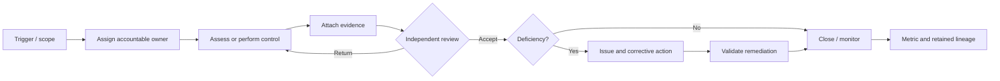

# Business Process Design

## Process design standard

Every process definition contains:

- trigger and measurable outcome;
- requester, accountable owner, reviewers and approver;
- inputs and authoritative sources;
- states, commands, decision rules and SLA;
- evidence and record-retention requirements;
- events and downstream consumers;
- exceptions, delegation, cancellation and reopening;
- Arabic/English notices;
- KPIs and acceptance scenarios.

Processes use BPMN-compatible semantics, but executable state/command tables are authoritative.

## Shared assurance cycle

## Process catalogue

| ID | Process | Owner | Material controls |
|---|---|---|---|
| BP-01 | Risk identification and assessment | ERM | methodology, owner, rating, control linkage |
| BP-02 | Risk treatment and acceptance | ERM | appetite, authority, SoD, expiry |
| BP-03 | KRI breach response | ERM | threshold version, alert, escalation |
| BP-04 | Obligation change and impact | Compliance | source/version, applicability, reviewer |
| BP-05 | Control design and testing | Compliance | independence, sample, evidence freshness |
| BP-06 | Policy lifecycle | Policy | version, legal review, approval, publication |
| BP-07 | Audit plan and engagement | Audit | independence, committee approval, working papers |
| BP-08 | Finding and CAPA | Assurance | ownership separation, validation, closure authority |
| BP-09 | Change enablement | Change | risk, collision, CAB/ECAB, implementation/PIR |
| BP-10 | Committee decision | Governance | membership, COI, quorum, vote, signed resolution |
| BP-11 | Cyber control assessment | Cyber | NCA/SAMA version, evidence, deficiency |
| BP-12 | Vulnerability lifecycle | Cyber | source, severity, asset criticality, SLA, exception |
| BP-13 | Security event and response | SOC Ops | ingestion, triage, custody, lessons |
| BP-14 | BIA and recovery strategy | BCM | MTPD/RTO/RPO hierarchy, approval |
| BP-15 | Plan exercise and activation | BCM | authority, safety, observations, AAR |
| BP-16 | RoPA and DPIA | Privacy | purpose, basis, minimisation, approval |
| BP-17 | Data-subject request | Privacy | identity, clock, exemptions, delivery |
| BP-18 | Personal-data breach | Privacy | severity, clock, notification, evidence |
| BP-19 | Third-party lifecycle | TPRM | tier, due diligence, acceptance, monitoring, exit |
| BP-20 | Material outsourcing | SAMA Resilience | materiality, approval, register, cloud/residency |
| BP-21 | Access request and SoD | Access Governance | manager/app owner, conflict, fulfilment |
| BP-22 | Access recertification and break-glass | Access Governance | independent review, revocation |
| BP-23 | ESG disclosure and assurance | ESG | calculation/version/lineage, maker-checker |
| BP-24 | Speak-up/investigation | Ethics | confidentiality, conflict, custody, retaliation |
| BP-25 | Regulatory filing/inspection | Regulatory Affairs | deadline, evidence, signature, submission hash |
| BP-26 | NDI assessment cycle | Data Governance | official framework, evidence, gaps, submission |
| BP-27 | AI model lifecycle | AI Governance | risk tier, validation, deployment, drift |
| BP-28 | Package activation and removal | Kernel | entitlement, dependencies, data retention |

## BP-09 — Target change-enablement process

### Trigger

Planned, standard or emergency modification to a service, application, infrastructure, control, vendor dependency or business process.

### Flow

1. Requester selects affected service/assets and change model.
2. Server assigns requester identity and organisation.
3. Risk assessment derives initial score from criticality, blast radius, timing, control impact and prior failure.
4. Impact owners complete security, privacy, BCM, vendor and compliance assessments where rules require.
5. Standard change is validated against an approved model; it is not merely labelled standard.
6. Normal change enters CAB agenda with complete pack, conflicts and missing evidence.
7. Eligible authenticated members declare COI and vote once.
8. Decision records conditions, expiry, dissent and authority.
9. Scheduling checks freeze window, collision and implementation readiness.
10. Deployment/integration may gate release.
11. Implementer records result and rollback.
12. Independent reviewer completes PIR; failed/high-risk changes create issue/CAPA.
13. Emergency change is ratified by ECAB/CAB within configured time.

### Hard rules

- requester cannot approve;
- writer permission cannot make CAB decision;
- vote identity is immutable authenticated ID;
- member eligibility derives from effective term;
- `CAB_REJECTED` requires an authoritative decision, not generic state transition;
- high-risk closure requires PIR evidence;
- emergency type alone never grants approval.

### KPIs

Change success, rollback, emergency rate, unauthorised changes, condition breach, lead time by risk, approval delay, collision avoidance and PIR completion.

## BP-10 — Target committee process

1. Secretary creates meeting under an active committee charter.
2. Agenda items and papers close at cutoff; late papers are visibly exceptional.
3. Attendance is reconciled to effective voting membership.
4. Member declares conflict/recusal.
5. System computes eligible denominator and quorum.
6. Chair opens each resolution for vote.
7. Authenticated eligible member votes once; dissent and abstention persist.
8. System calculates outcome from charter rule.
9. Chair/secretary finalise resolution wording.
10. Minutes are reviewed and independently approved.
11. Signature seals content hash and signer authority.
12. Actions are assigned and escalated.

The client never supplies the quorum result as authoritative.

## BP-17 — Data-subject request

1. Request arrives via accessible portal or authorised channel.
2. Identity verification is proportional to request and data sensitivity.
3. Request type and statutory clock are established.
4. Systems/data owners receive scoped tasks.
5. Privacy reviewer checks exemptions and third-party data.
6. Response is approved, securely delivered and acknowledged.
7. Fulfilment evidence and extension reason are retained.

The product separates identity evidence from operational request visibility.

## BP-19 — Third-party lifecycle

1. Business sponsor requests onboarding.
2. Existing party master is searched to avoid duplicate vendors.
3. Criticality and inherent risk determine due diligence paths.
4. Security, privacy, BCM, sanctions and outsourcing reviews run in parallel where applicable.
5. Risk acceptance uses delegated authority and expiry.
6. Contract controls are generated and tracked.
7. Continuous signals and scheduled reassessments update risk.
8. Material change triggers re-review.
9. Offboarding confirms access revocation, data return/destruction and exit readiness.

## Process anti-patterns prohibited

- status chosen directly by UI;
- approval using free-text actor;
- evidence uploaded after decision and backdated;
- dashboard count without process denominator;
- silent SLA reset on reassignment;
- deletion of rejected or dissenting decisions;
- optional Arabic field for a legally material record;
- cross-module task created without stable source reference;
- scheduler acting without explicit tenant.

