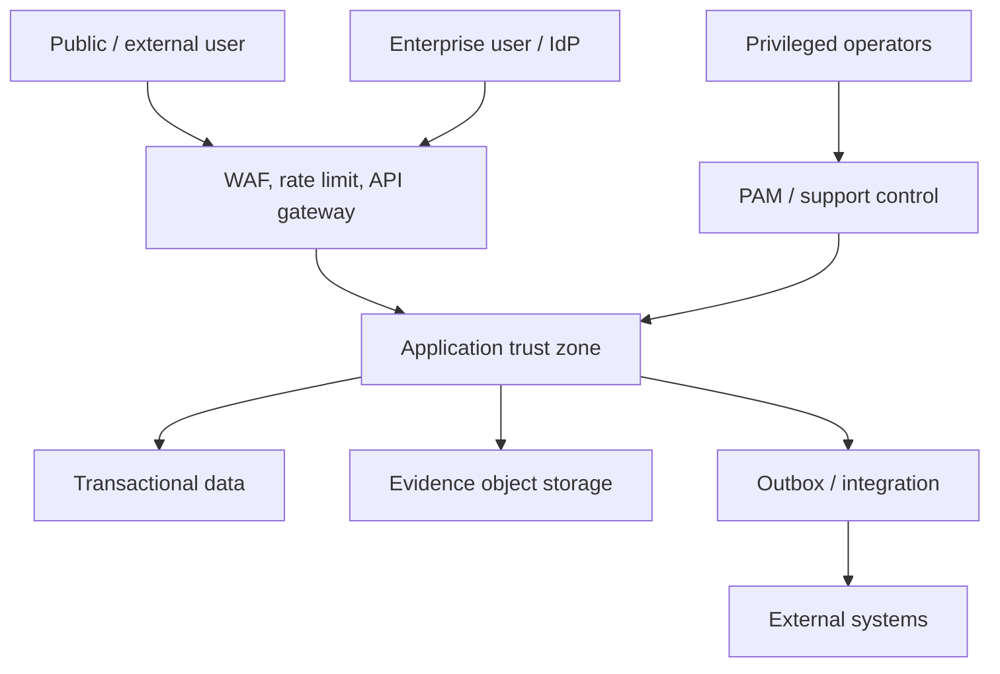

# Security Architecture

## Security opinion

The platform has serious security foundations—Spring Security, permission evaluation, tenant context, audit, JWT/refresh handling, an authorization ratchet and multiple SoD controls. It is not yet safe to call the governance layer fully assured because some material decisions trust caller-authored identities or use semantically weak permissions.

## Security objectives

- prevent one tenant, user, package or integration from exceeding authority;
- preserve confidentiality of highly sensitive cases and evidence;
- make material decisions attributable and tamper-evident;
- remain secure when schedulers, integrations and optional infrastructure fail;
- produce evidence suitable for customer and Saudi control assessment.

## Trust boundaries

Every boundary has authenticated identity, tenant/package scope, classification, rate limit and audit requirements.

## Authentication

Target:

- OIDC/SAML enterprise SSO;
- phishing-resistant MFA for privileged and decision roles;
- local accounts disabled or break-glass only in enterprise deployments;
- refresh-token rotation and revocation;
- session/device inventory;
- step-up authentication for restricted export, break-glass and material signature;
- SCIM/JML automation;
- service accounts with workload identity, not shared passwords.

Nafath is a selectable integration for appropriate external identity use cases, subject to contractual and technical validation; it is not assumed suitable for internal workforce authentication.

## Authorization

Layers:

1. package entitlement;
2. module action permission;
3. object/organisation-unit scope;
4. relationship/assignment;
5. case classification and need-to-know;
6. state-command authority;
7. SoD/conflict;
8. data-field masking/export.

`WRITE` never implies `APPROVE`, `SIGN`, `EXPORT`, `ADMIN`, `TRIAGE` or `DELETE`.

## Decision integrity

Material decisions record:

- immutable authenticated user ID;
- display name snapshot;
- effective role, delegation or committee term;
- tenant;
- object/version;
- command and result;
- rationale/conditions/expiry;
- supporting evidence versions;
- timestamp and correlation;
- signature/hash where required.

Names, roles, tenant IDs, quorum results and approval counts from request bodies are untrusted.

## Tenant isolation

Enforce through token, context, repository, database write guard, unique constraints, cache, search, file paths, events, websocket and schedulers. Support actions require explicit tenant selection, reason, time-bound privilege and enhanced audit.

## Audit and non-repudiation

The audit ledger is append-only and separately permissioned. High-value records use chained hashes or signed snapshots where justified. Audit failure policy is explicit: a material decision cannot succeed silently if its mandatory audit record fails.

## Evidence/file security

- content-type and extension validation;
- malware scanning before availability;
- checksum and immutable version;
- object-level authorization;
- encryption and key policy;
- classification and retention;
- safe preview/download headers;
- no executable active content;
- upload quotas and decompression-bomb protection;
- legal hold and destruction workflow.

## Secrets and cryptography

- production secrets come from managed secret storage;
- envelope encryption/approved KMS for restricted data;
- TLS for all links;
- rotation and revocation runbooks;
- no secrets in logs, URLs, frontend bundles or migrations;
- cryptographic choices documented and upgradeable;
- signing keys separated from application secrets.

## Public portals

Use separate route/security profiles, opaque tokens, rate limits, bot controls, minimal error disclosure, token expiry/one-time use, anti-enumeration responses and restricted upload. Public case status never reveals internal workflow, user or tenant details.

## API and integration security

- explicit allowlist of public endpoints;
- schema validation and mass-assignment-safe DTOs;
- SSRF-safe outbound connector controls;
- webhook signature, timestamp and replay cache;
- idempotency and quotas;
- egress allowlist for restricted deployments;
- partner credential scoping;
- error redaction.

## Business-logic security

Mandatory tests include:

- self-approval and collusion;
- forged actor, role, tenant and status;
- duplicate/replayed vote;
- fake membership/quorum;
- stale object/version;
- expired delegation/acceptance;
- cross-package entitlement bypass;
- scheduler race and disabled dependency;
- bulk export and inference;
- evidence substitution after approval.

## Secure development

- threat model per material epic;
- dependency and secret scanning;
- SAST plus manual business-logic review;
- DAST/API testing in production-like environment;
- SBOM and signed artifacts;
- protected branch and reviewed migration;
- secure coding training;
- vulnerability disclosure and response process;
- annual independent penetration test and after material architecture change.

## Saudi security alignment

The platform should maintain evidence mappings to NCA ECC and, for financial-sector deployments, SAMA Cyber Security Framework and relevant outsourcing/cloud requirements. Mapping does not prove customer compliance. Hosting, data location, provider and approval obligations are customer/deployment specific.

## Immediate P0 controls

1. bind change and committee decisions to authenticated IDs;
2. enforce `APPROVE`/`SIGN`/`EXPORT` semantics;
3. derive committee eligibility/quorum from effective membership;
4. enforce package entitlement for every commercial controller;
5. add two-tenant and governance-engine adversarial tests;
6. require bilingual validated DTOs for material records.

