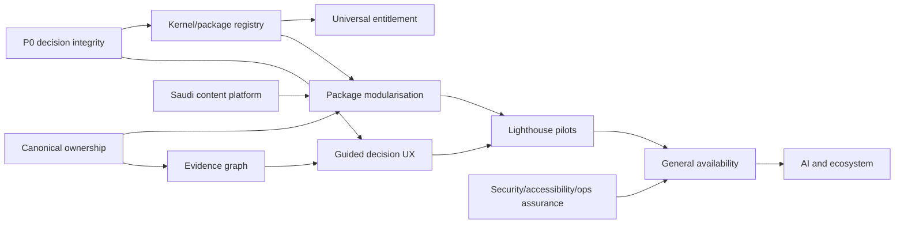

# TSS GRC Platform — Transformation Implementation Plan

**Document type:** Consolidated implementation plan  
**Version:** 1.0  
**Plan date:** 2026-07-25  
**Horizon:** 12 months to Saudi enterprise general availability; 24 months to ecosystem scale  
**Source:** `TSS_GRC_PLATFORM_AUDIT_REPORT.md` and the detailed Platform Bible  
**Initial status:** Planning baseline; implementation work is not implied by this document

---

## 1. Programme objective

Transform the current broad modular monolith into a trustworthy Arabic-first Saudi enterprise GRC platform with:

- valid and attributable governance decisions;
- independently purchasable and enforceable modules;
- outcome-based UX for executives, specialists, control owners and external users;
- clear bounded contexts and canonical data ownership;
- governed Saudi regulatory content;
- production, security, accessibility and customer evidence;
- safe, human-accountable AI.

## 2. Success definition

The programme succeeds when:

1. no Critical finding remains open;
2. the Platform Kernel boots without commercial packages;
3. every commercial API is protected by server-side package entitlement;
4. at least eight priority packages reach independence L3;
5. five flagship Arabic/English journeys pass moderated usability and WCAG 2.2 AA;
6. material decisions are bound to authenticated actor and effective authority;
7. two-tenant negative tests cover API, export, search, files, cache, jobs, events and realtime;
8. official Saudi content packs have version, source, applicability, review and release SLA;
9. production-like performance, backup/restore, upgrade and failover are witnessed;
10. three lighthouse Saudi customers validate measurable value.

---

## 3. Non-goals

- no immediate microservices rewrite;
- no customer-specific branches;
- no redesign of all screens in one big-bang release;
- no autonomous AI approval or regulatory decision;
- no claim that software usage equals compliance;
- no new major commercial module until P0 controls and package foundation are underway.

---

## 4. Architecture implementation target

### Platform Kernel

The mandatory kernel owns:

- identity, tenant and organisation;
- permission and authority resolution;
- licensing and package registry;
- workflow and decision contracts;
- evidence/attachment metadata;
- audit ledger and signatures;
- notification/SLA;
- integration gateway and outbox;
- reporting framework;
- localization, configuration, branding and help.

The kernel must not import commercial package code.

### Commercial packages

Initial package catalogue:

`ERM`, `COMPLIANCE`, `POLICY`, `AUDIT`, `CHANGE`, `GOVERNANCE`, `CYBER_GRC`, `SOCOPS`, `BCM`, `PRIVACY`, `DATA_GOV`, `TPRM`, `SAMA_RESILIENCE`, `ESG`, `ACCESS_GOV`, `ETHICS`, `REGULATORY`, `SAUDI_FS`, `AI_GOV`.

Every package provides:

- manifest and semantic version;
- dependencies;
- permissions and role templates;
- controllers/routes;
- schema ownership;
- public commands, queries and events;
- jobs/connectors;
- disable/removal policy;
- contract and acceptance tests.

### Package manifest

```yaml
code: ERM
version: 2.0.0
kernel: ">=2.0 <3"
optionalDependencies:
  - COMPLIANCE
  - GOVERNANCE
permissions:
  - ERM:READ
  - ERM:WRITE
  - ERM:APPROVE
  - ERM:EXPORT
routes:
  - /risk
ownedSchemas:
  - risk
publishedEvents:
  - risk.identified.v1
  - risk.rating-changed.v1
disablePolicy: read-only
removalPolicy: export-retain-remove
```

---

## 5. Delivery phases

## Phase 0 — Stop invalid decisions and establish truth

**Timeline:** Weeks 1–4  
**Goal:** Close Critical control defects before structural work.

### Work package P0-A — Change approval integrity

1. Replace writable approval entity with validated command DTO.
2. Remove `approverName` and `approverId` from caller authority.
3. Resolve authenticated `GrcUserDetails`.
4. Store immutable user ID and display-name snapshot.
5. Validate effective CAB/ECAB authority.
6. Enforce unique tenant/change/user vote.
7. Replace `CHANGE:WRITE` with `CHANGE:APPROVE`.
8. Split generic transitions into named commands.
9. Add emergency ratification and independent PIR.

### Acceptance

- requester cannot approve own change;
- a writer without `APPROVE` receives 403;
- forged actor fields are ignored/rejected;
- duplicate vote returns conflict;
- `CAB_APPROVED`, `CAB_REJECTED` and `EMERGENCY_APPROVED` cannot be reached through generic write;
- two users complete the normal flow;
- emergency flow cannot close without ratification/PIR;
- all events and audit records contain authenticated identity.

### Work package P0-B — Committee integrity

1. Snapshot effective committee membership at meeting.
2. Separate voting and non-voting membership.
3. Reconcile attendance to the snapshot.
4. Allow secretary to record presence/COI/recusal, not invent members.
5. Bind vote to authenticated user/member ID.
6. Enforce one vote per resolution/member.
7. Compute quorum server-side from charter and eligible denominator.
8. Ignore/reject caller-provided authoritative quorum.
9. Add chair/secretary/member permission model.
10. Enforce minutes preparation/approval SoD.

### Acceptance

- non-member vote denied;
- expired member term denied;
- duplicate aliases cannot vote;
- fake attendance cannot change denominator;
- conflicted member excluded according to configured charter;
- meeting cannot complete without computed quorum;
- dissent and abstention remain visible;
- signed minutes fail verification after content mutation.

### Work package P0-C — Low-effort security corrections

- require `CHANGE:EXPORT` for change and CAB exports;
- apply row/field security to export;
- enforce material Arabic/English DTO validation;
- add optimistic locking to material decisions;
- ensure server timestamps and tenant IDs are authoritative;
- reconcile affected user-story completion markers.

### Work package P0-D — Critical tests

Create:

- `ChangeDecisionAuthorizationTest`;
- `ChangeApprovalIdentityTest`;
- `EmergencyChangeRatificationTest`;
- `CommitteeMembershipEligibilityTest`;
- `CommitteeQuorumIntegrityTest`;
- `CommitteeVoteIdentityTest`;
- `CommitteeMinutesSodTest`;
- API-level two-principal tests;
- live proxy probes with `admin` and `so_officer`.

### Phase 0 gate

- 0 open Critical findings;
- backend/full frontend suites green;
- authorization ratchet does not increase;
- live 403/409/positive paths retained;
- documentation claims corrected;
- no merge to master without explicit user approval.

---

## Phase 1 — Platform Kernel and package enforcement

**Timeline:** Months 2–3  
**Goal:** Make commercial packaging technically real.

### WP1-1 — Package registry

Implement:

- package manifest schema;
- startup registry;
- dependency validation;
- package version/health API;
- organisation entitlement service;
- cache invalidation;
- package activation audit.

### WP1-2 — Universal entitlement enforcement

The package code is resolved from endpoint metadata or package registration. Enforce on:

- controller requests;
- exports;
- schedulers;
- asynchronous consumers;
- integration endpoints;
- websocket subscriptions;
- report schedules;
- navigation/route loading.

UI hiding remains convenience only.

### WP1-3 — Kernel-only operation

- classify kernel versus commercial code;
- remove domain dependency from kernel;
- create a kernel-only boot profile;
- migrate implicit assumptions;
- test fresh migration and admin login with no package enabled.

### WP1-4 — Architecture guardrails

Add build-time rules:

- no kernel → commercial imports;
- no package → peer repository/entity;
- no new bidirectional pair;
- no commercial controller without package declaration;
- no write endpoint without action permission;
- no generic status setter for regulated states.

Initially ratchet current debt; do not require an unsafe big-bang move.

### WP1-5 — Decision and authority contract

Define common immutable records:

- authenticated actor;
- effective role/delegation/member term;
- object/version;
- requested decision;
- SoD evaluation;
- evidence references;
- rationale/conditions/expiry;
- decision result;
- signature/hash where required.

Adapt workflow approvals, committee votes and domain decisions incrementally.

### Phase 1 gate

- Kernel boots without commercial packages.
- Unlicensed API tests pass for SOC Ops plus two lighthouse packages.
- Package dependency health is visible.
- New forbidden dependencies fail the build.
- No kernel import of migrated package code.

---

## Phase 2 — UX foundation and canonical data

**Timeline:** Months 3–6  
**Goal:** Convert feature breadth into usable workflows and stable ownership.

### WP2-1 — Experience shells

Build:

1. My Work;
2. Assurance;
3. installed Workspaces;
4. Executive;
5. Administration.

Routes and navigation are registered by package manifest.

### WP2-2 — My Work

Unify:

- approvals;
- evidence requests;
- attestations;
- deadlines;
- escalations;
- delegations;
- external/requestor follow-up.

Each work item contains why assigned, due status, risk, source object and next action.

### WP2-3 — Shared UX patterns

- object workspace;
- guided decision page;
- evidence lineage panel;
- bilingual material field;
- assurance status badge;
- accessible metric and chart;
- workflow state/next-action component;
- accessible public portal shell.

### WP2-4 — Arabic-first foundation

- versioned Saudi GRC glossary;
- material bilingual field policy;
- Arabic search normalization;
- direction isolation for IDs/URLs/numbers;
- Gregorian/Hijri display policy;
- Saudi calendar configuration;
- PDF/Excel bilingual export acceptance;
- NVDA Arabic and keyboard test matrix.

### WP2-5 — Canonical object council

Resolve and record:

- control owner;
- issue/CAPA owner;
- audit plan/engagement owner;
- party/vendor owner;
- approval/decision contract;
- incident ownership;
- data asset/processing activity ownership;
- lifecycle projection versus authoritative state.

### WP2-6 — Evidence graph MVP

Link:

`obligation ↔ control ↔ test ↔ evidence version ↔ issue ↔ action ↔ decision ↔ risk`

Every edge contains source, scope, validity/freshness and reviewer.

### Phase 2 gate

- flagship My Work usability succeeds in Arabic and English;
- all material forms use bilingual contract;
- canonical owner exists for every shared object;
- executive metric can drill to evidence;
- no package reads a migrated peer repository.

---

## Phase 3 — Lighthouse package modularisation

**Timeline:** Months 4–8  
**Goal:** Prove independent sale with real packages.

### Recommended waves

| Wave | Packages | Reason |
|---|---|---|
| 1 | ERM, Privacy, Compliance | buyer demand, strong domain maturity, common platform proof |
| 2 | BCM, TPRM, SAMA Resilience | strong Saudi differentiation and dependency test |
| 3 | Policy, Audit, Governance | connected assurance and decision proof |
| 4 | Cyber GRC, Access Governance, SOC Ops | NCA/SAMA security proposition |
| 5 | ESG, Data Governance/NDI, Regulatory Affairs | differentiated specialist depth |
| 6 | Ethics, Saudi FS, AI Governance | sensitive/specialist validation |

Commercial pipeline may reorder waves, but independence tests cannot be skipped.

### Per-package implementation checklist

1. approve PDS and buyer outcome;
2. identify owned objects and schemas;
3. classify dependencies;
4. expose public query/command interfaces;
5. replace peer repositories;
6. publish domain events;
7. build read projections;
8. register routes/permissions/jobs/connectors;
9. enforce entitlement;
10. define disable/removal behaviour;
11. test kernel + package only;
12. test optional dependency present/absent;
13. test N-1 upgrade;
14. test data export/removal;
15. run Arabic/English journey UAT;
16. create sales demo and implementation template.

### Independence acceptance

A package reaches L3 only when:

- zero forbidden source dependencies;
- owner-controlled schema/repositories;
- versioned public contracts;
- server-side entitlement;
- manifest-driven routes and permissions;
- optional dependencies degrade safely;
- package-only boot/journey test passes;
- export, disable and retention policy passes.

---

## Phase 4 — Saudi content and regulated-market proof

**Timeline:** Months 2–9  
**Goal:** Turn local framework breadth into a reliable subscription service.

### WP4-1 — Saudi Content Office

Required roles:

- regulatory lead;
- Arabic legal editor;
- NCA/cyber SME;
- SAMA SME;
- privacy/DPO SME;
- DGA/NDMO/data SME;
- product analyst;
- content QA.

### WP4-2 — Content platform

Each content pack stores:

- authority;
- official URL/document;
- Arabic authoritative text;
- reviewed English;
- version and effective dates;
- applicability;
- obligation decomposition;
- control mappings and confidence;
- supersession/change history;
- customer activation;
- impact assessment and release notes.

### WP4-3 — Priority validation

1. NCA ECC;
2. SAMA Cyber Security Framework;
3. SAMA outsourcing/cloud and operational resilience;
4. PDPL and implementing regulations;
5. DGA beneficiary/accessibility standards;
6. NDI/NDMO;
7. CMA/IFRS sustainability;
8. Sharia/open-banking/AML specialist packs.

### WP4-4 — Market proof

- three lighthouse customers;
- government profile;
- financial-institution profile;
- critical-infrastructure profile;
- signed success measures;
- implementation duration and cost;
- buyer objections and lost-deal analysis;
- pricing/willingness-to-pay research.

---

## Phase 5 — Operational and assurance general availability

**Timeline:** Months 6–12  
**Goal:** Retain the evidence required for enterprise sale and government acceptance.

### Security assurance

- business-logic threat models;
- complete two-tenant matrix;
- case-level restricted access tests;
- public-token abuse tests;
- export/DLP tests;
- SSO/MFA/SCIM reference profiles;
- secrets/KMS review;
- independent penetration test;
- Critical/High closure evidence.

### Accessibility assurance

- WCAG 2.2 AA automated baseline;
- independent Arabic/English review;
- keyboard, NVDA Arabic, 200% zoom and reflow;
- accessible chart/table parity;
- five end-to-end persona journeys;
- public and crisis mobile journeys.

### Operational assurance

- production workload and P95 targets;
- large tenant/data-volume tests;
- evidence upload/malware pipeline;
- scheduler/outbox failure tests;
- backup and restoration;
- RPO/RTO measurement;
- failover exercise;
- upgrade and rollback/forward-fix;
- signed artifacts and SBOM;
- privacy-aware telemetry;
- release evidence pack.

### General-availability gate

- 0 unmitigated Critical/High acceptance defects;
- independent security and accessibility reports;
- witnessed restore and upgrade;
- three referenceable customers;
- eight L3 packages;
- Saudi content update operation active;
- sales/support/implementation enablement complete.

---

## Phase 6 — AI transformation and ecosystem

**Timeline:** Months 9–24  
**Goal:** Add leverage after control and data foundations are reliable.

### AI gateway

- use-case allowlist;
- tenant and permission filtering;
- data-class/residency policy;
- provider/model registry;
- prompt version;
- redaction/minimisation;
- source citation;
- cost quota;
- evaluation;
- audit;
- kill switch.

### First use cases

1. regulatory-change summarisation;
2. obligation/control mapping suggestion;
3. evidence classification/reuse suggestion;
4. Arabic/English drafting;
5. cited executive briefing.

### AI acceptance

- Arabic/English golden evaluation sets;
- grounding/citation threshold;
- sensitive-data leakage and prompt-injection tests;
- human accept/edit/reject retained;
- no autonomous approval, risk acceptance, case closure or regulator notification.

### Ecosystem

- partner SDK;
- certified connectors;
- regulatory content marketplace;
- package marketplace;
- implementation partner certification;
- selective service extraction based on evidence.

---

## 6. Consolidated epic backlog

| Epic | Outcome | Priority | Target |
|---|---|---|---|
| E-01 Governance Identity | Authenticated actors and valid decisions | P0 | Month 1 |
| E-02 Change State Machine | Named commands, authority, ECAB/PIR | P0 | Month 1 |
| E-03 Committee Integrity | Membership, quorum, voting and minutes | P0 | Month 1 |
| E-04 Export and Bilingual Controls | Correct permission and material Arabic validation | P0 | Month 1 |
| E-05 Governance Test Pack | Adversarial and two-principal proof | P0 | Month 1 |
| E-06 Package Registry | Manifest, dependencies, versions and health | P0 | Month 2 |
| E-07 Universal Entitlement | Server enforcement across APIs/jobs/exports | P0 | Month 3 |
| E-08 Architecture Ratchet | Prevent new boundary violations | P0 | Month 2 |
| E-09 Kernel Contracts | Identity/evidence/workflow/audit/notification APIs | P1 | Month 3 |
| E-10 Decision Contract | Common actor/authority/decision model | P1 | Month 4 |
| E-11 UX Shells | My Work/Assurance/Workspaces/Executive/Admin | P1 | Month 5 |
| E-12 Arabic Design System | Bilingual contracts, search, RTL and accessibility | P1 | Month 5 |
| E-13 Canonical Objects | Control, issue, party, audit and data ownership | P1 | Month 4 |
| E-14 Evidence Graph | Connected assurance lineage | P1 | Month 6 |
| E-15 Lighthouse Packages | ERM, Privacy and Compliance L3 | P1 | Month 7 |
| E-16 Saudi Content Platform | Versioned official content lifecycle | P1 | Month 6 |
| E-17 Security Assurance | Tenant, case, public, export and penetration proof | P1 | Month 9 |
| E-18 Accessibility Assurance | Independent WCAG 2.2 AA proof | P1 | Month 9 |
| E-19 Operational Assurance | Load, restore, failover and upgrade | P1 | Month 10 |
| E-20 Market Proof | Three lighthouse customers and pricing evidence | P1 | Month 12 |
| E-21 AI Gateway | Safe governed model access | P2 | Month 12 |
| E-22 Ecosystem | Certified packages/connectors/partners | P2 | Months 12–24 |

---

## 7. Workstream dependencies



P0 security remediation precedes Change module extraction. Package manifests and canonical ownership precede broad code movement.

---

## 8. Team and governance

### Minimum programme structure

| Role/team | Responsibility |
|---|---|
| Executive sponsor | funding, priorities and acceptance |
| Product Council | constitution, package map, PDS and commercial decisions |
| Architecture Council | ADRs, boundaries, contracts and extraction |
| Security Council | threats, SoD, tenant and assurance |
| UX/Research team | journeys, Arabic, accessibility and design system |
| Saudi Content Office | official content and update SLA |
| Kernel squad | licensing, workflow, evidence, audit and integration |
| Package squads | domain modularisation and journeys |
| SDET/QA | state, contract, tenant, accessibility and live tests |
| SRE/DevOps | build, observability, performance and resilience |
| Sales/Customer Success | proof of value, pilots, pricing and adoption |

### RACI

| Decision | A | R | C | I |
|---|---|---|---|---|
| Package definition | CPO | Product Council | Architecture/Sales | Engineering |
| Canonical object owner | Chief Architect | Domain architect | Product/Data | All squads |
| Critical security closure | CISO | Security/engineering | QA/Product | Executive |
| Arabic terminology | CPO | Arabic content lead | Saudi SMEs/UX | All |
| Regulatory content release | Regulatory lead | Content Office | Legal/Product | Customers |
| GA acceptance | Executive sponsor | Programme lead | Security/UX/Ops/Customer | Board |

---

## 9. Engineering execution rules

1. Work on a feature/fix branch.
2. Commit each verified slice separately.
3. Never merge to master without explicit user instruction.
4. Keep authorization ratchet at or below baseline.
5. New write endpoints require real action permission.
6. Validate request DTOs while ensuring authorization tests submit valid bodies.
7. Keep every tenant operation organisation-scoped.
8. Schedulers and async work receive explicit tenant context.
9. New migrations use the next verified free version at implementation time.
10. Apply idempotent migrations twice to development SQL Server where required.
11. Use two principals for four-eyes paths.
12. Live-probe through the Vite proxy.
13. Tag and safely clean test records.
14. Update the Bible and evidence pack in the same slice.

---

## 10. Test and acceptance architecture

### Test pyramid

- domain/state tests;
- authorization and SoD tests;
- repository tenant tests;
- package contract tests;
- API integration tests;
- frontend component/journey tests;
- live two-user probes;
- production-like performance and resilience tests;
- independent security/accessibility assessment.

### Mandatory negative matrix

Every package tests:

- unlicensed tenant;
- no permission;
- wrong action permission;
- wrong object scope;
- other tenant ID;
- self-approval;
- forged actor;
- stale version;
- duplicate/replay;
- expired delegation;
- optional dependency unavailable;
- restricted export;
- background job tenant;
- public token abuse where applicable.

### Definition of done

A story is done only when:

- source and migration complete;
- unit/integration/frontend tests pass;
- live probe passes where relevant;
- Arabic and English behaviour verified;
- tenant/permission/SoD negatives pass;
- audit event asserted;
- operational telemetry added;
- documentation/ADR/PDS updated;
- release evidence attached;
- product owner and risk owner accept.

---

## 11. Metrics

### Transformation metrics

- open Critical/High findings;
- forbidden dependency count;
- bidirectional pair count;
- percentage of commercial APIs with entitlement;
- packages at L3/L4;
- canonical-object conflicts;
- critical journeys passing Arabic/English;
- WCAG defects by severity;
- two-tenant negative coverage;
- release evidence completeness.

### Product metrics

- time to first evidence-backed posture;
- My Work completion time;
- evidence-request rework;
- approval cycle time;
- overdue high-risk actions;
- common-control/evidence reuse;
- executive drill-down success;
- Arabic/English task parity;
- active package adoption;
- module attach, renewal and expansion.

### Operational metrics

- availability and error budget;
- P95/P99 latency;
- job/outbox lag;
- connector failures/dead letters;
- backup success and restore duration;
- security incident response;
- content update SLA;
- AI citation/error/override rates.

---

## 12. Programme risks and mitigations

| Risk | Probability | Impact | Mitigation |
|---|---|---|---|
| feature pressure overrides P0 work | High | Critical | executive gate; no new major module |
| modularisation becomes rewrite | Medium | High | ADR-001, ratchet and lighthouse proof |
| customer-specific forks reappear | Medium | High | configuration/content-pack policy |
| package map reflects code instead of buyers | Medium | High | PDS and commercial validation |
| Saudi content ages | High | High | permanent Content Office and SLA |
| UX redesign ignores real users | Medium | High | moderated Saudi research and telemetry |
| tests remain count-driven | High | High | criticality-weighted coverage and abuse cases |
| migration breaks production | Medium | Critical | production-like migration/restore CI |
| AI launches before data controls | Medium | High | AI gateway dependency on evidence graph/security |
| partner/customisation debt | Medium | Medium | certified extension contracts and no forks |

---

## 13. First 30-day action plan

### Week 1

- approve audit findings and P0 authority;
- freeze new high-risk workflow features;
- reproduce change and committee defects;
- approve actor/authority data model;
- establish dedicated branch and slice plan;
- appoint Product, Architecture and Saudi Content councils.

### Week 2

- implement authenticated change votes;
- implement correct approval/export permissions;
- add database uniqueness and migration;
- implement named decision commands;
- add focused backend tests.

### Week 3

- implement committee membership snapshot;
- reconcile attendance and compute quorum;
- bind votes to authenticated members;
- implement minutes SoD;
- add adversarial tests.

### Week 4

- execute full backend/frontend tests;
- run live two-principal and tenant probes;
- correct user stories and architecture ratings;
- add dependency ratchet;
- approve package manifest schema;
- issue Phase 0 evidence pack and go/no-go decision.

---

## 14. Release gates

| Gate | Required evidence |
|---|---|
| Code complete | reviewed source, migration and updated docs |
| Control complete | permission, tenant, SoD and abuse-case tests |
| UX complete | Arabic/English journey and accessibility evidence |
| Package complete | entitlement, dependency, boot, disable and upgrade tests |
| Operational complete | metrics, alert, backup/restore and rollback |
| Market complete | PDS, demo, implementation guide and customer acceptance |
| Regulatory complete | official source/version, SME review and applicability |

No single team can self-certify all gates.

---

## 15. Required evidence from the business

Work can begin with current evidence, but the following materially improve prioritisation:

- top ten sales opportunities and requested modules;
- lost-deal reasons;
- current pricing/discounting and cost-to-serve;
- customer deployment/residency requirements;
- production telemetry and incident history;
- real user/persona access for research;
- current content licensing and regulatory SME approvals;
- target cloud/on-prem strategy;
- legal retention and deletion requirements;
- partner and integration commitments;
- executive risk appetite for pilot/GA.

---

## 16. Final implementation instruction

The programme must not begin with visual redesign alone or module extraction alone.

The first executable sequence is:

> **Fix decision identity → prove governance controls → enforce package entitlements → establish canonical ownership → simplify UX → modularise lighthouse packages → prove Saudi acceptance → scale AI and ecosystem.**

This sequence protects the existing investment while converting TSS GRC from a broad software implementation into a credible, saleable and defensible enterprise product.

