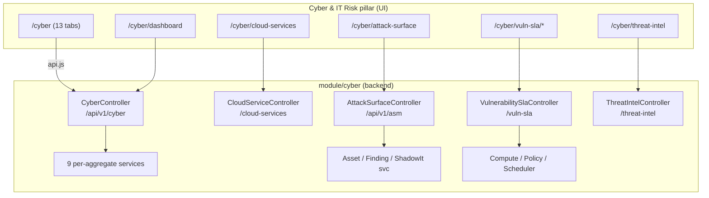
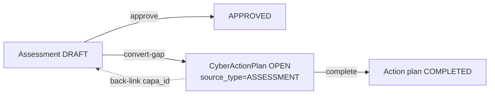
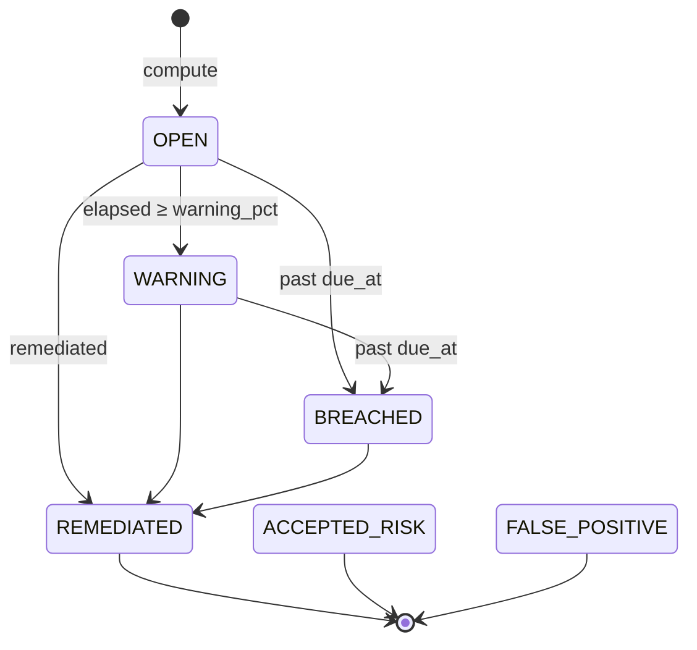
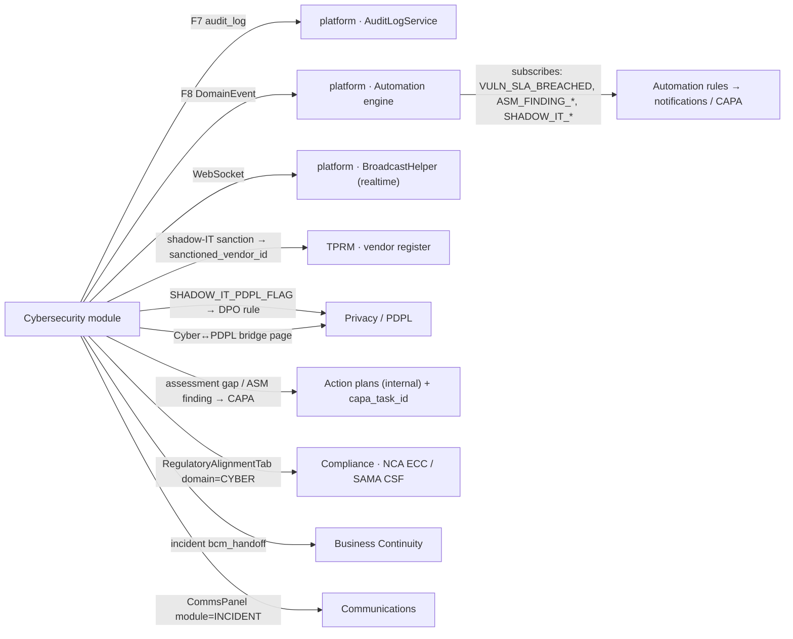
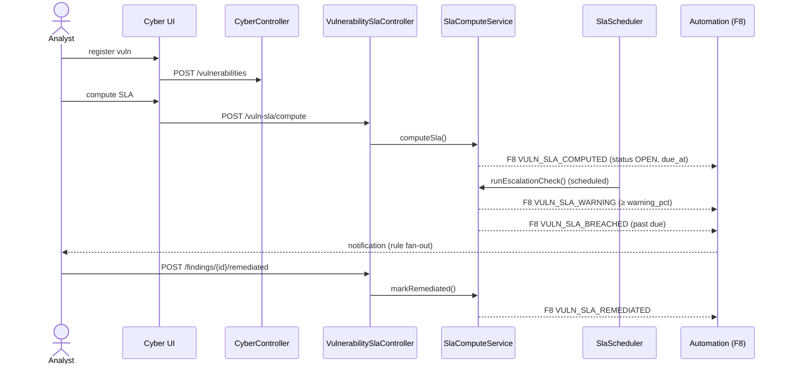
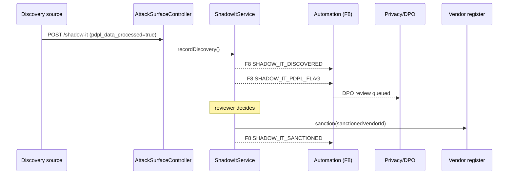
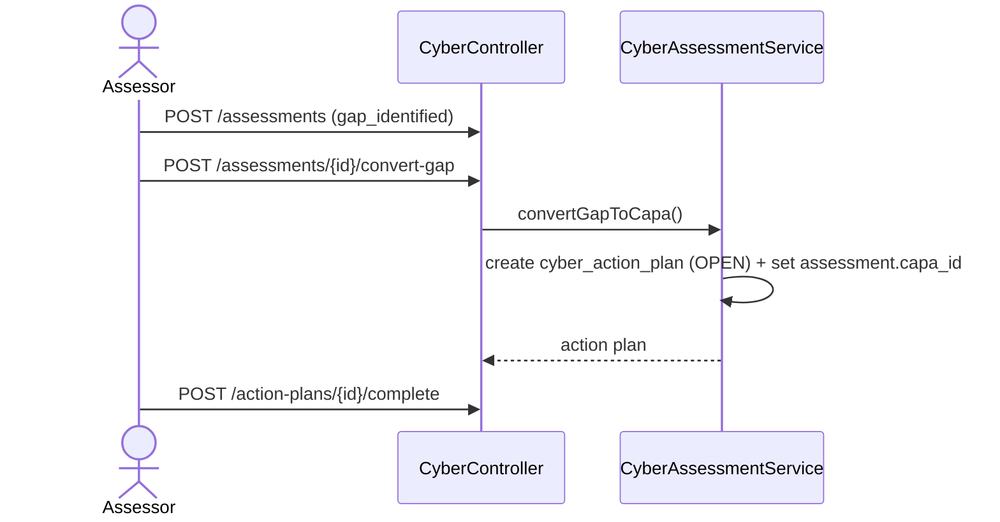
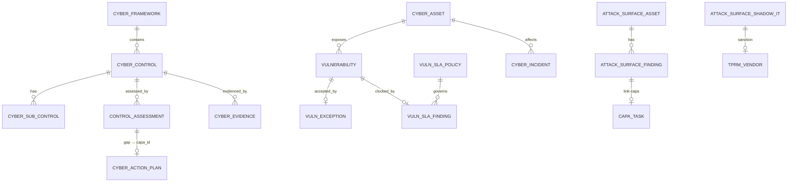

# Cybersecurity Module — Complete Map, Workflows, APIs & Dependencies

**Module:** `com.tss.grc.module.cyber` (backend) · Cyber & IT Risk pillar (frontend)
**Permission domain:** `CYBER` (`hasPermission('CYBER','READ'|'WRITE')`)
**Regulatory anchors:** NCA ECC / ECC-2, SAMA CSF, SSVC, IFRS-agnostic (cyber-specific)
**Generated:** 2026-07-04 · reflects `master @ 02b034ba`

> Scope note. This document covers the **Cybersecurity module** proper —
> backend package `module/cyber` (core + `asm` + `vuln_sla` + `threatintel`) and the
> **Cyber & IT Risk** UI pillar it powers. The **SOC Operations** area (`/socops/*`,
> ~20 pages) is a *separate sibling module* surfaced under the same pillar; it is listed
> in §3 for navigation completeness but documented on request (own backend surface).

---

## 0. Table of contents

1. [Executive overview](#1-executive-overview)
2. [Module map (backend + frontend)](#2-module-map)
3. [Navigation / information architecture](#3-navigation--information-architecture)
4. [Frontend — the `/cyber` workspace: every tab & its logic](#4-frontend--the-cyber-workspace)
5. [Frontend — the cyber sub-pages](#5-frontend--cyber-sub-pages)
6. [REST API catalogue (every endpoint)](#6-rest-api-catalogue)
7. [Workflows & state machines (steps · guards · actions · receipts)](#7-workflows--state-machines)
8. [Data model (schema + tables)](#8-data-model)
9. [Cross-module dependencies & integration](#9-cross-module-dependencies)
10. [Sequence diagrams (end-to-end flows)](#10-sequence-diagrams)
11. [Dependency & relation graphs](#11-dependency--relation-graphs)

---

## 1. Executive overview

The Cybersecurity module is a **9-aggregate** domain that manages a bank's cyber posture end-to-end:

| # | Aggregate | Purpose | Backing table |
|---|-----------|---------|---------------|
| 1 | **Frameworks** | Control catalogues (NCA ECC, SAMA CSF, ISO 27001) | `cyber.cyber_frameworks` |
| 2 | **Controls / Sub-controls** | Control library + implementation status | `cyber.cyber_controls`, `cyber.cyber_sub_controls` |
| 3 | **Assessments** | Control testing → gap → CAPA | `cyber.control_assessments` |
| 4 | **Vulnerabilities** | Vuln register + escalation | `cyber.vulnerabilities` |
| 5 | **Vuln exceptions** | Risk acceptance for un-remediable vulns | `cyber.vuln_exceptions` |
| 6 | **Incidents** | 9-step incident response | `cyber.cyber_incidents` |
| 7 | **Assets** | Cyber asset register | `cyber.cyber_assets` |
| 8 | **Evidence** | Control/assessment evidence | `cyber.cyber_evidence` |
| 9 | **Action plans (CAPA)** | Remediation tasks | `cyber.cyber_action_plans` |

Three **Sprint-11 sub-domains** extend it:

| Sub-domain | Package | Purpose |
|------------|---------|---------|
| **Attack-Surface Management (ASM)** | `cyber.asm` | External assets, findings, shadow-IT discovery |
| **Risk-Based Vuln-SLA engine** | `cyber.vuln_sla` | Policy-driven SLA clocks + escalation |
| **Threat-Intel correlation** | `cyber.threatintel` | IOC → asset/CVE matching |

**Design DNA** (all aggregates follow these):
- **Multi-tenant:** every query filters `organisation_id` via `TenantContext`; single-id reads use `findByIdAndOrganisationId` (SEC-CYB-001 — never load another org's row).
- **Soft delete:** `is_deleted = 0` filter.
- **Mass-assignment defense:** create/update null the id and re-stamp org/externalId/createdAt server-side.
- **F7 audit + F8 automation + realtime:** mutations write an `AuditLogService` entry (F7), publish a `DomainEvent` (F8 automation engine), and broadcast over WebSocket (`BroadcastHelper`).
- **Bilingual:** `title_en` / `title_ar` etc.

> **History:** the aggregates 1–9 were carved out of a former `CyberService` god-class under refactor **QUAL-CP-001** into per-aggregate services (behaviour unchanged). ASM / Vuln-SLA / Threat-Intel were added in Sprint 11.

---

## 2. Module map

### 2.1 Backend package tree

```
module/cyber/
├── controller/
│   ├── CyberController.java            → /api/v1/cyber           (core: 9 aggregates)
│   └── CloudServiceController.java     → /api/v1/cyber/cloud-services
├── service/                            (per-aggregate, post CP-001 split)
│   ├── CyberFrameworkService           CyberControlService        CyberSubControlService
│   ├── CyberAssessmentService*         CyberVulnerabilityService  CyberVulnExceptionService
│   ├── CyberIncidentService*           CyberAssetService          CyberEvidenceService
│   ├── CyberActionPlanService          CyberDashboardService      CloudServiceService
│   (* = owns a workflow / cross-aggregate write)
├── entity/    CyberFramework, CyberControl, CyberSubControl, ControlAssessment,
│              Vulnerability, VulnException, CyberIncident, CyberAsset,
│              CyberEvidence, CyberActionPlan, CloudService
├── repository/  (one Spring-Data repo per entity, org-scoped finders)
├── dto/         CyberDashboardDto
│
├── asm/                                → /api/v1/asm             (Attack Surface Mgmt)
│   ├── controller/AttackSurfaceController
│   ├── service/  AttackSurfaceAssetService, AttackSurfaceFindingService, ShadowItService
│   ├── entity/   AttackSurfaceAsset, AttackSurfaceFinding, AttackSurfaceShadowIt
│   ├── repository/ …    dto/AsmDtos
│
├── vuln_sla/                           → /api/v1/cyber/vuln-sla  (SLA engine)
│   ├── controller/VulnerabilitySlaController
│   ├── service/  VulnerabilitySlaComputeService, VulnerabilitySlaPolicyService,
│   │             VulnerabilitySlaScheduler (@Scheduled escalation)
│   ├── entity/   VulnerabilitySlaPolicy, VulnerabilitySlaFinding
│   ├── repository/ …    dto/VulnSlaDtos
│
└── threatintel/                        → /api/v1/cyber/threat-intel
    ├── ThreatIntelController
    └── ThreatIntelCorrelationService
```

### 2.2 Frontend page tree (`tss-grc-ui-v2/src/pages/`)

```
cyber/
├── CyberPage.tsx                 /cyber                 (13-tab workspace — the hub)
├── VulnerabilitiesV2Page.tsx     /cyber/vulns/v2        (rich vuln board)
├── AttackSurfacePage.tsx         /cyber/attack-surface
├── AttackSurfaceAssetDetailPage  /cyber/attack-surface/:id (asset drill-down)
├── VulnSlaDashboardPage.tsx      /cyber/vuln-sla/dashboard
├── VulnSlaPolicyPage.tsx         /cyber/vuln-sla/policies
├── CyberCloudServicesPage.tsx    /cyber/cloud-services
├── ThreatIntelCorrelationPage    /cyber/threat-intel
└── mockCyber.ts                  (fallback demo fixtures)
dashboards/CyberDashboardPage.tsx /cyber/dashboard       (exec KPI board)
cyber-lifecycle/CyberLifecyclePage       /cyber-lifecycle
cyber-pdpl-bridge/CyberPdplBridgePage    /cyber-pdpl-bridge
workflow/nca/CyberIncidentWizard         (guided incident intake)
workflow/nca/VulnerabilityTriageWizard   (guided vuln triage)
third-party-cyber/ThirdPartyCyberPage    /third-party-cyber
```



---

## 3. Navigation / information architecture

The **Cyber & IT Risk** pillar (`Sidebar.tsx`, `id: 'cyber'`, `titleKey: navCyber = "Cyber & IT Risk"`):

| Order | Link id | Route | Label key | Target |
|------:|---------|-------|-----------|--------|
| 1 | `cyber-dash` | `/cyber/dashboard` | `cyberDashSidebar` | Cyber exec dashboard |
| 2 | `cyber` | `/cyber` | `modCyber` | **Cyber workspace (13 tabs)** |
| 3 | `socops` | `/socops` | `socopsSidebar` | SOC Operations *(sibling module)* |
| 3a | ↳ `socops-events` | `/socops/events` | `socopsEventsSidebar` | SOC events |
| 3b | ↳ `socops-playbks` | `/socops/playbooks` | `socopsPlaybooksSidebar` | IR playbooks |
| 3c | ↳ `socops-pentest` | `/socops/pentests` | `socopsPentestsSidebar` | Pentests |
| 3d | ↳ `socops-regexam` | `/socops/regulator-exams` | `socopsRegulatorsSidebar` | Regulator exams |
| 3e | ↳ `socops-ot` | `/socops/ot-assets` | `socopsOtSidebar` | OT assets |
| 4 | `vuln-sla` | `/cyber/vuln-sla/dashboard` | `vulnSlaDashSidebar` | Vuln-SLA dashboard |
| 4a | ↳ `vuln-sla-pol` | `/cyber/vuln-sla/policies` | `vulnSlaPolicySidebar` | SLA policies |
| 5 | `asm` | `/cyber/attack-surface` | `asmSidebar` | Attack surface |
| 6 | `cloud-svc` | `/cyber/cloud-services` | `cloudServicesSidebar` | Cloud services |
| 7 | `ti-correlate` | `/cyber/threat-intel` | `threatIntelSidebar` | Threat-intel correlation |
| 8 | `cyb-pdpl` | `/cyber-pdpl-bridge` | `cpbSidebar` | Cyber ↔ PDPL bridge |
| 9 | `cyber-lc` | `/cyber-lifecycle` | `cycSidebar` | Cyber lifecycle |

---

## 4. Frontend — the `/cyber` workspace

`CyberPage.tsx` is the module hub: a `<Tabs>` component with **13 tabs** (local `useState<TabId>`, default `overview`). A **New** button is *tab-aware* (`switch(tab)` opens the right create-modal), a **Filter** modal uses a tab-aware schema (DD-47), and **Export** dumps the active tab to CSV (DD-46). Each tab lazy-loads its own dataset via the `api.js` client against `/api/v1/cyber/*`.

| Tab id | Label (`en`) | Shows | Backing API (GET) | Actions (buttons) |
|--------|--------------|-------|-------------------|-------------------|
| `overview` | Overview | Workflow steppers + KPI roll-up | `/cyber/dashboard` | — |
| `controls` | Controls | Control library grid | `/cyber/controls` | New / Edit / Delete |
| `subcontrols` | Sub-Controls | Sub-control grid | `/cyber/sub-controls` | New / Edit / Delete |
| `assessments` | Assessments | Assessment grid | `/cyber/assessments` | New / Edit / **Approve** / **Convert-gap→CAPA** / Delete |
| `vuln` | Vulnerabilities | Vuln register | `/cyber/vulnerabilities` | New / Edit / **Escalate** / Delete |
| `exceptions` | Exceptions | Risk-acceptance grid | `/cyber/exceptions` | New / Edit / **Approve** / Delete |
| `incidents` | Incidents | Incident register | `/cyber/incidents` | New / Edit / **Start-response** / Delete |
| `assets` | Assets | Cyber asset register | `/cyber/assets` | New / Edit / Delete |
| `evidence` | Evidence | Evidence repository | `/cyber/evidence` | New / Edit / Delete |
| `actions` | Action Plans | CAPA grid | `/cyber/action-plans` | New / Edit / **Complete** / Delete |
| `workflows` | Workflows | `ActiveWorkflowsPanel` — live in-flight items | (derived) | — |
| `comms` | Comms | `CommsPanel module="INCIDENT"` | comms API | Post / notify |
| `alignment` | Regulatory Alignment | `RegulatoryAlignmentTab domain="CYBER" families=[NCA Cyber, SAMA, International]` | alignment API | — |

**Tab logic notes**
- The **overview** tab renders per-aggregate *workflow steppers* — a visual of the incident (9-step) and vuln (6-step) pipelines — plus dashboard counters from `CyberDashboardService`.
- **assessments** is the compliance hinge: `Approve` locks the result; `Convert-gap→CAPA` spawns a `cyber_action_plan` and back-links it (see §7.3).
- **vuln** `Escalate` advances the vuln workflow one step; the richer board lives at `/cyber/vulns/v2` (`VulnerabilitiesV2Page`).
- **incidents** `Start-response` advances the 9-step incident pipeline (see §7.1); the guided intake is `CyberIncidentWizard`.
- **comms** and **alignment** are shared cross-module panels reused by other modules (module-scoped by the `module`/`domain` prop).

---

## 5. Frontend — cyber sub-pages

| Page | Route | Logic | APIs |
|------|-------|-------|------|
| **Cyber Dashboard** | `/cyber/dashboard` | Exec KPI board: posture %, open vulns by severity, incident funnel, SLA breaches | `GET /cyber/dashboard` |
| **Attack Surface** | `/cyber/attack-surface` | Asset list w/ computed risk score; findings + shadow-IT tabs | `GET /api/v1/asm/assets`, `/findings`, `/shadow-it`, `/dashboard` |
| **ASM Asset detail** | `/cyber/attack-surface/:id` | Per-asset findings, transitions, CAPA link | `/api/v1/asm/assets/{id}`, `/assets/{id}/findings` |
| **Vuln-SLA Dashboard** | `/cyber/vuln-sla/dashboard` | KPI snapshot (open/warning/breached/remediated), breached + warning rows | `GET /vuln-sla/dashboard` |
| **Vuln-SLA Policies** | `/cyber/vuln-sla/policies` | CRUD SLA policies; set default; recompute-all | `/vuln-sla/policies*`, `/recompute` |
| **Cloud Services** | `/cyber/cloud-services` | Cloud service register (IaaS/PaaS/SaaS…), stats | `/cyber/cloud-services`, `/stats` |
| **Threat-Intel Correlation** | `/cyber/threat-intel` | Paste IOCs → correlate vs assets/CVEs | `POST /cyber/threat-intel/correlate` |
| **Cyber ↔ PDPL bridge** | `/cyber-pdpl-bridge` | Maps cyber controls ↔ PDPL obligations | (privacy + cyber) |
| **Cyber Lifecycle** | `/cyber-lifecycle` | Governance lifecycle view | lifecycle API |

---

## 6. REST API catalogue

### 6.1 `CyberController` — `/api/v1/cyber`  (READ = `hasPermission('CYBER','READ')`, WRITE = `…'WRITE'`)

| Method | Path | Perm | Purpose |
|--------|------|------|---------|
| GET | `/dashboard` | READ | Aggregated KPI snapshot |
| GET | `/frameworks` | READ | List frameworks |
| POST | `/frameworks` | WRITE | Create framework |
| GET | `/controls` · `/controls/all` · `/controls/{id}` | READ | List (paged) / all / one control |
| POST · PUT · DELETE | `/controls` · `/controls/{id}` | WRITE | Create / update / soft-delete control |
| GET | `/sub-controls` | READ | List sub-controls |
| POST · PUT · DELETE | `/sub-controls` · `/sub-controls/{id}` | WRITE | CRUD sub-control |
| GET | `/assessments` · `/assessments/{id}` | READ | List / one assessment |
| POST · PUT · DELETE | `/assessments` · `/assessments/{id}` | WRITE | Create / update / delete |
| POST | `/assessments/{id}/approve` | WRITE | **Approve** assessment → `status=APPROVED` |
| POST | `/assessments/{id}/convert-gap` | WRITE | **Gap → CAPA** (spawns action-plan) |
| GET | `/vulnerabilities` · `/vulnerabilities/{id}` | READ | List / one vuln |
| POST · PUT · DELETE | `/vulnerabilities` · `/{id}` | WRITE | CRUD vuln |
| POST | `/vulnerabilities/{id}/escalate` | WRITE | **Advance** vuln workflow one step |
| GET | `/exceptions` | READ | List exceptions |
| POST · PUT · DELETE | `/exceptions` · `/{id}` | WRITE | CRUD exception |
| POST | `/exceptions/{id}/approve` | WRITE | **Approve** risk-acceptance |
| GET | `/incidents` · `/incidents/{id}` | READ | List / one incident |
| POST · PUT · DELETE | `/incidents` · `/{id}` | WRITE | CRUD incident |
| POST | `/incidents/{id}/start-response` | WRITE | **Advance** 9-step incident pipeline |
| GET | `/assets` · `/assets/all` | READ | List (paged) / all assets |
| POST · PUT · DELETE | `/assets` · `/{id}` | WRITE | CRUD asset |
| GET | `/evidence` | READ | List evidence |
| POST · PUT · DELETE | `/evidence` · `/{id}` | WRITE | CRUD evidence |
| GET | `/action-plans` · `/action-plans/{id}` | READ | List / one CAPA |
| POST · PUT · DELETE | `/action-plans` · `/{id}` | WRITE | CRUD CAPA |
| POST | `/action-plans/{id}/complete` | WRITE | **Complete** CAPA |

### 6.2 `CloudServiceController` — `/api/v1/cyber/cloud-services`
| Method | Path | Perm | Purpose |
|--------|------|------|---------|
| GET | `/` · `/{id}` | READ | List / one cloud service |
| POST | `/` | WRITE | Register cloud service (validates model/deployment/status enums) |
| PATCH | `/{id}` | WRITE | Partial update |
| GET | `/stats` | READ | Counts by status/model |

### 6.3 `VulnerabilitySlaController` — `/api/v1/cyber/vuln-sla`
| Method | Path | Perm | Purpose |
|--------|------|------|---------|
| GET | `/policies` · `/policies/{externalId}` | READ | List / one policy |
| POST · PUT · DELETE | `/policies` · `/policies/{externalId}` | WRITE | CRUD policy |
| POST | `/policies/{externalId}/default` | WRITE | Mark policy as tenant default |
| POST | `/compute` | WRITE | Compute SLA finding for a vuln (upsert) |
| POST | `/recompute` | WRITE | Recompute all non-terminal findings |
| POST | `/escalation/run` | WRITE | Run one escalation pass (WARNING/BREACHED) |
| GET | `/findings` · `/findings/{externalId}` | READ | List / one finding |
| POST | `/findings/{externalId}/remediated` | WRITE | Mark finding REMEDIATED (terminal) |
| GET | `/dashboard` | READ | SLA KPI snapshot |

### 6.4 `AttackSurfaceController` — `/api/v1/asm`
| Method | Path | Perm | Purpose |
|--------|------|------|---------|
| GET | `/assets` · `/assets/{externalId}` | READ | List / one asset |
| POST · PUT | `/assets` · `/assets/{externalId}` | WRITE | Create / update asset |
| POST | `/assets/{externalId}/transition` | WRITE | Asset state transition |
| GET | `/findings` · `/assets/{externalId}/findings` · `/findings/{externalId}` | READ | Findings (all / per-asset / one) |
| POST | `/findings` | WRITE | Record finding (recomputes asset risk) |
| POST | `/findings/{externalId}/transition` | WRITE | Finding state transition |
| POST | `/findings/{externalId}/link-capa` | WRITE | Attach CAPA task id (idempotent) |
| GET | `/shadow-it` · `/shadow-it/{externalId}` | READ | Shadow-IT list / one |
| POST | `/shadow-it` | WRITE | Record discovery (PDPL flag → DPO escalation) |
| POST | `/shadow-it/{externalId}/sanction` | WRITE | Promote → TPRM vendor (requires `sanctionedVendorId`) |
| POST | `/shadow-it/{externalId}/block` | WRITE | Terminal block |
| POST | `/shadow-it/{externalId}/not-applicable` | WRITE | Mark NA |
| GET | `/dashboard` | READ | ASM KPI snapshot |

### 6.5 `ThreatIntelController` — `/api/v1/cyber/threat-intel`
| Method | Path | Perm | Purpose |
|--------|------|------|---------|
| POST | `/correlate` | READ | Correlate IOC list vs assets (IP) + vulns (CVE) |

---

## 7. Workflows & state machines

Legend for **Receipt** = the artifacts a transition produces: **F7** = `audit_log` row, **F8** = `DomainEvent` published to the automation engine, **WS** = realtime broadcast, **DB** = state write, **±risk** = asset risk-score recompute.

### 7.1 Incident response — 9 steps (linear)

`CyberIncidentService.startResponse` advances one step along:

```
DETECTION → LOGGING → TRIAGE → CONTAINMENT → INVESTIGATION
         → ERADICATION → RECOVERY → CLOSURE → LESSONS_LEARNED
```

| From | Action | To | Guard | Receipt |
|------|--------|----|-------|---------|
| any step _n_ | `POST /incidents/{id}/start-response` | step _n+1_ | must not be last step; org-scoped load | DB (`workflow_status`), **WS** `cyber_incident` |
| `LESSONS_LEARNED` | start-response | (no-op) | terminal | — |

Fields: `severity`, `impact`, `incident_type`, `detected_at/reported_at/resolved_at`, `incident_lead`, `notification_sent`, `bcm_handoff`, `lessons_learned`. Related: `CyberIncidentWizard` (guided intake), `CommsPanel` (stakeholder comms), `bcm_handoff` flag hands to Business-Continuity.

```mermaid
stateDiagram-v2
  [*] --> DETECTION
  DETECTION --> LOGGING --> TRIAGE --> CONTAINMENT --> INVESTIGATION
  INVESTIGATION --> ERADICATION --> RECOVERY --> CLOSURE --> LESSONS_LEARNED
  LESSONS_LEARNED --> [*]
```

### 7.2 Vulnerability — 6 steps (linear)

`CyberVulnerabilityService.escalate` advances along:

```
REGISTERED → CLASSIFICATION → OWNER_ASSIGNMENT → REMEDIATION → VERIFICATION → CLOSED
```

| From | Action | To | Receipt |
|------|--------|----|---------|
| step _n_ | `POST /vulnerabilities/{id}/escalate` | step _n+1_ | DB, **WS** `vulnerability` |

Fields: `severity`, `cvss_score`, `cve_id`, `sla_days`, `due_date`, `overdue`, `reopened_count`, `capa_id`. A vuln that can't be fixed in time is covered by a **Vuln Exception** (§7.5); its SLA clock is tracked by the **Vuln-SLA engine** (§7.6).

### 7.3 Control assessment → gap → CAPA

`CyberAssessmentService`:

| Action | Effect | Receipt |
|--------|--------|---------|
| `POST /assessments` | create (`status=DRAFT`) | DB |
| `POST /assessments/{id}/approve` | `status=APPROVED` | DB, **WS** `cyber_assessment` |
| `POST /assessments/{id}/convert-gap` | creates a `cyber_action_plan` (`source_type=ASSESSMENT`, `source_id`, `linked_control_id`, `workflow_status=OPEN`), sets `assessment.capa_id` | DB ×2 (atomic), **WS** `cyber_action_plan` + `cyber_assessment` |



### 7.4 Action plan (CAPA)

`cyber_action_plans`: created `OPEN` (via convert-gap or manual `POST /action-plans`), tracked by `progress_pct`, closed via `POST /action-plans/{id}/complete` (`workflow_status=COMPLETED`, `completed_at`, with `completion_evidence` / `validation_notes`). `source_type` ∈ {ASSESSMENT, …}; `linked_control_id` ties it back to the control.

### 7.5 Vulnerability exception (risk acceptance)

`cyber_vuln_exceptions`: `workflow_status` default `REQUESTED` → `POST /exceptions/{id}/approve` sets approver + `approved_at`; carries `expiry_date`, `compensating_controls`, `impact_assessment`. Purpose: formal, expiring risk-acceptance for vulnerabilities that cannot yet be remediated.

```
REQUESTED → (approve) → APPROVED   [expires at expiry_date]
```

### 7.6 Risk-Based Vuln-SLA engine (`vuln_sla`)

**Formula** (locked in tests — `VulnerabilitySlaComputeService`):
```
base_hours          = policy.{severity}_sla_hours          (CRITICAL/HIGH/MEDIUM/LOW)
exposure_mul        = policy.exposure_{PUBLIC|PARTNER|INTERNAL|RESTRICTED}_mul
criticality_mul     = policy.criticality_{CRITICAL|HIGH|MEDIUM|LOW}_mul
raw_hours           = base × exposure_mul × criticality_mul
floor_hours         = 0.25 × base            (operationally-achievable floor)
effective_sla_hours = max(raw_hours, floor_hours)
due_at              = opened_at + effective_sla_hours
```
Missing asset attrs default to `INTERNAL` / `MEDIUM` (regulator baseline).

**Finding state machine:**

| From | Trigger | To | Guard | Receipt |
|------|---------|----|-------|---------|
| (none) | `POST /compute` | `OPEN` | upsert per (org,vuln) | F7 `COMPUTE`, **F8** `VULN_SLA_COMPUTED` |
| `OPEN` | escalation pass, elapsed ≥ `warning_pct`×effective | `WARNING` | before `due_at` | F7 `ESCALATION_WARNING`, **F8** `VULN_SLA_WARNING` |
| `OPEN`/`WARNING` | escalation pass, now > `due_at` | `BREACHED` | past due | F7 `ESCALATION_BREACH`, **F8** `VULN_SLA_BREACHED` |
| `OPEN`/`WARNING`/`BREACHED` | `POST /findings/{id}/remediated` | `REMEDIATED` | — | F7 `REMEDIATED`, **F8** `VULN_SLA_REMEDIATED` |
| any | `POST /recompute` | recomputed | skips terminal states | **F8** `VULN_SLA_RECOMPUTED` |

Terminal: `REMEDIATED`, `ACCEPTED_RISK`, `FALSE_POSITIVE` (dueAt frozen). Escalation runs via `VulnerabilitySlaScheduler` (`@Scheduled`) **and** manual `POST /escalation/run`.



### 7.7 ASM Finding

`AttackSurfaceFindingService` — `ALLOWED_TRANSITIONS`:

| From | Allowed → | Notes |
|------|-----------|-------|
| `OPEN` | INVESTIGATING, FIXED, FALSE_POSITIVE, ACCEPTED_RISK, OUT_OF_SCOPE | |
| `INVESTIGATING` | OPEN, FIXED, FALSE_POSITIVE, ACCEPTED_RISK, OUT_OF_SCOPE | |
| `FIXED` | OPEN | re-open allowed |
| `ACCEPTED_RISK` | OPEN | re-open allowed |
| `OUT_OF_SCOPE` | OPEN | re-open allowed |
| `FALSE_POSITIVE` | *(none)* | terminal |

**Receipts:** record → F7 `FINDING_RECORDED` + **F8** `ASM_FINDING_RECORDED` + **±risk**; transition → F7 `FINDING_TRANSITION` + **F8** `ASM_FINDING_RECORDED`/`ASM_FINDING_CLOSED` (closing statuses {FIXED, FALSE_POSITIVE, OUT_OF_SCOPE, ACCEPTED_RISK} stamp `closed_at`; re-OPEN clears it so the SLA counter restarts) + **±risk**; `link-capa` → F7 `FINDING_CAPA_LINKED` (idempotent, refuses to overwrite a different `capa_task_id`).

### 7.8 ASM Shadow-IT discovery

`ShadowItService` — `ALLOWED_TRANSITIONS`:

```
PENDING_REVIEW → IN_PROGRESS → { SANCTIONED | MIGRATED_TO_SANCTIONED | BLOCKED | NA }
PENDING_REVIEW → { SANCTIONED | MIGRATED_TO_SANCTIONED | BLOCKED | NA }
```
SANCTIONED / MIGRATED_TO_SANCTIONED / BLOCKED / NA are terminal.

| Action | Guard | Receipt |
|--------|-------|---------|
| `POST /shadow-it` (record) | — | F7 `SHADOW_IT_DISCOVERED`, **F8** `SHADOW_IT_DISCOVERED`; **if `pdpl_data_processed`** → F7 `SHADOW_IT_PDPL_ESCALATED` + **F8** `SHADOW_IT_PDPL_FLAG` (DPO automation rule subscribes) |
| `sanction` | requires `sanctionedVendorId` → **TPRM vendor** | F7 `SHADOW_IT_TRANSITION`, **F8** `SHADOW_IT_SANCTIONED` |
| `block` | from non-terminal | F7, **F8** `SHADOW_IT_BLOCKED` |
| `not-applicable` | from non-terminal | F7 `SHADOW_IT_TRANSITION` |

### 7.9 ASM Asset & Cloud service

- **ASM Asset** (`AttackSurfaceAssetService`): own `ALLOWED_TRANSITIONS`; risk score = f(finding severity weight × exposure multiplier × criticality multiplier) recomputed on every finding change.
- **Cloud service** (`CloudServiceService`): `status` ∈ {ACTIVE, UNDER_REVIEW, DEPROVISIONED, ARCHIVED}; validates `service_model` ∈ {IAAS,PAAS,SAAS,FAAS,DBAAS}, `deployment_model` ∈ {PUBLIC,PRIVATE,HYBRID,COMMUNITY}. Audited via `AuditLogService`.

---

## 8. Data model

### 8.1 Core `cyber` schema (bootstrapped by `setup_cyber_db.py`, 10 tables, ~41 seed rows)

Common columns on every table: `id` (IDENTITY PK), `external_id` (NEWID), `organisation_id`, `is_deleted`, `created_at`.

| Table | Distinctive columns |
|-------|---------------------|
| `cyber_frameworks` | name, version, description_en |
| `cyber_assets` | asset_name, asset_type, business/technical_owner, classification, **criticality**, ip_address, hostname, operating_system, linked_*_count, status |
| `cyber_controls` | framework_id/name, domain, control_number, title_en/ar, procedure_en, control_type, control_owner, review_frequency, maturity_level, implementation_status, status |
| `cyber_sub_controls` | control_id, sub_control_number, title, description, implementation_status, maturity_level, evidence_required |
| `control_assessments` | control_id, assessment_date, assessor/reviewer_name, result, maturity_score, **gap_identified/gap_description**, risk_level, status (DRAFT→APPROVED), **capa_id** |
| `vulnerabilities` | asset_id, title, severity, **cvss_score**, vulnerability_type, cve_id, owner_name, sla_days, due_date, **workflow_status** (REGISTERED…CLOSED), overdue, reopened_count, capa_id |
| `vuln_exceptions` | vulnerability_id, exception_reason, **workflow_status** (REQUESTED→APPROVED), approver_name, compensating_controls, impact_assessment, expiry_date, approved_at |
| `cyber_incidents` | incident_number, incident_type, affected_asset_id, impact, severity, **workflow_status** (DETECTION…LESSONS_LEARNED), detected/reported/resolved_at, incident_lead, notification_sent, **bcm_handoff**, lessons_learned |
| `cyber_evidence` | title, evidence_type, control_id, assessment_id, framework_requirement, owner, version, review/expiry_date, status, file_name |
| `cyber_action_plans` | title, description, **source_type/source_id/source_ref**, priority, owner, due_date, **workflow_status** (OPEN→COMPLETED), progress_pct, completion_evidence, validation_notes, **linked_control_id**, completed_at |

Indexes: `(organisation_id, <status/workflow_status>)` per table. Seed = 3 frameworks · 5 assets · 6 controls · 3 sub-controls · assessments · vulns · exceptions · incidents · evidence · action-plans.

### 8.2 Sprint-11 tables (created by Flyway migrations, not `setup_cyber_db.py`)

| Table | Aggregate | Key columns |
|-------|-----------|-------------|
| `attack_surface_asset` | ASM | asset_code, asset_type, exposure, criticality, risk_score, status |
| `attack_surface_finding` | ASM | asset_id, finding_type, severity, source, status, opened_at, closed_at, **capa_task_id** |
| `attack_surface_shadow_it` | ASM | service_name, vendor_domain, discovered_via, data_classification, **pdpl_data_processed**, status, **sanctioned_vendor_id** |
| `vuln_sla_policy` | Vuln-SLA | {critical/high/medium/low}_sla_hours, exposure_*_mul, criticality_*_mul, escalation_warning_pct, is_default |
| `vuln_sla_finding` | Vuln-SLA | vulnerability_id, policy_id, cvss_severity, asset_exposure/criticality, base/effective_sla_hours, opened_at, due_at, status, remediated_at/by |

---

## 9. Cross-module dependencies



| Direction | Mechanism | Purpose |
|-----------|-----------|---------|
| cyber → platform (audit) | `AuditLogService.log(...)` | F7 immutable audit trail on every mutation |
| cyber → platform (automation) | `ApplicationEventPublisher` → `DomainEvent` | F8 triggers: `VULN_SLA_*`, `ASM_FINDING_*`, `SHADOW_IT_*` — rules fan out to notifications / CAPA |
| cyber → platform (realtime) | `BroadcastHelper.entity(...)` | Live UI updates for incidents, vulns, assessments, action-plans |
| cyber → TPRM | `shadow_it.sanctioned_vendor_id` | Promote discovered SaaS into the vendor register |
| cyber → Privacy/PDPL | `SHADOW_IT_PDPL_FLAG` event + `/cyber-pdpl-bridge` | Shadow-IT carrying personal data → DPO review; control↔obligation mapping |
| cyber → CAPA | `convert-gap` (internal `cyber_action_plans`) + ASM `link-capa` (`capa_task_id`) | Remediation tasking from gaps & findings |
| cyber → Compliance | `RegulatoryAlignmentTab domain=CYBER` (NCA Cyber, SAMA, International) | Control-family alignment view |
| cyber → BCM | `incident.bcm_handoff` flag | Hand a major incident to continuity |

---

## 10. Sequence diagrams

### 10.1 Vulnerability → SLA → escalation → remediation



### 10.2 Shadow-IT discovery → PDPL + TPRM



### 10.3 Assessment gap → CAPA → close



---

## 11. Dependency & relation graphs

### 11.1 Entity-relationship (core aggregates)



### 11.2 Permission & tenancy model

- **Every** endpoint is `@PreAuthorize`-guarded on `CYBER:READ` (queries) or `CYBER:WRITE` (mutations).
- **Every** service read/write is `organisation_id`-scoped via `TenantContext`; single-id operations use `findByIdAndOrganisationId` (SEC-CYB-001) — a foreign-tenant id returns 404, never another org's row.
- Create/update null the client-supplied id and re-stamp `organisation_id` / `external_id` / `created_at` server-side (mass-assignment defense).

---

### Appendix — related sibling surfaces (not part of `module/cyber`)

| Surface | Route(s) | Note |
|---------|----------|------|
| **SOC Operations** | `/socops/*` (~20 pages: events, playbooks, pentests, regulator-exams, OT assets, threat-intel, scanner-runs, crypto-assets, SBOM, ZT maturity, awareness, IAM-JML, AppSec, DLP, cyber-insurance, brand-monitoring, forensics, M&A DD) | Separate module under the same UI pillar |
| **Third-Party Cyber** | `/third-party-cyber` | TPRM-side cyber view |
| **NCA wizards** | `CyberIncidentWizard`, `VulnerabilityTriageWizard` | Guided intake flows feeding this module |

*Document this appendix's SOC-Operations module separately on request.*
