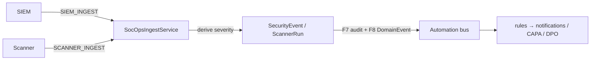
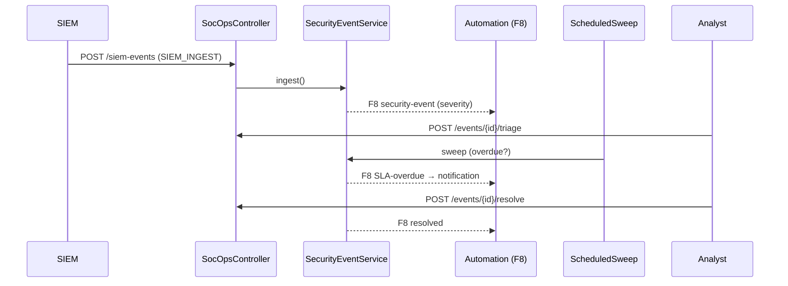
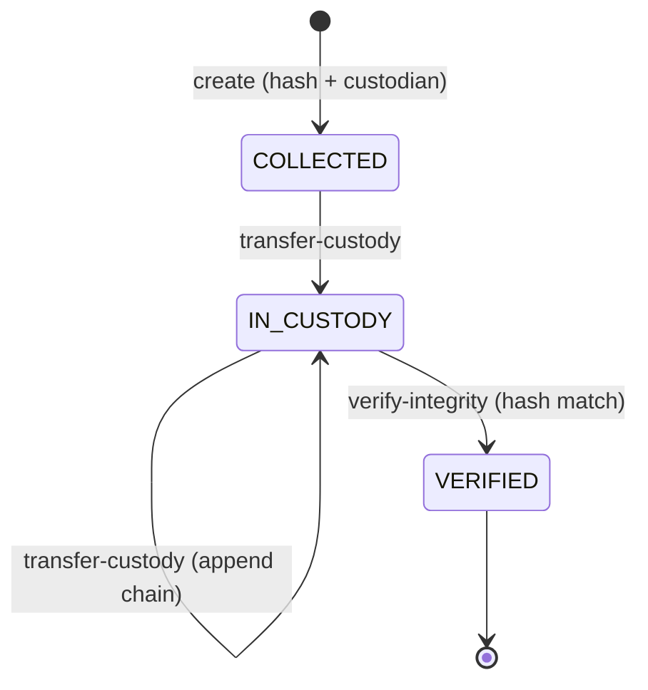
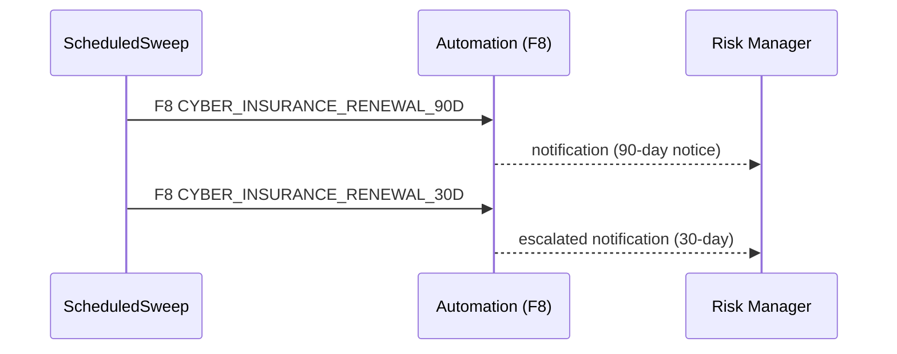

# SOC Operations Module — Complete Map, Workflows, APIs & Dependencies

**Module:** `com.tss.grc.module.socops` (backend) · SOC Operations area of the Cyber & IT Risk pillar (frontend)
**Authorization:** **role-based** (`@PreAuthorize("hasAnyRole(...)")`) — *not* the `CYBER` permission domain
**Integration style:** event-driven via the **F8 automation bus** (`DomainEvent`) — loosely coupled to the rest of the platform
**Generated:** 2026-07-04 · reflects `master @ a225bf1e`

> Companion to [`CYBERSECURITY_MODULE_MAP.md`](CYBERSECURITY_MODULE_MAP.md). SOC Operations is a **sibling module** surfaced under the same **Cyber & IT Risk** UI pillar but is architecturally distinct: it is a **SOC telemetry & operations** layer (SIEM events, scanners, threat-intel, IR playbooks, forensics, DLP, AppSec, OT, crypto, SBOM, awareness, insurance, M&A DD, regulator exams) that ingests machine feeds and fans work out through domain events.

---

## 0. Table of contents
1. [Executive overview](#1-executive-overview)
2. [Module map](#2-module-map)
3. [Navigation / IA](#3-navigation--information-architecture)
4. [Authorization model (RBAC)](#4-authorization-model)
5. [REST API catalogue (every endpoint)](#5-rest-api-catalogue)
6. [Ingest pipelines](#6-ingest-pipelines)
7. [Workflows & lifecycles (steps · actions · receipts)](#7-workflows--lifecycles)
8. [Scheduled sweep (SLA & expiry engine)](#8-scheduled-sweep)
9. [Data model (aggregates)](#9-data-model)
10. [Cross-module dependencies (event-driven)](#10-cross-module-dependencies)
11. [Sequence & relation graphs](#11-sequence--relation-graphs)

---

## 1. Executive overview

SOC Operations is a **20-aggregate** module — each a self-contained controller + service + entity + repository — grouped into six functional bands:

| Band | Aggregates |
|------|-----------|
| **Detection & response** | Security events (SIEM), IR playbooks, Threat-intel, Forensics |
| **Exposure & scanning** | Scanner runs, AppSec findings, SBOM components, Crypto assets, OT assets |
| **Data protection** | DLP events, IAM joiner-mover-leaver (JML) |
| **Assurance & posture** | Pentest engagements, Zero-Trust maturity, Awareness campaigns, Seasonal overlays |
| **Regulatory & risk transfer** | Regulator examinations, Cyber insurance |
| **Corporate events** | M&A cyber due-diligence, Brand monitoring |

**Design DNA**
- **Multi-tenant + soft-delete** like every module (`organisation_id`, `is_deleted`).
- **Role-based access** — fine-grained roles (see §4), including dedicated **machine-ingest roles** (`SIEM_INGEST`, `SCANNER_INGEST`, `DLP_INGEST`, `APPSEC_INGEST`, `SBOM_INGEST`, `JML_INGEST`, `BRAND_INGEST`, `TI_INGEST`) for automated feeds.
- **F7 audit + F8 automation** — every service writes an `AuditLogService` entry and publishes `DomainEvent.of(...)`; downstream automation rules (notifications, CAPA, DPO review) subscribe. There is **no direct call** from socops into evidence/capa/cyber/privacy — coupling is entirely through the event bus.
- **Scheduled sweep** — `SocOpsScheduledSweep` runs SLA / expiry / deadline checks across most aggregates (see §8).

---

## 2. Module map

```
module/socops/
├── controller/  (20)
│   ├── SocOpsController                 → /api/v1/socops            (dashboard + ingest)
│   ├── SecurityEventController          → /events
│   ├── IrPlaybookController             → /playbooks
│   ├── PentestEngagementController      → /pentests
│   ├── RegulatorExaminationController   → /regulator-exams
│   ├── OtAssetController                → /ot-assets
│   ├── ThreatIntelController            → /threat-intel
│   ├── ScannerRunController             → /scanner-runs
│   ├── CryptoAssetController            → /crypto-assets
│   ├── SbomComponentController          → /sbom
│   ├── ZtMaturityController             → /zt-maturity
│   ├── SeasonalOverlayController        → /seasonal-overlays
│   ├── AwarenessCampaignController      → /awareness
│   ├── AppsecFindingController          → /appsec
│   ├── DlpEventController               → /dlp
│   ├── IamJmlEventController            → /iam-jml
│   ├── ForensicsArtefactController      → /forensics
│   ├── BrandMonitoringController        → /brand-monitoring
│   ├── CyberInsuranceController         → /cyber-insurance
│   └── MaDueDiligenceController         → /ma-due-diligence
├── service/  (24)
│   ├── SocOpsDashboardService   SocOpsIngestService   SocOpsScheduledSweep (@Scheduled)
│   ├── SecurityEventService  ScannerRunService  ThreatIntelService  IrPlaybookService
│   ├── ForensicsArtefactService  DlpEventService  AppsecFindingService  SbomComponentService
│   ├── CryptoAssetService  OtAssetService  IamJmlEventService  PentestEngagementService
│   ├── RegulatorExaminationService  CyberInsuranceService  ZtMaturityService
│   ├── AwarenessCampaignService  SeasonalOverlayService  BrandMonitoringService
│   └── MaDueDiligenceService
├── entity/  (20)  SecurityEvent, IrPlaybook (+IrPlaybookStep), PentestEngagement,
│      RegulatorExamination, OtAsset, ThreatIntel, ScannerRun, CryptoAsset, SbomComponent,
│      ZtMaturity, SeasonalOverlay, AwarenessCampaign, AppsecFinding, DlpEvent,
│      IamJmlEvent, ForensicsArtefact, BrandMonitoring, CyberInsurance, MaDueDiligence
├── repository/  (one per entity)
└── dto/  SiemEventIngestRequest, ScannerRunIngestRequest, SocOpsDashboardResponse
```

Frontend (`tss-grc-ui-v2/src/pages/socops/`, 21 pages): `SocOpsDashboardPage`, `SocOpsDetailPage`, `SocOpsEventsPage`, `IrPlaybooksPage`, `PentestsPage`, `RegulatorExamsPage`, `OtAssetsPage`, `ThreatIntelPage`, `ScannerRunsPage`, `CryptoAssetsPage`, `SbomPage`, `ZtMaturityPage`, `SeasonalOverlaysPage`, `AwarenessPage`, `AppsecPage`, `DlpPage`, `IamJmlPage`, `ForensicsPage`, `BrandMonitoringPage`, `MaDueDiligencePage`, `CyberInsurancePage`.

---

## 3. Navigation / information architecture

Entry from the **Cyber & IT Risk** pillar → **SOC Operations** (`socops` node, `/socops`). Sidebar children (5 pinned) + the rest reachable from the dashboard / routes:

| Sidebar child | Route | Page |
|---------------|-------|------|
| SOC events | `/socops/events` | SocOpsEventsPage |
| IR playbooks | `/socops/playbooks` | IrPlaybooksPage |
| Pentests | `/socops/pentests` | PentestsPage |
| Regulator exams | `/socops/regulator-exams` | RegulatorExamsPage |
| OT assets | `/socops/ot-assets` | OtAssetsPage |

Full route table (`App.tsx`): `/socops` & `/socops/dashboard` → dashboard; `/socops/:id` → detail; plus `/socops/{events, playbooks, pentests, regulator-exams, ot-assets, threat-intel, scanner-runs, crypto-assets, sbom, zt-maturity, seasonal-overlays, awareness, iam-jml, appsec, dlp, cyber-insurance, brand-monitoring, forensics, ma-due-diligence}`.

**Dashboard page** (`SocOpsDashboardPage` → `GET /api/v1/socops/dashboard`) is the hub: KPI cards + per-aggregate widgets; each drills into its dedicated page. Each page is a register (list + create/edit/action) bound to the matching `/api/v1/socops/*` controller.

---

## 4. Authorization model

SOC Ops is **role-based** (contrast: `module/cyber` uses `hasPermission('CYBER',…)`). Roles observed:

| Category | Roles |
|----------|-------|
| Core | `CISO`, `SECURITY_ANALYST`, `PLATFORM_ADMIN`, `AUDITOR`, `RISK_MANAGER` |
| Specialist leads | `OT_LEAD`, `IAM_LEAD`, `HR_LEAD`, `FORENSICS_LEAD`, `IR_LEAD`, `APPSEC_LEAD`, `DLP_REVIEWER`, `MA_LEAD`, `LEGAL_COUNSEL`, `CFO`, `FINANCE_LEAD`, `COMPLIANCE_OFFICER`, `BRAND_MONITORING` |
| Machine ingest | `SIEM_INGEST`, `SCANNER_INGEST`, `DLP_INGEST`, `APPSEC_INGEST`, `SBOM_INGEST`, `JML_INGEST`, `BRAND_INGEST`, `TI_INGEST` |

Pattern: **read** = broad (CISO/analyst/admin/auditor + domain lead); **write/create** = narrower (CISO + domain lead + admin); **ingest** = a dedicated machine role (+admin/CISO); **delete** = `PLATFORM_ADMIN` only (some allow CISO).

---

## 5. REST API catalogue

All under `/api/v1/socops`. Roles abbreviated: **CI**=CISO, **SA**=SECURITY_ANALYST, **PA**=PLATFORM_ADMIN, **AU**=AUDITOR, **RM**=RISK_MANAGER.

### 5.1 Core — `SocOpsController` `/api/v1/socops`
| Method | Path | Roles | Purpose |
|--------|------|-------|---------|
| GET | `/dashboard` | CI/SA/PA/RM/AU | Aggregated SOC KPI snapshot |
| POST | `/siem-events` | `SIEM_INGEST`/PA/CI | Ingest SIEM event(s) → SecurityEvent |
| POST | `/scanner-runs` | `SCANNER_INGEST`/PA/CI | Ingest scanner run → ScannerRun |

### 5.2 Detection & response
| Controller | Base | Endpoints |
|-----------|------|-----------|
| **SecurityEvent** | `/events` | GET · GET `/{id}` · **POST `/{id}/triage`** · **POST `/{id}/resolve`** · DELETE `/{id}` |
| **IrPlaybook** | `/playbooks` | GET · GET `/templates` · GET `/{id}` · GET `/{id}/steps` · **POST `/clone`** · POST · **POST `/{id}/invoke`** |
| **ThreatIntel** | `/threat-intel` | GET · GET `/{id}` · POST · **POST `/{id}/action`** · DELETE `/{id}` |
| **ForensicsArtefact** | `/forensics` | GET · GET `/{id}` · GET `/by-case/{caseCode}` · POST · PUT `/{id}` · **POST `/{id}/transfer-custody`** · **POST `/{id}/verify-integrity`** |

### 5.3 Exposure & scanning
| Controller | Base | Endpoints |
|-----------|------|-----------|
| **ScannerRun** | `/scanner-runs` | GET · GET `/{id}` |
| **AppsecFinding** | `/appsec` | GET · GET `/{id}` · **POST `/ingest`** · POST · PUT `/{id}` · DELETE `/{id}` |
| **SbomComponent** | `/sbom` | GET · POST *(ingest)* |
| **CryptoAsset** | `/crypto-assets` | GET · **GET `/expiring`** · GET `/{id}` · POST · PUT `/{id}` · DELETE `/{id}` |
| **OtAsset** | `/ot-assets` | GET · GET `/{id}` · POST · PUT `/{id}` · DELETE `/{id}` |

### 5.4 Data protection
| Controller | Base | Endpoints |
|-----------|------|-----------|
| **DlpEvent** | `/dlp` | GET · GET `/{id}` · **POST `/ingest`** · **POST `/{id}/review`** |
| **IamJmlEvent** | `/iam-jml` | GET · GET `/{id}` · **GET `/privileged-reviews-due`** · POST · PUT `/{id}` · DELETE `/{id}` |

### 5.5 Assurance & posture
| Controller | Base | Endpoints |
|-----------|------|-----------|
| **PentestEngagement** | `/pentests` | GET · GET `/{id}` · POST · PUT `/{id}` · DELETE `/{id}` |
| **ZtMaturity** | `/zt-maturity` | GET · GET `/{assessmentCode}` · POST |
| **AwarenessCampaign** | `/awareness` | GET · GET `/{id}` · POST · PUT `/{id}` · DELETE `/{id}` |
| **SeasonalOverlay** | `/seasonal-overlays` | GET · **GET `/active-now`** · GET `/{id}` · POST |

### 5.6 Regulatory & risk transfer
| Controller | Base | Endpoints |
|-----------|------|-----------|
| **RegulatorExamination** | `/regulator-exams` | GET · GET `/{id}` · POST · PUT `/{id}` · DELETE `/{id}` |
| **CyberInsurance** | `/cyber-insurance` | GET · GET `/{id}` · **GET `/renewals-due`** · POST · PUT `/{id}` · DELETE `/{id}` |

### 5.7 Corporate events
| Controller | Base | Endpoints |
|-----------|------|-----------|
| **MaDueDiligence** | `/ma-due-diligence` | GET · GET `/{id}` · POST · PUT `/{id}` · **POST `/{id}/transition`** · DELETE `/{id}` |
| **BrandMonitoring** | `/brand-monitoring` | GET · GET `/{id}` · **POST `/ingest`** · **POST `/{id}/request-takedown`** · **POST `/{id}/complete-takedown`** |

---

## 6. Ingest pipelines

Machine feeds arrive on dedicated endpoints guarded by `*_INGEST` roles and are processed by `SocOpsIngestService` (SIEM + scanner) or the per-aggregate service. Ingest **auto-derives severity** and **publishes a `DomainEvent`** so automation rules can act immediately.

| Feed | Endpoint | Ingest role | Produces | Event |
|------|----------|-------------|----------|-------|
| SIEM alerts | `POST /siem-events` | `SIEM_INGEST` | `SecurityEvent` | severity-tiered SOC event |
| Vuln scanner | `POST /scanner-runs` | `SCANNER_INGEST` | `ScannerRun` (+ findings) | scan-complete |
| DLP | `POST /dlp/ingest` | `DLP_INGEST` | `DlpEvent` | DLP incident (high → escalate) |
| AppSec (SAST/DAST) | `POST /appsec/ingest` | `APPSEC_INGEST` | `AppsecFinding` | finding by severity |
| SBOM | `POST /sbom` | `SBOM_INGEST` | `SbomComponent` | component inventory |
| IAM JML | `POST /iam-jml` | `JML_INGEST` | `IamJmlEvent` | joiner/mover/leaver |
| Brand | `POST /brand-monitoring/ingest` | `BRAND_INGEST` | `BrandMonitoring` | impersonation/phish detection |
| Threat-intel | `POST /threat-intel` | `TI_INGEST` | `ThreatIntel` | IOC feed |



---

## 7. Workflows & lifecycles

**Receipt** legend as in the cyber doc: **F7** audit, **F8** `DomainEvent`, **DB** state write.

### 7.1 Security event (SIEM alert) triage → resolve
```
(ingest) NEW → triage → TRIAGED → resolve → RESOLVED
```
| Action | Endpoint | Receipt |
|--------|----------|---------|
| ingest | `POST /siem-events` | DB, F7, **F8** (new event, severity-tiered) |
| triage | `POST /events/{id}/triage` | DB (assignee, disposition), F7, **F8** |
| resolve | `POST /events/{id}/resolve` | DB (resolution), F7, **F8** |
| (sweep) | — | overdue events emit an SLA event (see §8) |

### 7.2 IR playbook: template → clone → invoke
`IrPlaybook` + `IrPlaybookStep`: browse `/templates`, `POST /clone` to instantiate an org copy, `POST /{id}/invoke` to start a run (steps tracked). Receipts: F7 + **F8** on invoke.

### 7.3 Forensics chain-of-custody
```
create artefact → (transfer-custody)* → verify-integrity
```
| Action | Endpoint | Guard / effect | Receipt |
|--------|----------|----------------|---------|
| create | `POST /forensics` | opens artefact w/ hash + custodian | F7 |
| transfer custody | `POST /{id}/transfer-custody` | append custody entry (who→whom) | DB, F7, **F8** |
| verify integrity | `POST /{id}/verify-integrity` | recompute hash vs stored | DB, F7 |
| by case | `GET /by-case/{caseCode}` | all artefacts for a case | — |

Legally significant: custody transfers + integrity checks are the evidentiary trail (roles gated to `FORENSICS_LEAD`/`IR_LEAD`/`CISO`/`LEGAL_COUNSEL`).

### 7.4 Brand-monitoring takedown
```
(ingest) DETECTED → request-takedown → TAKEDOWN_REQUESTED → complete-takedown → RESOLVED
```
| Action | Endpoint | Receipt |
|--------|----------|---------|
| ingest | `POST /brand-monitoring/ingest` | DB, F7, **F8** (impersonation detected) |
| request takedown | `POST /{id}/request-takedown` | DB, F7 |
| complete takedown | `POST /{id}/complete-takedown` | DB, F7 |

### 7.5 M&A cyber due-diligence
`MaDueDiligence` runs a **state machine** advanced by `POST /{id}/transition` (guarded to `CISO`/`MA_LEAD`/`PLATFORM_ADMIN`) — scoping the target's cyber posture through diligence phases; publishes **F8** on each transition.

### 7.6 DLP review
```
(ingest) OPEN → review → {CONFIRMED | FALSE_POSITIVE | ...}
```
`POST /dlp/{id}/review` records the reviewer disposition; high-severity ingests publish an escalation **F8** event.

### 7.7 Other aggregate lifecycles (summary)
| Aggregate | Lifecycle / key actions | Sweep hook (§8) |
|-----------|-------------------------|-----------------|
| ThreatIntel | ingest → `action` (block/monitor/dismiss) | — |
| Pentest | plan → execute → report → close | overdue engagement event |
| RegulatorExamination | open → respond → close (deadlines) | deadline event |
| CyberInsurance | policy CRUD + `renewals-due` | `CYBER_INSURANCE_RENEWAL_90D/30D` |
| CryptoAsset | cert register + `expiring` | `CRYPTO_CERT_EXPIRING_30D` / `CRYPTO_CERT_EXPIRED` |
| IamJmlEvent | JML lifecycle + `privileged-reviews-due` | privileged-review-due event |
| AppsecFinding | ingest/create → severity → remediate | ageing finding event |
| SeasonalOverlay | define time-boxed overlay + `active-now` | activate/expire event |
| ZtMaturity | assessment by `assessmentCode` | — |
| AwarenessCampaign | campaign CRUD | — |
| SbomComponent | ingest inventory | — |
| OtAsset | OT/ICS asset register | — |

---

## 8. Scheduled sweep

`SocOpsScheduledSweep` (`@Scheduled`, per-tenant `TenantContext`) is the module's time engine. Each pass checks deadlines/expiries and publishes `DomainEvent`s the automation layer turns into notifications/CAPA:

| Swept aggregate | Emits (examples) |
|-----------------|------------------|
| SecurityEvent | SLA overdue trigger |
| RegulatorExamination | deadline trigger |
| CyberInsurance | `CYBER_INSURANCE_RENEWAL_90D`, `CYBER_INSURANCE_RENEWAL_30D` |
| IamJmlEvent | privileged-review-due trigger |
| CryptoAsset | `CRYPTO_CERT_EXPIRED`, `CRYPTO_CERT_EXPIRING_30D` |
| PentestEngagement | overdue engagement trigger |
| SeasonalOverlay | activate / expire trigger |
| ForensicsArtefact | ageing/retention trigger |
| AppsecFinding | ageing finding trigger |
| DlpEvent | unreviewed DLP trigger |

Each sweep writes an F7 audit summary and per-item **F8** events.

---

## 9. Data model

20 aggregates (each `id`, `external_id`, `organisation_id`, `is_deleted`, `created_at` + domain columns). Tables are provisioned by **Flyway migrations** (socops is a Sprint-late module — not in `setup_cyber_db.py`).

| Aggregate | Purpose | Representative key attributes |
|-----------|---------|-------------------------------|
| SecurityEvent | SIEM alert record | source, severity, status (NEW→TRIAGED→RESOLVED), assignee, detected_at |
| IrPlaybook / IrPlaybookStep | IR runbook + ordered steps | name, is_template, step order/owner/status |
| ThreatIntel | IOC feed item | ioc_type, value, confidence, action |
| ForensicsArtefact | evidence artefact | case_code, hash, custodian, custody_chain, integrity_verified |
| ScannerRun | scan execution | scanner, target, started/finished, findings_count |
| AppsecFinding | SAST/DAST finding | tool, severity, cwe, status |
| SbomComponent | software component | package, version, license, vuln_flag |
| CryptoAsset | cert/key inventory | subject, issuer, algo, expiry_date |
| OtAsset | OT/ICS asset | zone, protocol, vendor, criticality |
| DlpEvent | data-loss event | channel, severity, review disposition |
| IamJmlEvent | joiner/mover/leaver | user, event_type, privileged, review_due |
| PentestEngagement | pentest | scope, tester, window, status |
| ZtMaturity | zero-trust assessment | assessment_code, pillar scores |
| SeasonalOverlay | time-boxed threat posture | window start/end, elevated controls |
| AwarenessCampaign | training campaign | audience, phishing rate, completion |
| RegulatorExamination | regulator exam | regulator, scope, deadline, status |
| CyberInsurance | insurance policy | insurer, coverage, renewal_date |
| MaDueDiligence | M&A cyber DD | target, phase (state machine), findings |
| BrandMonitoring | brand/phish detection | detected_domain, status (DETECTED→…→RESOLVED) |

> Exact columns/enum values live in the entity classes + Flyway migrations; the table above captures purpose + the attributes the workflows and sweep act on.

---

## 10. Cross-module dependencies

SOC Ops is deliberately **loosely coupled** — it depends only on the **platform** layer (audit + automation + realtime) and integrates with everything else **through domain events**, not direct service calls.

```mermaid
graph LR
  SOC["SOC Operations (20 aggregates)"]
  SOC -->|F7 audit_log| AUD["platform · AuditLogService"]
  SOC -->|F8 DomainEvent.of(...)| BUS["platform · Automation engine"]
  BUS --> N["Notifications"]
  BUS --> C["CAPA / action plans"]
  BUS --> D["Privacy / DPO review"]
  BUS --> R["Risk / KRI signals"]
  SOC -.dashboard rollup.-> CYBER["Cyber pillar dashboard"]
  SWEEP["SocOpsScheduledSweep @Scheduled"] --> SOC
```

| Direction | Mechanism | Purpose |
|-----------|-----------|---------|
| socops → platform (audit) | `AuditLogService.log(...)` | F7 trail on every mutation/ingest/sweep |
| socops → platform (automation) | `ApplicationEventPublisher` → `DomainEvent.of(...)` | F8 triggers (SIEM, DLP, cert-expiry, insurance-renewal, JML-review, pentest-overdue …) → rules fan to notifications/CAPA/DPO |
| socops → other modules | **via F8 events only** | no direct import of evidence/capa/cyber/privacy — pure event choreography |
| scheduler → socops | `SocOpsScheduledSweep` | deadline/expiry detection |

This is the key architectural contrast with `module/cyber`, which calls some collaborators directly (e.g. assessment→CyberActionPlan). SOC Ops keeps every integration on the bus.

---

## 11. Sequence & relation graphs

### 11.1 SIEM alert → triage → resolve (with sweep escalation)


### 11.2 Forensics chain-of-custody


### 11.3 Cyber-insurance renewal sweep


### 11.4 Aggregate → event-band map

```mermaid
graph TD
  subgraph Detection
    SE2[SecurityEvent] --- IRP[IrPlaybook] --- TI[ThreatIntel] --- FA[Forensics]
  end
  subgraph Exposure
    SR[ScannerRun] --- AF[AppsecFinding] --- SB[SbomComponent] --- CA[CryptoAsset] --- OT[OtAsset]
  end
  subgraph DataProtection
    DLP[DlpEvent] --- JML[IamJmlEvent]
  end
  subgraph Assurance
    PT[Pentest] --- ZT[ZtMaturity] --- AW[Awareness] --- SO[SeasonalOverlay]
  end
  subgraph Regulatory
    RE[RegulatorExam] --- CINS[CyberInsurance]
  end
  subgraph Corporate
    MA[MaDueDiligence] --- BM[BrandMonitoring]
  end
```


---

### Cross-reference
- Core cyber controls/vulns/incidents/ASM/SLA: [`CYBERSECURITY_MODULE_MAP.md`](CYBERSECURITY_MODULE_MAP.md)
- Both modules publish to the same **F8 automation engine** (`platform/automation`) and write the same **F7 audit_log** (`platform/auditlog`); automation rules are where SOC-Ops telemetry becomes cyber CAPA, privacy DPO reviews, and notifications.
