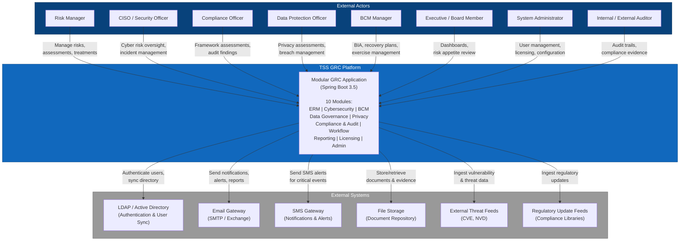

# C4 Context Diagram - TSS GRC Platform
> **HISTORIC — point-in-time snapshot (all files 2026-04-30). Not a statement of current state.**
> For what the platform is today read [`CLAUDE.md`](../../CLAUDE.md) and [`PROJECT_CHRONICLE.md`](../../PROJECT_CHRONICLE.md); for measured figures, [`MEASURED_BASELINE.md`](../../TSS-GRC-Platform-Bible/Appendix/MEASURED_BASELINE.md). Kept for provenance. *(W0-6)*

## Purpose

This diagram provides a high-level view of the TSS GRC platform, showing the system boundary, external actors (users and personas), and external systems it integrates with. It is the starting point for understanding the platform's scope and ecosystem.

## Context Diagram

## Key Interactions

- **User Actors** interact with the platform through a web browser over HTTPS.
- **LDAP/AD** provides centralized authentication and directory synchronization.
- **Email and SMS Gateways** handle all outbound notifications, escalations, and report delivery.
- **File Storage** serves as the document repository for attachments, evidence, and generated reports.
- **External Feeds** provide threat intelligence and regulatory update data to keep the platform current.
