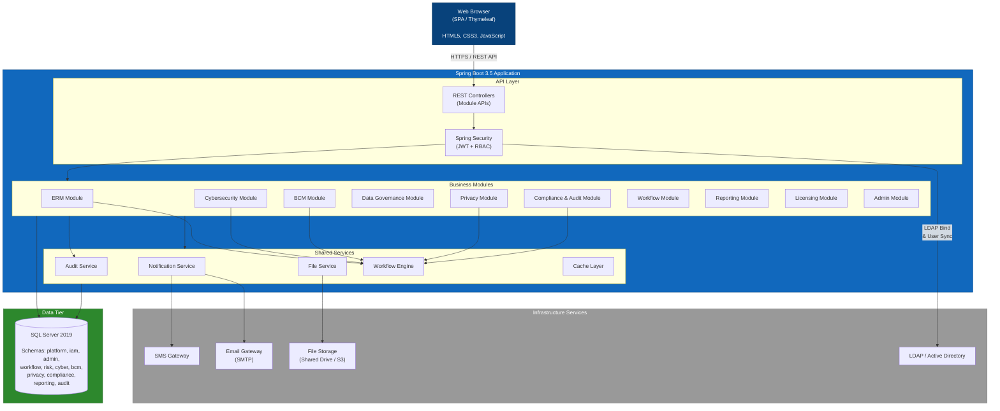

# C4 Container Architecture - TSS GRC Platform
> **HISTORIC — point-in-time snapshot (all files 2026-04-30). Not a statement of current state.**
> For what the platform is today read [`CLAUDE.md`](../../CLAUDE.md) and [`PROJECT_CHRONICLE.md`](../../PROJECT_CHRONICLE.md); for measured figures, [`MEASURED_BASELINE.md`](../../TSS-GRC-Platform-Bible/Appendix/MEASURED_BASELINE.md). Kept for provenance. *(W0-6)*

## Purpose

This diagram decomposes the TSS GRC platform into its primary containers: the web browser client, the Spring Boot application with its internal modules, the SQL Server database, and supporting infrastructure services.

## Container Diagram

## Container Descriptions

| Container | Technology | Responsibility |
|-----------|-----------|----------------|
| Web Browser | HTML5 / JS | User interface for all GRC functions |
| Spring Boot App | Java 21 + Spring Boot 3.5 | Core application hosting all 10 modules as a modular monolith |
| SQL Server | SQL Server 2019 | Persistent storage with schema-per-module isolation |
| File Storage | Shared Drive or S3 | Document and evidence file storage |
| LDAP/AD | Active Directory | Authentication provider and user directory |
| Email Gateway | SMTP / Exchange | Outbound email notifications |
| SMS Gateway | SMS API | Critical alert delivery via SMS |

## Design Decisions

- **Modular Monolith**: All modules are deployed within a single Spring Boot application but are logically isolated via package boundaries and separate database schemas.
- **Schema Isolation**: Each functional domain owns its database schema, enabling clear data ownership while sharing a single SQL Server instance.
- **Shared Services**: Audit logging, workflow engine, notifications, and file management are cross-cutting concerns shared by all modules.
