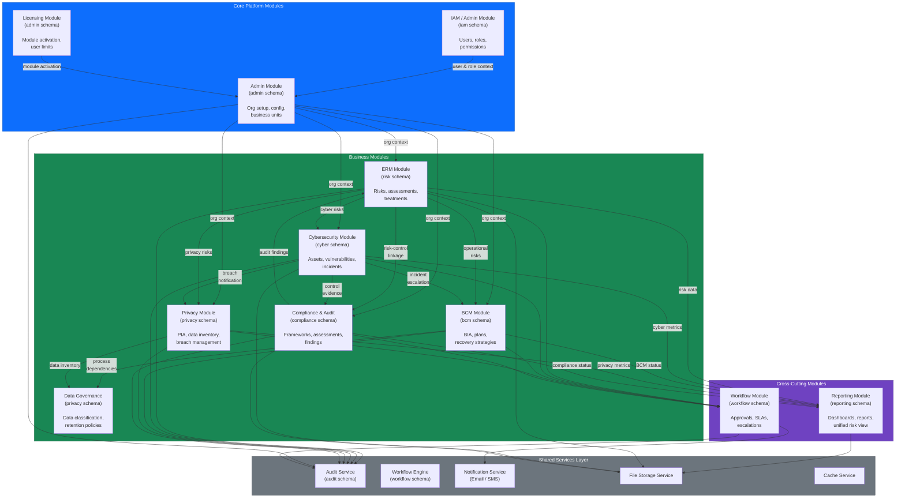

# Module Interaction Diagram - TSS GRC Platform
> **HISTORIC — point-in-time snapshot (all files 2026-04-30). Not a statement of current state.**
> For what the platform is today read [`CLAUDE.md`](../../CLAUDE.md) and [`PROJECT_CHRONICLE.md`](../../PROJECT_CHRONICLE.md); for measured figures, [`MEASURED_BASELINE.md`](../../TSS-GRC-Platform-Bible/Appendix/MEASURED_BASELINE.md). Kept for provenance. *(W0-6)*

## Purpose

This diagram shows all 10 platform modules, their inter-module dependencies, and how they leverage shared services. Understanding these interactions is critical for maintaining module boundaries and planning integration points.

## Module Interaction Diagram

## Module Dependency Summary

| Module | Depends On | Depended On By |
|--------|-----------|----------------|
| Admin | IAM, Licensing | All business modules |
| ERM | Admin, Workflow, Audit | Cyber, BCM, Privacy, Compliance, Reporting |
| Cybersecurity | Admin, ERM, Workflow, Audit | BCM, Privacy, Compliance, Reporting |
| BCM | Admin, ERM, Cyber, Workflow, Audit | Reporting |
| Privacy | Admin, ERM, Cyber, Data Gov, Workflow, Audit | Reporting |
| Compliance | Admin, ERM, Workflow, Audit | Reporting |
| Data Governance | Admin, Audit | BCM, Privacy |
| Reporting | All business modules | None |
| Workflow | Notification, Audit | All business modules |
| Licensing | None | Admin |

## Design Principles

- Modules communicate through well-defined service interfaces, not direct database access across schemas.
- All state-changing operations pass through the Audit Service for traceability.
- The Workflow Engine is the single orchestrator for approval flows across all modules.
- The Reporting Module is a read-only consumer that aggregates data from all business modules.
