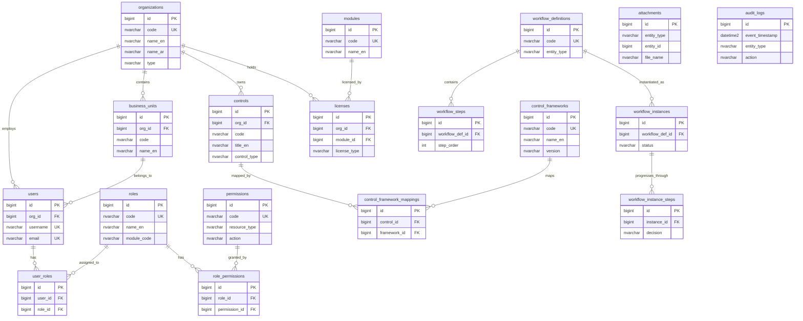

# ERD - Core Shared Entities
> **HISTORIC — point-in-time snapshot (all files 2026-04-30). Not a statement of current state.**
> For what the platform is today read [`CLAUDE.md`](../../CLAUDE.md) and [`PROJECT_CHRONICLE.md`](../../PROJECT_CHRONICLE.md); for measured figures, [`MEASURED_BASELINE.md`](../../TSS-GRC-Platform-Bible/Appendix/MEASURED_BASELINE.md). Kept for provenance. *(W0-6)*

## Purpose

This entity-relationship diagram defines the foundational data model shared across all modules of the TSS GRC Platform. It includes organizations, users, roles and permissions (RBAC), controls, frameworks, licensing, workflows, attachments, and audit logging.

## Entity-Relationship Diagram

## Entity Descriptions

### Organization & Structure
- **organizations** - Top-level tenant entity. Each client organization is a separate tenant with isolated data.
- **business_units** - Divisions, departments, or branches within an organization used for scoping and reporting.

### Identity & Access Management
- **users** - All platform users authenticated via LDAP/AD or local credentials.
- **roles** - Named permission groups scoped to a module (e.g., RISK_MANAGER, COMPLIANCE_OFFICER).
- **permissions** - Fine-grained action permissions on resource types (e.g., RISK:CREATE, CONTROL:UPDATE).
- **user_roles** - Junction table assigning roles to users (many-to-many).
- **role_permissions** - Junction table granting permissions to roles (many-to-many).

### Controls & Frameworks
- **controls** - Organizational controls that mitigate risks. Shared across modules (ERM, Cyber, Compliance).
- **control_frameworks** - Regulatory and standard frameworks (ISO 27001, NCA ECC, PDPL, ISO 22301).
- **control_framework_mappings** - Maps internal controls to framework requirements for compliance tracking.

### Licensing
- **modules** - Platform modules available for licensing (ERM, Cyber, BCM, Privacy, Compliance, etc.).
- **licenses** - Tracks which modules each organization is licensed to use, with license type and validity.

### Workflow Engine
- **workflow_definitions** - Configurable workflow templates tied to entity types (e.g., risk approval, incident review).
- **workflow_steps** - Ordered steps within a workflow definition (e.g., Step 1: Manager Review, Step 2: CISO Approval).
- **workflow_instances** - Active workflow executions tied to specific entity records.
- **workflow_instance_steps** - Tracks progress and decisions at each step of a running workflow.

### Cross-Cutting
- **attachments** - Polymorphic file attachment storage. Uses entity_type and entity_id to link to any record.
- **audit_logs** - Immutable audit trail capturing all create, update, and delete operations across the platform.
