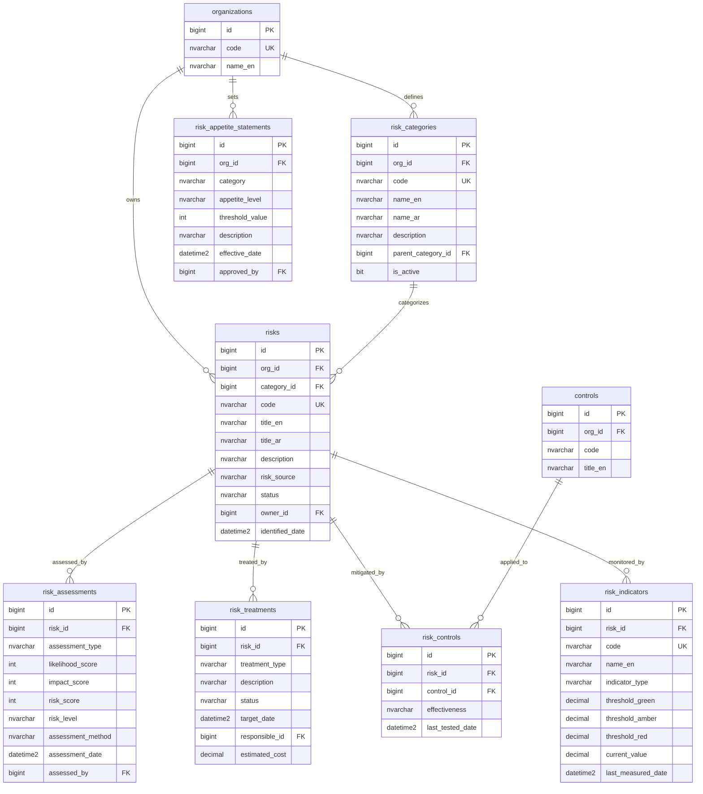

# ERD - Risk Management Module

## Purpose

This diagram defines the data model for the Enterprise Risk Management (ERM) module. It covers risk identification, categorization, assessment (inherent and residual), treatment planning, control linkage, risk appetite, and key risk indicators. Relationships to the shared platform entities (organizations, controls) are shown.

## Entity-Relationship Diagram

## Key Concepts

- **risk_categories** - Hierarchical taxonomy for classifying risks (strategic, operational, financial, compliance, cyber). Supports parent-child nesting.
- **risks** - Core risk register entries owned by an organization and assigned to a risk owner.
- **risk_assessments** - Records both inherent (before controls) and residual (after controls) assessments using likelihood x impact scoring.
- **risk_treatments** - Treatment plans with one of four strategies: Accept, Mitigate, Transfer, or Avoid.
- **risk_controls** - Links risks to platform controls and tracks control effectiveness.
- **risk_appetite_statements** - Organization-level risk appetite and tolerance thresholds per category.
- **risk_indicators** - Key Risk Indicators (KRIs) with traffic-light thresholds for ongoing monitoring.

## Cross-Module Relationships

- Risks link to **platform.controls** for shared control mitigation tracking.
- Risks are owned by **platform.organizations** for multi-tenant isolation.
- Cyber incidents and privacy breaches can create linked risk entries via the risk_source field.
