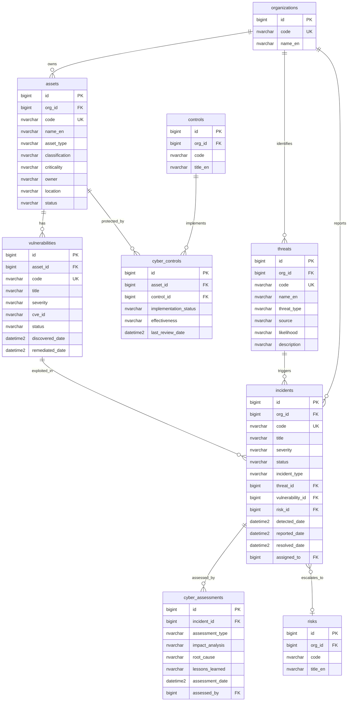

# ERD - Cybersecurity Module

## Purpose

This diagram defines the data model for the Cybersecurity module covering asset management, vulnerability tracking, threat identification, incident management, cyber assessments, and cyber-specific controls. It shows the critical linkage from incidents to the Risk module for enterprise risk escalation.

## Entity-Relationship Diagram

## Key Concepts

- **assets** - IT and information assets (servers, databases, applications, endpoints) classified by type, criticality, and data classification.
- **vulnerabilities** - Known weaknesses in assets, optionally linked to CVE identifiers, tracked through discovery to remediation.
- **threats** - Identified threat actors and threat types (malware, phishing, insider, APT) relevant to the organization.
- **incidents** - Security incidents from detection through resolution. Can link to the triggering threat and exploited vulnerability.
- **cyber_assessments** - Post-incident analysis including impact, root cause, and lessons learned.
- **cyber_controls** - Maps platform controls to specific assets, tracking implementation status and effectiveness.

## Cross-Module Relationships

- **incidents -> risks** - A cyber incident can escalate to an enterprise risk entry in the Risk module via risk_id. This enables the unified risk view.
- **cyber_controls -> platform.controls** - Reuses the shared controls library for consistent control management across modules.
- **incidents -> privacy.breach_records** - Incidents involving personal data trigger privacy breach workflows (linked via the Privacy module).
