# ERD - Business Continuity Management Module

## Purpose

This diagram defines the data model for the BCM module covering critical business process identification, dependency mapping, business impact analysis (BIA), continuity planning, recovery strategies, and exercise management.

## Entity-Relationship Diagram

```mermaid
erDiagram
    organizations ||--o{ critical_processes : identifies
    critical_processes ||--o{ process_dependencies : depends_on
    critical_processes ||--o{ business_impact_analyses : analyzed_by
    organizations ||--o{ bcm_plans : maintains
    bcm_plans ||--o{ recovery_strategies : defines
    recovery_strategies }o--|| critical_processes : recovers
    organizations ||--o{ bcm_exercises : conducts
    bcm_exercises }o--|| bcm_plans : tests

    organizations {
        bigint id PK
        nvarchar code UK
        nvarchar name_en
    }
    critical_processes {
        bigint id PK
        bigint org_id FK
        nvarchar code UK
        nvarchar name_en
        nvarchar name_ar
        nvarchar description
        nvarchar process_owner
        bigint business_unit_id FK
        nvarchar criticality_tier
        int rto_hours
        int rpo_hours
        int mtpd_hours
        nvarchar status
    }
    process_dependencies {
        bigint id PK
        bigint process_id FK
        bigint depends_on_process_id FK
        nvarchar dependency_type
        nvarchar description
        nvarchar criticality
    }
    business_impact_analyses {
        bigint id PK
        bigint process_id FK
        nvarchar bia_period
        nvarchar financial_impact
        nvarchar operational_impact
        nvarchar reputational_impact
        nvarchar regulatory_impact
        nvarchar overall_impact_level
        datetime2 assessment_date
        bigint assessed_by FK
        nvarchar status
    }
    bcm_plans {
        bigint id PK
        bigint org_id FK
        nvarchar code UK
        nvarchar name_en
        nvarchar plan_type
        nvarchar version
        nvarchar status
        datetime2 effective_date
        datetime2 next_review_date
        bigint owner_id FK
    }
    recovery_strategies {
        bigint id PK
        bigint plan_id FK
        bigint process_id FK
        nvarchar strategy_type
        nvarchar description
        int target_rto_hours
        int target_rpo_hours
        nvarchar resource_requirements
        decimal estimated_cost
        nvarchar status
    }
    bcm_exercises {
        bigint id PK
        bigint org_id FK
        bigint plan_id FK
        nvarchar code UK
        nvarchar exercise_type
        nvarchar name_en
        datetime2 scheduled_date
        datetime2 actual_date
        nvarchar status
        nvarchar outcome
        nvarchar lessons_learned
        bigint coordinator_id FK
    }
```

## Key Concepts

- **critical_processes** - Business processes identified as critical with defined RTO (Recovery Time Objective), RPO (Recovery Point Objective), and MTPD (Maximum Tolerable Period of Disruption).
- **process_dependencies** - Maps upstream and downstream dependencies between critical processes (IT systems, suppliers, other processes).
- **business_impact_analyses** - Periodic BIA assessments measuring financial, operational, reputational, and regulatory impacts of process disruption.
- **bcm_plans** - Business continuity and disaster recovery plans with versioning and review cycles.
- **recovery_strategies** - Specific recovery approaches for each critical process within a plan, with target RTO/RPO and cost estimates.
- **bcm_exercises** - Tabletop exercises, simulations, and full tests to validate plan effectiveness and capture lessons learned.

## Cross-Module Relationships

- BIA impact data feeds into the **Unified Risk View** for enterprise-wide risk aggregation.
- Critical process disruptions can trigger **risk entries** in the ERM module.
- IT asset dependencies link to the **Cybersecurity module** asset inventory.
