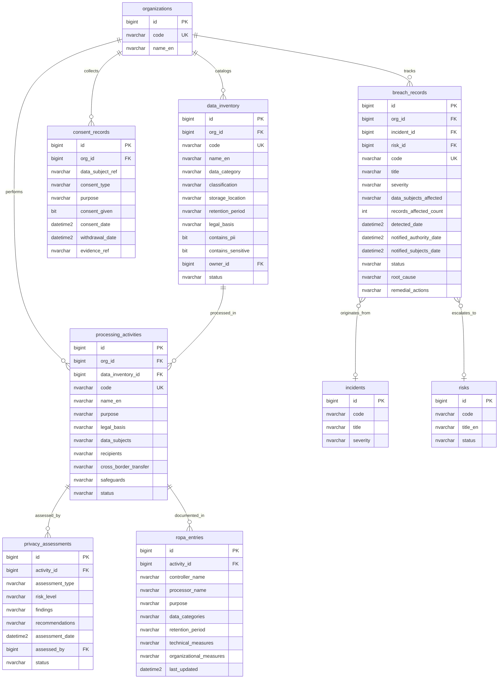

# ERD - Privacy & Data Governance Module
> **HISTORIC — point-in-time snapshot (all files 2026-04-30). Not a statement of current state.**
> For what the platform is today read [`CLAUDE.md`](../../CLAUDE.md) and [`PROJECT_CHRONICLE.md`](../../PROJECT_CHRONICLE.md); for measured figures, [`MEASURED_BASELINE.md`](../../TSS-GRC-Platform-Bible/Appendix/MEASURED_BASELINE.md). Kept for provenance. *(W0-6)*

## Purpose

This diagram defines the data model for the Privacy module covering data inventory, processing activity records, privacy impact assessments, consent management, breach management, and Records of Processing Activities (ROPA). It shows cross-module links to cyber incidents and enterprise risks.

## Entity-Relationship Diagram

## Key Concepts

- **data_inventory** - Catalog of all personal and sensitive data assets held by the organization, with classification and retention policies.
- **processing_activities** - Records of how data is processed, for what purpose, under what legal basis (PDPL, GDPR compliance).
- **privacy_assessments** - Privacy Impact Assessments (PIA) and Data Protection Impact Assessments (DPIA) for processing activities.
- **consent_records** - Tracks consent given by data subjects, including purpose, date, and withdrawal status.
- **breach_records** - Personal data breach register with authority/subject notification tracking and regulatory timelines.
- **ropa_entries** - Regulatory-mandated Records of Processing Activities for controller and processor documentation.

## Cross-Module Relationships

- **breach_records -> cyber.incidents** - A privacy breach originates from a cybersecurity incident (incident_id links to the Cyber module).
- **breach_records -> risk.risks** - A significant breach escalates to an enterprise risk entry (risk_id links to the Risk module).
- Both linkages feed into the **Unified Risk View** for holistic risk reporting.
