# ERD - Compliance & Audit Module

## Purpose

This diagram defines the data model for the Compliance module covering framework management, compliance assessments, control assessments, findings, gap identification, remediation planning, and evidence management.

## Entity-Relationship Diagram

```mermaid
erDiagram
    organizations ||--o{ compliance_frameworks : adopts
    compliance_frameworks ||--o{ assessments : evaluated_by
    assessments ||--o{ assessment_controls : includes
    controls ||--o{ assessment_controls : assessed_in
    assessments ||--o{ findings : produces
    findings ||--o{ gaps : identifies
    gaps ||--o{ remediation_plans : addressed_by
    assessment_controls ||--o{ evidence_items : supported_by

    organizations {
        bigint id PK
        nvarchar code UK
        nvarchar name_en
    }
    controls {
        bigint id PK
        bigint org_id FK
        nvarchar code
        nvarchar title_en
    }
    compliance_frameworks {
        bigint id PK
        bigint org_id FK
        nvarchar code UK
        nvarchar name_en
        nvarchar name_ar
        nvarchar version
        nvarchar framework_type
        nvarchar issuing_body
        datetime2 effective_date
        nvarchar status
    }
    assessments {
        bigint id PK
        bigint framework_id FK
        nvarchar code UK
        nvarchar name_en
        nvarchar assessment_type
        nvarchar scope
        datetime2 start_date
        datetime2 end_date
        nvarchar status
        bigint lead_assessor_id FK
    }
    assessment_controls {
        bigint id PK
        bigint assessment_id FK
        bigint control_id FK
        nvarchar compliance_status
        nvarchar maturity_level
        nvarchar evidence_status
        nvarchar notes
        bigint assessor_id FK
    }
    findings {
        bigint id PK
        bigint assessment_id FK
        nvarchar code UK
        nvarchar title
        nvarchar description
        nvarchar severity
        nvarchar finding_type
        nvarchar status
        bigint owner_id FK
        datetime2 due_date
    }
    gaps {
        bigint id PK
        bigint finding_id FK
        nvarchar code UK
        nvarchar description
        nvarchar gap_type
        nvarchar priority
        nvarchar current_state
        nvarchar target_state
        nvarchar status
    }
    remediation_plans {
        bigint id PK
        bigint gap_id FK
        nvarchar code UK
        nvarchar title
        nvarchar description
        nvarchar status
        datetime2 target_date
        datetime2 completed_date
        bigint responsible_id FK
        decimal estimated_cost
        int progress_percentage
    }
    evidence_items {
        bigint id PK
        bigint assessment_control_id FK
        nvarchar code UK
        nvarchar title
        nvarchar evidence_type
        nvarchar file_reference
        datetime2 collected_date
        bigint collected_by FK
        nvarchar status
    }
```

## Key Concepts

- **compliance_frameworks** - Regulatory and standards frameworks adopted by the organization (NCA ECC, ISO 27001, PDPL, SAMA CSF, ISO 22301).
- **assessments** - Periodic compliance assessments scoped to a framework, with assigned lead assessors and timelines.
- **assessment_controls** - Per-control assessment results including compliance status, maturity level, and evidence status.
- **findings** - Non-conformities, observations, and recommendations discovered during assessments.
- **gaps** - Specific compliance gaps identified from findings, describing current vs. target state.
- **remediation_plans** - Action plans to close identified gaps, tracked with responsible owners, deadlines, and progress.
- **evidence_items** - Documentary evidence supporting control compliance (policies, screenshots, logs, certificates).

## Cross-Module Relationships

- **assessment_controls -> platform.controls** - Reuses the shared controls library for consistent assessment across modules.
- Compliance gaps feed into the **Unified Risk View** as compliance risk indicators.
- Findings may trigger **risk entries** in the ERM module for material non-compliance.
- Evidence items link to the platform **attachments** system for file storage.
