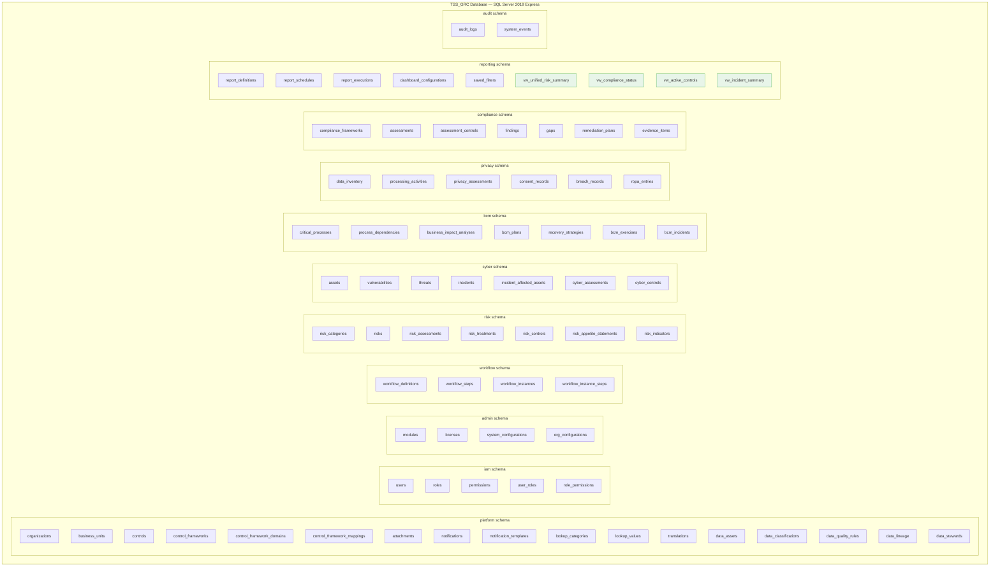
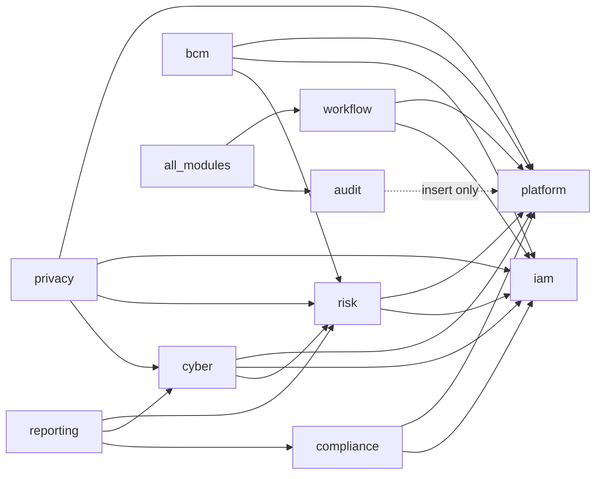

# Schema-Module Diagram
> **HISTORIC — point-in-time snapshot (all files 2026-04-30). Not a statement of current state.**
> For what the platform is today read [`CLAUDE.md`](../../CLAUDE.md) and [`PROJECT_CHRONICLE.md`](../../PROJECT_CHRONICLE.md); for measured figures, [`MEASURED_BASELINE.md`](../../TSS-GRC-Platform-Bible/Appendix/MEASURED_BASELINE.md). Kept for provenance. *(W0-6)*

## Purpose
Shows the SQL Server database schema structure and which tables belong to which schema. Each schema corresponds to a logical module boundary.

---

---

## Cross-Schema Reference Rules

**Key rule:** Module schemas may reference `platform` and `iam` schemas via FK. Module schemas should NOT have direct FKs to each other — cross-module links use application-level joins on shared IDs. The exception is `cyber → risk` (linked_risk_id) and `privacy → cyber` (linked_cyber_incident_id) as they represent intentional cross-module data linkage.
