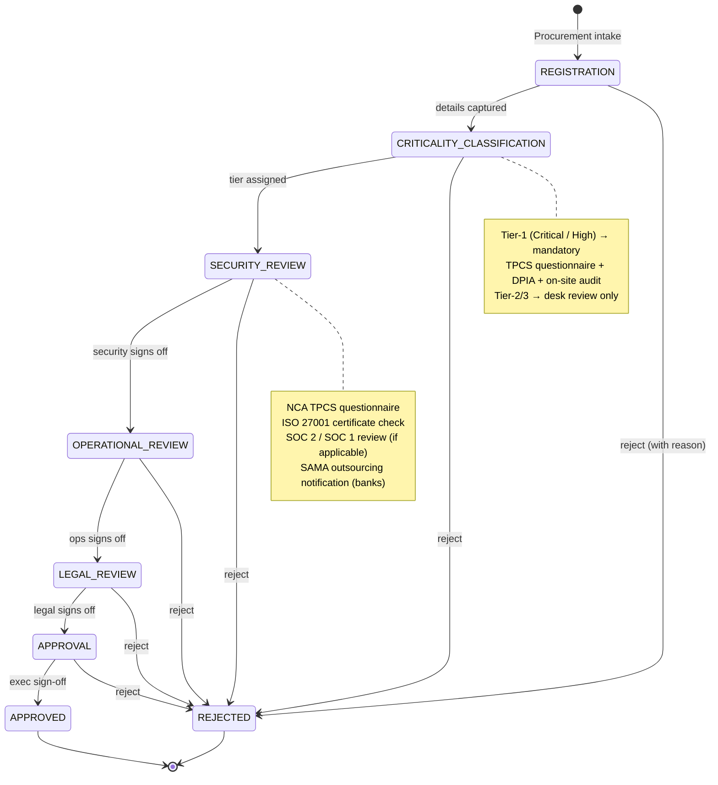
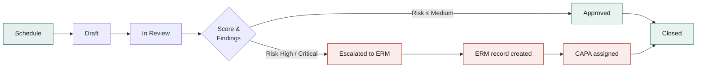
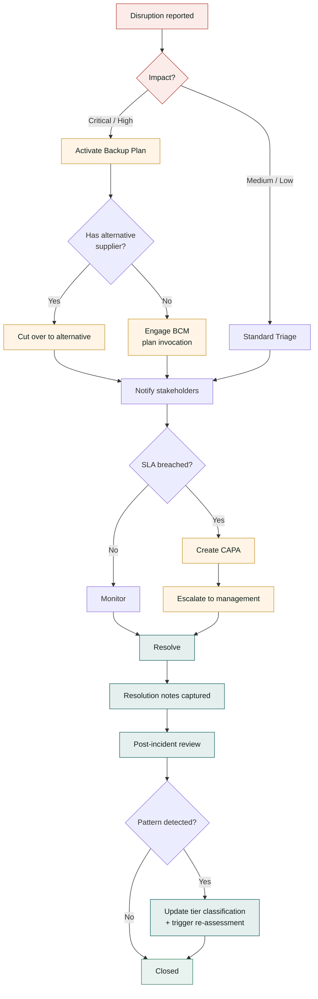
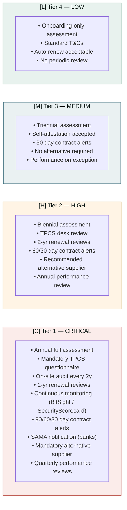
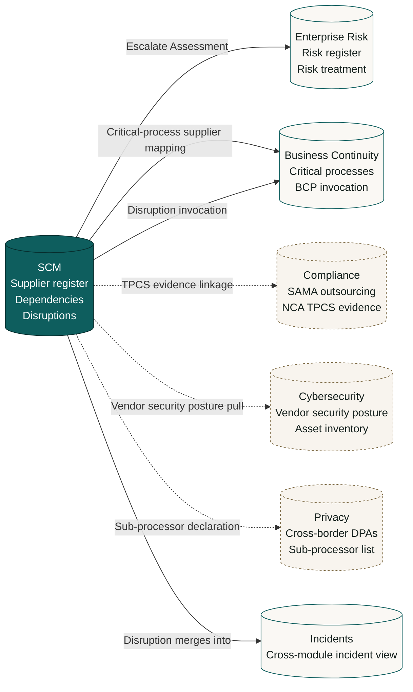

# Supply Chain Map — SCM Module

**Module:** `tss-grc-backend/src/main/java/com/tss/grc/module/scm`
**Frontend:** `tss-grc-ui-v2/src/pages/scm/ScmPage.tsx`
**Frameworks aligned:** ISO 28000:2022 · NIST SP 800-161r1 · NCA TPCS (Third-Party Cybersecurity Standard) · SAMA Outsourcing · ISO 27036

This document is a complete visual reference for the redesigned Supply Chain Management module: the dependency map an analyst sees when answering *"if this supplier fails, what breaks?"*, the data model behind it, and the workflows that move a supplier through onboarding, assessment, and disruption response.

All diagrams are Mermaid and render inline on GitHub.

---

## 1. Multi-Tier Supplier Dependency Map

The map below is what a **Saudi mid-market enterprise** would see in the SCM module. It traces business services down through their direct (Tier-1) suppliers, sub-suppliers (Tier-2 / 4th-party), and any pre-approved alternative suppliers. Risk colour follows the platform's eye-comfort palette:

- **[C] Critical** — single point of failure, no alternative, regulator-impacting if disrupted
- **[H] High** — material business impact, alternative exists but with switching cost
- **[M] Medium** — moderate impact, alternative readily available
- **[L] Low** — commodity, easily replaced
- **KSA tag** — Saudi-domiciled supplier (preferred under Vision 2030 / Nitaqat / Saudi Made)

```mermaid
%%{init: {'flowchart': {'curve': 'basis', 'nodeSpacing': 30, 'rankSpacing': 50}}}%%
flowchart LR
    %% ─── Business Services (the things the organisation actually delivers) ───
    subgraph Services["Business Services"]
        direction TB
        SVC1[("Core Banking<br/>Operations")]
        SVC2[("Customer<br/>Portal")]
        SVC3[("Payroll &<br/>HR Operations")]
        SVC4[("Branch &<br/>Field Logistics")]
        SVC5[("Internal<br/>Communications")]
    end

    %% ─── Tier-1 (direct) suppliers ───
    subgraph Tier1["Tier 1 — Direct Suppliers"]
        direction TB
        T1_STC["STC Cloud<br/>KSA KSA · IaaS"]
        T1_MOB["Mobily SCC<br/>KSA KSA · IaaS"]
        T1_TEMENOS["Temenos T24<br/>Core Banking"]
        T1_SF["Salesforce<br/>CRM"]
        T1_SAP["SAP S/4HANA<br/>HCM + ERP"]
        T1_O365["Microsoft 365<br/>Email + Collab"]
        T1_BAYAN["Bayan Logistics<br/>KSA KSA · 3PL"]
        T1_AKAM["Akamai<br/>CDN + WAF"]
    end

    %% ─── Tier-2 / 4th-party suppliers (the dependencies your suppliers depend on) ───
    subgraph Tier2["Tier 2 / 4th-Party"]
        direction TB
        T2_AWS["AWS Bahrain<br/>(me-south-1)"]
        T2_AZURE["Azure UAE<br/>(uaenorth)"]
        T2_GCP["GCP Belgium<br/>(europe-west1)"]
        T2_TWILIO["Twilio<br/>SMS Gateway"]
        T2_STRIPE["Stripe Connect"]
        T2_GOSI["GOSI<br/>KSA KSA"]
        T2_FATOORA["ZATCA Fatoora<br/>KSA KSA"]
    end

    %% ─── Alternative / fallback suppliers ───
    subgraph Alts["Pre-Approved Alternatives"]
        direction TB
        ALT_SCCC["SCCC Alibaba<br/>KSA KSA"]
        ALT_HUBSPOT["HubSpot CRM"]
        ALT_DHL["DHL Express<br/>KSA KSA branch"]
    end

    %% ─── Service → Tier-1 dependencies ───
    SVC1 -->|[C] Critical| T1_TEMENOS
    SVC1 -->|[C] Critical| T1_STC
    SVC1 -->|[H] High| T1_AKAM
    SVC2 -->|[C] Critical| T1_SF
    SVC2 -->|[H] High| T1_AKAM
    SVC2 -->|[M] Medium| T1_MOB
    SVC3 -->|[C] Critical| T1_SAP
    SVC4 -->|[H] High| T1_BAYAN
    SVC5 -->|[H] High| T1_O365

    %% ─── Tier-1 → Tier-2 sub-dependencies ───
    T1_TEMENOS -.->|hosted on| T2_AWS
    T1_SF -.->|hosted on| T2_AWS
    T1_SF -.->|sends SMS via| T2_TWILIO
    T1_SAP -.->|integrates| T2_GOSI
    T1_SAP -.->|integrates| T2_FATOORA
    T1_O365 -.->|hosted on| T2_AZURE
    T1_AKAM -.->|peers with| T2_GCP
    T1_BAYAN -.->|payment via| T2_STRIPE

    %% ─── Tier-1 → Alternatives ───
    T1_STC -.->|alt| ALT_SCCC
    T1_SF -.->|alt| ALT_HUBSPOT
    T1_BAYAN -.->|alt| ALT_DHL

    %% ─── Styling ───
    classDef svcStyle fill:#0E5E5E,stroke:#062E2E,color:#FFFFFF,stroke-width:2px
    classDef criticalStyle fill:#FBECEA,stroke:#B23A2F,color:#15201D,stroke-width:2px
    classDef highStyle fill:#FFF4E5,stroke:#C8932A,color:#15201D,stroke-width:1.5px
    classDef ksaStyle fill:#E5F0EE,stroke:#0E5E5E,color:#15201D,stroke-width:1.5px
    classDef mediumStyle fill:#EAF1F2,stroke:#3D6E7C,color:#15201D
    classDef altStyle fill:#F8F4EE,stroke:#7A6741,color:#15201D,stroke-dasharray:4 3

    class SVC1,SVC2,SVC3,SVC4,SVC5 svcStyle
    class T1_TEMENOS,T1_SF,T1_SAP criticalStyle
    class T1_AKAM,T1_O365 highStyle
    class T1_STC,T1_MOB,T1_BAYAN ksaStyle
    class T2_AWS,T2_AZURE,T2_GCP,T2_TWILIO,T2_STRIPE mediumStyle
    class T2_GOSI,T2_FATOORA ksaStyle
    class ALT_SCCC,ALT_HUBSPOT,ALT_DHL altStyle
```

### How to read it

- **Solid arrows** are direct production dependencies. Disrupting the supplier disrupts the service in real time.
- **Dotted arrows** to Tier-2 nodes are *4th-party dependencies* — you don't contract with these vendors but your Tier-1 supplier does, so a Tier-2 outage cascades up.
- **Dotted arrows** to the Alternatives subgraph are pre-approved fallbacks recorded in `dependencies.alternative_vendor_id`. If `has_alternative = false` on a critical dependency, that's the highest-risk row to escalate to BCM.
- **KSA KSA labels** flag suppliers domiciled inside the Kingdom — relevant for Saudization scoring, sovereign-data-residency under PDPL, and Vision 2030 local-content preference.

---

## 2. SCM Data Model (ERD)

This is the data model the redesigned module persists. Every box maps one-to-one to a JPA entity under `module/scm/entity/`.

```mermaid
erDiagram
    organisations ||--o{ vendors : "has many"
    vendors ||--o{ vendor_onboarding : "passes through"
    vendors ||--o{ vendor_assessments : "evaluated by"
    vendors ||--o{ contracts : "engaged via"
    vendors ||--o{ supplier_incidents : "reports"
    vendors ||--o{ dependencies : "is provider for"
    vendors ||--o{ alternative_dependencies : "is fallback for"
    contracts ||--o{ slas : "defines"

    vendors {
        bigint id PK
        bigint organisation_id FK
        uuid external_id
        nvarchar name_en
        nvarchar name_ar
        nvarchar category
        nvarchar criticality "CRITICAL|HIGH|MEDIUM|LOW"
        nvarchar country
        nvarchar service_type
        nvarchar risk_level
        nvarchar status "ACTIVE|INACTIVE|UNDER_REVIEW|BLACKLISTED|EXITED"
        nvarchar registration_number "Saudi CR / VAT"
        nvarchar onboarding_status
        nvarchar website
        nvarchar contact_name
        nvarchar contact_email
        nvarchar contact_phone
        boolean is_deleted
    }

    vendor_onboarding {
        bigint id PK
        bigint vendor_id FK
        nvarchar current_stage "REGISTRATION → CRITICALITY_CLASSIFICATION → SECURITY_REVIEW → OPERATIONAL_REVIEW → LEGAL_REVIEW → APPROVAL"
        nvarchar status "IN_PROGRESS|COMPLETED|REJECTED|ON_HOLD"
        bigint assigned_to_id FK
        date due_date
        nvarchar completed_stages
        nvarchar rejection_reason
    }

    vendor_assessments {
        bigint id PK
        bigint vendor_id FK
        nvarchar assessment_type "INITIAL|PERIODIC|TRIGGERED"
        date assessment_date
        date next_assessment_date
        decimal overall_score "0-10"
        nvarchar risk_rating
        nvarchar status "PLANNED|IN_PROGRESS|COMPLETED|ESCALATED"
        nvarchar findings
        nvarchar recommendations
        boolean escalated_to_risk
    }

    contracts {
        bigint id PK
        bigint vendor_id FK
        nvarchar contract_number
        nvarchar title_en
        nvarchar title_ar
        nvarchar contract_type "SERVICE|SUPPLY|NDA|FRAMEWORK|OTHER"
        date start_date
        date end_date
        boolean auto_renewal
        decimal contract_value
        nvarchar currency "default SAR"
        nvarchar status "ACTIVE|DRAFT|UNDER_REVIEW|EXPIRED|TERMINATED"
    }

    slas {
        bigint id PK
        bigint contract_id FK
        nvarchar metric_name
        nvarchar target
        nvarchar measurement_window
        nvarchar penalty_clause
    }

    supplier_incidents {
        bigint id PK
        bigint vendor_id FK
        nvarchar incident_code
        nvarchar incident_type "SERVICE_DISRUPTION|BREACH|DELAY|QUALITY|SLA_BREACH|OTHER"
        nvarchar impact "CRITICAL|HIGH|MEDIUM|LOW"
        nvarchar description
        boolean sla_breached
        nvarchar status "OPEN|IN_PROGRESS|RESOLVED|CLOSED"
        boolean backup_plan_activated
        boolean capa_created
        boolean escalated_to_management
        datetime reported_at
        datetime resolved_at
        nvarchar resolution_notes
    }

    dependencies {
        bigint id PK
        bigint organisation_id FK
        bigint vendor_id FK
        bigint alternative_vendor_id FK
        nvarchar service_name_en "e.g. Core Banking"
        nvarchar service_name_ar
        nvarchar asset_name "e.g. Temenos T24 production cluster"
        nvarchar dependency_type "CRITICAL|NON_CRITICAL|SHARED|EXCLUSIVE"
        nvarchar dependency_level "CRITICAL|HIGH|MEDIUM|LOW"
        boolean has_alternative
        nvarchar status "ACTIVE|INACTIVE|AT_RISK"
        nvarchar impact_analysis
    }

    alternative_dependencies {
        bigint id PK
        nvarchar note "Same row as dependencies — alternative_vendor_id"
    }
```



---

## 3. Onboarding Workflow (6-stage NCA TPCS gated lifecycle)

The state machine below is what the **Advance / Approve / Reject** row-action buttons drive. Each stage has implicit gates — you only advance once that stage's owner has signed off.



---

## 4. Risk-Assessment Lifecycle

Periodic and event-triggered assessments roll up to vendor risk-rating. The Escalate-to-Enterprise-Risk row action creates a linked record in the Enterprise Risk module.



---

## 5. Disruption Response Flow

This is the SCM-side incident lifecycle. The four row-action buttons (Activate Backup, Create CAPA, Escalate, Resolve) drive transitions; multi-step issues touch all four.



---

## 6. Tier Classification — How Criticality Drives Treatment

The matrix below is the policy-level mapping from a vendor's `criticality` field to the supervisory treatment SCM applies. This is the ruleset administrators should configure when the **configurable workflow engine** lands; today it is hard-coded in service-class logic.



---

## 7. Module Touch-Points (Who Talks to Whom)

The SCM module is not isolated — these are the cross-module bridges already wired or recommended:



**Live (solid arrows):** implemented in this commit — Escalate Assessment to ERM, Disruption-to-Incident merge, BCM-supplier mapping via Dependencies.
**Recommended (dotted arrows):** assessment §6 cross-cutting items, not yet wired — Cyber posture pull, Privacy sub-processor declaration, Compliance TPCS evidence linkage.

---

## 8. Saudi Localisation Highlights Embedded in the Map

| Element | What it does |
|---|---|
| Country defaults to **Saudi Arabia** | New supplier records start with KSA pre-populated; aligns with Saudization preference scoring. |
| Currency defaults to **SAR** | Contract values default to riyals; USD/EUR/AED available from dropdown. |
| `registration_number` field | Captures Saudi Commercial Registration (CR) or VAT number for ZATCA cross-check. |
| KSA suppliers tagged KSA in the dependency map | Visual cue for Vision 2030 local-content scoring and PDPL data-residency assessment. |
| Disruption type **BREACH** | Captures supplier-side data or contract breach; the catch-all for PDPL-relevant supplier incidents until a dedicated `COMPLIANCE` value lands. |
| Onboarding stage **LEGAL_REVIEW** | Captures Saudi-Article-39 / cross-border-transfer legal sign-off. |

### Aspirational additions (require a follow-up DB CHECK-constraint migration)

The buyer assessment recommended several Saudi-specific enum values that are not yet in the DB CHECK constraints. Adding them needs a new migration that drops and re-creates the relevant `CK_*` constraints with the expanded value set:

| Future value | Column | Why it matters |
|---|---|---|
| `DPA` | `contracts.contract_type` | Data Processing Agreement under PDPL; required for any vendor processing personal data of Saudi data subjects. |
| `SLA` | `contracts.contract_type` | First-class SLA contract record alongside the existing SLA child table. |
| `MASTER_AGREEMENT`, `SOW`, `PURCHASE_ORDER` | `contracts.contract_type` | Aligns with mid-market procurement vocabulary. |
| `FINANCIAL_DISTRESS` | `supplier_incidents.incident_type` | SAMA expectation — banks must track vendor financial-stability indicators. |
| `COMPLIANCE` | `supplier_incidents.incident_type` | NCA / Data Office / SAMA breach-of-obligation by the supplier. |
| `SECURITY` | `supplier_incidents.incident_type` | Vendor-originated security incident (separate from `BREACH` for sub-typing). |
| `EVENT_TRIGGERED` | `vendor_assessments.assessment_type` | More descriptive than `TRIGGERED` for UI labelling. |

---

**Maintained alongside:**
- Backend: `tss-grc-backend/src/main/java/com/tss/grc/module/scm/`
- Frontend: `tss-grc-ui-v2/src/pages/scm/ScmPage.tsx`
- API client: `tss-grc-ui-v2/src/lib/api.ts` (search `scmApi`)
- Buyer assessment §5.6 and §5.7 for the strategic rationale.
