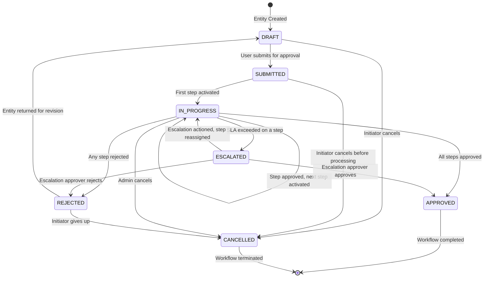
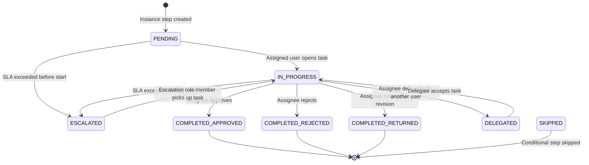
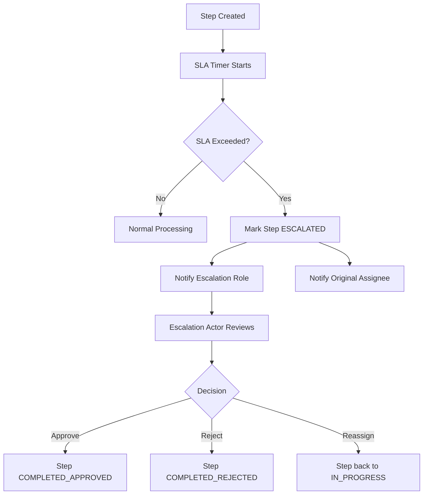
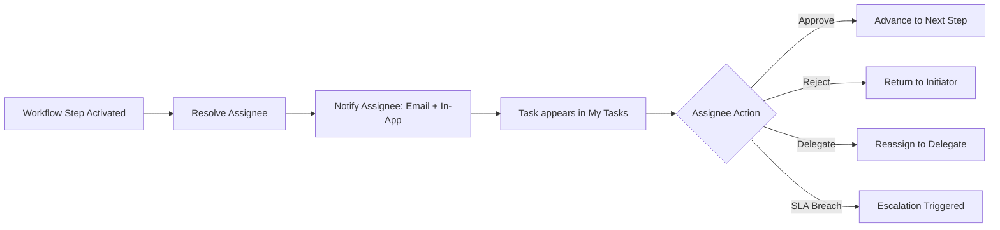

# Workflow State Diagram
> **HISTORIC — point-in-time snapshot (all files 2026-04-30). Not a statement of current state.**
> For what the platform is today read [`CLAUDE.md`](../../CLAUDE.md) and [`PROJECT_CHRONICLE.md`](../../PROJECT_CHRONICLE.md); for measured figures, [`MEASURED_BASELINE.md`](../../TSS-GRC-Platform-Bible/Appendix/MEASURED_BASELINE.md). Kept for provenance. *(W0-6)*

## Purpose
Defines the state machine for the TSS GRC Platform workflow engine, covering all workflow states and valid transitions.

---

## Core Workflow State Machine

---

## Workflow Step State Machine

---

## SLA and Escalation Flow

---

## Module Entity Workflow Mapping

| Module | Entity | Default Workflow |
|--------|--------|-----------------|
| ERM | Risk | Risk Review & Approval |
| ERM | Risk Treatment | Treatment Plan Approval |
| Cyber | Cyber Incident | Incident Response |
| BCM | BCM Plan | Plan Approval |
| Privacy | Privacy Assessment | PIA/DPIA Approval |
| Privacy | Breach Record | Breach Management |
| Compliance | Assessment | Assessment Approval |
| Admin | User Creation | User Provisioning |
| Admin | License Request | License Approval |

---

## Task Inbox Flow

