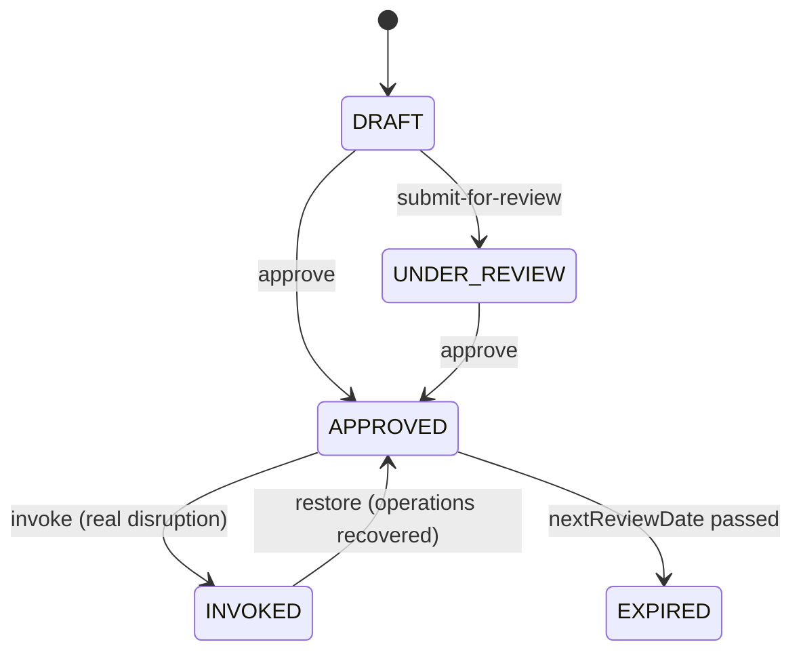
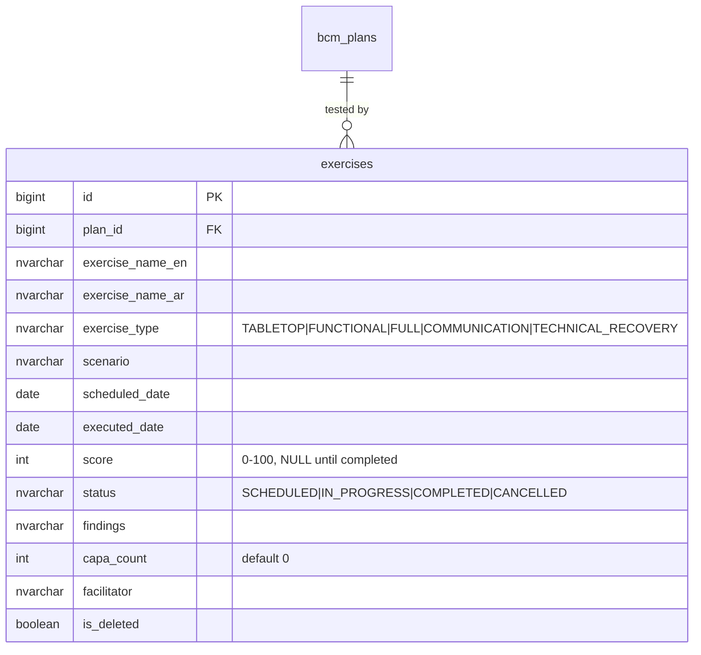
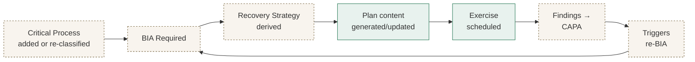
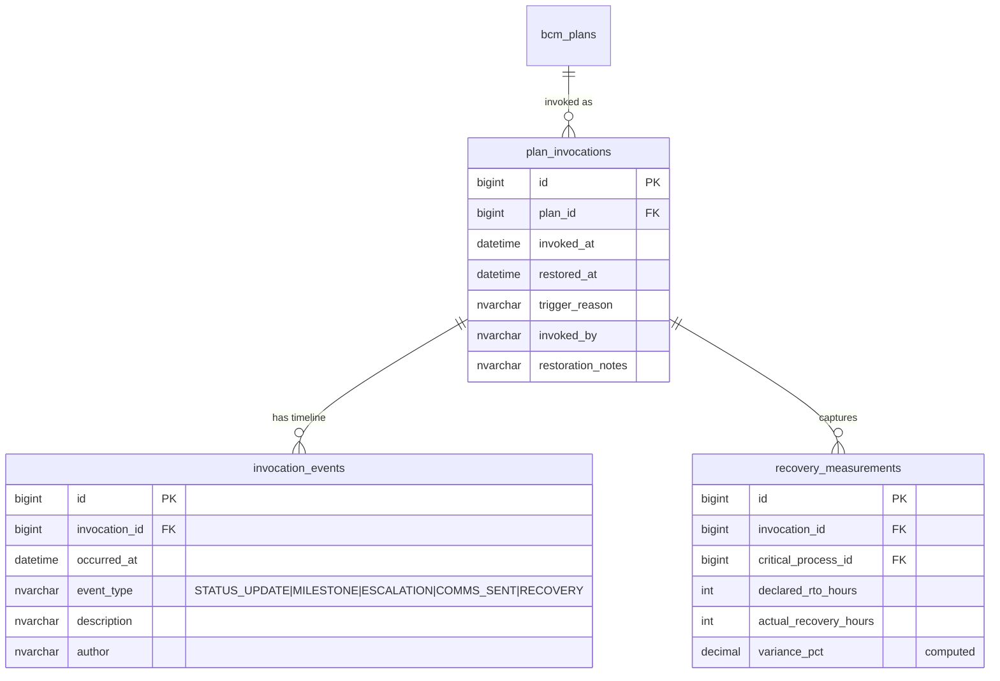
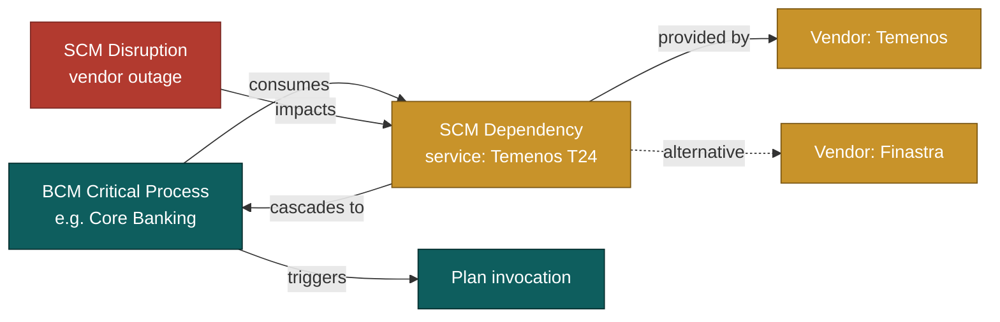

# BCM Module — Implementation Status & Roadmap
> **HISTORIC — point-in-time snapshot (all files 2026-05-02). Not a statement of current state.**
> For what the platform is today read [`CLAUDE.md`](../../CLAUDE.md) and [`PROJECT_CHRONICLE.md`](../../PROJECT_CHRONICLE.md); for measured figures, [`MEASURED_BASELINE.md`](../../TSS-GRC-Platform-Bible/Appendix/MEASURED_BASELINE.md). Kept for provenance. *(W0-6)*

**Module:** `tss-grc-backend/src/main/java/com/tss/grc/module/bcm`
**Frontend:** `tss-grc-ui-v2/src/pages/bcm/BcmPage.tsx`
**Frameworks aligned:** ISO 22301:2019 · ISO 22313:2020 · ISO 27031 · NCEMA Standards · SAMA BCP requirements

This document tracks what is implemented, what was just shipped, and what remains as deferred follow-up across the six recommendations from §5.5 of the buyer assessment.

---

## 1. Summary table — recommendation status

| # | Recommendation | Priority | Status |
|---|---|---|---|
| 1 | BCM lifecycle workflow (Process → BIA → Strategy → Plan → Exercise → CAPA → re-BIA) | Critical | **Partially shipped** — Plan-side ISO 22301 lifecycle wired (DRAFT → UNDER_REVIEW → APPROVED → INVOKED → APPROVED-after-restore) with backend endpoints + UI buttons. Process / BIA / strategy linkages remain manual — see §3 below. |
| 2 | Plan invocation runbook (Trigger → notify → activate → recovery → de-escalate → after-action) | Critical | **Foundation shipped** — `/api/v1/bcm/plans/{id}/invoke` and `/restore` are live. Notification cascade, status broadcasts and after-action templating are deferred (see §4). |
| 3 | Exercise lifecycle engine (Schedule → execute → score → CAPA → next cycle) | High | **Shipped** — full backend entity + CRUD + complete-with-score workflow. Replaces the in-memory v3 scaffold. |
| 4 | Supplier-dependency mapping (Critical process ↔ vendor ↔ outage impact ↔ contingency) | High | **Deferred** — needs cross-module work between BCM `critical_processes` and SCM `dependencies`. Plan in §5. |
| 5 | Crisis communication module (templates → role-based distribution → multi-channel) | High | **Deferred** — net-new module. Plan in §6. |
| 6 | RTO/RPO compliance scoring (declared vs measured → variance → trend) | Medium | **Deferred** — requires recovery-event capture during plan invocation. Plan in §7. |

---

## 2. Shipped this session

### 2.1 Plan ISO 22301 lifecycle workflow

The state machine the Approve / Invoke / Restore row-action buttons drive on the Plans tab:

Backend endpoints (BcmController):

| Endpoint | Allowed from | Sets status |
|---|---|---|
| `POST /api/v1/bcm/plans/{id}/submit-for-review` | DRAFT | UNDER_REVIEW |
| `POST /api/v1/bcm/plans/{id}/approve` | DRAFT, UNDER_REVIEW | APPROVED |
| `POST /api/v1/bcm/plans/{id}/invoke` | APPROVED | INVOKED |
| `POST /api/v1/bcm/plans/{id}/restore` | INVOKED | APPROVED |

Each transition is enforced server-side; calling out-of-order transitions returns HTTP 400.

### 2.2 Exercise as a real backend entity

Replaces the in-memory exercise list that BcmPage held as React state. Survives page reload, links to a plan, and feeds exercise-pass-rate KPIs.

Data model (`bcm.exercises`):

Endpoints (`/api/v1/bcm/exercises`):

| Method | Path | Action |
|---|---|---|
| GET | `/exercises` | List paged |
| GET | `/exercises/{id}` | Get by id |
| POST | `/exercises` | Create |
| PUT | `/exercises/{id}` | Update |
| DELETE | `/exercises/{id}` | Soft-delete |
| POST | `/exercises/{id}/complete` | Mark completed with score + findings (sets `executed_date` to today) |

Frontend (BcmPage.tsx): full tab-aware add/edit/delete, plus a "Complete & Score" button on every non-completed exercise that prompts for score and findings and calls the complete endpoint.

DDL: `tss-grc-backend/src/main/resources/db/seed/V_bcm_exercises_ddl.sql` — idempotent (safe to re-run); seeds 3 sample exercises if the table is empty.

---

## 3. Deferred — BCM cross-entity lifecycle (recommendation #1 remainder)

The Plan-side lifecycle is shipped. The remaining piece is the **upstream chain** that drives plan reviews automatically:

**Concrete next steps:**
1. Add `linked_plan_id` to `bcm.bia_records` so a BIA explicitly drives a plan.
2. Add an automated trigger when a BIA's `next_assessment_date` passes — surface a "BIA review due" KPI on the dashboard.
3. Add CAPA records as a child of `exercise_findings` (currently `findings` is a single text field — split into rows when CAPA tracking matures).

Effort estimate: **2–3 sessions**.

---

## 4. Deferred — Plan invocation runbook (recommendation #2 remainder)

The `/invoke` endpoint flips the status, but a real invocation needs:

1. **Notification cascade** — pre-defined recipient list per plan (executives, BCM team, comms, regulators) notified at invocation, milestone updates, and de-escalation.
2. **Status broadcast log** — every `STATUS_UPDATE` during invocation captured with timestamp + author, viewable as a timeline.
3. **Recovery objectives tracker** — for each critical process listed in the plan, the actual elapsed recovery time vs. the declared RTO. Feeds recommendation #6.
4. **After-action review template** — auto-generated from the invocation timeline + recovery measurements; produces the dataset that drives recommendation #1 re-BIA trigger.

**Data model additions required:**

**Sketch of new endpoints:**

| Endpoint | Purpose |
|---|---|
| `POST /plans/{id}/invocations` | Start a real invocation (returns `invocation_id`) |
| `POST /invocations/{id}/events` | Log a milestone, status update or recovery |
| `POST /invocations/{id}/measurements` | Log recovery time for a process |
| `POST /invocations/{id}/restore` | Mark recovered — flips Plan → APPROVED, computes variances |

Effort estimate: **3–4 sessions**.

---

## 5. Deferred — Supplier-dependency mapping (recommendation #4)

Cross-module work. The data already half-exists:

- `bcm.critical_processes` already lists business processes.
- `scm.dependencies` already links a service/asset to a vendor and tracks an alternative vendor.

**Bridge needed:** add `critical_process_id` foreign key to `scm.dependencies` so a single dependency record knows which BCM critical process consumes it. Then:

**Concrete deliverables:**
1. DDL: add `critical_process_id` nullable FK to `scm.dependencies`.
2. UI: on the BCM Processes tab, add an "Vendors providing this process" panel that lists dependencies for the selected process.
3. UI: on the SCM Disruptions tab, show "Critical processes affected" derived from the disruption's vendor.
4. Workflow: when a Critical disruption is logged for a vendor whose dependencies have no alternative, surface a banner alerting the BCM team to consider plan invocation.

Effort estimate: **2 sessions**.

---

## 6. Deferred — Crisis communication module (recommendation #5)

This is a **net-new feature** — there is no existing data model for it. Recommended scope:

**Entities to add:**

- `crisis_comms_template` — pre-approved EN+AR message templates with placeholders, categorised by audience (executives, employees, customers, regulators, public).
- `crisis_comms_audience` — recipient groups with role/channel mappings (email, SMS, push, Tawakkalna Business).
- `crisis_comms_distribution` — record of every message sent during an invocation, with delivery confirmation.

**UX sketch:**

- New tab "Communications" inside the BCM module (or under Plan Invocation surface).
- Pre-approved templates editable only by Comms role.
- During an active invocation, one-click "Send to executives" / "Send to employees" with the matching template auto-populated from the invocation context.
- Audit log of every send: who, when, what template, what audience, delivery status.

**Saudi-specific:**

- Multi-channel including SMS (Twilio Saudi gateway / STC SMS API) — critical when email is unavailable during an outage.
- Tawakkalna Business push during pandemic-class events.
- Bilingual templates with Hijri-date stamping.

Effort estimate: **3–5 sessions**.

---

## 7. Deferred — RTO/RPO compliance scoring (recommendation #6)

Builds on top of recommendation #2's `recovery_measurements` table. Once invocations capture measurements, this becomes mostly a reporting layer:

- KPI tile: **RTO compliance %** = (count of measurements where actual ≤ declared) / total measurements over the trailing 12 months.
- Trend chart: rolling 4-quarter RTO compliance per critical process.
- Board-pack export: PDF + XLSX with year-on-year comparison.
- Hijri-date alignment for SAMA quarterly reporting.

**Concrete deliverables:**
1. New endpoint: `GET /api/v1/bcm/recovery/compliance?period=quarter` returning aggregated metrics.
2. Frontend KPI replacement: replace today's hardcoded "RTO Compliance: 76%" tile with live data.
3. Board-pack export integration with the existing reporting service.

Effort estimate: **1 session**, dependent on §4 landing first.

---

## 8. Suggested sequencing for the next 4 sessions

| Session | Focus |
|---|---|
| 1 | Recommendation #4 (supplier-dependency bridge) — small, high visibility, unblocks BCM↔SCM correlation |
| 2 | Recommendation #2 part 1 — `plan_invocations` table + `invocation_events` timeline endpoints |
| 3 | Recommendation #2 part 2 — `recovery_measurements` + plan-invocation UI |
| 4 | Recommendation #6 — wire RTO/RPO scoring on top of the measurement data captured in sessions 2-3 |

After those four, recommendation #5 (crisis comms) is a clean net-new feature with no upstream dependencies.

---

**Maintained alongside:**
- Backend: `tss-grc-backend/src/main/java/com/tss/grc/module/bcm/`
- Frontend: `tss-grc-ui-v2/src/pages/bcm/BcmPage.tsx`
- API client: `tss-grc-ui-v2/src/lib/api.ts` (search `bcmApi`)
- DDL artefact: `tss-grc-backend/src/main/resources/db/seed/V_bcm_exercises_ddl.sql`
- Buyer assessment §5.5 for the strategic rationale.
