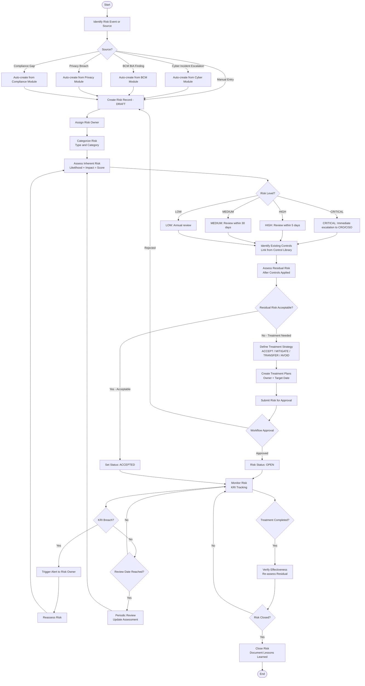
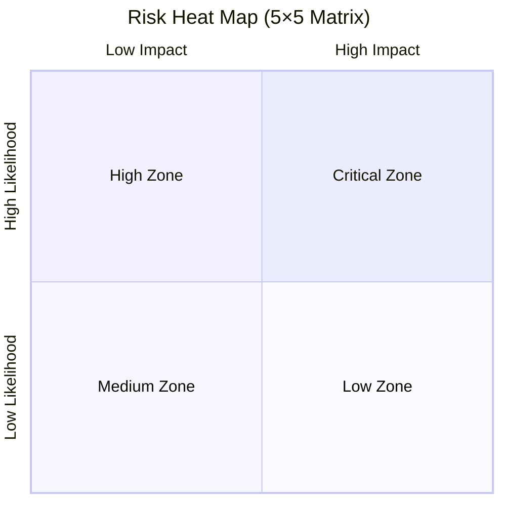
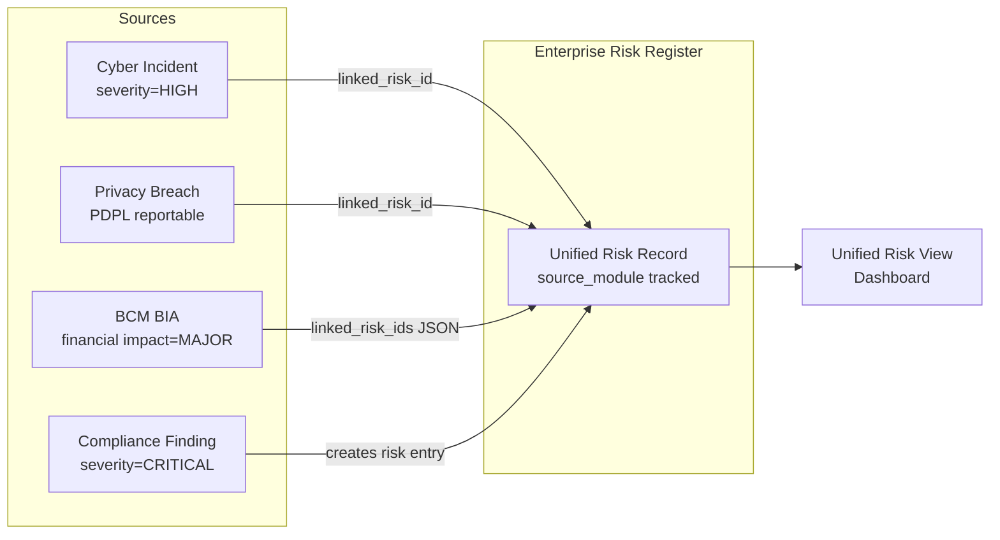

# Risk Assessment Business Flow
> **HISTORIC — point-in-time snapshot (all files 2026-04-30). Not a statement of current state.**
> For what the platform is today read [`CLAUDE.md`](../../CLAUDE.md) and [`PROJECT_CHRONICLE.md`](../../PROJECT_CHRONICLE.md); for measured figures, [`MEASURED_BASELINE.md`](../../TSS-GRC-Platform-Bible/Appendix/MEASURED_BASELINE.md). Kept for provenance. *(W0-6)*

## Purpose
Defines the end-to-end business flow for the Enterprise Risk Management module's risk assessment process.

---

## Risk Lifecycle Flow

---

## Risk Scoring Matrix Visual

---

## Risk Cross-Module Linkage Flow

