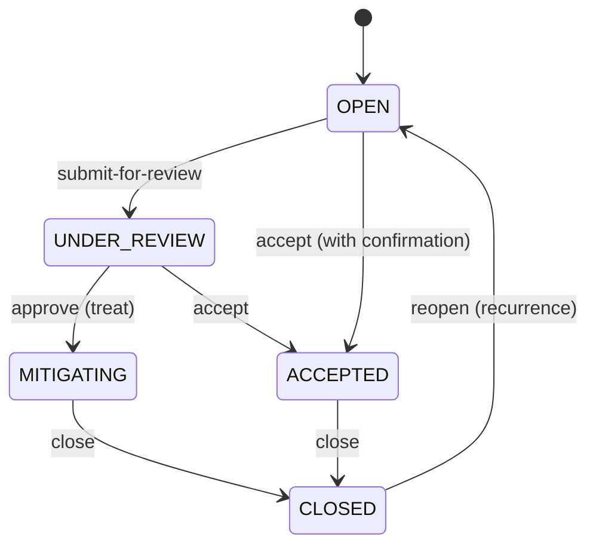
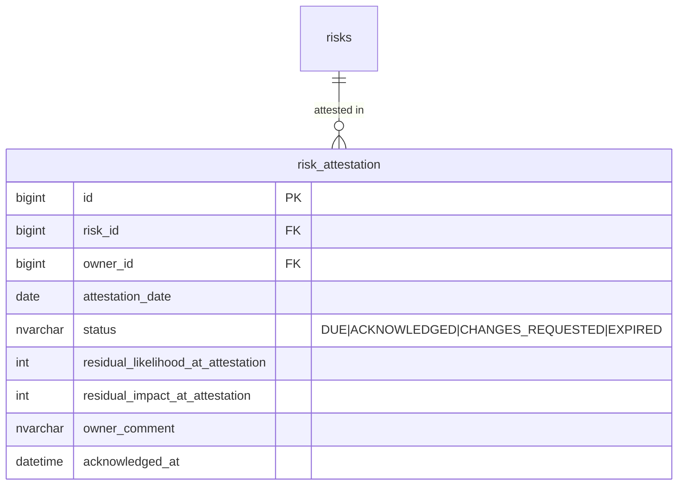
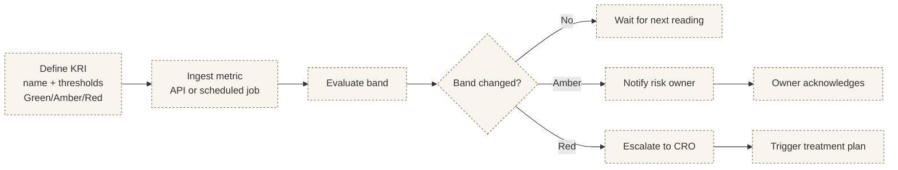
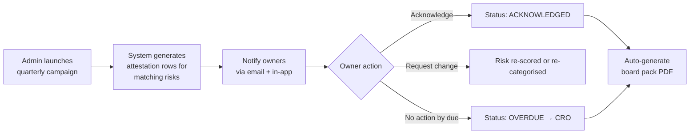
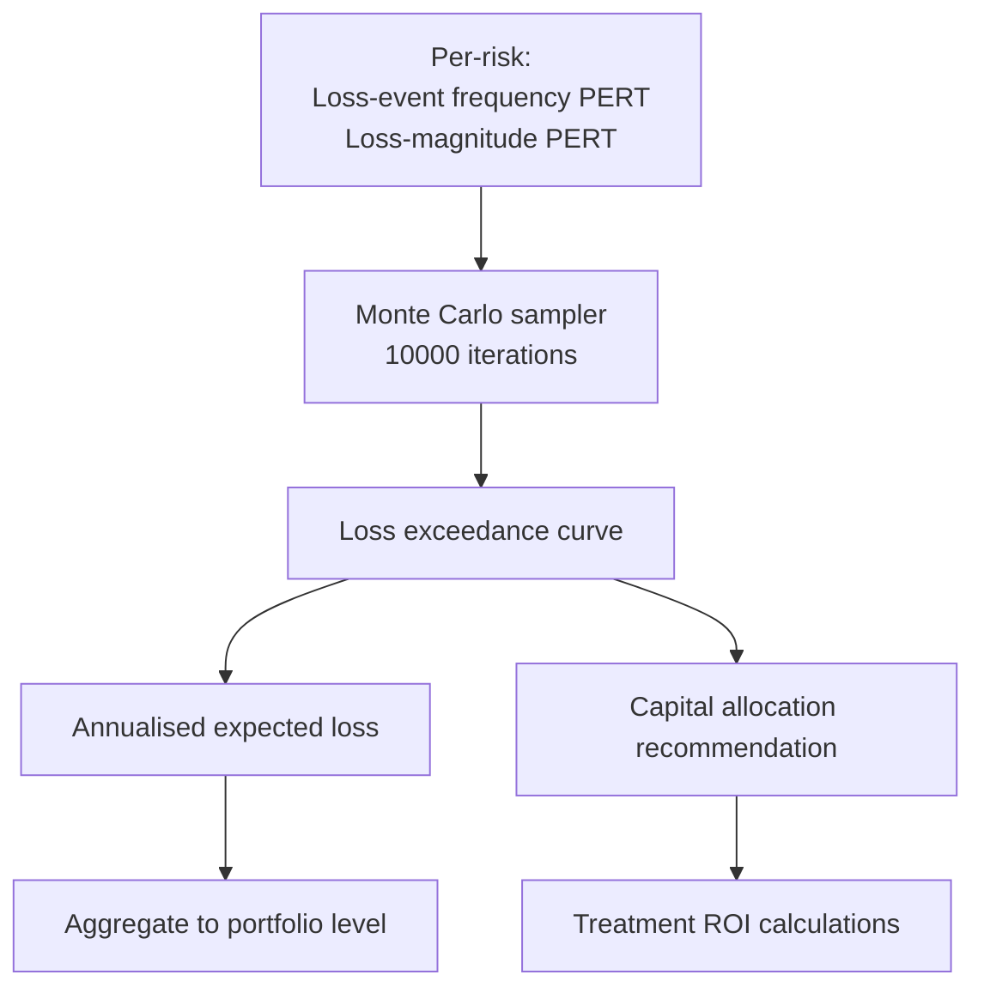

# ERM Module — Implementation Status & Roadmap
> **HISTORIC — point-in-time snapshot (all files 2026-05-02). Not a statement of current state.**
> For what the platform is today read [`CLAUDE.md`](../../CLAUDE.md) and [`PROJECT_CHRONICLE.md`](../../PROJECT_CHRONICLE.md); for measured figures, [`MEASURED_BASELINE.md`](../../TSS-GRC-Platform-Bible/Appendix/MEASURED_BASELINE.md). Kept for provenance. *(W0-6)*

**Module:** `tss-grc-backend/src/main/java/com/tss/grc/module/risk`
**Frontend:** `tss-grc-ui-v2/src/pages/risk/RiskRegisterPage.tsx`
**Frameworks aligned:** ISO 31000:2018 · ISO 27005:2022 · COSO ERM 2017 · SAMA Operational Risk · NCA ECC §1-3 · Basel III Op-Risk · FAIR (deferred)

This document tracks what is implemented, what just shipped, and what remains as deferred follow-up across the six recommendations from §5.1 of the buyer assessment.

---

## 1. Summary table — recommendation status

| # | Recommendation | Priority | Status |
|---|---|---|---|
| 1 | Risk lifecycle workflow (Identify → assess → treat → control map → residual review → owner attestation → re-evaluation) | Critical | **Partially shipped** — state-machine workflow is wired (OPEN → UNDER_REVIEW → MITIGATING → CLOSED, plus ACCEPTED branch for formal acceptance and reopen path). Owner attestation cycle remains as deferred (see §3). |
| 2 | KRI threshold engine (define bands → ingest metric → state evaluation → notify → escalate) | Critical | **Deferred** — net-new feature. Plan in §4. |
| 3 | Quarterly attestation campaign | High | **Deferred** — needs campaign entity + scheduler. Plan in §5. |
| 4 | Risk-incident retrospective (incident → bumps residual likelihood) | High | **Foundation shipped** — `incident-bump` endpoint live; cross-module call from Incidents → Risk still to be wired. Plan in §6. |
| 5 | Quantitative risk extension (FAIR / Monte Carlo) | Medium | **Deferred** — significant statistical model. Plan in §7. |
| 6 | Appetite-vs-exposure variance dashboard | High | **Deferred** — needs appetite entity + aggregation queries. Plan in §8. |

Saudi-specific opportunities from §5.1:

| Opportunity | Status |
|---|---|
| Pre-load NCA ECC risk catalogue | Shipped — see V_cyber_nca_ecc_seed.sql commit |
| SAMA Operational Risk Loss Database (ORLD) categories | **Shipped** — V_risk_saudi_taxonomy_seed.sql |
| PDPL personal-data-processing risk taxonomy | **Shipped** — same seed file (9 PDPL-specific risk categories under "Personal Data Protection (PDPL)" parent) |
| Hijri calendar for attestation cycles | **Deferred** — depends on attestation campaign module (§5) |

---

## 2. Shipped this session

### 2.1 Risk lifecycle workflow

Backend endpoints under `/api/v1/risk/risks/{id}/{action}`:

| Action | Allowed from | Sets status to |
|---|---|---|
| `submit-for-review` | OPEN | UNDER_REVIEW |
| `approve` | UNDER_REVIEW | MITIGATING |
| `accept` | OPEN, UNDER_REVIEW | ACCEPTED |
| `close` | MITIGATING, ACCEPTED | CLOSED |
| `reopen` | CLOSED | OPEN |
| `incident-bump` | any | (unchanged status; bumps `residual_likelihood` by 1, capped at 5) |

Each transition is enforced server-side; calling out-of-order returns HTTP 400.

Frontend: Risk register rows now show context-aware buttons per status (only the legal next action surfaces, e.g. Approve only from UNDER_REVIEW).

### 2.2 Saudi risk taxonomy seed

`db/seed/V_risk_saudi_taxonomy_seed.sql` pre-loads four taxonomy hierarchies:

| Top-level taxonomy | Children | Source |
|---|---|---|
| Personal Data Protection (PDPL) | 9 (Lawful Basis Failure, Cross-Border Transfer Risk, Sensitive Data Mishandling, Children's Data Risk, Retention, DSR Fulfilment, Breach Notification, Sub-Processor Compliance, Consent Withdrawal Cascade) | PDPL articles + Implementing Regulations |
| Operational Risk (SAMA ORLD) | 7 (Internal Fraud, External Fraud, Employment Practices, Clients/Products/Business Practices, Damage to Physical Assets, Business Disruption, Execution/Delivery) | SAMA Operational Risk Loss Database categories (Basel-aligned) |
| Cybersecurity (NCA ECC) | 5 (Governance, Defence, Resilience, Third-Party, ICS) | NCA ECC v2.0 main domains |
| ISO 31000 generic | (Strategic, Financial, Compliance & Regulatory, Reputational as separate top-level rows) | ISO 31000:2018 |

Total: **38 risk categories** seeded for organisation_id=1. Idempotent — re-running inserts only missing rows.

---

## 3. Deferred — Owner attestation cycle (recommendation #1 remainder)

The lifecycle ships the state machine. The remaining piece is **periodic re-attestation** by the risk owner — proving the residual score is still accurate.

**Concrete deliverables:**

1. New entity `risk_attestation` linking a risk to an owner snapshot:

2. Scheduler (Spring `@Scheduled` cron) to create new attestation rows on a frequency stored at risk-level (default quarterly).
3. Notification cascade on `DUE` / `OVERDUE`.
4. Frontend: per-risk "Attestation history" panel + a dashboard tile showing aggregate attestation freshness.

Effort estimate: **2 sessions**.

---

## 4. Deferred — KRI threshold engine (recommendation #2)

KRI rows currently exist only as static UI; bringing them to life requires:

**Entities to add:**
- `key_risk_indicators` — name, owner, source, metric_unit, green_threshold, amber_threshold, red_threshold, frequency
- `kri_readings` — kri_id, recorded_at, value, band (auto-calc), notes
- `kri_breach_events` — kri_id, reading_id, band_transition (e.g. AMBER→RED), notified_owner_at, escalated_at

**API surface:**
- POST /api/v1/risk/kri — create KRI definition
- POST /api/v1/risk/kri/{id}/readings — log a reading (manual or via scheduled metric pull)
- GET /api/v1/risk/kri/breaches — list active band breaches

Effort estimate: **3 sessions**.

---

## 5. Deferred — Quarterly attestation campaign (recommendation #3)

Builds on §3. Adds the **campaign concept** so an admin can launch an org-wide attestation across hundreds of risks in one click.

**Entities:**
- `risk_attestation_campaign` — name, scheduled_at, due_date, target_filter (e.g. "all risks where category in PDPL")
- `risk_attestation` (already in §3) gains `campaign_id` FK

**Workflow:**

Saudi: Hijri-calendar option for SAMA quarterly periods.

Effort estimate: **2-3 sessions** (after §3 lands).

---

## 6. Deferred — Risk-incident retrospective wiring (recommendation #4 remainder)

The `/incident-bump` endpoint is live; what's missing is the **automatic call** from Incidents.

**Concrete deliverables:**
1. Add `linked_risk_id` foreign key on `cyber.incidents` and `incidents.incidents` (general module).
2. When an incident is logged with a linked risk, on workflow stage `IN_PROGRESS` or `RESOLVED`, automatically call `/incident-bump` (idempotent — bump only on first transition).
3. UI surface: in the risk detail view, show "Realised events" timeline of incidents that have linked back to this risk.

Effort estimate: **1 session**.

---

## 7. Deferred — Quantitative risk (FAIR / Monte Carlo) (recommendation #5)

Adds quantitative loss-magnitude modelling on top of the qualitative likelihood × impact heatmap.

**Entities:**
- `quantitative_risk` — risk_id, loss_event_frequency_min/most/max, loss_magnitude_min/most/max (PERT-distributed), simulation_count
- `simulation_results` — run_id, percentile_50_loss, percentile_95_loss, expected_annual_loss, exceedance_curve_json

**Sketch:**

Saudi context: useful for SAMA-licensed banks computing op-risk capital under Basel SMA (Standardised Measurement Approach).

Effort estimate: **3-4 sessions** (statistical engine + visualisation).

---

## 8. Deferred — Appetite vs exposure variance dashboard (recommendation #6)

Adds the **appetite definition entity** and live aggregation against actual exposure.

**Entities:**
- `risk_appetite_statement` — category_id, max_acceptable_residual_score, max_count_critical_risks, narrative_description, approved_by_board_date
- `appetite_breach_event` — statement_id, detected_at, current_value, target_value, variance_pct, status (OPEN | ACKNOWLEDGED | RESOLVED)

**UX:**
- Dashboard tile: "Appetite Health" — gauge per category showing exposure / appetite ratio
- Drill-through: list of risks driving any breach
- Alerts: when category exposure exceeds appetite, raise an event and notify CRO

Effort estimate: **2 sessions**.

---

## 9. Suggested sequencing for the next 5 sessions

| Session | Focus |
|---|---|
| 1 | Recommendation #4 remainder — Incident → Risk link with auto-bump (small, high-leverage cross-module) |
| 2 | Recommendation #1 remainder + #3 — owner attestation entity + campaign launcher |
| 3 | Recommendation #6 — appetite statements + variance dashboard |
| 4 | Recommendation #2 part 1 — KRI definitions + readings |
| 5 | Recommendation #2 part 2 — KRI band evaluation + escalation, plus #5 quantitative risk MVP |

---

**Maintained alongside:**
- Backend: `tss-grc-backend/src/main/java/com/tss/grc/module/risk/`
- Frontend: `tss-grc-ui-v2/src/pages/risk/RiskRegisterPage.tsx`
- API client: `tss-grc-ui-v2/src/lib/api.ts` (search `riskApi`)
- Saudi taxonomy seed: `tss-grc-backend/src/main/resources/db/seed/V_risk_saudi_taxonomy_seed.sql`
- Buyer assessment §5.1 for the strategic rationale.
