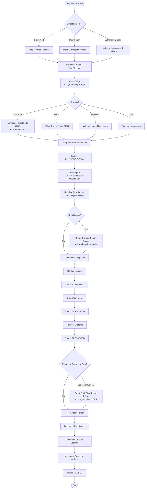
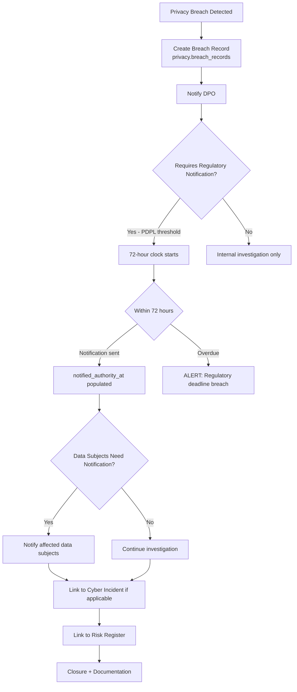
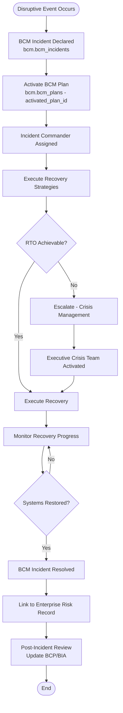

# Incident Management Flow
> **HISTORIC — point-in-time snapshot (all files 2026-04-30). Not a statement of current state.**
> For what the platform is today read [`CLAUDE.md`](../../CLAUDE.md) and [`PROJECT_CHRONICLE.md`](../../PROJECT_CHRONICLE.md); for measured figures, [`MEASURED_BASELINE.md`](../../TSS-GRC-Platform-Bible/Appendix/MEASURED_BASELINE.md). Kept for provenance. *(W0-6)*

## Purpose
Defines the incident management flow covering cybersecurity incidents, privacy breaches, and BCM incidents, with cross-module linkage.

---

## Cyber Incident Lifecycle

---

## Privacy Breach Notification Flow

---

## BCM Incident Flow

