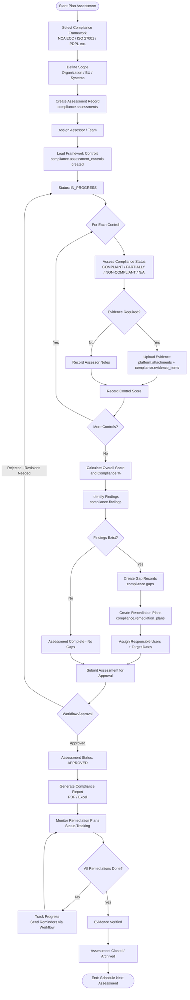
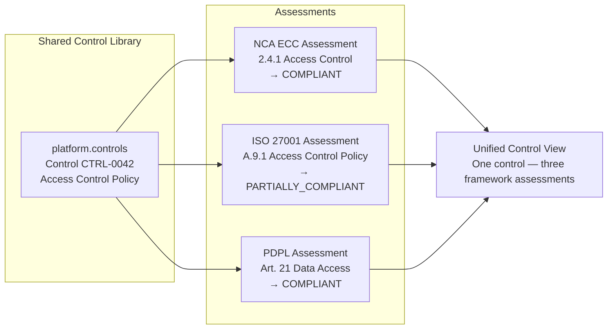
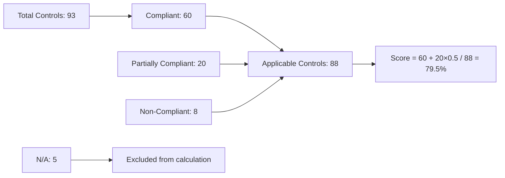

# Compliance Assessment Flow

## Purpose
Defines the business process for conducting compliance assessments against frameworks like NCA ECC, ISO 27001, ISO 22301, and Saudi PDPL.

---

## Compliance Assessment Process

---

## Multi-Framework Assessment View

---

## Compliance Score Calculation

