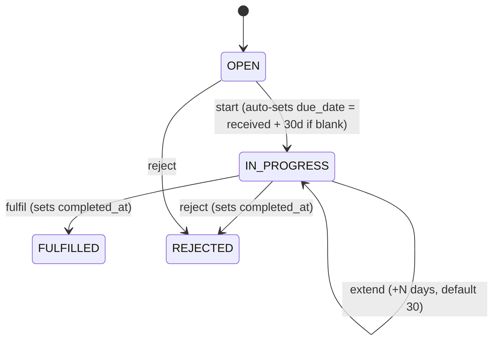
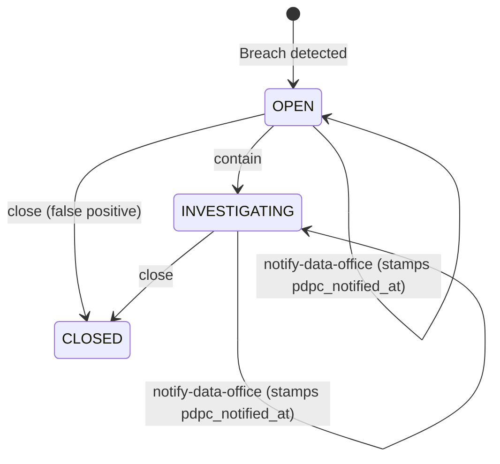
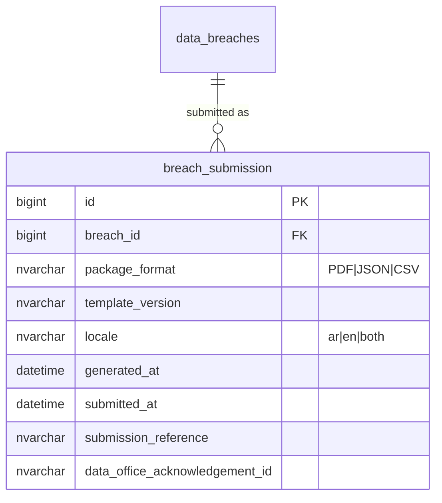
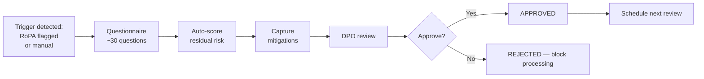

# PDPL / Privacy Module — Implementation Status & Roadmap

**Module:** `tss-grc-backend/src/main/java/com/tss/grc/module/privacy`
**Frontend:** `tss-grc-ui-v2/src/pages/privacy/PrivacyPage.tsx`
**Frameworks aligned:** Saudi PDPL + Implementing Regulations (SDAIA / Saudi Data Office) · ISO/IEC 27701:2019 · ISO/IEC 29100:2011 · GDPR (reference) · CCPA/CPRA (reference)

This document tracks what is implemented, what just shipped, and what remains as deferred follow-up across the seven recommendations from §5.4 of the buyer assessment.

---

## 1. Summary table — recommendation status

| # | Recommendation | Priority | Status |
|---|---|---|---|
| 1 | DSR fulfilment SLA engine (PDPL: 30 days, with auto-extension) | Critical | **Shipped** — workflow endpoints, auto-due-date calculation, frontend countdown column with green/amber/red colour-coding. |
| 2 | Breach 72-hour notification automation (PDPL Article 20) | Critical | **Foundation shipped** — workflow endpoints (contain / notify-data-office / close), frontend 72hr countdown clock with green/amber/red. Auto-package generation for the Saudi Data Office submission deferred (§4). |
| 3 | DPIA workflow (Data Protection Impact Assessment) | Critical | **Deferred** — net-new entity. Plan in §5. |
| 4 | Consent lifecycle (collect → re-collect → withdraw → erase) | High | **Deferred** — net-new entity + cross-module erasure cascade. Plan in §6. |
| 5 | RoPA → data-flow graph (Article 30) | High | **Deferred** — RoPA records exist; graph layer is the addition. Plan in §7. |
| 6 | Cross-border transfer assessment (non-adequate countries) | High | **Deferred** — extension to RoPA. Plan in §8. |
| 7 | Special-category data classifier (health, biometric, children) | Medium | **Deferred** — classifier rules + elevated-controls enforcement. Plan in §9. |

Saudi-specific opportunities from §5.4:

| Opportunity | Status |
|---|---|
| Pre-load PDPL DSR types | Existing — already in DSR `request_type` field |
| Saudi Data Office breach notification template (Arabic auto-population) | **Deferred** — §4 |
| Cross-border transfer flow for non-adequate countries | **Deferred** — §8 |
| Children's data parental-consent flow (PDPL Article 7) | **Deferred** — part of §6 consent lifecycle + §9 classifier |
| Health-data special handling (Sehhaty / Mawid) | **Deferred** — §9 |
| Cookie-consent banner generator localised to KSA | **Deferred** — small follow-up to §6 |

---

## 2. Shipped this session

### 2.1 DSR fulfilment SLA engine (recommendation #1)

State machine and SLA logic now wired:



Backend endpoints under `/api/v1/privacy/dsrs/{id}/{action}`:

| Action | Effect |
|---|---|
| `start` | OPEN → IN_PROGRESS; sets `due_date = received_at + 30 days` if not already set (PDPL default) |
| `fulfil` | → FULFILLED; sets `completed_at = now` |
| `extend` | Extends `due_date` by `days` (body `{"days": 30}`); PDPL allows one-time extension |
| `reject` | → REJECTED; sets `completed_at = now` |

Frontend UI:
- New "SLA" column shows live days-remaining with colour code (green ≥ 7, amber 1–6, red overdue).
- Row actions render context-aware Start / Fulfil / Extend / Reject buttons.

### 2.2 Breach 72-hour notification (recommendation #2 foundation)



Backend endpoints under `/api/v1/privacy/breaches/{id}/{action}`:

| Action | Effect |
|---|---|
| `contain` | OPEN → INVESTIGATING |
| `notify-data-office` | Stamps `pdpc_notified_at = now` and forces `pdpc_notification_required = true` |
| `close` | OPEN or INVESTIGATING → CLOSED |

Frontend UI:
- New "72hr Clock" column shows live hours-remaining since `discovered_at`, with colour code (green > 12h, amber ≤ 12h, red overdue) and a "Notified" badge once the Data Office has been informed.
- Row actions: Contain / Notify Saudi Data Office / Close.

---

## 3. Saudi taxonomy already in place (cross-reference)

The PDPL personal-data risk taxonomy was seeded in this session as part of the ERM Saudi-taxonomy seed (`V_risk_saudi_taxonomy_seed.sql`). Risks created against those nine PDPL categories will appear in both the ERM register and the Privacy module's stats once cross-module dashboards are wired.

---

## 4. Deferred — Auto-generated Saudi Data Office submission package (recommendation #2 remainder)

The `notify-data-office` endpoint stamps the timestamp; the **submission package itself** (the document that goes to the Saudi Data Office) is still manual.

**Concrete deliverables:**

1. New entity `breach_submission` capturing the package contents:

2. Apache POI / OpenPDF generator producing the package with:
   - Bilingual (EN+AR) cover page with Hijri + Gregorian dates
   - Article 20 mandatory fields: nature of breach, categories of data subjects, approximate counts, contact details of DPO, likely consequences, mitigation measures
   - Linked evidence list (from Evidence module) attached as inline appendices
   - Digital signature placeholder for Nafath (when integrated)
3. POST `/api/v1/privacy/breaches/{id}/generate-submission` — returns the file blob; persists a `breach_submission` row.
4. UI: "Generate submission" button next to "Notify Data Office" that opens a preview before download.

Effort estimate: **2 sessions**.

---

## 5. Deferred — DPIA workflow (recommendation #3)

Net-new entity. PDPL Implementing Regulations require DPIAs for high-risk processing.

**Entities:**
```mermaid
erDiagram
    processing_activities ||--o{ dpia : "may require"
    dpia ||--o{ dpia_question : "comprises"
    dpia ||--o{ dpia_mitigation : "produces"
    dpia ||--o{ dpia_review : "approved via"

    dpia {
        bigint id PK
        bigint processing_activity_id FK
        nvarchar trigger_reason "NEW_HIGH_RISK_PROCESSING|MAJOR_CHANGE|REGULATORY_REQUEST|PERIODIC"
        nvarchar status "DRAFT|IN_REVIEW|APPROVED|REJECTED|EXPIRED"
        nvarchar overall_residual_risk
        bigint dpo_id FK
        date assessment_date
        date next_review_date
        nvarchar conclusion
    }
    dpia_question { bigint id PK; bigint dpia_id FK; nvarchar question_en; nvarchar question_ar; nvarchar answer; nvarchar risk_level }
    dpia_mitigation { bigint id PK; bigint dpia_id FK; nvarchar mitigation_en; nvarchar status; date target_date }
    dpia_review { bigint id PK; bigint dpia_id FK; bigint reviewer_id FK; nvarchar decision; nvarchar comments; datetime decided_at }
```

**Trigger criteria** (configurable, defaults baked in):
- Processing involves special-category data (health, biometric, children's, financial)
- Cross-border transfer to non-adequate jurisdiction
- Large-scale automated decision-making
- Systematic monitoring of public spaces
- New technology with privacy implications

**Workflow:**


Effort estimate: **3 sessions**.

---

## 6. Deferred — Consent lifecycle (recommendation #4)

Net-new module. Tracks consent collection, re-collection on policy changes, withdrawal, and propagates withdrawal to downstream systems for erasure.

**Entities:**
- `consent_purpose` — purposeId, name_en/ar, granular description, lawful_basis
- `consent_record` — data_subject_id, purpose_id, granted_at, withdrawn_at, capture_method (web | paper | call | nafath), policy_version
- `consent_policy_version` — version, effective_from, content_hash, requires_re_collection (boolean)
- `erasure_task` — when consent withdrawn, downstream systems must erase; this is the cross-module work-item

**Saudi specifics:**
- Children's data: PDPL Article 7 requires verified parental consent. Add `parental_consent_record` with verifier identity (Nafath citizen ID).
- Cookie-consent banner generator localised to KSA jurisdiction (subset of consent module).

Effort estimate: **3-4 sessions**.

---

## 7. Deferred — RoPA data-flow graph (recommendation #5)

Today RoPA records exist as flat rows. The graph extension turns them into a directed graph: data sources → processing activities → destinations, with cross-border edges flagged.

**Entities to add on top of existing `processing_activities`:**
- `data_flow_edge` — source_id, source_type (system|api|file|manual), target_id, target_type, data_categories[], cross_border_flag, jurisdiction
- `data_destination` — name, type (internal_system | sub_processor | regulator | data_subject), country, adequacy_decision_status

**UX:** new tab in Privacy module "Data Flow Map" rendering an interactive Mermaid-style graph of the org's processing activities. Critical-flag rules:
- Edges into non-adequate jurisdictions render in red
- Edges carrying special-category data render with a lock icon
- Hovering an edge shows the legal basis + retention period

Effort estimate: **3 sessions**.

---

## 8. Deferred — Cross-border transfer assessment (recommendation #6)

Builds on §7. Adds the **adequacy-decision lookup table** and the **Data Office approval flow** for transfers to non-adequate countries.

**Entities:**
- `country_adequacy_status` — country_code, adequacy_status (ADEQUATE | NON_ADEQUATE | UNDER_REVIEW), reference (Saudi Data Office decision document), effective_date
- `cross_border_transfer_assessment` — ropa_id, destination_country_code, transfer_mechanism (CBR | SCC | EXPLICIT_CONSENT | DERROGATION), approval_status, data_office_consultation_reference

**Workflow:** when a RoPA's `cross_border_transfer = true` and destination is NON_ADEQUATE, force a `cross_border_transfer_assessment` row with status `PENDING_DATA_OFFICE`. Block the RoPA from going `ACTIVE` until that assessment is `APPROVED`.

**Saudi specifics:** pre-load the Saudi Data Office's published adequacy list (currently very small — only a handful of countries are ADEQUATE under PDPL).

Effort estimate: **2 sessions**.

---

## 9. Deferred — Special-category data classifier (recommendation #7)

Auto-classifies processing inputs (database columns, API fields, document types) as special-category and applies elevated rules.

**Entities:**
- `data_classification_rule` — pattern (regex or column-name match), category (HEALTH | BIOMETRIC | CHILD | FINANCIAL_CARD | OTHER_SENSITIVE), source (NCA | SDAIA | INTERNAL)
- `classified_data_field` — field_path, classification, confidence, classified_at, manually_overridden

**Elevated controls automatically enforced for special-category fields:**
- Encryption at rest (mandatory)
- Field-level audit logging
- Restricted access (role-based)
- Shorter retention default
- DPIA trigger if combined with profiling
- Saudi-specific: HCIS (health) and Sehhaty/Mawid integration cases get tagged `HEALTH` and inherit MoH/CCHI handling rules.

Effort estimate: **2-3 sessions**.

---

## 10. Suggested sequencing for the next 5 sessions

| Session | Focus |
|---|---|
| 1 | Recommendation #2 remainder — Saudi Data Office auto-submission package (high regulator-visibility) |
| 2 | Recommendation #3 part 1 — DPIA entity + questionnaire engine |
| 3 | Recommendation #3 part 2 — DPIA review/approval workflow + RoPA trigger |
| 4 | Recommendation #5 — RoPA data-flow graph |
| 5 | Recommendation #6 — Cross-border transfer assessment (depends on #5) |

After those, Recommendation #4 (consent lifecycle) and #7 (special-category classifier) are larger but unblocked.

---

**Maintained alongside:**
- Backend: `tss-grc-backend/src/main/java/com/tss/grc/module/privacy/`
- Frontend: `tss-grc-ui-v2/src/pages/privacy/PrivacyPage.tsx`
- API client: `tss-grc-ui-v2/src/lib/api.ts` (search `privacyApi`)
- Buyer assessment §5.4 for the strategic rationale.
