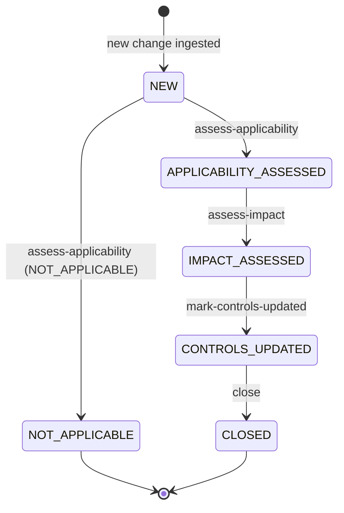
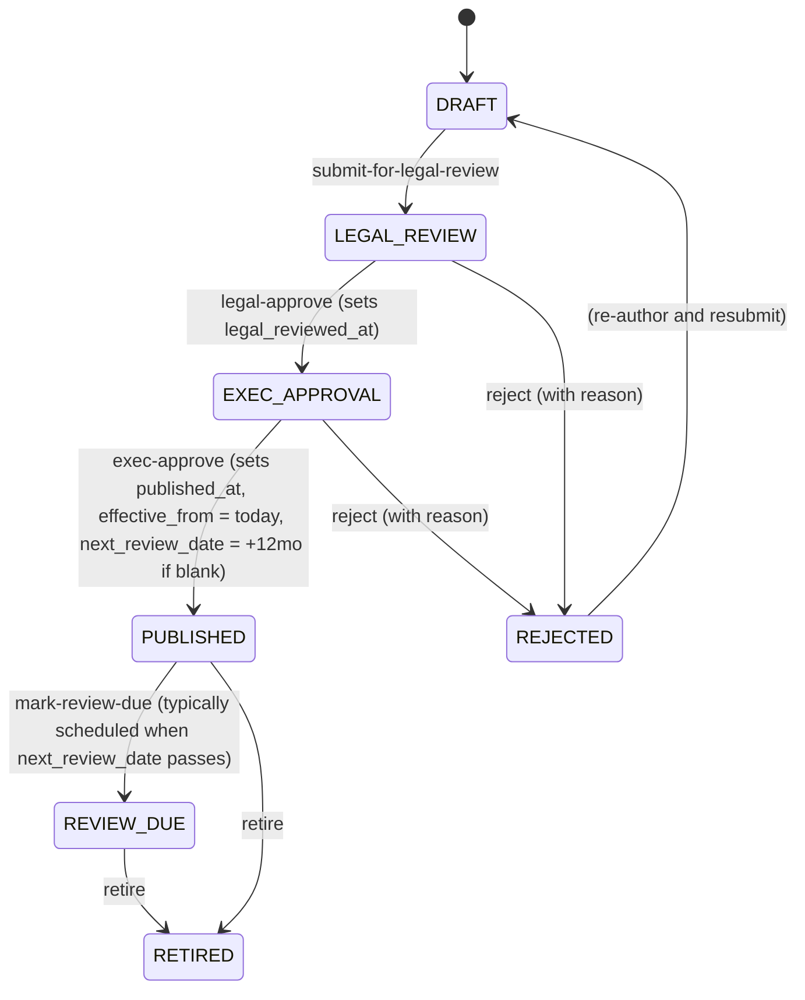
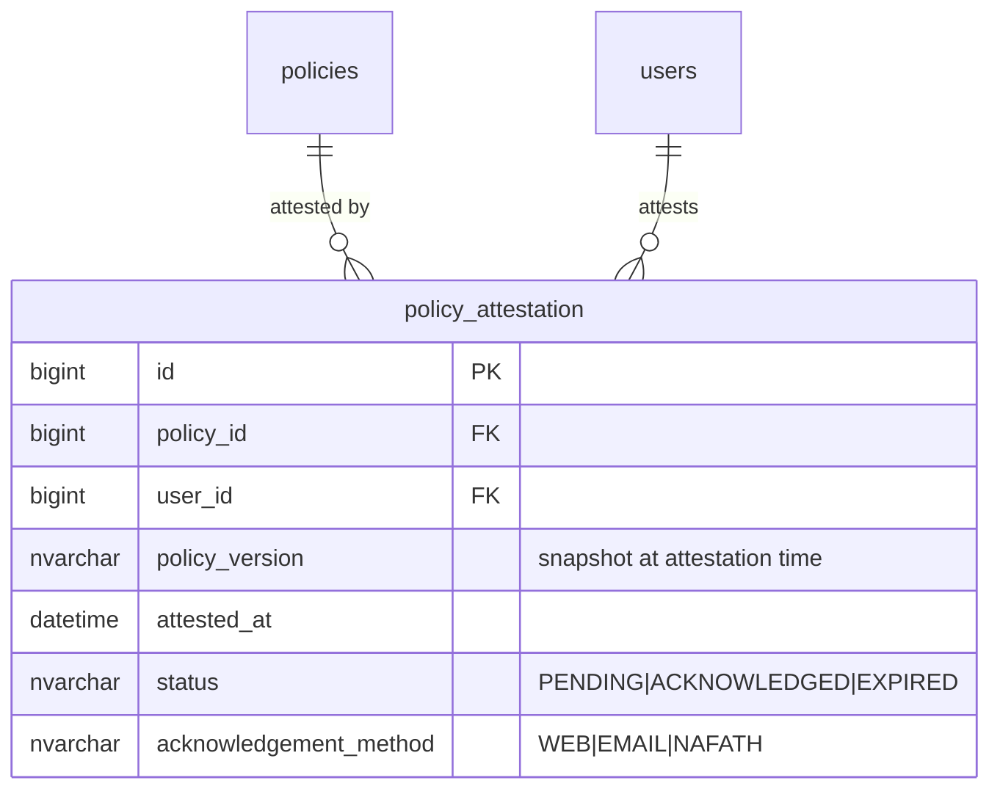
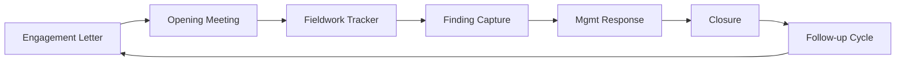
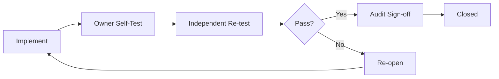

# Compliance Module — Implementation Status & Roadmap

**Module:** `tss-grc-backend/src/main/java/com/tss/grc/module/compliance`
**Frontend:** `tss-grc-ui-v2/src/pages/compliance/CompliancePage.tsx`
**Frameworks aligned:** ISO 19600 / 37301 (Compliance MS) · COSO Internal Control · NCA · SAMA · CMA · SDAIA · ZATCA · CITC · NCEMA · ISO 19011 (Audit)

This document tracks all seven recommendations from §5.3 of the buyer assessment.

---

## 1. Summary table — recommendation status

| # | Recommendation | Priority | Status |
|---|---|---|---|
| 1 | Regulatory change management | Critical | **Shipped** end-to-end (state-machine workflow + UI + 6 sample Saudi changes seeded) |
| 2 | Policy lifecycle | Critical | **Shipped** end-to-end (state-machine workflow + UI + 5 sample policies seeded) |
| 3 | External audit lifecycle | High | **Deferred** — entity sketch in §4 |
| 4 | Findings aging engine | High | **Deferred** — small follow-up in §5 |
| 5 | Dynamic compliance scorecard | High | **Partially shipped** — current Scorecard tab computes per-framework averages; weighted aggregation + drill-through is the gap (§6) |
| 6 | CAPA closure verification | High | **Deferred** — small extension to existing AuditFinding entity (§7) |
| 7 | Internal audit working papers | Medium | **Deferred** — net-new entity, multi-session (§8) |

---

## 2. Shipped this session

### 2.1 Regulatory change management (Critical #1)

Backend endpoints under `/api/v1/compliance/regulatory-changes`:

| Method | Path | Action |
|---|---|---|
| GET | `/regulatory-changes` | List paged |
| POST | `/regulatory-changes` | Create |
| PUT | `/regulatory-changes/{id}` | Update |
| DELETE | `/regulatory-changes/{id}` | Soft-delete |
| POST | `/regulatory-changes/{id}/assess-applicability` | Body: `{applicability: APPLICABLE\|NOT_APPLICABLE\|PARTIAL}` |
| POST | `/regulatory-changes/{id}/assess-impact` | Body: `{impactLevel, impactSummary}` |
| POST | `/regulatory-changes/{id}/mark-controls-updated` | Body: `{controlsUpdatedCount}` |
| POST | `/regulatory-changes/{id}/close` | Final transition |
| GET | `/regulatory-changes/stats` | Status counts for dashboards |

Frontend: new "Regulatory Changes" tab with full CRUD + workflow buttons that surface only the legal next action per status.

DB seed (already applied): 6 sample Saudi-specific changes covering PDPL Implementing Regulations (SDAIA, CRITICAL impact, CONTROLS_UPDATED status), NCA ECC v2.0 (NCA, HIGH, IMPACT_ASSESSED), SAMA CSF 2025 update (SAMA, HIGH, APPLICABILITY_ASSESSED), CITC Cloud Computing Regulatory Framework v3 (CITC, NEW), CMA Cybersecurity Guide (CMA, NEW), ZATCA Fatoora Phase 2 Wave 5 (ZATCA, NOT_APPLICABLE — under threshold).

### 2.2 Policy lifecycle (Critical #2)

Backend endpoints under `/api/v1/compliance/policies` mirroring the state machine.

Frontend: new "Policies" tab with full CRUD + context-aware workflow buttons.

DB seed (already applied): 5 sample policies — Information Security (PUBLISHED, ISO 27001 + NCA ECC aligned), PDPL Personal Data Protection (PUBLISHED), Business Continuity (PUBLISHED, ISO 22301 + NCEMA), Enterprise Risk Management (EXEC_APPROVAL), Acceptable Use (DRAFT).

### 2.3 Saudi authorities pre-loaded as dropdown options

The "Issuing Authority" select on the Regulatory Change form lists:
NCA · SDAIA · SAMA · CMA · ZATCA · CITC · NCEMA · MoCI · HRSD · MoH/HCIS · OTHER

Each row in the table shows the authority as a primary-tone badge, making cross-authority filtering and dashboarding trivial.

---

## 3. Deferred — Policy attestation cycle (recommendation #2 remainder)

The lifecycle ships the state machine. The Critical recommendation also calls for **periodic user attestation** that personnel have read and acknowledged each PUBLISHED policy.

**Concrete deliverables:**

- New entity `policy_attestation` linking policy + user.
- Scheduler creates attestation rows per policy when first PUBLISHED, plus refreshes annually or when version changes.
- Notification cascade for `PENDING` after 14 days, escalation after 30 days.
- Saudi: Nafath citizen-identity sign as the strongest acknowledgement method.

Effort estimate: **2 sessions**.

---

## 4. Deferred — External audit lifecycle (recommendation #3)

**Entities:**
- `audit_engagement` — engagement letter, scope, period, auditor, opening date, closing date, status
- `audit_fieldwork_session` — engagement_id, session_date, location, auditors_present, notes
- `audit_finding` (existing) — extend with engagement_id FK, target_close_date, mgmt_response, follow_up_date
- `audit_management_response` — finding_id, response_text, owner, target_date, status

Effort estimate: **3 sessions**.

---

## 5. Deferred — Findings aging engine (recommendation #4)

Finding age drives auto-escalation tiers. Quick to build on existing `AuditFinding` entity:

**Backend:**
- Add helper that computes `daysOpen` from `created_at` and `escalationTier` based on bands:
  - 0–29 days: `ON_TRACK`
  - 30–59 days: `MANAGER_ESCALATED`
  - 60–89 days: `DIRECTOR_ESCALATED`
  - ≥ 90 days: `EXEC_ESCALATED`
- Expose via `/api/v1/compliance/findings/aging` endpoint returning aged findings with computed fields.
- Scheduler that, on tier transition, sends email + creates a notification record.

**Frontend:**
- Add a "Days Open" + "Escalation" column to the Findings tab.
- Dashboard tile: "Findings by escalation tier" stacked bar.
- Board-pack export: PDF + XLSX of aged findings grouped by tier.

Effort estimate: **1 session**.

---

## 6. Deferred — Dynamic compliance scorecard (recommendation #5)

Today's scorecard tab averages `maturity_level` per framework. The dynamic version aggregates **control test results** with weights:

**Calculation:**
- Each control has a `weight` field (default 1, configurable for high-impact controls)
- Score per framework = Σ(test_result × weight) / Σ(weight × max_score)
- Test result = latest assessment outcome (PASS=5, PARTIAL=3, FAIL=0, N/A excluded from denominator)

**Drill-through:**
- Click framework tile → list of controls with current test result
- Click control → assessment history + linked findings + linked evidence

Effort estimate: **1-2 sessions**.

---

## 7. Deferred — CAPA closure verification (recommendation #6)

**Schema additions to existing `audit_finding`:**
- `owner_test_at`, `owner_test_result`, `owner_test_evidence_id`
- `independent_test_at`, `independent_test_by_id`, `independent_test_result`
- `audit_signoff_at`, `audit_signoff_by_id`

**Workflow endpoints:**
- POST `/findings/{id}/owner-test` — owner submits self-test + evidence
- POST `/findings/{id}/independent-test` — auditor confirms or rejects
- POST `/findings/{id}/sign-off` — final closure (only after independent-test pass)

Effort estimate: **1 session**.

---

## 8. Deferred — Internal audit working papers (recommendation #7)

Net-new module. Bigger lift.

**Entities:**
- `audit_engagement` (shared with §4)
- `working_paper` — engagement_id, section (PLANNING | FIELDWORK | REVIEW | REPORTING), title, content, evidence_links[], status (DRAFT | UNDER_REVIEW | APPROVED), reviewer_id, reviewed_at
- `audit_review_note` — working_paper_id, reviewer_id, comment, status (OPEN | RESOLVED), resolution_text

**UX:**
- Folder view per engagement with sections (Planning, Fieldwork, Review, Reporting)
- Rich-text editor for working-paper content
- Inline review notes with thread-style resolution
- Final archive on engagement close

Effort estimate: **3-4 sessions**.

---

## 9. Suggested sequencing for the next 5 sessions

| Session | Focus |
|---|---|
| 1 | #4 Findings aging engine (small, high visibility) + start #6 CAPA closure verification |
| 2 | Finish #6 + #2 remainder (policy attestation cycle) |
| 3 | #5 Dynamic compliance scorecard with weighted aggregation + drill-through |
| 4 | #3 External audit lifecycle part 1 (audit_engagement entity + fieldwork sessions) |
| 5 | #3 part 2 + #7 working papers MVP |

After those five sessions every Critical and High recommendation in §5.3 will be shipped end-to-end.

---

## 10. Saudi-specific notes already embedded

| Element | What it does |
|---|---|
| Issuing-authority dropdown | Pre-populated with NCA, SDAIA, SAMA, CMA, ZATCA, CITC, NCEMA, MoCI, HRSD, MoH — the regulators that drive Saudi GRC reality |
| 6 sample regulatory changes seeded | All Saudi-issued: PDPL Implementing Regulations, NCA ECC v2.0, SAMA CSF 2025 update, CITC Cloud Computing Regulatory Framework v3, CMA Cybersecurity Guide, ZATCA e-invoicing wave 5 |
| 5 sample policies seeded | Information Security (NCA ECC + ISO 27001), PDPL personal data, BCM (ISO 22301 + NCEMA), Risk (ISO 31000), AUP |
| EN+AR titles on every entity | Bilingual content for both Regulatory Changes and Policies |

---

**Maintained alongside:**
- Backend: `tss-grc-backend/src/main/java/com/tss/grc/module/compliance/`
- Frontend: `tss-grc-ui-v2/src/pages/compliance/CompliancePage.tsx`
- API client: `tss-grc-ui-v2/src/lib/api.ts` (search `complianceApi`)
- DDL artefact: `tss-grc-backend/src/main/resources/db/seed/V_compliance_change_policy_ddl.sql`
- Buyer assessment §5.3 for the strategic rationale.
