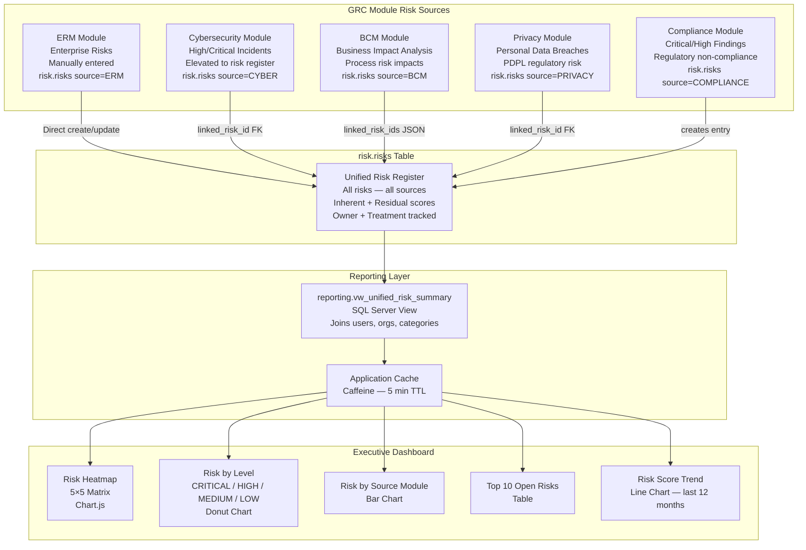
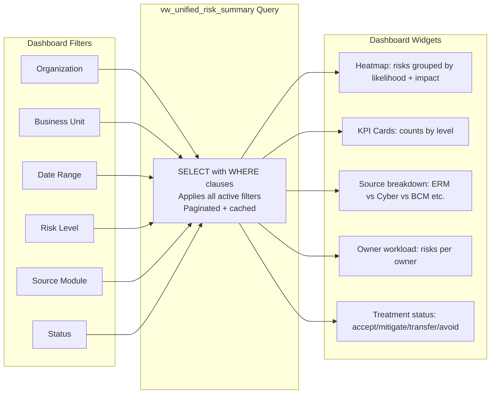
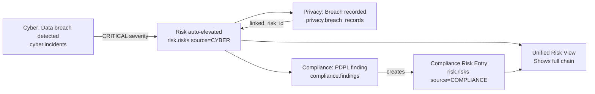

# Unified Risk View — Data Aggregation Diagram

## Purpose
Shows how risk data from all five GRC modules aggregates into the Unified Risk View, which is the key executive dashboard feature.

---

## Data Flow to Unified Risk View

---

## Risk Aggregation Logic

---

## Cross-Module Risk Chain

