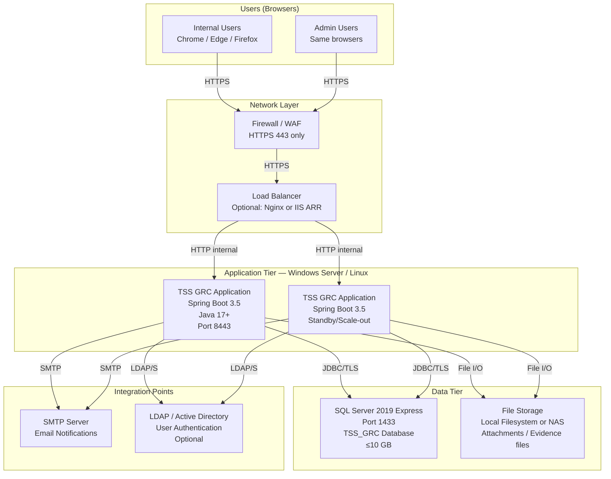
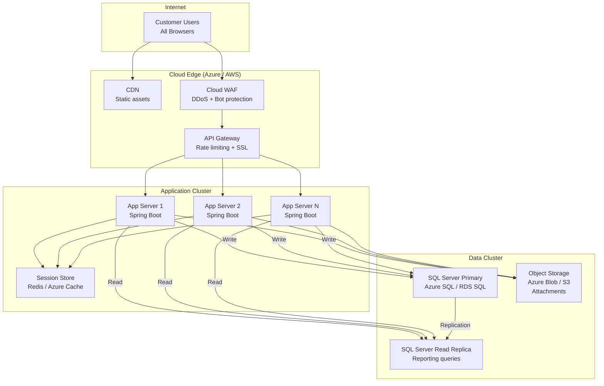

# Deployment Architecture Diagram

## Purpose
Shows the deployment topology for the TSS GRC Platform across on-premises and future cloud deployment models.

---

## On-Premises Deployment (Phase 1)



---

## Future SaaS Deployment (Phase 10+)



---

## Component Health Monitoring

```mermaid
flowchart LR
    APP[Spring Boot App] --> ACT[/actuator/health]
    ACT --> DB_CHK[Database Connectivity Check]
    ACT --> MAIL_CHK[Mail Server Check]
    ACT --> FS_CHK[File Storage Check]
    ACT --> CACHE_CHK[Cache Health Check]
    LB2[Load Balancer] -->|Probes every 30s| ACT
```
