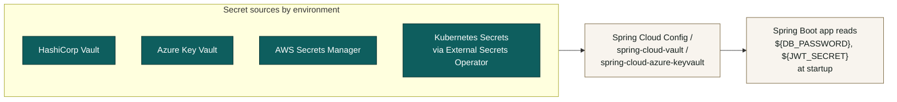

# Secrets Management
> **HISTORIC — point-in-time snapshot (all files 2026-05-02). Not a statement of current state.**
> For what the platform is today read [`CLAUDE.md`](../../CLAUDE.md) and [`PROJECT_CHRONICLE.md`](../../PROJECT_CHRONICLE.md); for measured figures, [`MEASURED_BASELINE.md`](../../TSS-GRC-Platform-Bible/Appendix/MEASURED_BASELINE.md). Kept for provenance. *(W0-6)*


**Status:** dev profile cleaned up (this commit) · prod still requires deployment-time wiring · long-term move to a dedicated secrets manager is recommended

This document captures (a) what changed for the local-dev profile, (b) the recommended setup for non-dev environments, and (c) the small set of remaining items the platform team should pick up.

---

## 1. What changed in `application-dev.yml`

Until this commit, the dev profile shipped with two secrets hard-coded in the YAML and tracked in git:

| Concern | Old value (in git) | What it protected |
|---|---|---|
| Database password | `"tss.123"` (literal) | Local SQL Server `sa` account |
| JWT signing secret | `"tss-dev-secret-key-at-least-32-chars-padding-ok"` (literal) | All JWT access + refresh tokens |

The buyer assessment (§6.7 DevSecOps) flagged this as a known credential-leak risk now that the codebase is in a private GitHub repo. This commit moves both behind environment-variable resolution:

```yaml
spring:
  datasource:
    url:      ${DB_URL:jdbc:sqlserver://localhost:1433;…}
    username: ${DB_USERNAME:sa}
    password: ${DB_PASSWORD:CHANGE_ME_IN_ENV}

grc:
  jwt:
    secret: ${JWT_SECRET:CHANGE_ME_PROVIDE_JWT_SECRET_VIA_ENVIRONMENT_VARIABLE_AT_LEAST_32_CHARS}
```

Two design choices:
- **Defaults remain in the YAML.** This keeps day-one local-dev frictionless: anyone who clones the repo and runs the JAR with no env vars set still gets a working DB connection (against the `sa` user with the documented dev password — which they have to set in their environment). The JWT default is intentionally a recognisably-broken placeholder.
- **The default password and JWT secret are no longer the historical literal values.** The literals `tss.123` and `tss-dev-secret-…` are removed from the file, so anyone running on an existing local DB needs to set `DB_PASSWORD` (and the new `JWT_SECRET`) explicitly before the backend will start. This prevents the new default from silently working in environments that only happened to share the legacy password.

### Local-dev quick-start

```bash
# Windows (PowerShell)
$env:DB_PASSWORD = 'tss.123'
$env:JWT_SECRET  = 'replace-this-with-a-real-32-char-or-longer-secret'
java -jar tss-grc-backend/target/tss-grc-platform-0.1.0-SNAPSHOT.jar --spring.profiles.active=dev

# macOS / Linux
export DB_PASSWORD='tss.123'
export JWT_SECRET='replace-this-with-a-real-32-char-or-longer-secret'
java -jar tss-grc-backend/target/tss-grc-platform-0.1.0-SNAPSHOT.jar --spring.profiles.active=dev
```

Maven users can put the same exports in `~/.mavenrc` or use `mvn -DargLine="-Dgrc.jwt.secret=..."`.

---

## 2. Recommended setup for non-dev environments



### Recommended pattern by hosting target

| Environment | Recommended secrets backend | Why |
|---|---|---|
| Self-hosted on STC Cloud / Mobily SCC / SCCC (Saudi sovereign clouds) | **HashiCorp Vault** (self-hosted) | Cloud-agnostic, runs in any of the three Saudi sovereign-cloud providers, integrates with Saudi customer's existing IAM via OIDC |
| Azure (any region; if customer is allowed Azure UAE North or KSA Central) | **Azure Key Vault** | Native integration with Azure AD / Microsoft Entra; certificate, key and secret types in one place |
| AWS (Bahrain me-south-1 typically) | **AWS Secrets Manager** | Native rotation; integrates with RDS for automatic DB password rotation |
| Kubernetes anywhere | **External Secrets Operator** + one of the above | Maps cluster secrets to a backing store; minimal app-level change |

For all four, the application-side change is identical — Spring resolves `${DB_PASSWORD}` and `${JWT_SECRET}` from the environment, and the secrets backend (via sidecar / init container / CSI driver) populates the environment at pod start.

### Spring Boot integration libraries

| Library | When to use |
|---|---|
| `spring-cloud-starter-vault-config` | HashiCorp Vault — recommended for sovereign-cloud deployments |
| `spring-cloud-azure-starter-keyvault-secrets` | Azure Key Vault |
| `spring-cloud-aws-starter-secrets-manager` | AWS Secrets Manager |

These libraries let secrets be referenced as if they were any other Spring property — the YAML stays clean, the bootstrap pulls secrets at startup, and rotations are picked up on next refresh.

---

## 3. Saudi-specific compliance notes

| Regulation | Implication for secrets management |
|---|---|
| **PDPL Article 5 (lawfulness)** | The DB password gates access to personal data of Saudi data subjects — must be rotated on any role-change (joiner/mover/leaver) for personnel with privileged access |
| **NCA ECC §2-2 (Identity & Access)** | Privileged credentials must be vaulted, rotated regularly, and access-logged. Secrets in YAML files in git fail multiple ECC sub-controls |
| **NCA ECC §2-8 (Cryptography)** | Cryptographic keys (including JWT signing keys) must follow documented key-management procedures: generation, distribution, rotation, escrow, destruction |
| **CITC Cloud Computing Regulatory Framework** | Level C (Highly Confidential) workloads require sovereign hosting; the secrets backend must also be sovereign-hosted (e.g. SCCC-hosted Vault rather than US-hosted SaaS) |
| **SAMA CSF (banks)** | Quarterly attestation by CISO/CRO that all production credentials are vaulted and rotated; manual statement here is not enough — needs evidence |

---

## 4. Remaining items for the platform team

The dev YAML cleanup is the visible part. The complete fix has three more items:

| # | Item | Effort | Notes |
|---|---|---|---|
| 1 | `application-prod.yml` audit | 1 hour | Confirm the prod profile's keystore password (server.ssl.key-store-password) is also env-var-only. Any other secrets there should follow the same pattern. |
| 2 | Add a `spring-cloud-vault-config` dependency and a `bootstrap.yml` for staging+prod profiles | ½ day | Wires Vault as the runtime secret source |
| 3 | Establish a **rotation cadence** for the JWT secret (eg. quarterly) | Process change | Decide on dual-secret rollover (overlap window where both old and new signing keys validate tokens during rotation) |
| 4 | **Saudi sovereign-region Vault deployment** for any customer who needs PDPL or NCA CCC level C workloads | 2-3 days customer-by-customer | Reference architecture sketch in §2 |

Until items 1-3 are done, the recommendation is:
- Keep the `dev` profile as it is now (env-var-with-defaults).
- For staging and prod, do **not** use `application-{env}.yml` to hold any secret literals; rely entirely on environment variables sourced from the deployment platform's native secrets store (CI variable, Kubernetes Secret, ECS task-definition secret reference, etc.).

---

## 5. What the running JAR sees today

The JAR running on port 8084 was built before this commit. It still contains the historical literal defaults compiled in. To pick up the new env-var pattern, rebuild:

```bash
cd tss-grc-backend
mvn -DskipTests clean package
# Then export DB_PASSWORD + JWT_SECRET as shown in §1 and run the new JAR.
```

After rebuild, **the backend will refuse to start** if `DB_PASSWORD` and `JWT_SECRET` are not set, which is the correct fail-loud behaviour. The `application-dev.yml` defaults still work for `DB_USERNAME` (`sa`) and `DB_URL` so those don't need explicit exports for local SQL Server.

---

**See also:**
- Buyer assessment §6.7 (DevSecOps and operational maturity) for the strategic rationale.
- `application-dev.yml` line numbers for the exact placeholders.
- Future commit: a `bootstrap.yml` for staging+prod with `spring-cloud-vault-config` once the deployment target is fixed.
