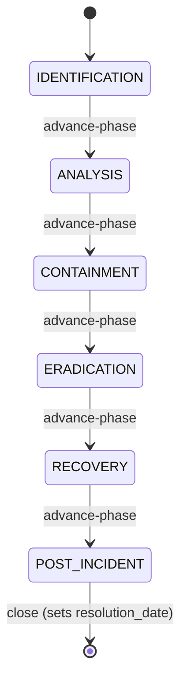
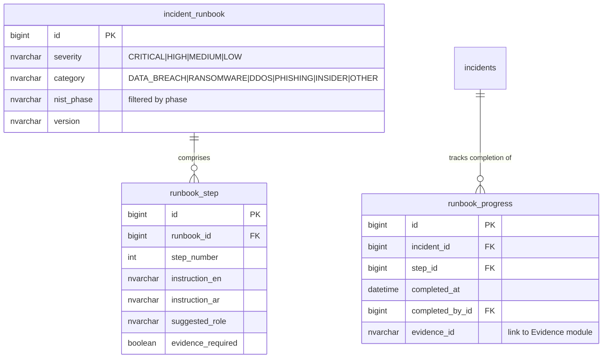

# Incidents Module — Implementation Status & Roadmap

**Module:** `tss-grc-backend/src/main/java/com/tss/grc/module/incident`
**Frontend:** `tss-grc-ui-v2/src/pages/incidents/IncidentsPage.tsx`
**Frameworks aligned:** NIST SP 800-61r2 · ISO/IEC 27035 · NCA HEY · Saudi Data Office (PDPL Article 20) · CITC Cybersecurity Requirements · SAMA Cyber Threat Intelligence Sharing · HRSD employee-data breach reporting

---

## 1. Summary table — recommendation status

From buyer-assessment §5.8:

| # | Recommendation | Priority | Status |
|---|---|---|---|
| 1 | NIST 800-61 lifecycle workflow (Identify → Analyse → Contain → Eradicate → Recover → Post-incident) | Critical | **Shipped** |
| 2 | Severity-based runbooks | Critical | **Deferred** — see §4 |
| 3 | Stakeholder notification matrix | High | **Deferred** — see §5 |
| 4 | Saudi regulatory-report templating (NCA HEY 24h, Data Office 72h, CITC 24h, SAMA, HRSD) | Critical | **Shipped** (auto-filled bilingual templates + notify-regulator endpoints) |
| 5 | MITRE ATT&CK mapping | High | **Foundation shipped** (entity columns + ready for tactic/technique tagging) |
| 6 | Lessons-learned → preventive action | High | **Partial** — fields exist; auto-CAPA wiring deferred (§7) |

---

## 2. Shipped this session

### 2.1 NIST SP 800-61r2 lifecycle workflow



The high-level `status` column (`OPEN | INVESTIGATING | RESOLVED | CLOSED` — preserved by the existing CHECK constraint) is **auto-mapped** from the new `nist_phase` column by the service layer:

| nist_phase | maps to status |
|---|---|
| IDENTIFICATION | OPEN |
| ANALYSIS, CONTAINMENT, ERADICATION | INVESTIGATING |
| RECOVERY, POST_INCIDENT | RESOLVED |
| (close action) | CLOSED |

**Backend endpoints** under `/api/v1/incidents/{id}`:

| Method | Path | Action |
|---|---|---|
| POST | `/advance-phase` | Move to the next NIST phase |
| POST | `/set-phase` | Set explicitly (body: `{phase: …}`) — for back-corrections |
| POST | `/close` | Final close; sets resolution_date if blank |

**Frontend:** new "NIST Phase" column on the register; row-level "Advance Phase" button surfaces only when not in POST_INCIDENT; "Close Incident" surfaces while not CLOSED.

### 2.2 Saudi regulatory-report templating

Five regulator templates auto-filled from incident data, returned by:

```
GET /api/v1/incidents/{id}/regulatory-templates
```

| Template | Authority | Deadline | When applicable |
|---|---|---|---|
| **NCA HEY** | NCA (National Cybersecurity Authority) | **24 hours** from discovery | All government and CNI cybersecurity incidents — NCA mandate |
| **Saudi Data Office** | SDAIA Saudi Data Office | **72 hours** from discovery | Personal data breaches under PDPL Article 20 |
| **CITC** | Communications, Space & Technology Commission | **24 hours** | Telecoms and cloud-provider customers |
| **SAMA** | Saudi Central Bank | 48 hours (advisory) | SAMA-licensed financial institutions — Cyber Threat Intelligence Sharing |
| **HRSD** | Ministry of Human Resources & Social Development | 72 hours | Breaches affecting employee personal/payroll data |

Each template returns:
- Bilingual (EN+AR) title
- `deadlineHours`, `hoursSinceDiscovery`, `hoursRemaining`, `overdue` flag
- `notifiedAt` timestamp (null if not yet notified)
- `submissionChannel` — where the package goes (e.g. `https://hey.nca.gov.sa`)
- `applicabilityHint` — when to use this template
- `prefilledBody` — text body with placeholders replaced from the incident data; the operator fills `<to be completed>` placeholders before submission

**Workflow endpoint:**

```
POST /api/v1/incidents/{id}/notify-regulator    body: {regulator: NCA_HEY|DATA_OFFICE|CITC|SAMA|HRSD}
```

stamps the corresponding `*_notified_at` timestamp on the incident.

**Frontend:** "Saudi Reports" row-action opens a modal listing all five templates with live countdown badges (green/amber/red) and one-click "Mark Notified" buttons.

### 2.3 MITRE ATT&CK foundation

Two new columns on `cyber.incidents`:
- `mitre_tactics` — comma-separated tactic IDs (e.g. `TA0001,TA0002`)
- `mitre_techniques` — comma-separated technique IDs (e.g. `T1078,T1133`)

The full UI for ATT&CK tagging (autocomplete from the official catalogue, kill-chain visualisation) is deferred — see §6.

### 2.4 DDL artefact

`db/seed/V_incidents_nist_lifecycle.sql` is idempotent and adds:
- `nist_phase` (NOT NULL DEFAULT 'IDENTIFICATION', no CHECK — service guards transitions)
- `nca_hey_notified_at`, `data_office_notified_at`, `citc_notified_at`, `sama_notified_at`, `hrsd_notified_at`
- `mitre_tactics`, `mitre_techniques`
- Index on `nist_phase` for fast active-incident filtering

---

## 3. Deferred — Severity-based runbooks (recommendation #2)

Each severity tier should auto-load a runbook (sequence of recommended actions per NIST phase) when an incident is created.

**Entities:**



Effort estimate: **3 sessions** (entity, seed of representative runbooks for top 5 severity-category combinations, UI integration in NIST workflow).

---

## 4. Deferred — Stakeholder notification matrix (recommendation #3)

Pre-defined recipient lists per severity × category that auto-fire when an incident transitions phases.

**Entity sketch:**

| Field | Purpose |
|---|---|
| matrix_rule_id | row identifier |
| trigger_severity | severity that fires this row |
| trigger_phase | NIST phase that fires this row |
| trigger_category | optional category filter |
| recipients | role(s) — CISO, CRO, COMMS, LEGAL, EXEC, REGULATOR_LIAISON |
| channel | EMAIL, SMS, IN_APP, NAFATH |
| template_id | which message template to send |

**UI:** when phase transitions, the system computes applicable matrix rows and shows a preview ("This will notify: CISO, CRO, Comms, Saudi Data Office liaison") before the operator confirms.

Effort estimate: **2 sessions**.

---

## 5. Deferred — MITRE ATT&CK rich tagging (recommendation #5 remainder)

The columns are in place. Remaining work:

1. Pre-load the MITRE ATT&CK Enterprise tactics catalogue (~14 tactics) and high-frequency techniques as a seed file.
2. Multi-select autocomplete on the Incident edit form.
3. Kill-chain visualisation: render the tagged tactics in MITRE order on the incident detail page, with techniques as sub-bullets.
4. Cross-incident analytics: which techniques recur most often across the org?

Effort estimate: **2 sessions**.

---

## 6. Deferred — Lessons-learned → preventive action wiring (recommendation #6 remainder)

Today the `lessons_learned` field captures free-text. To turn lessons into preventive action:

1. New field `lessons_to_capa` on Incident — when set, automatically creates a Compliance CAPA record on POST_INCIDENT phase entry.
2. The CAPA inherits the lessons-learned text and the linked Cybersecurity / Risk control IDs.
3. Closure of the CAPA back-references the Incident in the audit trail.

Effort estimate: **1 session** (depends on Compliance CAPA closure-verification work — §7 of the Compliance roadmap).

---

## 7. Suggested sequencing for next 4 sessions

| Session | Focus |
|---|---|
| 1 | Recommendation #6 lessons → CAPA wiring (cross-module, small, high cohesion with Compliance CAPA work) |
| 2 | Recommendation #2 severity-based runbooks part 1 — entities + seed |
| 3 | Recommendation #2 part 2 — UI integration with NIST phase workflow |
| 4 | Recommendation #3 stakeholder notification matrix + #5 MITRE ATT&CK rich tagging |

---

## 8. Saudi-specific notes embedded today

| Element | What it does |
|---|---|
| 5-template regulatory module | Pre-built NCA HEY, Data Office, CITC, SAMA, HRSD templates with bilingual titles and the Saudi regulatory deadlines (24h/72h/24h/48h/72h) |
| Live countdown badge | Green/amber/red badge per template based on hours remaining; instantly visible if a 24h deadline is within hours |
| Notification audit trail | Each template stamps a column on the incident at the moment of notification — provides regulator-facing evidence the org notified within the deadline |
| Bilingual prefilled body | English template body with Arabic title — intended to be reviewed and the Arabic body added by the operator before submission to Arabic-speaking regulator desks |
| Submission channel hint | Each template names where the package goes (NCA HEY portal, Data Office portal, CITC operator portal, SAMA channel, HRSD employer portal) |
| MITRE ATT&CK tactics in NCA HEY body | The auto-filled NCA HEY notification includes MITRE tactics + techniques, matching the format NCA prefers for cyber-incident reports |

---

**Maintained alongside:**
- Backend: `tss-grc-backend/src/main/java/com/tss/grc/module/incident/`
- Frontend: `tss-grc-ui-v2/src/pages/incidents/IncidentsPage.tsx`
- API client: `tss-grc-ui-v2/src/lib/api.ts` (search `incidentApi`)
- DDL artefact: `tss-grc-backend/src/main/resources/db/seed/V_incidents_nist_lifecycle.sql`
- Buyer assessment §5.8 for the strategic rationale.
