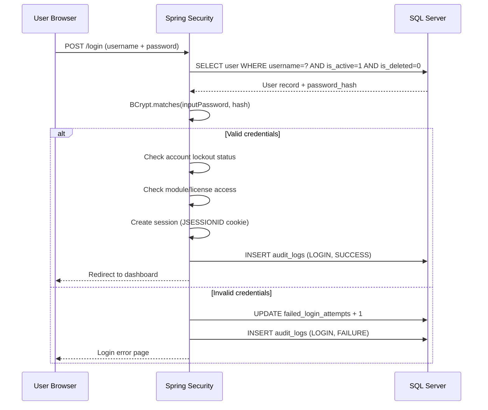

# Security Architecture Diagram
> **HISTORIC — point-in-time snapshot (all files 2026-04-30). Not a statement of current state.**
> For what the platform is today read [`CLAUDE.md`](../../CLAUDE.md) and [`PROJECT_CHRONICLE.md`](../../PROJECT_CHRONICLE.md); for measured figures, [`MEASURED_BASELINE.md`](../../TSS-GRC-Platform-Bible/Appendix/MEASURED_BASELINE.md). Kept for provenance. *(W0-6)*


## Purpose
Shows the layered security architecture of the TSS GRC Platform, from the network perimeter to the database.

---

## Security Layers

```mermaid
flowchart TD
    subgraph Internet["External Network"]
        U[User Browser\nHTTPS]
    end

    subgraph Perimeter["Perimeter Security"]
        FW[Firewall\nAllow HTTPS 443 only\nBlock all other ports]
        WAF[Web Application Firewall\nOWASP rule sets\nSQL injection protection\nXSS protection]
    end

    subgraph Transport["Transport Security"]
        TLS[TLS 1.2+ Termination\nHSTS Enabled\nStrong cipher suites only]
    end

    subgraph Application["Application Security — Spring Boot"]
        HEADERS[Secure HTTP Headers\nContent-Security-Policy\nX-Frame-Options DENY\nX-Content-Type-Options\nX-XSS-Protection]
        CSRF[CSRF Token Validation\nSpring Security CSRF\nAll state-changing requests]
        AUTHN[Authentication\nSpring Security\nBCrypt password hashing\nAccount lockout\nSession management]
        AUTHZ[Authorization\nRBAC - Role-Based\nModule-level access\nOrg/BU scoping\n@PreAuthorize on methods]
        INPUT[Input Validation\nJakarta Bean Validation\nHTML sanitization\nFile type restrictions]
        SESSION[Session Security\nSecure + HttpOnly cookies\nSameSite=Strict\nIdle timeout 30 min\nAbsolute timeout 8 hr]
    end

    subgraph DataAccess["Data Access Security"]
        PARAMS[Parameterized Queries\nJPA/Hibernate\nNo string concatenation SQL\nPrevents SQL injection]
        FILTER[Tenant Filter\norg_id filter on all queries\nApplication-enforced\nJPA @Where / Hibernate Filter]
        AUDIT[Audit Logging\nAll writes to audit.audit_logs\nImport-only on audit table\nNo delete of audit records]
    end

    subgraph Database["Database Security — SQL Server 2019 Express"]
        DBUSER[Dedicated DB User\ngrc_app_user\nMinimum privileges\nINSERT-only on audit schema]
        ENCRYPT[Connection Encryption\nForce Encrypted=True\nSSL on JDBC connection]
        BITLOCK[OS-Level Encryption\nBitLocker on data volume\nCompensates for TDE unavailability in Express]
    end

    U -->|HTTPS| FW
    FW --> WAF
    WAF --> TLS
    TLS --> HEADERS
    HEADERS --> CSRF
    CSRF --> AUTHN
    AUTHN --> AUTHZ
    AUTHZ --> INPUT
    INPUT --> PARAMS
    PARAMS --> FILTER
    FILTER --> AUDIT
    AUDIT --> DBUSER
    DBUSER --> ENCRYPT
    ENCRYPT --> BITLOCK
```



---

## Authentication Flow



---

## RBAC Authorization Flow

```mermaid
flowchart LR
    REQ[HTTP Request\nGET /risk/risks/42] --> SC[Spring Security\nSecurityContext]
    SC --> UR[User's Roles\nfrom SecurityContext]
    UR --> PA[@PreAuthorize check\nhasPermission - risk:READ]
    PA --> RP[role_permissions lookup\ncached in memory]
    RP --> DECISION{Has Permission?}
    DECISION -->|Yes| PROCEED[Execute Service Method]
    DECISION -->|No| DENY[403 Forbidden]
    PROCEED --> ORGFILTER[Apply org_id filter\nin repository query]
    ORGFILTER --> DATA[Return filtered data]
```
