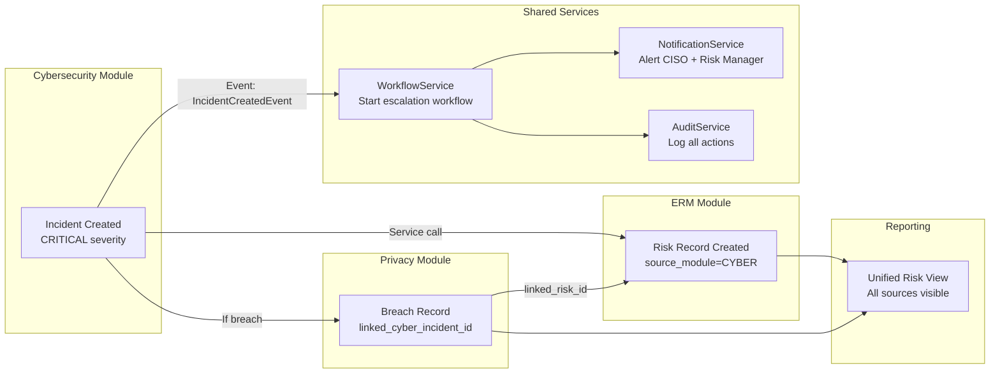
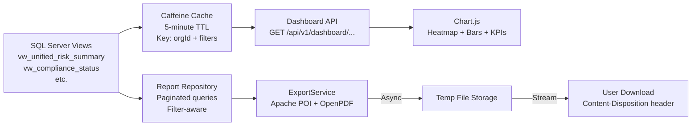

# Data Flow Diagram

## Purpose
Shows how data flows through the TSS GRC Platform layers — from user input through the application to the database and back to reporting.

---

## Core Data Flow

```mermaid
flowchart TD
    subgraph UI["Presentation Layer"]
        FORM[Thymeleaf HTML Form\nUser Data Input]
        TABLE[Data Table View\nPaginated list]
        DASH[Dashboard\nChart.js widgets]
    end

    subgraph Controller["Controller Layer (Spring MVC)"]
        WEB[Web Controller\n@Controller\nReturns HTML views]
        API[API Controller\n@RestController\nReturns JSON]
    end

    subgraph Service["Service Layer"]
        BIZ[Business Service\n@Service @Transactional\nBusiness logic + validation]
        AUDIT_SVC[Audit Service\nCaptures all changes]
        WFL_SVC[Workflow Service\nManages approvals]
        NOTIF_SVC[Notification Service\n@Async email + in-app]
        EXPORT_SVC[Export Service\nPDF / Excel / Word]
    end

    subgraph Repository["Data Access Layer"]
        REPO[Spring Data JPA Repository\nParameterized queries\norg_id filtered]
    end

    subgraph DB["SQL Server 2019 Express"]
        TABLES[Business Tables\nrisk / cyber / bcm / privacy / compliance]
        SHARED[Shared Tables\nplatform / iam / workflow / audit]
        VIEWS[Reporting Views\nvw_unified_risk_summary etc.]
    end

    subgraph External["External Services"]
        SMTP[SMTP Server\nEmail delivery]
        FS[File Storage\nAttachment files]
        LDAP[LDAP / AD\nOptional authentication]
    end

    FORM -->|HTTP POST + CSRF| WEB
    WEB -->|DTO| BIZ
    BIZ -->|Entity| REPO
    REPO -->|INSERT / UPDATE| TABLES
    BIZ --> AUDIT_SVC
    AUDIT_SVC -->|INSERT only| SHARED
    BIZ --> WFL_SVC
    WFL_SVC -->|State change| SHARED
    WFL_SVC --> NOTIF_SVC
    NOTIF_SVC -->|@Async| SMTP
    NOTIF_SVC -->|INSERT| SHARED

    REPO -->|SELECT| TABLES
    REPO -->|SELECT| VIEWS
    REPO -->|Return entities| BIZ
    BIZ -->|DTO| WEB
    WEB -->|Model + View| TABLE
    API -->|JSON| DASH

    EXPORT_SVC -->|Query data| REPO
    EXPORT_SVC -->|Stream file| FS

    LDAP -->|User authentication| BIZ
```

---

## Module-to-Module Data Flow



---

## Reporting Data Flow


