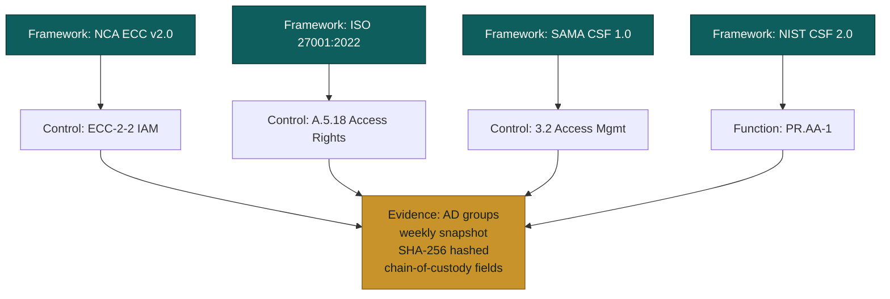
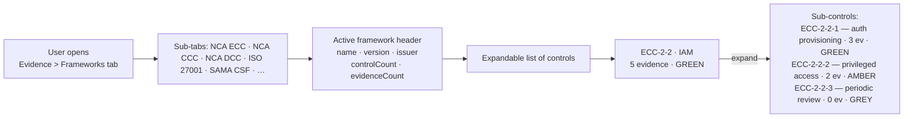
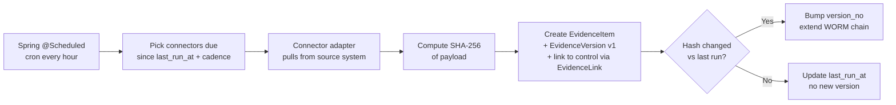

# Evidence Module — Implementation Status & Roadmap
> **HISTORIC — point-in-time snapshot (all files 2026-05-02). Not a statement of current state.**
> For what the platform is today read [`CLAUDE.md`](../../CLAUDE.md) and [`PROJECT_CHRONICLE.md`](../../PROJECT_CHRONICLE.md); for measured figures, [`MEASURED_BASELINE.md`](../../TSS-GRC-Platform-Bible/Appendix/MEASURED_BASELINE.md). Kept for provenance. *(W0-6)*

**Module:** `tss-grc-backend/src/main/java/com/tss/grc/module/evidence`
**Frontend:** `tss-grc-ui-v2/src/pages/evidence/EvidencePage.tsx`
**Frameworks aligned:** ISO 19011:2018 (Audit) · ISO/IEC 27001:2022 §A.5.36 · NCA ECC §1-5 · SAMA Audit Guidelines · ISO/IEC 27036 (forensic chain-of-custody)

This document tracks the buyer-assessment §5.9 recommendations and the design pivot to **control/sub-control as prime key + framework as tab/sheet**.

---

## 1. Architectural pivot — control-anchored evidence

The Evidence module now follows the **Drata / Vanta / Secureframe pattern** that compliance-automation challengers used to win mid-market deals:

**Why this matters:**
- Auditors think "show me evidence for control X" — not "show me your evidence pile"
- One evidence collection (e.g. weekly AD group snapshot) satisfies controls in **all 4 frameworks** above
- Saudi customers face NCA ECC + ISO 27001 + SAMA CSF audits in parallel; reuse cuts collection effort dramatically
- The bilingual EN+AR title/description shows once and applies across every framework view

---

## 2. Summary table — recommendation status

| # | Recommendation | Priority | Status |
|---|---|---|---|
| 1 | Version control with diff | Critical | **Shipped** — `evidence_versions` table + `/items/{id}/versions` + `/snapshot` endpoints + UI version-history modal |
| 2 | Connector library MVP | Critical | **Shipped** — `connector_definitions` table + 4 seeded connectors + run/status endpoints + UI Connectors tab |
| 3 | Chain-of-custody fields | High | **Shipped** — 11 new columns on `evidence_items`: collection_method, collector_id, collector_name, witness_id, tool_version, evidence_hash, previous_hash, merkle_anchor, collected_at, review_due_date, connector_code |
| 4 | WORM / hash-chain storage | High | **Foundation shipped** — previous_hash + merkle_anchor columns + version-snapshot extends per-evidence chain. External timestamp authority anchoring deferred (§5) |
| 5 | Collection-freshness engine | High | **Shipped** — service computes GREEN / AMBER / RED / GREY freshness per sub-control based on freshest valid_to date |

---

## 3. Shipped this session — what the user sees

### 3.1 Frameworks tab (the matrix view)

The user picks a framework, sees every control with its evidence count + freshness band, expands a control to drill into sub-controls, and clicks through to the underlying evidence.

### 3.2 Connectors tab — connector library MVP

Four connectors seeded:

| Connector | Type | Vendor | Frameworks satisfied |
|---|---|---|---|
| **AD_GROUPS** | IDP | Microsoft | NCA ECC ECC-2-2, ISO 27001 A.5.18, SAMA CSF 3.2 |
| **DEFENDER_ALERTS** | EDR | Microsoft | NCA ECC ECC-2-12, ISO 27001 A.8.16, NIST CSF DE.CM-1 |
| **AWS_CONFIG** | Cloud Security | AWS | NCA CCC v1.0, CSA CCM, ISO 27017 |
| **NCA_HEY_THREAT_INTEL** | Threat Intel | NCA (Saudi) | NCA ECC ECC-2-13, SAMA Cyber Threat Intel Sharing |

Each row shows status (AVAILABLE | CONFIGURED | RUNNING | DISABLED), last-run summary, and one-click Enable/Disable + "Run Now" buttons (currently simulated — see §4).

### 3.3 Version history (per evidence)

Every evidence item now has a "History" row-action that opens a modal listing all prior versions with the change summary, evidence hash (SHA-256 prefix), and snapshot timestamp. "Snapshot New Version" extends the WORM chain.

**DDL backfill:** all 58 existing evidence items got a v1 row in `evidence_versions` so the history is not empty for existing data.

### 3.4 Chain-of-custody fields

Every evidence item now carries:

| Field | Purpose |
|---|---|
| `collection_method` | MANUAL · AGENT · API_PULL · SIEM · SCANNER · NAFATH_SIGNED |
| `collector_name` / `collector_id` | Who collected it |
| `witness_id` | Witness for forensic-grade collection |
| `tool_version` | Version of the tool / connector that produced the evidence |
| `evidence_hash` (SHA-256) | Integrity hash of the payload |
| `previous_hash` | Per-evidence WORM chain — points to the predecessor's hash |
| `merkle_anchor` | Optional external timestamp authority anchor (RFC 3161) |
| `collected_at` | When it was actually collected (vs created_at) |
| `review_due_date` | Periodic re-review trigger |
| `connector_code` | Which connector produced it (if any) |
| `current_version_no` | Evidence-document version number |

---

## 4. Deferred — Real connector implementations

The connector library MVP ships definitions + simulated runs. The follow-up work is the **actual integration runtime**:

| Connector | Production implementation | Effort |
|---|---|---|
| AD_GROUPS | Microsoft Graph API or LDAP query → JSON snapshot of group members → SHA-256 hash → store as evidence + new EvidenceVersion row | 2 sessions |
| DEFENDER_ALERTS | Microsoft Graph API `/security/alerts_v2` → daily aggregate by severity → evidence package | 2 sessions |
| AWS_CONFIG | AWS SDK ConfigService.getComplianceSummary → conformance pack snapshot → evidence | 2 sessions |
| NCA_HEY_THREAT_INTEL | NCA HEY API integration (subject to NCA onboarding) → IoC ingestion + asset match results → evidence | 3 sessions (depends on NCA portal access) |

Plus a **scheduling layer** — Spring `@Scheduled` cron + connector configuration storage so each connector runs on its declared cadence.

Effort estimate to ship the full connector runtime: **6-9 sessions**.

---

## 5. Deferred — External timestamp authority for WORM hash chain

The `merkle_anchor` column is in place but is currently NULL on all rows. To make the WORM chain forensically defensible, anchor each version's hash to an **external trusted timestamp**:

**Options:**
1. **RFC 3161 Time-Stamp Protocol** with a reputable public TSA (DigiCert, Sectigo)
2. **NCA-issued timestamp** — if NCA publishes a timestamping service (Saudi-sovereign)
3. **Blockchain anchor** — append the daily Merkle root of all new evidence hashes to a public chain (Ethereum / Bitcoin) for end-end provability

Effort estimate: **2 sessions** for option 1; **3-5 sessions** for blockchain anchoring.

---

## 6. Deferred — Auto-collection scheduler

The connector run is currently triggered manually via the "Run Now" button. The full design schedules connectors per their declared cadence (default: weekly):

Effort estimate: **2 sessions** (scheduler + 1 fully-implemented reference connector to validate the runtime).

---

## 7. Deferred — Cross-control evidence reuse linkage

`evidence_links` already exists and supports M:N. The remaining UI work:

- "This evidence also satisfies" banner on the evidence drawer showing every control in every framework that links to this evidence
- "Bulk attach to controls" action — pick multiple controls across multiple frameworks and create EvidenceLink rows in one click
- Cross-framework reuse stat on the dashboard — % of evidence reused across ≥ 2 frameworks

Effort estimate: **1 session**.

---

## 8. Suggested sequencing for the next 5 sessions

| Session | Focus |
|---|---|
| 1 | §7 cross-control reuse linkage UI + a bulk-attach action |
| 2 | §6 scheduler runtime + 1 fully-implemented connector (AD_GROUPS as reference) |
| 3 | §6 second connector (Defender or AWS Config) + freshness-driven re-collection trigger |
| 4 | §5 RFC 3161 timestamp authority integration + Merkle anchoring of evidence hashes |
| 5 | NCA HEY threat-intel connector (depends on NCA onboarding) |

After those five sessions, the Evidence module is at full Tier-1 (Drata-class) parity with a Saudi sovereignty edge.

---

## 9. Saudi-specific touches embedded

| Element | What it does |
|---|---|
| NCA HEY connector seeded | Recognises Saudi-sovereign threat-intel feed as a peer of Defender/AWS connectors |
| Bilingual control titles + sub-control descriptions | Every framework block, control row and sub-control row carries EN+AR (existing schema) |
| Saudi framework codes pre-populated | NCA ECC, NCA CCC, NCA DCC, NCEMA BCM-1/2, NCA Teleworking — already in the seeded `evidence.frameworks` table |
| `collection_method = NAFATH_SIGNED` | Reserved enum value for evidence collected via Nafath digital signature — strongest legal-grade artefact in KSA |
| Merkle anchor allows Saudi-sovereign TSA | When NCA or SDAIA publishes a timestamping service, the column accepts that anchor without schema change |

---

**Maintained alongside:**
- Backend: `tss-grc-backend/src/main/java/com/tss/grc/module/evidence/`
- Frontend: `tss-grc-ui-v2/src/pages/evidence/EvidencePage.tsx`
- API client: `tss-grc-ui-v2/src/lib/api.ts` (search `evidenceApi`)
- DDL artefact: `tss-grc-backend/src/main/resources/db/seed/V_evidence_v2_chain_custody.sql`
- Buyer assessment §5.9 for the strategic rationale.
