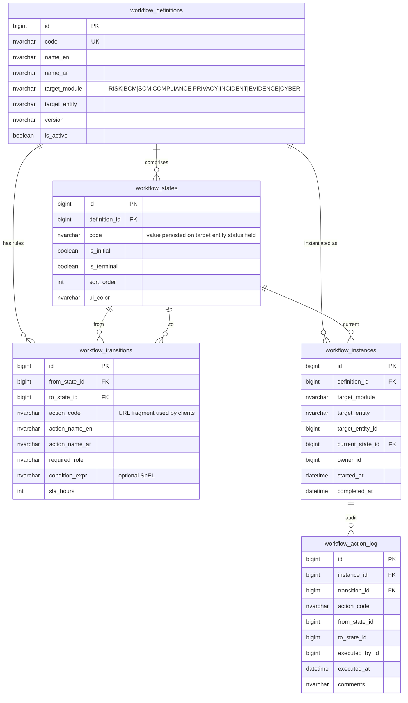
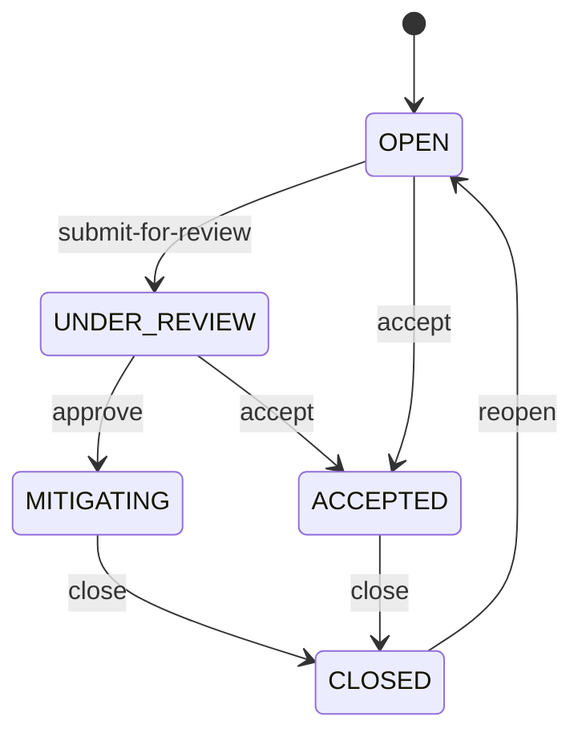
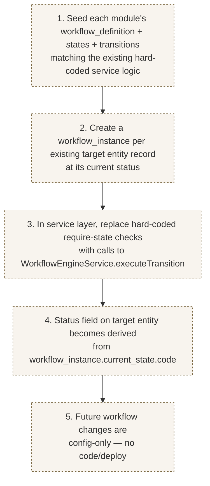
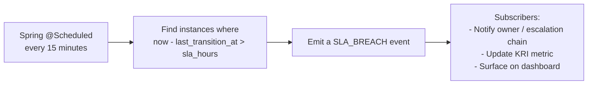

# Configurable Workflow Engine — Implementation Status & Roadmap
> **HISTORIC — point-in-time snapshot (all files 2026-05-02). Not a statement of current state.**
> For what the platform is today read [`CLAUDE.md`](../../CLAUDE.md) and [`PROJECT_CHRONICLE.md`](../../PROJECT_CHRONICLE.md); for measured figures, [`MEASURED_BASELINE.md`](../../TSS-GRC-Platform-Bible/Appendix/MEASURED_BASELINE.md). Kept for provenance. *(W0-6)*

**Module:** `tss-grc-backend/src/main/java/com/tss/grc/module/workflow`
**Frontend:** `tss-grc-ui-v2/src/pages/workflow/WorkflowsPage.tsx`
**Buyer assessment reference:** §6.1 — the strategic flagship recommendation.

ServiceNow IRM's primary commercial moat is its workflow engine — workflows defined in data, not code. This commit ships the **MVP foundation** for the same capability in TSS GRC.

---

## 1. What shipped

### REST surface

| Endpoint | Purpose |
|---|---|
| `GET /api/v1/workflow/definitions` | List active definitions (optional `targetModule` filter) |
| `GET /api/v1/workflow/definitions/{id}` | Definition + states + transitions for state-machine rendering |
| `POST /api/v1/workflow/instances` | Start an instance for a target entity |
| `GET /api/v1/workflow/instances/{id}` | Instance + current state + allowed transitions + history |
| `POST /api/v1/workflow/instances/{id}/transitions` | Execute a transition (body: `{actionCode, executedById, comments}`) |
| `GET /api/v1/workflow/instances/by-target` | Find instance for a specific target entity |

### Reference workflow seeded

`RISK_LIFECYCLE_V1` mirrors the hard-coded transitions in `RiskService`:

5 states + 7 transitions, bilingual labels, exercised end-to-end as the engine's integration test target.

### Frontend

New `/workflows` route with a two-pane Workflows admin page:
- Left: list of all active definitions (filter by module)
- Right: state-machine viewer with colour-coded state cards + transition table including SLA badges and required-role chips

---

## 2. The migration plan — moving existing modules onto the engine

The MVP ships the engine and one reference workflow. The follow-up work is migrating each module's hard-coded workflow onto it:

### Module-by-module migration estimate

| Module | Existing hard-coded workflow | Migration effort |
|---|---|---|
| Risk | OPEN → UNDER_REVIEW → MITIGATING → ACCEPTED → CLOSED + reopen | **Reference seeded** — full migration ~½ session |
| BCM Plan | DRAFT → UNDER_REVIEW → APPROVED → INVOKED → APPROVED + EXPIRED | ½ session |
| BCM Exercise | SCHEDULED → IN_PROGRESS → COMPLETED + CANCELLED | ½ session |
| SCM Onboarding | 6-stage NCA TPCS lifecycle (REGISTRATION … APPROVAL) + REJECTED | 1 session (more states) |
| Compliance Regulatory Change | NEW → APPLICABILITY_ASSESSED → IMPACT_ASSESSED → CONTROLS_UPDATED → CLOSED | ½ session |
| Compliance Policy | DRAFT → LEGAL_REVIEW → EXEC_APPROVAL → PUBLISHED → REVIEW_DUE → RETIRED + REJECTED | ½ session |
| Privacy DSR | OPEN → IN_PROGRESS → FULFILLED / REJECTED | ½ session |
| Privacy Breach | OPEN → INVESTIGATING → CLOSED + notify-data-office | ½ session |
| Incident NIST 800-61 | IDENTIFICATION → ANALYSIS → CONTAINMENT → ERADICATION → RECOVERY → POST_INCIDENT | 1 session |
| Cyber Assessment / Vuln / Exception | several state machines | 1-2 sessions |

**Total migration effort:** ~6-8 sessions to put every module on the engine.

---

## 3. Deferred — Authoring UI (drag-and-drop builder)

Today the WorkflowsPage is read-only. The full authoring experience:

- Drag-and-drop state-machine canvas (React Flow / Mermaid edit mode)
- State editor: code, EN+AR names, initial / terminal flags, colour picker
- Transition editor: action code, EN+AR labels, required role from RBAC, SLA hours, optional condition expression
- Version-bump on save (creates a new definition with `version` = old + minor)
- Test-run mode: click through states without affecting any real instance

Effort estimate: **3-4 sessions**.

---

## 4. Deferred — SLA-breach scheduler

The schema captures `sla_hours` per transition but no enforcement loop exists yet. The follow-up:

Effort estimate: **1 session**.

---

## 5. Deferred — Cross-module workflow events

Currently each transition is local to its instance. Real GRC workflows often span modules — e.g. when a Privacy Breach reaches CONTAINED, automatically advance the linked Cybersecurity Incident. The follow-up:

- New `workflow_event_subscription` entity — listen for transition X on definition Y, fire transition Z on a different instance
- Event bus (Spring `ApplicationEvent` is sufficient for in-process; Kafka / Redis Streams when scale demands)

Effort estimate: **2 sessions**.

---

## 6. Deferred — Conditional transitions (SpEL evaluator)

The `condition_expr` column is in place but currently NULL on all rows. To make it real:

- Spring SpEL evaluator wired up
- Variable bag includes the target entity, the user executing the transition, the workflow instance state
- Test harness for condition-only authoring

Effort estimate: **1-2 sessions**.

---

## 7. Suggested sequencing for next 6 sessions

| Session | Focus |
|---|---|
| 1 | Migrate Risk module onto the engine (the reference) — replace `require()` calls with `engine.executeTransition` |
| 2 | Migrate BCM Plan + BCM Exercise + Compliance Policy (similar shapes) |
| 3 | Authoring UI — state-machine canvas + state editor (read-only edit mode) |
| 4 | Authoring UI — transition editor + version bump on save |
| 5 | SLA-breach scheduler + cross-module event subscriptions |
| 6 | SpEL conditional-transition evaluator |

After those six, every module's workflow is config-only and the platform achieves ServiceNow-class workflow flexibility.

---

## 8. Saudi-relevant notes

- **Bilingual labels everywhere** — `name_en` / `name_ar` on definitions, states, and transitions. Workflows display in the user's locale automatically.
- **Required role** field accepts any RBAC role string — including future Nafath-issued roles when SSO lands.
- **Saudi reference workflows to seed in subsequent migrations:**
  - SCM onboarding: NCA TPCS 6-stage gated lifecycle
  - Privacy DSR: PDPL 30-day SLA with extension flow
  - Privacy Breach: PDPL Article 20 72-hour notification
  - Incident: NCA HEY 24-hour cyber incident reporting
- **Hijri-calendar SLA** option (deferred — current implementation uses Gregorian only).

---

**Maintained alongside:**
- Backend: `tss-grc-backend/src/main/java/com/tss/grc/module/workflow/`
- Frontend: `tss-grc-ui-v2/src/pages/workflow/WorkflowsPage.tsx`
- API client: `tss-grc-ui-v2/src/lib/api.ts` (search `workflowApi`)
- DDL artefact: `tss-grc-backend/src/main/resources/db/seed/V_workflow_engine_ddl.sql`
- Buyer assessment §6.1 for the strategic rationale.
