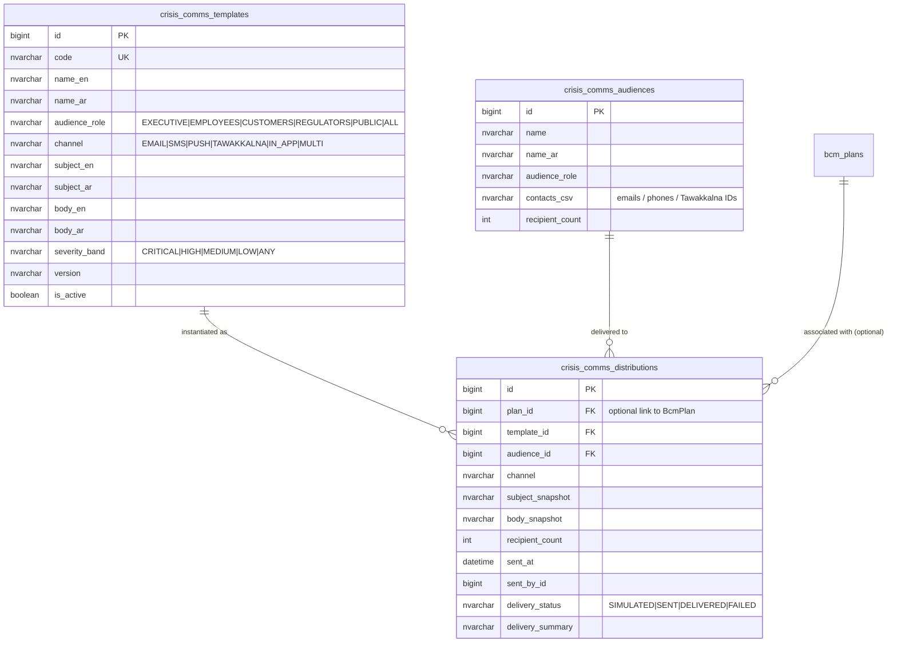
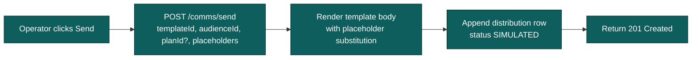
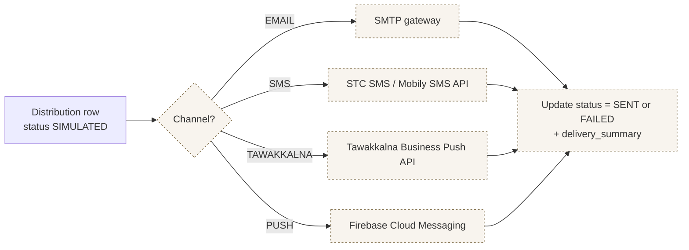

# BCM Crisis Communication — Implementation Status & Roadmap

**Module:** `tss-grc-backend/src/main/java/com/tss/grc/module/bcm` (templates / audiences / distributions tables under `bcm` schema)
**Frontend:** new "Crisis Comms" tab on `tss-grc-ui-v2/src/pages/bcm/BcmPage.tsx`
**Buyer assessment reference:** §5.5 #5

Implements the buyer-assessment recommendation: **pre-approved templates, role-based distribution, multi-channel delivery, audit log per send.** Saudi-flavoured: SMS via STC/Mobily-friendly channel codes, Tawakkalna Business push reserved for pandemic-class events, fully bilingual EN+AR templates.

---

## 1. What shipped

### Schema

### REST surface

| Endpoint | Purpose |
|---|---|
| `GET /api/v1/bcm/comms/templates` | List active templates |
| `POST /api/v1/bcm/comms/templates` | Create template |
| `PUT /api/v1/bcm/comms/templates/{id}` | Update template |
| `DELETE /api/v1/bcm/comms/templates/{id}` | Soft-delete template |
| `GET /api/v1/bcm/comms/audiences` | List audience groups |
| `POST/PUT /api/v1/bcm/comms/audiences{,/id}` | Create/update audience |
| `GET /api/v1/bcm/comms/distributions` | Audit log of sent distributions |
| `POST /api/v1/bcm/comms/send` | Send a template to an audience (currently SIMULATED) |

### Frontend

- New **Crisis Comms** tab on the BCM page
- Side-by-side cards: Templates (with one-click "Send" button) + Audience groups
- Below: Distribution audit log with timestamp, channel, recipient count, delivery status badge

### Saudi-flavoured pre-seeded content

5 representative bilingual templates:

| Code | Audience | Channel | Severity |
|---|---|---|---|
| `EXEC_INVOCATION` | Executive | EMAIL | CRITICAL |
| `EMP_GENERAL` | Employees | MULTI (email + SMS + Tawakkalna) | HIGH |
| `CUST_BANKING` | Customers | SMS | HIGH |
| `REG_NCA_24H` | Regulators (NCA HEY) | EMAIL | CRITICAL |
| `PUB_PRESS` | Public | EMAIL | CRITICAL |

Plus 4 audience groups: Executive Committee, All Employees, Saudi Data Office Liaison, Press & Media Relations.

Templates use `{placeholder}` substitution (e.g. `{plan_name}`, `{invocation_time}`, `{trigger_reason}`, `{disruption_type}`, `{eta}`, `{incident_code}`, `{severity}`, `{discovery_date}`) — the operator passes a placeholders map at send time.

---

## 2. The "send" pipeline today vs production

**Production runtime (deferred — see §3):**

---

## 3. Deferred — Channel adapters (the production runtime)

| Channel | Recommended adapter | Effort |
|---|---|---|
| **EMAIL** | Spring Boot starter mail + SES / SendGrid for prod | ½ session |
| **SMS** | STC SMS API (primary, Saudi-sovereign) + Mobily SMS API (failover) — both via direct REST | 1-2 sessions |
| **TAWAKKALNA** | Tawakkalna Business push API (requires onboarding with Tawakkalna program) | 2 sessions + onboarding |
| **PUSH** | Firebase Cloud Messaging for cross-platform mobile push | 1 session |
| **IN_APP** | Internal notifications table + websocket / SSE feed | 1 session |

Effort estimate: **6-8 sessions** for full multi-channel runtime.

---

## 4. Deferred — Authoring UI for templates

Today templates are seeded; the API supports CRUD but the frontend UI is read-only. Follow-up:
- Inline modal for create/edit with rich-text body editor (EN+AR side-by-side)
- Placeholder-picker dropdown listing the standard variables (`{plan_name}`, `{incident_code}`, etc.)
- Live preview rendering with sample placeholder values
- Version-bump on save (creates a new template row with `version` = current + 1)

Effort estimate: **2 sessions**.

---

## 5. Deferred — Tawakkalna Business integration

Saudi-specific. The Tawakkalna Business platform supports:
- Push notifications to verified employees via Nafath identity
- Health-status confirmations during pandemic / quarantine events
- Geofenced presence checks during evacuation

To integrate, the platform team needs to:
1. Apply for Tawakkalna Business program enrolment (commercial process)
2. Receive API credentials and onboarding documentation
3. Wire the adapter (~1-2 sessions once credentials are in hand)
4. Map Audience contacts_csv to Tawakkalna user IDs (could be Nafath ID-based)

Effort estimate: **1-2 sessions of dev + onboarding lead time**.

---

## 6. Deferred — Cross-module event triggers

A real crisis-comms cascade fires automatically when other modules reach key states. Examples:

| Trigger | Recommended template |
|---|---|
| BCM Plan invoked | `EXEC_INVOCATION` to Executive Committee |
| Privacy Breach reaches CONTAINED + reportable | `REG_DATA_OFFICE_72H` to Data Office Liaison |
| Cybersecurity Incident severity = CRITICAL + status = INVESTIGATING | `EXEC_CYBER_BRIEF` to CISO + CEO |
| BCM Plan restored | `EMP_RESTORATION` to All Employees |

Wired via either:
- Direct service-layer call (simple, tightly coupled), OR
- Workflow engine event subscriptions (preferred, cross-module — see workflow-engine roadmap §5)

Effort estimate: **2 sessions** once the workflow engine event subscription model lands.

---

## 7. Suggested sequencing for the next 4 sessions

| Session | Focus |
|---|---|
| 1 | Template authoring UI (create/edit/version bump) — §4 |
| 2 | Email + SMS adapters (STC/Mobily) — §3 |
| 3 | Tawakkalna Business adapter (subject to onboarding) — §3 + §5 |
| 4 | Cross-module event triggers wired through the workflow engine — §6 |

---

## 8. Saudi notes embedded today

| Element | What it does |
|---|---|
| `Tawakkalna` channel value reserved | Future-proofs the schema for Saudi-sovereign push when the integration ships |
| Bilingual templates (EN + AR everywhere) | Saudi-recipient-facing templates ship Arabic-primary; cross-border templates retain English with Arabic mirror |
| Pre-seeded "Saudi Data Office Liaison" audience | Recognises the SDAIA Data Office liaison as a first-class audience role for PDPL Article 20 reporting |
| `REG_NCA_24H` template | Bilingual NCA HEY 24-hour notification — pairs with the Saudi regulatory templates already shipped in the Incidents module |
| `delivery_status = SIMULATED` default | Makes it explicit that the MVP is not actually dispatching; production runtime sets SENT / DELIVERED / FAILED |

---

**Maintained alongside:**
- Backend: `tss-grc-backend/src/main/java/com/tss/grc/module/bcm/` (CrisisCommsTemplate, Audience, Distribution entities + service + controller)
- Frontend: `tss-grc-ui-v2/src/pages/bcm/BcmPage.tsx` (CrisisCommsTab subcomponent)
- API client: `tss-grc-ui-v2/src/lib/api.ts` (search `crisisCommsApi`)
- DDL artefact: `tss-grc-backend/src/main/resources/db/seed/V_bcm_crisis_comms_ddl.sql`
- Buyer assessment §5.5 for the strategic rationale.
