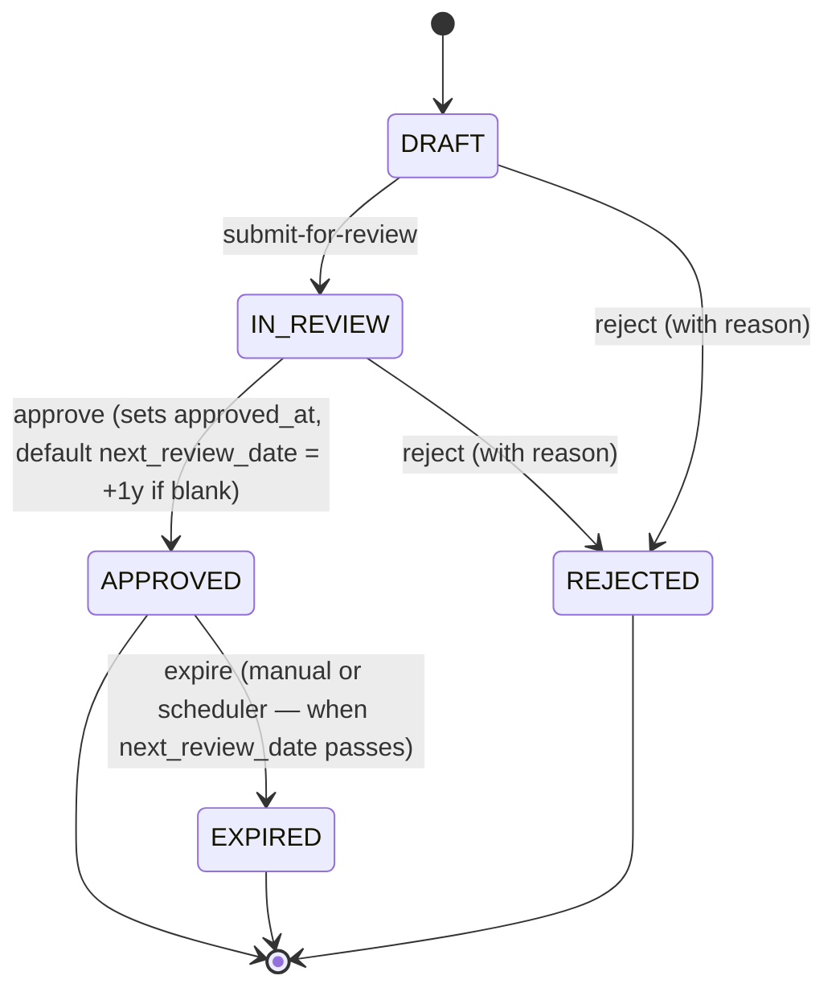
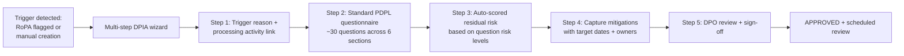

# PDPL DPIA Workflow — Implementation Status & Roadmap

**Module:** `tss-grc-backend/src/main/java/com/tss/grc/module/privacy` (4 new entities + service + controller)
**Frontend:** new "DPIA" tab on `tss-grc-ui-v2/src/pages/privacy/PrivacyPage.tsx`
**Buyer assessment reference:** §5.4 critical recommendation #3

PDPL Implementing Regulations require Data Protection Impact Assessments for high-risk processing activities. This commit ships the entity model, lifecycle workflow, and review surface end-to-end.

---

## 1. What shipped

```mermaid
erDiagram
    processing_activities ||--o{ dpia : "may require (optional FK)"
    dpia ||--o{ dpia_question : "questionnaire"
    dpia ||--o{ dpia_mitigation : "produces"
    dpia ||--o{ dpia_review : "approved via"

    dpia {
        bigint id PK
        bigint processing_activity_id FK
        nvarchar title_en
        nvarchar title_ar
        nvarchar trigger_reason "NEW_HIGH_RISK | MAJOR_CHANGE | REGULATORY_REQUEST | PERIODIC | SPECIAL_CATEGORY | CROSS_BORDER | AUTO_DECISION | LARGE_SCALE_MONITORING"
        nvarchar status "DRAFT | IN_REVIEW | APPROVED | REJECTED | EXPIRED"
        nvarchar overall_residual_risk "CRITICAL|HIGH|MEDIUM|LOW"
        bigint dpo_id
        bigint assessor_id
        date assessment_date
        date next_review_date
        datetime approved_at
        datetime rejected_at
        nvarchar rejection_reason
        nvarchar conclusion
    }
    dpia_question {
        bigint id PK; bigint dpia_id FK
        nvarchar question_code "PDPL-7-1, GDPR-35-7-a, …"
        nvarchar question_en; nvarchar question_ar
        nvarchar answer
        nvarchar risk_level "CRITICAL|HIGH|MEDIUM|LOW|NA"
        int sort_order
    }
    dpia_mitigation {
        bigint id PK; bigint dpia_id FK
        nvarchar mitigation_en; nvarchar mitigation_ar
        nvarchar status "PLANNED|IN_PROGRESS|IMPLEMENTED|VERIFIED"
        bigint owner_id
        date target_date
        datetime verified_at
    }
    dpia_review {
        bigint id PK; bigint dpia_id FK
        bigint reviewer_id
        nvarchar reviewer_name
        nvarchar decision "APPROVE|REJECT|REQUEST_CHANGES"
        nvarchar comments
        datetime decided_at
    }
```

### Lifecycle state machine



### REST surface

| Method | Path | Purpose |
|---|---|---|
| GET  | `/api/v1/privacy/dpias` | List paged |
| GET  | `/api/v1/privacy/dpias/{id}` | DPIA + child questions + mitigations + reviews |
| POST | `/api/v1/privacy/dpias` | Create |
| PUT  | `/api/v1/privacy/dpias/{id}` | Update |
| DELETE | `/api/v1/privacy/dpias/{id}` | Soft-delete |
| POST | `/api/v1/privacy/dpias/{id}/submit-for-review` | DRAFT → IN_REVIEW |
| POST | `/api/v1/privacy/dpias/{id}/approve` | IN_REVIEW → APPROVED |
| POST | `/api/v1/privacy/dpias/{id}/reject` | IN_REVIEW or DRAFT → REJECTED |
| POST | `/api/v1/privacy/dpias/{id}/expire` | APPROVED → EXPIRED |
| POST | `/api/v1/privacy/dpias/{id}/questions` | Append a questionnaire row |
| POST | `/api/v1/privacy/dpias/{id}/mitigations` | Append a mitigation |
| POST | `/api/v1/privacy/dpias/{id}/reviews` | Append a review decision |
| GET  | `/api/v1/privacy/dpias/stats` | Status counts for dashboards |

### Frontend

New "DPIA" tab on the Privacy page lists every DPIA with status badge, residual-risk badge, trigger-reason, and context-aware lifecycle buttons (Submit / Approve / Reject / Expire).

### Saudi pre-seeded content

2 sample DPIAs:
- **Customer Onboarding KYC (Sehhaty integration)** — APPROVED, MEDIUM residual risk, special-category trigger (health data); next review 2026-01-15
- **Employee Performance Analytics — automated scoring** — IN_REVIEW, HIGH residual risk, AUTO_DECISION trigger (PDPL Article on automated decisions)

---

## 2. Deferred — Questionnaire-driven authoring UI

The MVP exposes JSON CRUD on questions/mitigations/reviews but the UI doesn't yet author them. The full authoring experience:



**Standard questionnaire to seed** (~30 questions, bilingual EN+AR):
- Section 1: Necessity & proportionality (4 questions)
- Section 2: Lawful basis & consent (4)
- Section 3: Data minimisation & retention (4)
- Section 4: Data subject rights (4)
- Section 5: Security & integrity (5)
- Section 6: Cross-border transfers + sub-processors (4)
- Section 7: Special-category & children's data (5)

Effort estimate: **3 sessions** (questionnaire seed + multi-step wizard UI + auto-scoring).

---

## 3. Deferred — Auto-trigger from RoPA

When a `processing_activity` (RoPA) is created or updated with high-risk indicators (special-category data, cross-border transfer to non-adequate country, large-scale automated decisions), automatically create a DRAFT DPIA. Today the operator must create the DPIA manually.

**Trigger rules:**
- `data_categories` contains HEALTH | BIOMETRIC | CHILDREN | FINANCIAL_CARD → trigger SPECIAL_CATEGORY
- `cross_border_transfer = true` and destination ∉ adequacy list → trigger CROSS_BORDER
- `legal_basis = LEGITIMATE_INTERESTS` and processing involves automated decision-making → trigger AUTO_DECISION
- Annual review of any APPROVED DPIA whose `next_review_date` has passed → auto-expire

Effort estimate: **1 session** (rules engine + scheduler).

---

## 4. Deferred — DPO sign-off via Nafath

For maximum legal weight, DPIA approval should be Nafath-signed (Saudi national digital identity) — the strongest legal-grade artefact in KSA. Once Nafath SSO lands across the platform, replace `approver_id` references with the Nafath identity assertion.

Effort estimate: **1 session** (depends on Nafath SSO landing first — currently deferred).

---

## 5. Deferred — Saudi Data Office DPIA package export

For DPIAs that must be shared with the Saudi Data Office (e.g. consultation requests for non-adequate cross-border transfers), export the full DPIA + questionnaire + mitigations as a bilingual EN+AR PDF.

Effort estimate: **2 sessions** (uses the same Apache POI / OpenPDF stack as the regulatory-report templates already shipped in the Incidents module).

---

## 6. Suggested sequencing for the next 4 sessions

| Session | Focus |
|---|---|
| 1 | §2 Standard questionnaire seed + multi-step wizard UI |
| 2 | §3 Auto-trigger from RoPA + scheduler for next-review-date expiry |
| 3 | §5 Saudi Data Office DPIA package export (bilingual PDF) |
| 4 | §4 Nafath sign-off integration (depends on Nafath SSO landing) |

---

## 7. Saudi notes embedded today

| Element | What it does |
|---|---|
| `trigger_reason = SPECIAL_CATEGORY` | Reserved for processing of health (Sehhaty/Mawid), biometric, children's, or financial card data — PDPL elevated-controls trigger |
| `trigger_reason = CROSS_BORDER` | Reserved for transfers to non-adequate jurisdictions — pairs with the cross-border transfer assessment work tracked in PDPL roadmap §6 |
| `trigger_reason = AUTO_DECISION` | Per PDPL Article-on-automated-decisions, captures profiling and automated decision-making cases |
| Sample DPIA #1: Sehhaty integration | Demonstrates how a PDPL-relevant Saudi healthcare integration appears in the DPIA register |
| Sample DPIA #2: Employee performance scoring | Demonstrates the AUTO_DECISION trigger with HIGH residual risk |
| Bilingual title + content | Every DPIA carries EN+AR title + conclusion; questionnaire questions and mitigations also bilingual |

---

**Maintained alongside:**
- Backend: `tss-grc-backend/src/main/java/com/tss/grc/module/privacy/` (Dpia, DpiaQuestion, DpiaMitigation, DpiaReview entities + service + controller)
- Frontend: `tss-grc-ui-v2/src/pages/privacy/PrivacyPage.tsx` (DpiaTab subcomponent)
- API client: `tss-grc-ui-v2/src/lib/api.ts` (search `dpiaApi`)
- DDL artefact: `tss-grc-backend/src/main/resources/db/seed/V_pdpl_dpia_ddl.sql`
- Buyer assessment §5.4 #3 for the strategic rationale.
