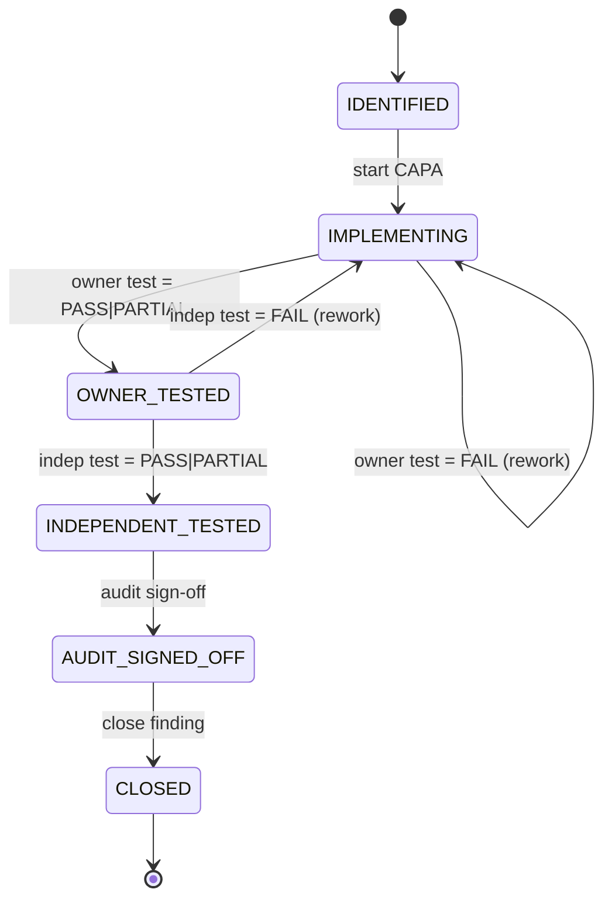
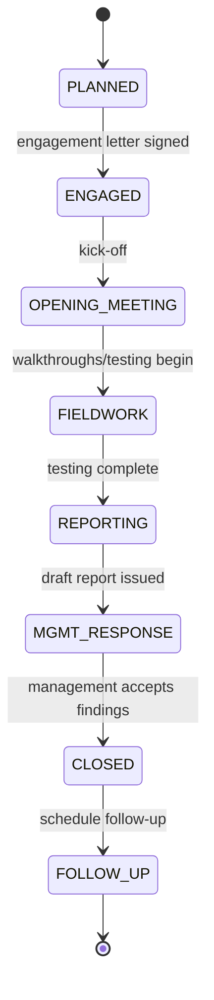

# W1 — Compliance: CAPA closure verification + External audit lifecycle
> **HISTORIC — point-in-time snapshot (all files 2026-05-02). Not a statement of current state.**
> For what the platform is today read [`CLAUDE.md`](../../CLAUDE.md) and [`PROJECT_CHRONICLE.md`](../../PROJECT_CHRONICLE.md); for measured figures, [`MEASURED_BASELINE.md`](../../TSS-GRC-Platform-Bible/Appendix/MEASURED_BASELINE.md). Kept for provenance. *(W0-6)*


Buyer-assessment §5.3 recommendations:

| #  | Recommendation | Sprint |
|----|---|---|
| #3 | External audit lifecycle | W1 |
| #4 | Findings aging engine     | (delivered earlier as part of incidents/findings work) |
| #6 | CAPA closure verification | W1 |

This sprint completes the remaining §5.3 items.

---

## #6 — CAPA closure verification

**Problem.** The original `compliance.findings` table tracked OPEN → CLOSED status with a single `capa` text column. There was no proof of effectiveness — auditors must see evidence that the corrective action **actually fixed the root cause**, not just that someone marked the row closed.

**Solution.** Three-stage verification ladder layered on top of the existing finding entity:

```
IDENTIFIED ──► IMPLEMENTING ──► OWNER_TESTED ──► INDEPENDENT_TESTED ──► AUDIT_SIGNED_OFF ──► CLOSED
                  │                  │                    │                       │
              control                owner                 second-line             audit/QA
              owner runs             confirms              tests                   stamps
              the fix                fix works             independently           closure
```

Each gate captures (`*_at`, `*_result` ∈ PASS/FAIL/PARTIAL, `*_by_id`, `*_notes`). A FAIL at any test gate sends the stage **back to IMPLEMENTING** so the owner has to rework — this is the buyer-assessment ask. PASS/PARTIAL advances forward.

### State machine (Mermaid)



### DDL

`compliance.findings` gains 12 columns (idempotent ALTER TABLE):
- `capa_stage` NVARCHAR(40) DEFAULT 'IDENTIFIED'
- `owner_test_at`, `owner_test_result`, `owner_test_evidence_id`, `owner_test_notes`
- `independent_test_at`, `independent_test_by_id`, `independent_test_result`, `independent_test_notes`
- `audit_signoff_at`, `audit_signoff_by_id`, `audit_signoff_notes`

### API

| Method | Path | Effect |
|---|---|---|
| POST | `/api/v1/compliance/findings/{id}/capa/start-implementing` | IDENTIFIED → IMPLEMENTING |
| POST | `/api/v1/compliance/findings/{id}/capa/owner-test`         | record owner test result |
| POST | `/api/v1/compliance/findings/{id}/capa/independent-test`   | record 2LOD test result |
| POST | `/api/v1/compliance/findings/{id}/capa/audit-signoff`      | record audit/QA sign-off |
| POST | `/api/v1/compliance/findings/{id}/capa/close`              | AUDIT_SIGNED_OFF → CLOSED |

Stage guards are enforced server-side in `CapaWorkflowService` — invalid transitions throw `IllegalArgumentException` (mapped to 400 by the global handler).

### Frontend

The **Findings** tab on the Compliance page now shows two distinct views:
- If the aging endpoint returns rows → **aging-aware table** with `daysOpen`, `escalationTier`, `capaStage` columns and per-row workflow buttons (Start CAPA → Owner Test → Independent Test → Audit Sign-off → Close).
- Else → fallback to the simple findings table (legacy behaviour preserved).

KPI strip above the table shows On-Track / Manager / Director / Exec escalation counts (assessment §5.3 #4 reuse).

---

## #3 — External audit lifecycle

**Problem.** External audits (BSI surveillance, NCA ECC self-assessment, SAMA quarterly) are tracked today only by their findings — there is no view of the engagement itself, its scope, its auditor, its phase. Audit committees can't see "where are we in the cycle?".

**Solution.** New `compliance.audit_engagements` entity with full lifecycle:



### DDL

`compliance.audit_engagements` — 22 columns including:
- Identification: `engagement_code`, `external_id` (UUID), `title_en`, `title_ar`
- Classification: `audit_type` (INTERNAL | EXTERNAL | REGULATORY | CERTIFICATION), `framework`
- Parties: `auditor_firm`, `lead_auditor`
- Lifecycle dates: `engagement_letter_date`, `opening_meeting_date`, `fieldwork_start_date`, `fieldwork_end_date`, `report_issued_date`, `closure_date`, `next_followup_date`
- State: `status`, `findings_count`, `is_deleted`

Indexes: `IX_aeng_org_status` (filtered).

### Seed data

Three representative engagements bilingually seeded:
1. **AUD-2025-001** — ISO 27001:2022 Surveillance Audit Cycle 2 (BSI Saudi Arabia), CLOSED
2. **AUD-2025-002** — NCA ECC v2.0 Compliance Assessment, FIELDWORK
3. **AUD-2025-003** — SAMA Cybersecurity Framework Quarterly Review, PLANNED

### API

| Method | Path | Effect |
|---|---|---|
| GET    | `/api/v1/compliance/audit-engagements`                          | paged list with filters (`auditType`, `status`, `framework`) |
| GET    | `/api/v1/compliance/audit-engagements/{id}`                     | detail |
| POST   | `/api/v1/compliance/audit-engagements`                          | create (defaults to PLANNED) |
| PUT    | `/api/v1/compliance/audit-engagements/{id}`                     | update |
| DELETE | `/api/v1/compliance/audit-engagements/{id}`                     | soft-delete |
| POST   | `/api/v1/compliance/audit-engagements/{id}/advance`             | advance status forward (auto-stamps lifecycle dates) |
| POST   | `/api/v1/compliance/audit-engagements/{id}/schedule-followup`   | CLOSED → FOLLOW_UP with `nextFollowupDate` |
| GET    | `/api/v1/compliance/audit-engagements/stats`                    | counts per status |

`AuditEngagementService.advance()` enforces forward-only transitions and auto-fills the corresponding lifecycle date when entering OPENING_MEETING / FIELDWORK / REPORTING / MGMT_RESPONSE / CLOSED.

### Frontend

New **Audit Engagements** tab on the Compliance page — table view with type/framework/fieldwork window/status, advance and follow-up actions on the row.

---

## Summary table

| Layer | Files added/changed |
|---|---|
| DB    | `db/seed/V_compliance_capa_audit_ddl.sql` |
| Entity | `AuditEngagement.java`, `AuditFinding.java` (extended) |
| Repo  | `AuditEngagementRepository.java` |
| Service | `AuditEngagementService.java`, `CapaWorkflowService.java` |
| Controller | `AuditEngagementController.java`, `RegChangePolicyController.java` (capaStage in aging output) |
| DTO   | `FindingResponse.java` (extended with CAPA fields) |
| Frontend | `lib/api.ts`, `pages/compliance/CompliancePage.tsx` |
| i18n | `translations/en.ts`, `translations/ar.ts` |
