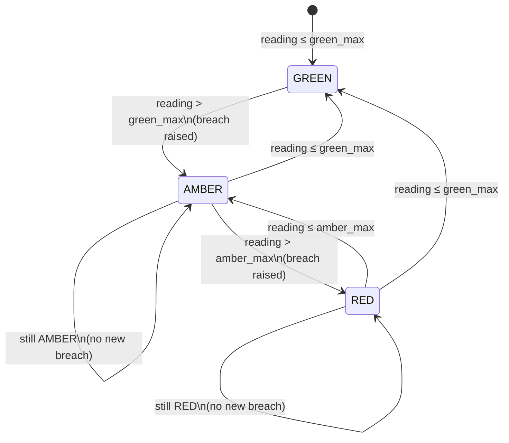
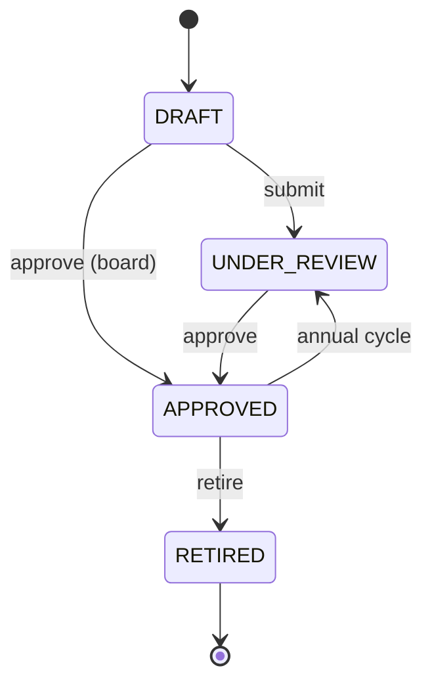

# W3 — ERM: KRI threshold engine + Risk appetite vs. exposure
> **HISTORIC — point-in-time snapshot (all files 2026-05-02). Not a statement of current state.**
> For what the platform is today read [`CLAUDE.md`](../../CLAUDE.md) and [`PROJECT_CHRONICLE.md`](../../PROJECT_CHRONICLE.md); for measured figures, [`MEASURED_BASELINE.md`](../../TSS-GRC-Platform-Bible/Appendix/MEASURED_BASELINE.md). Kept for provenance. *(W0-6)*


Buyer-assessment §5.1 ERM remainder:

| #  | Recommendation | Sprint |
|----|---|---|
| #5 | KRI threshold engine — green/amber/red bands, time-series readings, auto-breach | W3 |
| #6 | Risk appetite vs. exposure — formal statements, tolerance bands, breach events | W3 |

---

## #5 — KRI threshold engine

**Problem.** The previous "KRI" tab on the risk register page was a hard-coded mock with no persistence, no per-tenant data and no breach detection. Auditors asking "how do you know the cyber posture is degrading?" had nothing to point at.

**Solution.** Three-table model:

```
risk.kri_definitions        ── metadata: name, unit, direction, green_max, amber_max,
                                target, frequency, owner, framework, data_source
risk.kri_readings           ── time-series: kri_id, value, reading_at, band, notes
risk.kri_breach_events      ── auto-generated when band worsens — open/ack/resolve workflow
```

### Band evaluation

```
direction = HIGHER_IS_WORSE      direction = LOWER_IS_WORSE
─────────────────────────       ─────────────────────────
v ≤ green_max → GREEN            v ≥ green_max → GREEN
v ≤ amber_max → AMBER            v ≥ amber_max → AMBER
otherwise     → RED              otherwise     → RED
```

### Auto-breach generation

On every `recordReading()`:

1. Look up the previous reading's band
2. Evaluate the new band from value + thresholds
3. If new band is **worse** than previous AND not GREEN → create a `kri_breach_event` (status OPEN)
4. Persist the new reading with its band stamped on it

This means breaches are only generated on **transitions** — a sustained RED state generates one breach event, not one per reading.

### State diagram (Mermaid)



### Seed KRIs

Five Saudi-relevant KRIs auto-seeded:

| Code | KRI | Direction | Green | Amber | Framework |
|---|---|---|---|---|---|
| KRI-CYB-001 | Critical vulns open > 30 days | higher_is_worse | 0  | 2  | NCA ECC §2-12-3 |
| KRI-CYB-002 | Phishing simulation click-through % | higher_is_worse | 8  | 15 | NCA ECC §2-13-3 |
| KRI-OPS-001 | Unplanned downtime (min/month) | higher_is_worse | 60 | 180 | ISO 22301 |
| KRI-CMP-001 | Overdue regulatory filings (ZATCA, SAMA) | higher_is_worse | 0  | 1  | ZATCA + SAMA |
| KRI-PRV-001 | PDPL DSR responses overdue (>30 days) | higher_is_worse | 0  | 2  | SDAIA PDPL Art. 7 |

### API

| Method | Path | Effect |
|---|---|---|
| GET    | `/api/v1/risk/kris`                                  | paged list |
| POST   | `/api/v1/risk/kris`                                  | create |
| PUT    | `/api/v1/risk/kris/{id}`                             | update |
| DELETE | `/api/v1/risk/kris/{id}`                             | soft-delete |
| POST   | `/api/v1/risk/kris/{id}/readings`                    | record reading + auto-breach |
| GET    | `/api/v1/risk/kris/{id}/readings`                    | last 60 readings |
| GET    | `/api/v1/risk/kris/{id}/breaches`                    | breach event history |
| POST   | `/api/v1/risk/kris/breaches/{breachId}/acknowledge`  | OPEN → ACKNOWLEDGED |
| POST   | `/api/v1/risk/kris/breaches/{breachId}/resolve`      | → RESOLVED with notes |
| GET    | `/api/v1/risk/kris/dashboard`                        | tenant counts: green/amber/red/no-data + open breaches |

---

## #6 — Risk appetite vs. exposure

**Problem.** The previous "Appetite" tab synthesised buckets from inherent scores — no tie to a board-approved appetite statement, no concept of tolerance bands, no audit trail of when exposure crossed appetite.

**Solution.** Two tables:

```
risk.risk_appetite_statements     ── statement_en/ar, dimension, appetite_level
                                     (AVERSE|MINIMAL|CAUTIOUS|OPEN|HUNGRY),
                                     tolerance_lower / tolerance_upper,
                                     current_exposure, approval workflow
risk.appetite_breach_events       ── auto-generated when exposure exceeds upper bound
                                     severity = WITHIN_TOLERANCE | EXCEEDED | CRITICAL
```

### Severity formula

```
exposure ≤ upper                       → WITHIN_TOLERANCE
exposure > upper, (exposure-upper)/upper < 25%  → EXCEEDED
exposure > upper, (exposure-upper)/upper ≥ 25%  → CRITICAL
```

### Appetite lifecycle



### Seed appetite statements

| Dimension | Title | Level | Tolerance band | Current |
|---|---|---|---|---|
| CYBER | Cyber & Information Security | MINIMAL | 0 – 15 | 12 |
| OPERATIONAL | Operational Resilience | CAUTIOUS | 0 – 20 | 18 |
| COMPLIANCE | Compliance & Regulatory | AVERSE | 0 – 5 | **7 (EXCEEDED)** |
| STRATEGIC | Strategic Investment | OPEN | 0 – 35 | 22 |

The Compliance row demonstrates the breach-event flow — its `current_exposure = 7` exceeds `tolerance_upper = 5`, so the dashboard shows it as EXCEEDED on first load.

### API

| Method | Path | Effect |
|---|---|---|
| GET    | `/api/v1/risk/appetite`                          | paged list |
| POST   | `/api/v1/risk/appetite`                          | create (defaults DRAFT) |
| PUT    | `/api/v1/risk/appetite/{id}`                     | update — auto-evaluates breach if exposure changed |
| DELETE | `/api/v1/risk/appetite/{id}`                     | soft-delete |
| POST   | `/api/v1/risk/appetite/{id}/approve`             | DRAFT/UNDER_REVIEW → APPROVED |
| POST   | `/api/v1/risk/appetite/{id}/retire`              | → RETIRED |
| POST   | `/api/v1/risk/appetite/{id}/exposure`            | update exposure; auto-emit breach event if outside band |
| GET    | `/api/v1/risk/appetite/{id}/breaches`            | breach event history |
| GET    | `/api/v1/risk/appetite/dashboard`                | tenant counts: within/exceeded/critical/no-data |

---

## Frontend wiring

The existing **KRI** and **Appetite** tabs on the Risk Register page were stubbed with mock cards. They are now backend-wired:

- **KRI tab** — top KPI strip: Total / Green / Amber / Red / Open Breaches. Card grid of KRIs with current band, threshold values, frequency/owner/framework. "Record reading" button on each card prompts for value + notes, persists, and shows the new band + whether a breach was raised.
- **Appetite tab** — top KPI strip: Statements / Within Tolerance / Exceeded / Critical / No Exposure. Card grid showing exposure-vs-upper-bound progress bar, severity badge, open breach count, and inline "Update exposure" + "Approve" actions.

Demo mode (unauthenticated) keeps the card stubs but shows a sign-in prompt.

---

## Summary table

| Layer | Files added/changed |
|---|---|
| DB | `db/seed/V_erm_kri_appetite_ddl.sql` (5 KRIs + 4 appetite statements seeded) |
| Entities | `KriDefinition.java`, `KriReading.java`, `KriBreachEvent.java`, `RiskAppetiteStatement.java`, `AppetiteBreachEvent.java` |
| Repos | `KriDefinitionRepository.java`, `KriReadingRepository.java`, `KriBreachEventRepository.java`, `RiskAppetiteStatementRepository.java`, `AppetiteBreachEventRepository.java` |
| Services | `KriEngineService.java` (band evaluation + auto-breach), `RiskAppetiteService.java` (severity evaluation + auto-breach) |
| Controller | `KriAppetiteController.java` |
| Frontend | `lib/api.ts` (ermAdvancedApi + DTOs), `pages/risk/RiskRegisterPage.tsx` (KriDashboard + AppetiteDashboard rewrite) |
