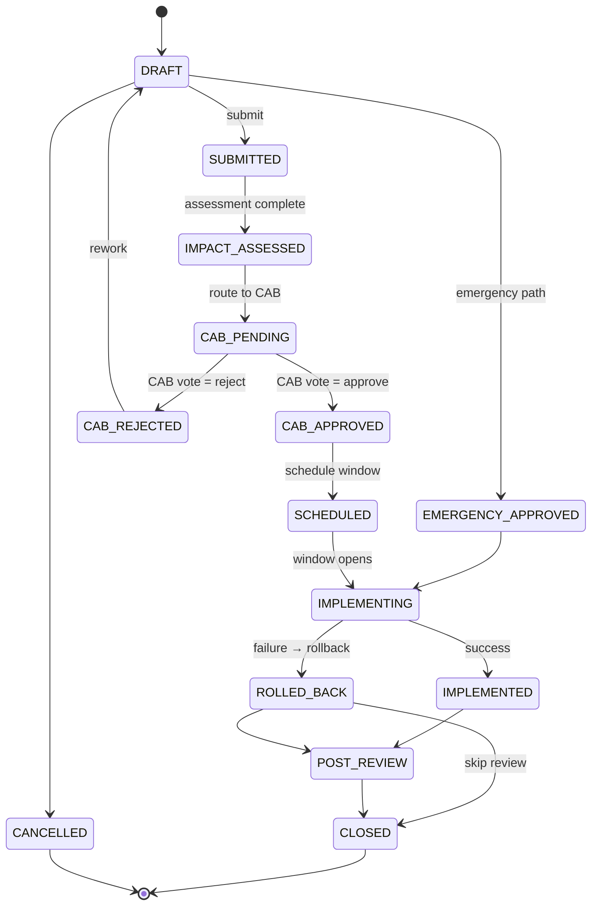

# Change Management module — ITIL v4 Change Enablement
> **HISTORIC — point-in-time snapshot (all files 2026-05-03). Not a statement of current state.**
> For what the platform is today read [`CLAUDE.md`](../../CLAUDE.md) and [`PROJECT_CHRONICLE.md`](../../PROJECT_CHRONICLE.md); for measured figures, [`MEASURED_BASELINE.md`](../../TSS-GRC-Platform-Bible/Appendix/MEASURED_BASELINE.md). Kept for provenance. *(W0-6)*


A new top-level module providing end-to-end change lifecycle management with
formal CAB approval, implementation tasks, post-implementation review, and
generic cross-module integration with risks, controls, incidents, vendors,
BCM plans, audit findings, policies, regulatory changes, DPIAs, KRIs, assets
and evidence.

---

## Process design

### State machine



### Three change types (ITIL classification)

| Type | Approval path | Use case |
|---|---|---|
| **STANDARD**  | Pre-approved (skips CAB) | Routine, low-risk, frequently repeated changes (e.g. password resets, certificate renewals) |
| **NORMAL**    | Full CAB review | Default — most planned changes |
| **EMERGENCY** | Expedited CAB / emergency manager approval | Time-critical fixes (security advisories, P1 incidents) |

### Roles

- **Requester** — creates the request with business justification
- **Change Owner** — accountable for the change end-to-end
- **Implementer** — executes the technical work
- **CAB Member / Approver** — votes (APPROVE / REJECT / DEFER / ABSTAIN)
- **Change Manager** — orchestrates the process

---

## Database schema

`change_mgmt` schema, idempotent DDL in
`db/seed/V_change_mgmt_ddl.sql`.

```
change_mgmt.change_requests          ── main entity
change_mgmt.change_approvals         ── CAB voting log
change_mgmt.change_tasks             ── implementation steps
change_mgmt.change_links             ── generic typed links to other modules
change_mgmt.change_comments          ── collaboration thread
```

### Generic cross-module integration

`change_mgmt.change_links(entity_type, entity_id, link_type)` — a polymorphic
link table. `entity_type` ∈ { RISK, CONTROL, INCIDENT, VENDOR, BCM_PLAN,
AUDIT_FINDING, POLICY, REGULATORY_CHANGE, DPIA, KRI, ASSET, EVIDENCE }.
`link_type` ∈ { AFFECTS, TRIGGERED_BY, MITIGATES, TARGETS, REMEDIATES,
DEPENDS_ON, INFORMS }. Adding a new module to the platform requires no schema
change here — just pick the appropriate `entity_type`.

### Seed data

Four representative changes with realistic Saudi context:
- **CHG-2025-0001** — NCA ECC v2.0 MFA roll-out (NORMAL, HIGH, CLOSED, SUCCESS)
- **CHG-2025-0002** — Core banking migration to KSA-CENTRAL-1 (NORMAL, CRITICAL, IMPLEMENTING) with 5 implementation tasks pre-seeded
- **CHG-2025-0003** — Emergency Tomcat CVE patch (EMERGENCY, CRITICAL, IMPLEMENTED, SUCCESS)
- **CHG-2025-0004** — AUP update for AI tools (STANDARD, LOW, CAB_PENDING) with three CAB votes pre-seeded

---

## API

| Method | Path | Effect |
|---|---|---|
| GET    | `/api/v1/changes`                       | paged list with `status`, `type`, `risk`, `category` filters |
| GET    | `/api/v1/changes/{id}`                  | detail |
| POST   | `/api/v1/changes`                       | create (defaults to DRAFT, NORMAL) |
| PUT    | `/api/v1/changes/{id}`                  | partial update |
| DELETE | `/api/v1/changes/{id}`                  | soft-delete |
| POST   | `/api/v1/changes/{id}/transition`       | move to target status — validates ITIL transitions, auto-stamps `implementationStarted/Ended/closureDate` etc. |
| GET    | `/api/v1/changes/{id}/approvals`        | CAB voting log |
| POST   | `/api/v1/changes/{id}/approvals`        | record a CAB vote (APPROVE/REJECT/DEFER/ABSTAIN) |
| GET    | `/api/v1/changes/{id}/tasks`            | implementation tasks |
| POST   | `/api/v1/changes/{id}/tasks`            | add task |
| PUT    | `/api/v1/changes/tasks/{taskId}`        | update task — auto-stamps `completedAt` when status flips to DONE |
| DELETE | `/api/v1/changes/tasks/{taskId}`        | delete task |
| GET    | `/api/v1/changes/{id}/links`            | links to other modules |
| POST   | `/api/v1/changes/{id}/links`            | link to a (entityType, entityId) with link_type |
| DELETE | `/api/v1/changes/links/{linkId}`        | remove link |
| GET    | `/api/v1/changes/links/by-entity?entityType=RISK&entityId=…` | inverse lookup — what changes affect this entity? |
| GET    | `/api/v1/changes/{id}/comments`         | comment thread |
| POST   | `/api/v1/changes/{id}/comments`         | post comment |
| GET    | `/api/v1/changes/analytics`             | dashboard data — by status / type / outcome + success-rate % |

All endpoints enforce `@PreAuthorize("hasPermission('WORKFLOW', …)")`.

State-machine transitions are validated server-side via
`ChangeManagementService.NORMAL_TRANSITIONS` — invalid transitions throw
`IllegalArgumentException` (mapped to HTTP 400). The EMERGENCY type is the
only one allowed to take the `DRAFT → EMERGENCY_APPROVED` shortcut.

---

## Frontend

A new `/changes` route in `App.tsx` plus a sidebar entry under the existing
modules group (icon: GitBranch). The page has five tabs:

1. **Register** — sortable / searchable table of all changes with row actions
   for edit / delete / open-in-workflow.
2. **Kanban** — six lanes (DRAFT, SUBMITTED, CAB, APPROVED, IMPLEMENTING,
   COMPLETED) with one-click transitions to the next-recommended state.
3. **Workflow** — split-pane detail view: change list on the left, full
   detail panel on the right with description / impact / rollback / test plan
   blocks, action bar (advance, vote, rollback), CAB voting log, task
   checklist with status cycling, and inline comment thread.
4. **Analytics** — three progress-bar charts (by status, by type, by outcome)
   plus a headline success-rate %, all driven by `/changes/analytics`.
5. **Integrations** — manage `change_links` for the selected change, with a
   chip selector for entity_type and link_type.

KPI strip at the top: Total / In Flight / Overdue / Success Rate %.

### Cross-module integration: `<LinkedChangesPanel>`

A drop-in card component (`components/ui/LinkedChangesPanel.tsx`) that any
existing module page can mount to show the changes linked to one of its
records. Single line of usage:

```tsx
<LinkedChangesPanel entityType="RISK" entityId={risk.id} />
```

No bespoke per-module code — it calls `/api/v1/changes/links/by-entity?…`
and renders a list of typed-link badges plus a "View" link to the changes
page. Future modules adopting this pattern need zero backend changes.

---

## Reporting

The platform-wide PDF / Excel export framework (Q1 + Q2) already covers
risk register, findings aging and KRI dashboard. The change-management
module surfaces its analytics through `/api/v1/changes/analytics` and
will get a dedicated PDF/XLSX in a follow-up alongside the cross-module
"Change Activity Report" (planned).

---

## Files added

| Layer | Path |
|---|---|
| DDL | `tss-grc-backend/src/main/resources/db/seed/V_change_mgmt_ddl.sql` |
| Entities | `module/change_mgmt/entity/{ChangeRequest,ChangeApproval,ChangeTask,ChangeLink,ChangeComment}.java` |
| Repos | `module/change_mgmt/repository/{Change*Repository}.java` |
| Service | `module/change_mgmt/service/ChangeManagementService.java` |
| Controller | `module/change_mgmt/controller/ChangeManagementController.java` |
| Frontend page | `tss-grc-ui-v2/src/pages/changes/ChangesPage.tsx` |
| Reusable cross-module panel | `tss-grc-ui-v2/src/components/ui/LinkedChangesPanel.tsx` |
| Translations | `translations/{en,ar}.ts` (~70 new keys) |
| Router + sidebar | `App.tsx`, `components/layout/Sidebar.tsx` |
